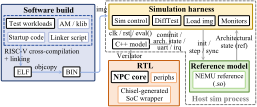
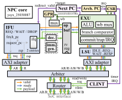

# ysyx-workbench

 [一生一芯（ysyx）](https://ysyx.oscc.cc/docs/) 仓库 (ysyx_25030087).

RISC-V 处理器 + SoC 集成，涉及从 RTL 实现、软件启动到系统验证的软硬件协同开发。

## 简介

实现单发射、顺序提交的 RV32E 前后端解耦处理器，支持 GShare 分支预测、精确异常与定时器中断；通过 AXI4 单拍接口接入 ysyxSoC，配合 AbstractMachine（AM）、链接脚本和启动代码，支持 MROM/SRAM、Flash→SRAM/PSRAM 启动运行。基于 Verilator/C++ 与 NEMU 搭建差分验证环境，并使用 Synopsys DC、PrimeTime 开展 CPU 子系统的 pre-PnR 面积与时序评估。

  

Fig. 1. Project overview.

  

Fig. 2. Core architecture.

