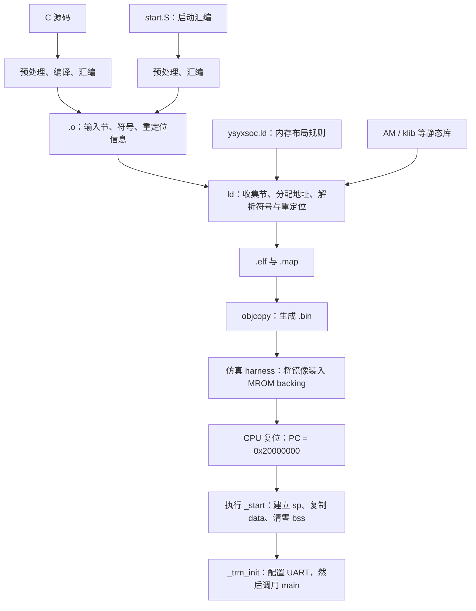

# 裸机程序如何启动：程序节、链接脚本与 ROM/RAM 布局

2026-10-25。以本工程 M5 S3 的 MROM/SRAM 启动为例，介绍 GNU ld 链接脚本的基础知识。目标是能够读懂当前实现，并根据硬件地址图写出与启动代码配套的简单脚本。阶段功能与验收记录见 [M5 S3](../post-c/5-ysyx-soc-integration/3-runtime-difftest.md)。

若对汇编标签、符号表、目标文件或重定位还不熟悉，建议先读 [从源码名字到机器指令](symbols-elf-and-relocation-basics.md)；其中也有 poison、两个启动负例的源码定位与 a0 观察步骤。

**`_stack_top` 叫链接器符号（linker-defined symbol），更具体地说，是由链接脚本定义的栈顶边界符号。** `_stack_top` 这个名字是工程约定，不是 ld 的关键字。`symbol = expression;` 才是定义它所使用的语法。这个定义给名字关联一个数值，不会创建一个存放该数值的 C 变量，也不会自动设置 CPU 的 `sp`。

建议先读第 1～4 节，理解程序如何进入内存；再对照第 5～7 节阅读 `.ld` 和 `start.S`；最后用第 8～9 节的方法查看产物、检查自己的设计。

## 1. 当前程序在哪里运行

当前 S3 使用的物理地址范围为：

| 存储器 | 地址范围，包含首尾 | 容量 | 当前用途 |
| --- | --- | --- | --- |
| MROM | `0x20000000`～`0x20000fff` | 4 KiB | 启动代码、程序代码、只读数据，以及可写数据的初值 |
| SRAM | `0x0f000000`～`0x0f001fff` | 8 KiB | 可写全局/静态数据、零初始化数据、heap、stack |

**当前并没有把整个程序从 MROM 搬到 SRAM。** CPU 一直从 MROM 执行 `.text` 中的代码；只把 `.data` 的初值从 MROM 复制到 SRAM，并在 SRAM 清零 `.bss`。函数的取指地址与它读写变量的地址，可以分别位于两块不同的存储器。

```text
MROM：复位时已有镜像内容              SRAM：由启动代码建立运行时内容
0x20000000                         0x0f000000
┌────────────────────┐             ┌────────────────────┐
│ .text：_start、函数代码 │             │ .data：可读写的变量    │
├────────────────────┤             ├────────────────────┤
│ .rodata：只读数据      │             │ .bss：启动时写零      │
├────────────────────┤             ├────────────────────┤
│ .data 的初值          │             │ heap：由分配器管理     │
└────────────────────┘             ├────────────────────┤ ← 0x0f001800
                                   │ stack：向低地址增长   │
                                   └────────────────────┘ ← 0x0f002000
```

启动时的复制关系为：`MROM 的 .data 初值 → SRAM 的 .data 运行区`。`0x0f002000` 是 SRAM **末尾的下一地址**；栈的有效存储空间仍然止于 `0x0f001fff`。

未来也可以采用“ROM 中的引导代码先搬运应用代码，再跳到 SRAM 执行”的方案。这需要为被搬运代码安排不同的运行地址和镜像地址，并实现复制与跳转；它不是当前 S3 的行为。

## 2. 从 C 源码到 CPU 执行，各部分负责什么



编译器通常先决定函数、变量应进入哪类 **输入节**，并生成机器指令。`.o` 中尚未确定的地址引用通过重定位信息留给链接器。例如代码引用 `counter`，最终应访问 SRAM 的哪个地址，要等链接器完成布局后才能确定。

链接器按照脚本把多个 `.o` 和库成员中的输入节收集为 **输出节**，分配最终地址，并完成地址引用的解析。链接不是把源文件简单拼接，也不是在 CPU 上执行初始化。

`.elf` 包含代码、数据和描述它们的元信息；`.bin` 是当前装载方案使用的裸镜像。仿真 harness 不解析 `.ld`，CPU 也不会读取链接脚本或根据符号表寻找 `main`。本工程的静态链接已将必要地址落实到指令/数据中。

本工程用 `.S` 表示需要先预处理的汇编文件，因此其中可以使用预处理指令；它与通常不经过预处理的 `.s` 有区别。

## 3. 常见程序节，以及栈和堆

日常说的“代码段、数据段”在这里主要对应 ELF 的 **section（节）**。严格说，ELF 还有 **segment（程序头描述的装载单元）**，一个 segment 可以包含多个 section。阅读链接脚本主要看 section；阅读 ELF 装载方式还会看 program headers。当前 harness 使用 raw binary，不走通用 ELF loader。

以下以需要实际保留的 C 对象为例；优化、常量折叠和链接时垃圾回收都可能使某些对象不再出现在最终文件中。

| 内容 | 常见输入节 | 运行时特征 | 当前布局 |
| --- | --- | --- | --- |
| 函数机器码 | `.text`、`.text.main` 等 | 取指执行 | MROM |
| 字符串常量、只读表 | `.rodata`、`.rodata.*` 等 | 通常只读 | MROM |
| 有非零初值的可写全局/静态变量，如 `int counter = 3;` | `.data`、`.data.*` 等 | 既要保留初值，也要允许后续写入 | 初值在 MROM，运行对象在 SRAM |
| 零初始化的全局/静态变量，如文件作用域的 `int result;`、`static char buf[128];` | `.bss`、`.bss.*` 等 | C 运行环境应在使用前保证为零 | SRAM，启动时清零 |
| small data 等目标平台变体 | `.sdata`、`.sbss`、`.srodata` 及其子节 | 分别归入相应数据类别 | 当前脚本显式收集 |
| 调试信息、编译器/目标属性 | `.debug_*`、`.comment`、`.riscv.attributes` 等 | 部分只供工具使用，不占运行内存 | 依类别保留在 ELF 或丢弃 |

显式写成 `int result = 0;` 也通常进入 `.bss`，不必在镜像中保存四个零。`.bss` 记录需要多少运行空间，不保存对应大小的初始化字节；**没有文件初值不等于硬件上电已经是零**。这些基本概念可对照 [GNU ld：Basic Script Concepts](https://sourceware.org/binutils/docs/ld/Basic-Script-Concepts.html)。

函数内的普通局部变量可能放在寄存器或栈上，甚至被优化掉；它不因为写了 `int x = 3;` 就进入 `.data`。函数内的 `static int x = 3;` 则具有静态存储期，需要像全局变量一样安排长期存储和初始化。

**stack 和 heap 不一定是 ELF 中的两个 section。** 当前脚本只定义其边界：

- stack 由 CPU 的 `sp`、函数调用约定和编译器生成的函数序言/尾声使用；当前预留 2 KiB。
- heap 由软件分配器使用；导出 `_heap_start/_heap_end` 不等于已经实现 `malloc/free`。

当前 [trm.c](../../../abstract-machine/am/src/riscv/ysyxsoc/trm.c) 将堆边界导出为 AM 的 `heap`，实际分配仍需调用者或分配器管理。

## 4. VMA、LMA、文件偏移：四个数字为什么不同

| 名称 | 回答的问题 | 当前 `.data` 的例子 |
| --- | --- | --- |
| VMA，运行地址 | CPU 在程序运行时用什么地址访问这个节？ | SRAM 中的变量地址 |
| LMA，装载地址 | 在当前 ROM 启动方案中，这个节的初始字节放在哪里？ | MROM 中的初值地址 |
| ELF file offset | 字节存放在 `.elf` 文件的哪个位置？ | 受 ELF 头、对齐及文件布局影响 |
| raw binary offset | 字节存放在 `.bin` 文件的哪个位置？ | 当前为 `LMA - 0x20000000` |

VMA 名称中虽然有 virtual，本工程当前没有启用虚拟内存；这里直接按 CPU 可见地址理解。LMA 也不是“第二份运行时变量”，而是启动时初始化字节的来源。

S3 的 `memory` 测试保留了以下 [原始布局](../post-c/5-ysyx-soc-integration/s3-validation/memory-layout.txt)，后续程序变化会改变具体数字：

| 输出节 | 大小 | VMA | LMA / 初值来源 | ELF 文件偏移 | BIN 文件偏移 |
| --- | --- | --- | --- | --- | --- |
| `.text` | `0x3bc` | `0x20000000` | `0x20000000` | `0x1000` | `0x000` |
| `.rodata` | `0x40` | `0x200003bc` | `0x200003bc` | `0x13bc` | `0x3bc` |
| `.data` | `0x20` | `0x0f000000` | `0x200003fc` | `0x2000` | `0x3fc` |
| `.bss` | `0x30` | `0x0f000020` | 无镜像初值，CPU 写零 | 不占对应大小的文件内容 | 无 |

这次 `.bin` 大小为 `0x41c = 1052 B`。其中最后 32 B 是 `.data` 的初值；启动时从 `0x200003fc` 复制到 `0x0f000000`。随后清零 SRAM 的 `[0x0f000020, 0x0f000050)`。

原始 `objdump -h` 也会为 `.bss` 显示 LMA/File off 数值，但它只有 `ALLOC`，没有 `CONTENTS/LOAD`，不能据此认为 ROM 中存在 48 B 的 `.bss` 初值。应结合节类型、标志与实际文件内容判断。

`objcopy -O binary` 以被复制节的最低 LMA 为镜像起点，并移除符号等元信息；因此本例 offset 0 对应 MROM 起点，ELF 中的 `0x1000` 文件前缀不会原样带入 BIN。若错误地把某个有内容节的 LMA 放到遥远的 SRAM 地址，raw image 可能因地址空洞而异常变大。参见 [GNU objcopy：binary 输出](https://sourceware.org/binutils/docs/binutils/objcopy.html)。

## 5. 对照当前实现学习 GNU ld 脚本

`.ld` 文件使用链接器自己的语言；不是 C，也不是汇编。下面是 [当前 ysyxsoc.ld](../../../abstract-machine/scripts/ysyxsoc.ld) 的等价排版及解释性注释，布局规则保持一致。

```ld
/* 声明可供链接器分配的地址区域。K 表示 1024。 */
MEMORY {
  mrom (rx)  : ORIGIN = 0x20000000, LENGTH = 4K
  sram (rwx) : ORIGIN = 0x0f000000, LENGTH = 8K
}

/* 设置 ELF 的入口符号；CPU 的复位地址仍由硬件决定。 */
ENTRY(_start)

SECTIONS {
  .text : {
    KEEP(*(entry))           /* 启动汇编的 entry 输入节放在最前 */
    *(.text .text.*)         /* 收集各目标文件的代码输入节 */
  } > mrom

  .rodata : {
    *(.rodata .rodata.* .srodata .srodata.*)
    . = ALIGN(4);
  } > mrom

  .data : {
    _data_start = .;         /* SRAM 运行区间的起点 */
    *(.data .data.* .sdata .sdata.*)
    . = ALIGN(4);
    _data_end = .;           /* 结束地址不包含在复制区间中 */
  } > sram AT> mrom          /* VMA 在 SRAM，LMA 在 MROM */

  _data_load = LOADADDR(.data);
  _rom_end = LOADADDR(.data) + SIZEOF(.data);

  .bss (NOLOAD) : {
    _bss_start = .;
    *(.bss .bss.* .sbss .sbss.*)
    *(COMMON)
    . = ALIGN(16);
    _bss_end = .;
  } > sram

  _heap_start = _bss_end;
  _stack_top = ORIGIN(sram) + LENGTH(sram);
  _stack_bottom = _stack_top - 2K;
  _heap_end = _stack_bottom;
  _sram_start = ORIGIN(sram);

  /DISCARD/ : { *(.eh_frame .eh_frame.* .comment) }
}

ASSERT(_rom_end <= ORIGIN(mrom) + LENGTH(mrom),
       "MROM image exceeds 4 KiB")
ASSERT(_heap_start <= _heap_end,
       "SRAM data/bss overlaps reserved 2 KiB stack")
```

### 5.1 `MEMORY`：描述地址图，不创建硬件

`mrom`、`sram` 是此脚本中的区域名，可以更名，但引用它们的地方必须一致。`ORIGIN` 是起点，`LENGTH` 是容量；`> sram` 要求输出节分配到该区域，链接器据此进行布局和容量检查。

`(rx)`、`(rwx)` 是 ld 的区域属性，可影响未显式指定区域的节如何匹配内存。它们不会建立总线地址译码，也不会配置实际读写保护。把区域改成 `(rwx)` 不会让物理 ROM 变得可写；更改 `ORIGIN` 也不会让硬件 SRAM 自动搬家。参见 [GNU ld：MEMORY](https://sourceware.org/binutils/docs/ld/MEMORY.html)。

### 5.2 `SECTIONS`、冒号、花括号与通配符

以 `.text : { *(.text .text.*) } > mrom` 为例：

- 最外面的 `.text` 是要生成的**输出节名**。
- `:` 后的 `{ ... }` 描述其内容，`> mrom` 指定运行区域。
- `*(...)` 外面的 `*` 匹配各输入文件；括号里匹配输入节名。
- `.text` 匹配这个名字本身，`.text.*` 匹配 `.text.main` 等名字。两者需要分别写出。

本工程使用 `-ffunction-sections -fdata-sections`，一个函数或数据对象可能有独立输入节，因此不能只收集 `.text/.data/.bss` 而遗漏其带后缀的变体。

`entry` 是 [start.S](../../../abstract-machine/am/src/riscv/ysyxsoc/start.S) 中 `.section entry, "ax"` 指定的自定义输入节名；它与脚本的 `*(entry)` 配对。名字本身没有自动启动的魔法。汇编中的 `"ax"` 表示该输入节具有分配及执行属性，与 `MEMORY` 区域属性不是同一条语法。

`*(COMMON)` 收集目标文件中的 common 符号存储请求，常见于使用 common 方式表示的暂定定义；并不是说当前每个未初始化变量都以 COMMON 表示。

### 5.3 `.`、赋值和 `ALIGN`：定位与对齐

`.` 是位置计数器（location counter），用于描述当前输出位置：

```ld
_data_start = .;   /* 记下当前位置，定义符号；不移动位置 */
*(.data .data.*)   /* 放入输入内容，位置随之推进 */
. = ALIGN(4);     /* 向上对齐位置，可能增加 padding */
_data_end = .;     /* 记下结束位置 */
```

赋值通常写作 `名字 = 表达式;`，末尾有分号；`/* ... */` 可写注释。`ALIGN(4)` 是计算对齐值，真正推进位置的是 `. = ...`。尾部 padding 算入输出节大小，也因此可能算入复制或清零范围。

**`.` 的语义与上下文有关。** 在输出节内部，它具有节内位置语义；例如在 `.text : { ... }` 中直接写 `. = 0x100;`，是在设该节内的偏移，不是在把整个 `.text` 放到绝对地址 `0x100`。若要指定节的绝对起点，可用 `.text 0x20000000 : { ... }`，或使用已定义好起点的 `MEMORY` 区域。不要把别处的 `. = 常数` 随意搬进花括号。参见 [GNU ld：Location Counter](https://sourceware.org/binutils/docs/ld/Location-Counter.html)。

当前启动循环使用 4 B 的 `lw/sw`，所以复制的源、目的起点以及长度都必须满足相应对齐要求。只在尾部加 `ALIGN(4)` 并不能替代对起点的检查。栈也应符合所选 ABI 的对齐要求；当前边界采用 16 B 对齐，不代表所有 ABI 的最低要求都是 16 B。

### 5.4 `> sram AT> mrom`：为同一份数据安排两个地址

```ld
.data : { /* 内容 */ } > sram AT> mrom
```

`> sram` 安排 VMA，`AT> mrom` 安排 LMA；链接器在相应区域中分配空间。也可以用 `AT(表达式)` 显式指定 LMA，但手工算地址需要自己处理节大小与对齐，不能和 `AT> 区域` 混为一种语法。

**这条规则只定义布局，不生成搬运指令。** 如果没有启动代码执行复制，CPU 按 VMA 访问到的 SRAM 数据仍未初始化。当前 `.text/.rodata` 的 VMA 与 LMA 相同，直接在 MROM 中使用。参见 [GNU ld：Output Section LMA](https://sourceware.org/binutils/docs/ld/Output-Section-LMA.html)。

### 5.5 常用内建函数与边界表达式

| 写法 | 含义 | 本工程的用途 |
| --- | --- | --- |
| `ORIGIN(sram)` | 区域起点 | SRAM 起点 |
| `LENGTH(sram)` | 区域容量，字节数 | 8 KiB |
| `ADDR(.data)` | 输出节 VMA | `.data` 的运行地址 |
| `LOADADDR(.data)` | 输出节 LMA | `.data` 初值来源 |
| `SIZEOF(.data)` | 输出节大小，包含节内 padding | 计算 ROM 内容末尾 |
| `ALIGN(4)` | 对当前位置求向上对齐值 | 为 word 复制/清零准备边界 |
| `ABSOLUTE(.)` | 将表达式明确转为绝对值 | 需要绝对符号时使用，当前脚本未用 |

这些是 ld 函数，不是会在 CPU 上执行的函数。完整定义见 [GNU ld：Builtin Functions](https://sourceware.org/binutils/docs/ld/Builtin-Functions.html)。

### 5.6 `NOLOAD`、`KEEP`、`/DISCARD/` 和 `ASSERT`

| 写法 | 用途 | 不能误解成什么 |
| --- | --- | --- |
| `.bss (NOLOAD)` | 当前 ELF 中保留运行空间，不提供要装载的初始化内容 | 不会自动把 SRAM 清零 |
| `KEEP(*(entry))` | 在使用 `--gc-sections` 时保留指定输入节 | 不会自动设置复位 PC，也不等于保留所有启动依赖 |
| `/DISCARD/ : { ... }` | 明确丢弃匹配的输入内容 | 不应把不认识的所有节一并丢掉 |
| `ASSERT(条件, "消息")` | 条件为假时报链接错误 | 不能静态证明任意运行过程都没有栈溢出 |

相应语法见 [NOLOAD](https://sourceware.org/binutils/docs/ld/Output-Section-Type.html)、[KEEP](https://sourceware.org/binutils/docs/ld/Input-Section-Keep.html)、[ASSERT](https://sourceware.org/binutils/docs/ld/Miscellaneous-Commands.html)。

当前 `_rom_end` 的算法基于“`.data` 初值是最后一块 ROM 内容”。若以后增加新的 ROM 输出节，应重新计算镜像末尾，不能假设旧表达式仍覆盖全部内容。当前栈也没有单独输出节，因此要靠边界约定、断言和运行时检查共同维护其空间。

没写进脚本的输入节不一定消失：ld 可能自动为它安排输出位置，这称为 **orphan section（孤儿节）**。应检查 `.map` 和节表，判断它是合理的工具元信息，还是遗漏的运行内容。参见 [GNU ld：Orphan Sections](https://sourceware.org/binutils/docs/ld/Orphan-Sections.html)。

## 6. `_stack_top` 到底是什么，C 和汇编如何使用它

### 6.1 符号名称与赋值规则

```ld
_stack_top = ORIGIN(sram) + LENGTH(sram);
```

当前这条表达式计算出 `0x0f002000`，将它赋给 `_stack_top`，并使其成为链接器可解析的符号。`_data_start`、`_data_end`、`_heap_start` 也是相同思路：**用名字导出内存布局信息，供启动代码和运行库引用**。参见 [GNU ld：Assigning Values to Symbols](https://sourceware.org/binutils/docs/ld/Assignments.html)。

前导下划线常用于运行时/工具链相关名字，但 `_stack_top` 不是固定关键字；换成另一个无冲突的名字并同步修改引用，链接效果不变。不要因此认为所有下划线名称都可任意占用，已有 ABI 和运行库可能定义自己的符号约定。

符号也可以表示容量、数量等数值，不一定表示可解引用的地址。要根据定义判断意义，不能只看名称。

### 6.2 符号定义不分配变量存储

下面两种写法发生在不同层次：

```c
/* C 对象定义：需要为一个可写整数安排存储，并保存初值。 */
unsigned int counter = 3;
```

```ld
/* 链接器赋值：只定义符号，不在这个地址存入一个数值。 */
_stack_top = 0x0f002000;
```

后一条不会在 SRAM 中额外创建四字节的“栈顶变量”，也不会向 `0x0f002000` 写入 `0x0f002000`。实际上该地址位于 SRAM 末尾之后，本来就不能在这里做普通 word 读写。

在汇编里，当前代码使用：

```asm
la sp, _stack_top   # 将符号对应的地址值放入 sp
```

`la` 是加载地址的伪指令，汇编/链接后变成目标指令序列。它与 `lw` 读取某地址处的内存内容不同。CPU 不知道 `_stack_top` 这个名字；它只执行已经完成链接的指令。

### 6.3 在 C 中引用时，取得地址而非读取一个假想变量

可以使用标量声明并取地址：

```c
#include <stdint.h>

extern char _stack_top;  /* 声明外部符号，不在这里定义一个 char 对象 */

uintptr_t stack_top_address(void) {
  return (uintptr_t)&_stack_top;
}
```

也可以将地址边界声明为数组，利用数组名转换为首地址：

```c
extern unsigned char _data_load[], _data_start[], _data_end[];
/* _data_load 是初值源地址；_data_start/_data_end 是目的区间边界。 */
```

容易写错的是把它当成真正存储了一个数值的变量：

```c
/* 错误示意：与上面的正确写法二选一，不能混在同一翻译单元中。 */
extern uintptr_t _stack_top;
uintptr_t wrong(void) {
  return _stack_top;  /* 试图从 0x0f002000 读取一个 uintptr_t */
}
```

这些引用方式属于 GNU 工具链中访问链接脚本符号的惯用接口，参见 [GNU ld：Source Code Reference](https://sourceware.org/binutils/docs/ld/Source-Code-Reference.html)。当前 [trm.c](../../../abstract-machine/am/src/riscv/ysyxsoc/trm.c) 的 `extern char _heap_start, _heap_end;` 与 `RANGE(&_heap_start, &_heap_end)` 就是实际例子。取得边界值不等于改变硬件 `sp`；初始栈指针由 `start.S` 设置。

### 6.4 绝对符号与节相对符号

符号可以是绝对符号，也可以与某个节关联；在进一步重定位链接时，两类符号的行为不同。`_data_start = .;` 写在 `.data` 内，是典型的节相关定义。但不能仅凭赋值写在输出节之外，就断言任意表达式的结果一定是绝对符号；还应核对表达式语义和实际 ELF。

2026-10-25 核查当前 S3 `memory` ELF：`nm` 将 `_data_load` 标为 `A`，将 `_stack_top` 标为 `B`；`readelf -sW` 显示后者与 `.bss` 关联，值仍为 `0x0f002000`。它仍然是边界符号，没有额外分配一个存放栈顶地址的 BSS 变量。此前将当前 `_stack_top` 直接描述为绝对符号不准确，现以产物修正。

`nm` 常把绝对符号标成 `A`，把与 `.data/.bss` 关联的符号标成 `D/B`。需要明确的绝对符号时可以用 `ABSOLUTE(表达式)` 表达该要求；本文只解释规则，不修改现有链接脚本。参见 [GNU ld：The Section of an Expression](https://sourceware.org/binutils/docs/ld/Expression-Section.html)。

另外一种常见写法是 `PROVIDE(symbol = expression);`：当符号被引用且没有由输入对象定义时提供默认定义，适合允许外部覆盖的约定；当前脚本使用普通赋值即可。参见 [GNU ld：PROVIDE](https://sourceware.org/binutils/docs/ld/PROVIDE.html)。

## 7. 链接脚本与启动汇编如何共同建立 C 运行环境

### 7.1 `ENTRY(_start)` 为什么还不够

`_start` 是 [start.S](../../../abstract-machine/am/src/riscv/ysyxsoc/start.S) 中的汇编标签，位置由链接决定；`ENTRY(_start)` 设置的是 ELF 的入口地址。本工程还传了 `-e _start`，该命令行选项优先于脚本 `ENTRY`。参见 [GNU ld：Entry Point](https://sourceware.org/binutils/docs/ld/Entry-Point.html)。

CPU 的复位 PC 来自 [ysyx_25030087.sv](../../../npc/vsrc/top/ysyx_25030087.sv) 的 `PC_RST` 等 RTL 参数，当前为 `0x20000000`；不会因修改 ELF 的入口元信息而自动改变。

当前能够进入启动代码，是以下三件事一致：

1. 链接布局使 `entry` 位于 MROM 起点，且 `_start` 是其中的首条指令。
2. [harness](../../../npc/csrc/soc/main.cpp) 把 BIN 的 offset 0 装入 MROM 的 `0x20000000`。
3. CPU 复位后从 `0x20000000` 取指。

### 7.2 启动代码依次兑现布局规则

| 启动动作 | 使用的链接器符号 | 为什么需要 |
| --- | --- | --- |
| 设置 `sp` | `_stack_top` | C 函数的保存寄存器、局部变量、调用过程可能使用栈 |
| S3 特有：SRAM 填 `0xa5a5a5a5` | `_sram_start`、`_stack_top` | 使漏复制/漏清零不会被仿真的零初值掩盖 |
| 从 MROM 复制 `.data` | `_data_load`、`_data_start`、`_data_end` | 让可写变量在 SRAM 中取得正确初值 |
| 清零 `.bss` | `_bss_start`、`_bss_end` | 满足静态存储对象的零初始化要求 |
| 调用 `_trm_init` | 汇编/代码符号 `_trm_init` | 进入 AM 平台初始化，再调用 `main` |

复制的含义可以写成下面的伪代码；实际实现用汇编，不依赖尚未建立好的 C 运行环境：

```text
src = _data_load
dst = _data_start
while dst < _data_end:
    memory32[dst] = memory32[src]
    src += 4
    dst += 4

dst = _bss_start
while dst < _bss_end:
    memory32[dst] = 0
    dst += 4
```

这些区间均为 `[start, end)`，长度是 `end - start`，空区间也应正确处理。原有初值不会在每次使用变量时重搬；复制只属于启动过程，之后对变量的普通读写直接访问 SRAM。

`sp = 0x0f002000` 是向下增长栈的初始空栈位置。函数通常先减小 `sp` 再向栈帧写入，因此初始 SP 可以是有效 RAM 上界的下一地址。当前预留栈区间为 `[0x0f001800, 0x0f002000)`；链接断言只保证静态布局留有空间，实际递归深度、局部数组等仍可能造成栈溢出。

S3 的 SRAM poison 是验证手段，不是裸机启动的必备步骤；它必须发生在使用活动栈和全局状态之前。若今后改为在 SRAM 执行代码，不能继续无条件覆盖整块 SRAM。

若以后引入 C++ 构造函数、TLS 或新的 ABI/运行库要求，还要补充相应的节处理与运行时初始化。当前代码完成的是本工程这组裸机 C 程序所需的启动过程。

## 8. 如何在本工程配置、查看和核实产物

### 8.1 先找到实际生效的构建入口

| 文件 | 关注的配置 |
| --- | --- |
| [riscv32e-ysyxsoc.mk](../../../abstract-machine/scripts/riscv32e-ysyxsoc.mk) | 选择 ISA/ABI：`-march=rv32e_zicsr -mabi=ilp32e`，以及 32 位 ELF 链接模式 |
| [platform/ysyxsoc.mk](../../../abstract-machine/scripts/platform/ysyxsoc.mk) | 加入启动/运行时源文件、`LDSCRIPTS`、节拆分、`--gc-sections`、map 和 BIN 生成 |
| [AM Makefile](../../../abstract-machine/Makefile) | 将 `.c/.S` 编译成 `.o`，用 `-T` 传入链接脚本，再链接对象与库 |
| [ysyxsoc.ld](../../../abstract-machine/scripts/ysyxsoc.ld) | 硬件区域、输出节布局及边界符号 |
| [start.S](../../../abstract-machine/am/src/riscv/ysyxsoc/start.S) | CPU 实际执行的初始化步骤 |

几个容易混淆的选项：

- `gcc -c` 只生成目标文件，不做最终链接；`-march/-mabi` 控制目标指令集及调用约定，不指定 SRAM 地址。
- `ld -T 脚本` 选择链接布局；本工程的 `LDSCRIPTS` 最终转为这个参数。
- `ld -Map=文件` 输出映射表；`--gc-sections` 移除不需要保留的节，脚本用 `KEEP` 保护特定内容。
- `objcopy -O binary` 从 ELF 生成 raw image，不能代替 CPU 的 `.data` 搬运。

若经 GCC 驱动最终链接，链接器选项通常用 `-Wl,` 传递，例如 `-Wl,-Map=app.map`；本工程该平台直接调用 `ld`，不能照搬所有 GCC 命令行前缀。

### 8.2 用一份小程序查看产物

在工程根目录、已配置 `AM_HOME` 的环境中，可以构建默认的 hello 程序：

```bash
make -C npc/tests/soc-runtime ARCH=riscv32e-ysyxsoc image

soc_elf=npc/tests/soc-runtime/build/soc-runtime-riscv32e-ysyxsoc.elf
riscv64-linux-gnu-readelf -h "$soc_elf"
riscv64-linux-gnu-objdump -h "$soc_elf"
riscv64-linux-gnu-readelf -lW "$soc_elf"
riscv64-linux-gnu-nm -n "$soc_elf"
riscv64-linux-gnu-objdump -d "$soc_elf"
```

| 观察工具 | 要回答的问题 |
| --- | --- |
| `readelf -h` | Machine/ELF 位数是否匹配？入口是否为 `0x20000000`？ |
| `objdump -h`，必要时 `readelf -SW` | 各节的大小、VMA/LMA、文件偏移、内容/分配属性是什么？ |
| `readelf -lW` | ELF 有哪些装载 segment？它们覆盖哪些 section？不能把 ELF 的全部文件内容等同于 ROM 内容 |
| `nm -n` | `_start`、`_data_*`、`_bss_*`、heap/stack 边界最终是多少？ |
| 同目录 `.map` | 哪个目标文件/库成员贡献了哪个输入节？是否存在意外节和 padding？ |
| `objdump -d` 或生成的 `.txt` | 第一条指令是什么？`sp` 初始化与复制/清零循环是否存在？ |
| 仿真自检、总线/commit 记录 | 硬件是否真的执行了初始化，最终数据是否符合程序预期？ |

上面的命令构建的是 hello，不能期待其地址数字与第 4 节的 `memory` 测试完全一致；该例的固定数字应查归档报告。涉及 `.bss` 时，也不要只看镜像大小就断言 SRAM 占用很小。

## 9. 从零写一个简单裸机链接脚本的顺序

1. **先列硬件事实。** 记录可取指/可读写的存储器地址、真实容量、复位 PC，以及仿真器/烧录器把镜像放在哪里。链接脚本应匹配这些事实。
2. **决定运行方案。** 是 ROM 执行代码、RAM 放变量，还是引导后搬运代码到 RAM？逐节列出 VMA、LMA、运行权限需求及初始化方法；本工程当前可直接参考第 4 节。
3. **确认工具链与输入节。** 选择匹配 CPU 的 ISA/ABI，查看编译后对象有哪些节；把 `.text.*`、`.sdata.*` 等变体纳入考虑。判断是否需要构造函数表、特殊向量表等额外内容。
4. **写 `MEMORY/SECTIONS`。** 先安排入口和只读内容，再安排可写数据及其初值位置，接着安排 `.bss`。用区域名和内建函数表达关系，减少手算固定地址。
5. **设计链接器与启动代码的接口。** 为复制/清零导出起止边界和源地址；为 stack/heap 导出边界。明确端点是否包含、循环粒度及对齐要求，确保双方使用完全相同的名字。
6. **实现启动过程。** 建立 ABI 所需状态，执行必要的复制、清零和平台初始化，再进入 C。需要搬运代码时还要安排引导代码的位置与最终跳转。
7. **加入容量和重叠检查。** 至少检查完整 ROM 镜像容量、RAM 静态数据与预留栈的关系。新增输出节后同步更新检查覆盖范围。
8. **检查产物并运行小测试。** 先检查 ELF、BIN、map 和反汇编，再验证非零初值、零初始化、变量可写、实际栈使用等；用非零 RAM 初态检测被零初态掩盖的问题。

本工程 [memory.c](../../../npc/tests/soc-runtime/memory.c) 就覆盖了非零 data、零 bss、宽数据、heap 与递归栈。S3 还做了遗漏 data-copy/bss-clear 的负例：程序自身应失败，即使 DUT 和参考模型恰好执行了同一份有缺陷的软件。详细证据见 [S3 验证记录](../post-c/5-ysyx-soc-integration/s3-validation/README.md)。

## 10. 回顾时应能回答的几个问题

| 问题 | 回答要点 |
| --- | --- |
| 为什么 `int counter = 3;` 在 MROM 有初值，在 SRAM 又占空间？ | 初值必须随镜像保存；运行中的对象必须可写。VMA/LMA 与启动复制共同实现它 |
| 不复制 `.data`，为何仍可能正常取指，却读到错误变量？ | `.text` 本来就在 MROM；SRAM 中的变量尚未取得镜像里的初值 |
| `NOLOAD` 是否意味着不分配 RAM 或已经清零？ | 当前 ELF 的 `.bss` 仍占运行空间；初始化要由启动代码完成 |
| `_stack_top` 是变量吗？前导下划线是关键字吗？ | 是工程自定义的链接器符号；赋值不会额外分配变量存储，名字不是 ld 关键字 |
| 为什么初始 SP 比 SRAM 最后一个地址大 1？ | 它表示空栈上界；向下增长的栈先分配栈帧，再访问有效地址 |
| 改 `ENTRY` 能改变硬件复位地址吗？ | 不能。ELF 入口、镜像装载位置与 RTL 复位 PC 必须分别配置并保持一致 |
| 如果希望整个应用在 SRAM 执行，只改 `> sram` 足够吗？ | 不够。还需设计初值 LMA、可先执行的引导代码、复制范围和跳转，并检查 SRAM 容量 |

