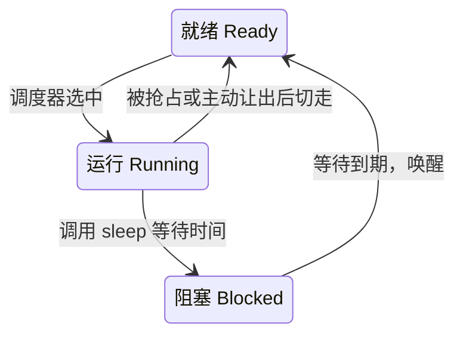

# RT-Thread 系统测试入门：线程、抢占、睡眠与上下文切换

2026-10-28。以本工程 M5 S5/S6 的单核 RV32E 实现为例。阅读后应能解释：两个线程怎样轮流使用一个 CPU；线程睡眠时 CPU 在做什么；timer 中断怎样让线程继续运行；S6 的检查分别要发现什么错误。

**这里的“睡眠”是操作系统管理线程的一种方式：线程暂时变为不可运行，CPU 去执行其他线程，等待指定时间到期后它再获得运行机会。** 本地 RT-Thread 内核原本就有这项功能；S6 新增了调用它的测试。没有新增“睡眠指令”或睡眠硬件。

本篇讲基础原理。[S6 实施文档](../post-c/5-ysyx-soc-integration/6-system-validation.md)讲具体改动和源码分工；[S6 验证记录](../post-c/5-ysyx-soc-integration/s6-validation/README.md)列出实际运行结果和证据。理解新增测试时，建议按这三个层次阅读，不必只看结果表猜测试意图。

## 1. 先认识本文使用的名词

### 1.1 操作系统与线程

| 名词 | 含义及本工程对应 |
| --- | --- |
| OS / RTOS / kernel | OS 是操作系统；RTOS 是实时操作系统，面向有时间要求的任务安排执行；kernel 是内核，负责线程调度、计时、内存管理等核心机制。这里使用 RT-Thread 内核。“使用 RTOS”本身不证明应用一定满足某个响应时间要求。 |
| Thread（线程） | 一条可以独立暂停、恢复的程序执行流程，有自己的执行位置、寄存器状态和栈。S6 创建 A、B 两个工作线程，运行同一个 `worker()` 函数，传入不同的 id。 |
| Scheduler / schedule（调度器 / 调度） | 调度器是决定接下来由哪个线程使用 CPU 的内核代码；调度是作出这个选择的过程。本工程由 `rt_schedule()` 实现选择。 |
| Ready / running / blocked | 分别是就绪、运行、阻塞。就绪表示具备运行条件但尚未得到 CPU；运行表示正在使用 CPU；阻塞表示在等待时间或事件，暂时不能被选中。 |
| Priority（优先级）/ time slice（时间片） | 优先级决定多个可运行线程谁先得到 CPU；时间片用于同优先级线程轮流执行。本地 RT-Thread 的数字越小，优先级越高。S6 的 A/B 均为优先级 10，时间片均为 1 个内核 tick。 |
| Preempt / preemption（抢占） | 当前线程没有主动让出 CPU，调度器仍然暂停它并选择其他线程。本步由定时器中断触发同优先级线程的时间片轮换。 |
| Yield（主动让出） | 线程主动请求重新调度，自己仍然具备运行条件。如果没有其他合适线程，也可能继续运行自己。`rt_thread_yield()` 是 RT-Thread 提供的接口。 |
| Sleep / wakeup（睡眠 / 唤醒） | 睡眠是等待一段时间的阻塞；唤醒是条件满足后重新变为就绪。唤醒后还需被调度选中，才真正继续执行。 |
| Context / context switch（上下文 / 上下文切换） | 上下文是恢复执行所需的 PC、寄存器等状态。切换时保存 A 的状态，再恢复 B 的状态。当前 `Context` 结构由 AM 的异常处理汇编保存和恢复。 |
| Stack / SP / heap（栈 / 栈指针 / 堆） | 栈保存函数调用现场、局部变量和异常现场；SP 指向当前栈位置，是 RISC-V 的 x2。堆是程序通过 `rt_malloc()` 申请、`rt_free()` 释放的内存区域。 |
| Idle thread（空闲线程） | 没有其他可运行线程时运行的低优先级线程。本测试中它继续执行循环，内核仍然能响应 timer 中断。 |

### 1.2 时间、中断与测试

| 名词 | 含义及本工程对应 |
| --- | --- |
| Timer / OS tick | timer 是计时器；OS tick 是内核节拍，即内核时间计数推进一次。本工程 CLINT 硬件计数与 OS tick 的速度不同，见第 3 节。 |
| IRQ / handler / trap | IRQ 是中断请求；handler 是处理程序；trap 是 CPU 转入异常或中断处理入口的统称。当前 timer IRQ 使 CPU 暂停普通执行，进入 AM 保存现场和处理事件的通路。 |
| CLINT / `mtime` / `mtimecmp` | CLINT 是核本地中断模块。本工程用 `mtime` 保存当前硬件时间，`mtimecmp` 保存到期阈值；`mtime >= mtimecmp` 时产生 timer IRQ。 |
| CSR / MIE / ECALL / MRET | CSR 是控制与状态寄存器；这里 MIE 指 `mstatus` 中的全局中断使能位。ECALL 指令主动进入异常处理，当前 AM 用它实现主动让出的入口；MRET 从机器态 trap 返回，恢复到保存的执行位置。 |
| AM / BSP | AM 是 AbstractMachine 硬件抽象层；BSP 是 Board Support Package，即板级支持包。这里 BSP 将 RT-Thread 的调度和计时需求接到 AM 的上下文、中断接口。 |
| Callback / hook（回调 / 钩子） | 把函数注册给另一个模块，指定事件发生时由对方调用它。S6 的调度 hook 记录线程切换，idle hook 记录空闲线程运行；计时到期也通过回调处理。 |
| Sentinel / watermark（哨兵值 / 水位） | 哨兵是预先放入、稍后核对的已知值，用来发现数据损坏；水位是本次运行观察到的最大资源用量，例如栈和堆使用峰值。 |
| DUT / REF / DiffTest / harness | DUT 是被测 RTL CPU，REF 是 NEMU 参考模型，DiffTest 比较两者执行后的状态；harness 是驱动时钟和观察结果的宿主机 C++ 程序。线程调度由目标 CPU 执行的 RT-Thread 完成。 |

## 2. 一个 CPU 为什么可以执行两个线程

### 2.1 线程并不需要另一套硬件寄存器

S6 中只有一个 CPU 核、一个正在使用的 PC 和一套通用寄存器。运行 A 时，寄存器里保存 A 的当前状态；切到 B 前，把 A 的状态存入 RAM，再从 RAM 恢复 B 的状态。

可以把每个线程理解为：

```text
线程 A：入口 worker(id=0) + A 的栈 + A 暂停时保存的寄存器/PC + 内核管理信息
线程 B：入口 worker(id=1) + B 的栈 + B 暂停时保存的寄存器/PC + 内核管理信息
```

“内核管理信息”存放在 **线程控制块**中，即描述线程的结构体。本例是 `tasks[2]` 中的两个 `struct rt_thread`，其中有状态、优先级、栈指针、剩余时间片和计时对象等字段。`worker_stacks[2][8192]` 则为两个线程各预留 8 KiB 栈空间。

两个线程可以执行同一个函数，代码字节可以共享，但函数的调用现场和局部数组分别位于各自的栈。全局变量 `progress[2]` 和堆所在的内存则由整个程序共享。这里没有独立进程地址空间，也没有为每个线程增加硬件内存隔离；“各自的数据”表示程序分别使用的区域。

### 2.2 调度器只选择具备运行条件的线程

理解下面三个状态，就能理解睡眠和抢占：



这张图省略了线程创建和退出，只描述本步最重要的运行过程。**就绪和阻塞的区别在于“能否被选中”，而不只是当前有没有使用 CPU。**

本地 RT-Thread 优先运行优先级最高的可运行线程；同优先级线程可以在时间片到期后轮换。A/B 都为优先级 10；idle 是最低优先级 31。因此 A/B 有工作可做时通常不会选 idle，两者都阻塞后才由 idle 继续执行。

### 2.3 三种“等待”在软件上并不相同

| 写法/行为 | 等待期间线程状态 | CPU 如何执行 | 本工程的例子 |
| --- | --- | --- | --- |
| 忙等待：循环读取某个值 | 运行，或被抢占后就绪 | 获得 CPU 时持续执行读取、比较、跳转 | S5 循环读取 tick；S6 抢占阶段循环读取同伴进度 |
| 主动 yield | 仍具备运行条件 | 请求重新选择线程，以后可再次选中自己 | 旧 RT-Thread 双线程测试主动交替运行 |
| 定时 sleep | 阻塞，直到到期唤醒 | 不再执行该线程，选择其他就绪线程 | S6 的 `rt_thread_delay(4)` / `(6)` |

“协作式调度”依赖线程主动 yield、阻塞或退出来交出 CPU。**抢占式调度允许在没有这些主动操作时切走线程。** 一个支持抢占的内核仍然可以使用 yield 和 sleep；它们解决不同的需求。

## 3. 抢占为什么需要定时器中断

### 3.1 从旧测试到 S6，新增的是哪一层

| 阶段 | 当时的程序行为 | 已经验证什么 |
| --- | --- | --- |
| 旧 B1 测试、M5 S4 复用的 RT-Thread 程序 | A/B 每轮调用 `rt_thread_yield()`；未启动内核周期中断 | 主动切换线程、内存保持及堆释放等 |
| M5 S5 的 `rtthread-tick.c` | 一个工作线程循环读取 `rt_tick_get()`，等内核 tick 增加至少 3 次 | 硬件 IRQ 能驱动内核时间，关中断/恢复旧使能状态有效；这个循环属于忙等待 |
| M5 S6 的 `rtthread-system.c` + `preempt.S` | A/B 无主动 yield 地反复会合，再分别调用 `rt_thread_delay()` 睡眠 | 定时抢占、睡眠到期唤醒、切换后的数据保持及分栈资源观测 |

因此，“睡眠从哪开始出现”有两个答案：**实现来自已有内核 `thread.c`；在当前 M5 系统验收中，显式调用睡眠并检查唤醒的是 S6。** S5 提供了让睡眠计时能够前进的硬件和 BSP 通路。

### 3.2 硬件计数和内核 tick 是两种时间单位

当前仿真中的 CLINT 以 100 MHz 计数，即 `mtime` 每 10 ns 增加 1。S6 的 `RT_TICK_PER_SECOND=100`，目标每 10 ms 推进一次内核 tick。BSP 通过以下间隔配置下一次硬件到期时间：

```text
硬件计数间隔 = 100,000,000 / 100 = 1,000,000
mtimecmp = 读取到的当前 mtime + 1,000,000
```

这个配置位于 BSP 的 `__am_timer_init()` 和 timer 事件处理分支。后者每次处理到期事件时重新设置下一次阈值，再调用 `rt_tick_increase()`。

因此，`rt_thread_delay(4)` 的单位是 **4 个 OS tick**，约为 40 ms 量级，不是 4 个 CPU 周期。tick 是离散计数，调用可能发生在两个 tick 之间，唤醒后也可能等待调度；当前 BSP 还按处理时读到的 `mtime` 设置下一次期限。测试按内核 tick 差检查，不把它当作精确的 40 ms 墙钟延时。

### 3.3 一次 timer IRQ 可以触发时间片轮换

假设 A 正在计算，B 已就绪，A 没有调用任何调度函数：

```text
CLINT 到期
  → CPU 接受 timer IRQ，记录恢复位置，跳到 trap 入口
  → AM 保存 A 的上下文，通知 BSP 收到 timer 事件
  → BSP 调用 rt_tick_increase()
      → 内核 tick 加 1
      → 当前线程的 remaining_tick 减 1
      → 时间片耗尽，调用 rt_schedule() 选择 B
  → AM 恢复 B 的上下文，MRET 后开始执行 B
```

本测试把时间片设置为 1 tick，使两个始终有工作可做的同优先级线程能够快速轮换。优先级和时间片是内核政策；CPU 只执行对应的指令，并不知道 A/B 是线程。

**接受中断不一定切换线程。** 如果没有其他合适的就绪线程，处理中断后仍可恢复原线程。抢占也不只由时间片耗尽引起；更高优先级线程变为就绪时也可能触发切换。本步主要验证同优先级 A/B 的定时轮换。

## 4. `rt_thread_delay(4)` 实际怎样让线程睡眠

### 4.1 睡眠从目标程序调用内核接口开始

S6 的 `worker()` 在抢占检查结束后执行：

```c
sleep_ticks[id] = rt_tick_get();
CHECK(rt_thread_delay(4 + id * 2) == RT_EOK);
wake_ticks[id] = rt_tick_get();
```

`id=0` 请求 4 tick，`id=1` 请求 6 tick；`RT_EOK` 表示接口返回成功。`CHECK` 是测试中的断言：条件不成立就报告失败并结束程序。

这一调用由仿真中的 RISC-V CPU 执行。Python 负责启动整个测试和核对结果，不通过宿主机的 `sleep()` 函数暂停某个目标线程。

### 4.2 内核把线程变为不可运行，并登记到期时间

本地 `thread.c` 中，`rt_thread_delay(tick)` 直接调用 `rt_thread_sleep(tick)`。以 A 在内核 tick=100 时请求睡眠 4 tick 为例，其主要步骤为：

1. 找到当前线程 A，短暂关闭中断，保护线程状态和计时队列的修改。
2. 调用 `rt_thread_suspend_with_flag()`，把 A 从可运行集合移除并标记为挂起/阻塞。
3. 配置 A 自带的 `thread_timer`，由 `rt_timer_start()` 登记到期 tick 为 `100 + 4 = 104`。
4. 恢复进入保护区前的中断使能状态，调用 `rt_schedule()`，切去 B 或 idle。

这里的短暂保护区叫 **临界区**：避免一次中断在共享的内核数据只更新了一半时又访问它。它只覆盖状态修改；不会在整个睡眠期间保持关中断。

`thread_timer` 是 RAM 中保存“何时到期、到期后调用谁”的软件对象。多个线程可以各有一个这样的对象，内核统一维护；不需要给每个睡眠线程增加一个 CLINT。

### 4.3 硬件中断继续推进时间，内核找到到期线程

在 A 睡眠期间，B 或 idle 继续执行，CLINT 也继续计时：

```text
OS tick 100：A 调用 delay(4)，A 阻塞，CPU 改跑 B/idle
OS tick 101：timer IRQ → rt_tick_increase() → A 尚未到期
OS tick 102：timer IRQ → rt_tick_increase() → A 尚未到期
OS tick 103：timer IRQ → rt_tick_increase() → A 尚未到期
OS tick 104：timer IRQ → rt_timer_check() 找到 A 的到期对象
                         → 调用 _thread_timeout(A)
                         → A 被放回就绪队列，请求调度
之后选中 A：恢复 A 的上下文，A 沿原调用栈执行，delay() 最终返回
```

**就绪队列**是内核记录“当前可以运行哪些线程”的数据结构。`_thread_timeout()` 将 A 放回这个队列；它不重新调用 `worker()`，也不清空 A 的栈。

`rt_tick_increase()` 每次既处理时间片，又调用 `rt_timer_check()` 检查计时对象。当前线程睡眠用到的到期回调在 tick 中断处理中执行。阅读上游源码时可能看到“硬定时器/软定时器”：RT-Thread 用这两个词区分回调是在中断上下文还是专用线程中执行；这里的计时对象本身仍是软件管理的数据。

### 4.4 唤醒、继续运行和 CPU 低功耗是不同的事

唤醒只意味着 A 重新有资格运行。若还有其他调度条件，A 实际恢复执行可以晚一些；S6 请求 6 tick 的线程实际观测到 7 tick 后返回，也是正常结果。

两个工作线程都睡眠时，CPU 运行 idle；本工程没有让 CPU 执行 `WFI`（等待中断指令）进入低功耗等待。线程睡眠首先解决“暂时不需要工作时如何让出执行资源”，不要求停止 CPU 时钟。

若硬件 timer 不产生 IRQ，或者中断一直被屏蔽，OS tick 就不会正常前进，依赖它的睡眠无法按预期到期。这也是 S6 要把线程测试放到真实 CPU + CLINT 路线上运行的原因。

## 5. 被切走的函数，为什么以后还能继续返回

### 5.1 保存的是暂停现场，不需要搬走整个程序

在当前 AM 中，`trap.S` 先在当前线程栈上分配一个 80 字节的 RV32E `Context` 区域，保存通用寄存器、恢复 PC 和状态等。栈里的其他函数调用现场、局部数组仍留在 RAM，线程的堆数据也留在原处。

恢复时，AM 使用 handler 返回的 `Context *`：若返回 A 的上下文就恢复 A；若返回 B 的上下文就切换为 B。汇编恢复寄存器和 PC，最后执行 `MRET`。因此同一个异常入口可以承担普通中断返回和线程切换。

对于睡眠，A 暂停时仍处于 `rt_thread_delay()` → 调度器 → BSP 的调用链内。以后恢复 A，就从这条调用链中的保存点继续执行、逐层返回，最后到达 `wake_ticks[id] = rt_tick_get()`。

### 5.2 主动睡眠与被动抢占使用不同的进入方式

| 场景 | 怎样进入 AM 保存/恢复通路 | BSP 怎样安排目标线程 |
| --- | --- | --- |
| A 主动调用 sleep，内核决定切走 A | 普通线程执行路径调用 `rt_hw_context_switch()`，BSP 使用 AM `yield()` 发出 ECALL | 先记录待保存/恢复的线程上下文位置，再由 AM handler 完成切换 |
| timer IRQ 打断 A，内核决定改跑 B | 已经通过硬件中断进入 trap，不需要再发 ECALL | `rt_hw_context_switch_interrupt()` 记录待切换目标，当前中断处理结束时返回 B 的 Context |

AM 的 `yield()` 是进入 trap 的底层机制，RT-Thread 的 `rt_thread_yield()` 是“主动重新调度”的内核接口，二者层次不同。**`sleep()` 内部可以借助 AM `yield()` 完成切换，但线程已经被内核标记为阻塞；这不等于调用了 `rt_thread_yield()`。**

BSP 中 `pending_from/pending_to` 分别记录本次切换要保存和恢复的上下文位置。一个 tick 内可能先因时间片到期请求切换，又因某线程到期唤醒改变选择；当前实现保留原始被中断线程，最终恢复最后选定的目标。

源码入口：[AM cte.c](../../../abstract-machine/am/src/riscv/npc/cte.c)、[trap.S](../../../abstract-machine/am/src/riscv/npc/trap.S)、[RT-Thread BSP context.c](../../../rt-thread-am/bsp/abstract-machine/src/context.c)。CPU 的中断接受、CSR 和精确恢复位置详见 [M5 S5](../post-c/5-ysyx-soc-integration/5-timer-interrupt.md)。

## 6. S6 如何把这些理论变成可判定的测试

### 6.1 抢占：让“不能切换”必然表现为无法前进

[preempt.S](../../../npc/tests/soc-system/preempt.S) 的核心行为可写成以下伪代码；实际实现用汇编，以便明确控制和检查寄存器：

```c
for (round = 1; round <= 6; round++) {
  progress[id] = round;
  while (progress[1 - id] < round) {
    // 忙等待，没有 yield、sleep 或函数调用
  }
  check_my_registers();
}
```

这种“自己到达一轮，再等同伴也到达”的约定叫 **屏障/会合（barrier/rendezvous）**，这里不指 RISC-V 内存屏障指令 `FENCE`。

假设 A 先执行：它把 `progress[0]` 改为 1，然后等待 B。没有抢占时，B 无法执行到更新语句，A 永远等下去；有抢占时，B 得到 CPU 并更新进度，两个线程才能完成六轮。测试因此通过实际前进证明发生了切换。

调度 hook 还检查忙等待阶段的切换发生在中断处理期间。`IRQ nest` 是内核维护的中断处理层数，0 表示不在中断中，1 表示正在处理一层；这里要求为 1。它不意味着本 CPU 支持多层嵌套中断。

### 6.2 上下文：检查恢复的确实是自己的寄存器

两个线程给同一寄存器放入不同哨兵值。例如 a1：

```text
A：0x12300b00
B：0x12300b01
```

每轮会合后检查值仍属于自己；还检查 id 和进度计数。这样能发现少保存/恢复某个寄存器、恢复错线程等问题。用汇编可以让这些值持续留在指定寄存器中，减少 C 编译器分配寄存器带来的不确定性。

**DiffTest 与程序自检承担不同任务。** 如果保存现场的软件本身少写了一条恢复指令，DUT 与 REF 可能一致执行这个错误程序，逐指令比较仍一致；哨兵检查能够发现“程序本来应该保留的值丢了”。

### 6.3 睡眠：验证不可运行、到期、恢复三个环节

[rtthread-system.c](../../../npc/tests/soc-system/rtthread-system.c) 在抢占阶段后，让 A/B 分别睡眠 4/6 tick，检查：

| 检查 | 预期 | 能发现的问题 |
| --- | --- | --- |
| 返回前后 `rt_tick_get()` 的差 | A 至少 4，B 至少 6 | 等待尚未到期就返回 |
| 整个程序在周期上限内完成 | 两线程都能继续执行 | tick 不推进、没有到期处理、唤醒后无法再调度 |
| `idle_runs > 0` | 两个工作线程都阻塞期间 idle 获得 CPU | 线程没有真正阻塞，或系统不能切换到 idle |
| 返回后 `ienabled()` 为真、IRQ nest 为 0 | 普通线程继续运行，中断状态正常 | 错误保留关中断状态，或中断进入/退出计数失衡 |
| 栈上局部数组和各自申请的堆数据保持不变 | 切换和睡眠前后的值相同 | 栈相互覆盖、错误的上下文或访存破坏数据 |

测试不通过 harness 强制恢复线程，也不调用 `rt_thread_resume()` 手工替代到期唤醒；时间推进和到期处理都由目标 CPU 执行。

### 6.4 资源：检查本次系统负载需要多少空间

每个工作线程申请 256 字节堆内存，写入带有自己 id 的数据，睡眠返回后核对并释放。检查堆的最终已用量回到分配前的值，证明本次申请得到了释放；同时记录峰值和总容量。这个检查在旧协作式测试已有基础，S6 将它放到抢占/睡眠场景中继续验证。

栈则分别观察 main、worker0、worker1 和 idle 四个区域，不能把四个栈的地址混成一个“最低 SP”。S6 用两种方法记录用量：

- **SP 观测**：每次指令提交/IRQ 后采样栈指针，按所在栈区间统计最低值，得到本次最大使用量和剩余空间。
- **填充图案扫描**：RT-Thread 建栈时填入 `'#'`，结束时从栈底检查还有多少连续字节没被改写。函数可能分配栈空间但未写遍，所以这个结果与 SP 测量不必完全相等。

本次检查要求各栈有观测样本、确实被使用，并至少保留 128 字节余量；还用故意缩小声明栈范围的负例验证观察器能报告越界。这里得到的是这次负载的资源需求，没有推导任意程序的最坏栈深度。

### 6.5 为什么还要在 AXI 随机延迟下重跑

同一 RT-Thread 程序从 Flash 启动、在 PSRAM 中运行，分别使用正常 AXI 时序和随机等待时序各跑一次。等待周期变化会改变每个 tick 内能执行多少条指令，从而改变中断落在程序什么位置、何时访问内存。

CPU 和 CLINT 在总线等待期间继续计时。两次运行都要通过上述程序自检、逐指令/IRQ DiffTest，以及结束后的全部 SRAM/PSRAM 比较。我们关心线程的语义和数据是否正确，不要求两次运行的忙等待循环次数或总指令数相同。

## 7. 对照源码和结果的阅读路线

先读测试想做什么，再读内核怎样实现，最后看实际证据：

| 顺序 | 文件与关键符号 | 阅读时回答的问题 |
| --- | --- | --- |
| 1 | [rtthread-system.c](../../../npc/tests/soc-system/rtthread-system.c)：`main/worker` | 创建了谁，各自的栈、优先级、时间片是什么？哪里开始睡眠？ |
| 2 | [preempt.S](../../../npc/tests/soc-system/preempt.S)：`next_round/wait_peer/CHECK` | 为什么没有切换就无法完成？哪些值在切换后必须保持？ |
| 3 | [thread.c](../../../rt-thread-am/src/thread.c)：`rt_thread_delay/rt_thread_sleep/_thread_timeout` | 谁把线程变为阻塞，谁又把它放回就绪队列？ |
| 4 | [clock.c](../../../rt-thread-am/src/clock.c)：`rt_tick_increase`；[timer.c](../../../rt-thread-am/src/timer.c)：`rt_timer_start/rt_timer_check` | 时间片怎样减少？到期时间在哪里保存和比较？ |
| 5 | [scheduler_up.c](../../../rt-thread-am/src/scheduler_up.c)：`rt_schedule` | 哪些线程有资格被选中？普通线程路径和中断路径怎样分开？ |
| 6 | [BSP context.c](../../../rt-thread-am/bsp/abstract-machine/src/context.c)：`ev_handler/rt_hw_context_switch*`，再看 AM `trap.S` | 选择一个线程后，怎样真正换掉 CPU 正在使用的寄存器和 PC？ |
| 7 | [m5_s6_test.py](../../../npc/tests/m5_s6_test.py)：`rtthread()` | 程序如何编译、启动，哪些输出和统计必须满足条件？ |
| 8 | [S6 验证记录](../post-c/5-ysyx-soc-integration/s6-validation/README.md)及其中的 `.tx`、IRQ 记录 | 本次是否完成了预期切换、睡眠和资源检查？具体结果是多少？ |

串口输出中的 `PREEMPT` 记录进度和切换次数，`WAKE` 记录睡眠前后 tick 差与 idle 次数，`HEAP` 记录堆用量，`STACK` 记录未改写的栈字节数。`RTT SYSTEM PASS` 表示程序自身检查已经通过；Python 还会继续核对这些数值和 harness 的差分统计。

这些测试主要支撑 DE/DV 面试中对“CPU 中断、上下文保存/恢复与软件负载如何形成验证闭环”的解释。当前最值得掌握的是下面四件事，不必先记住内核链表或所有接口细节：

1. 画出 running、ready、blocked 之间的转换，说明抢占、yield、sleep 各改变什么。
2. 沿 `mtime → IRQ → OS tick → 到期回调 → 就绪 → 恢复 Context` 解释一次睡眠唤醒。
3. 解释两线程无主动让出的会合为何能验证抢占，以及哨兵为何能补充 DiffTest。
4. 说明我们新增的是 BSP/硬件支持与测试场景，线程睡眠和调度算法来自已有 RT-Thread 内核；测试证明当前场景通过，没有覆盖完整 RT-Thread API 或所有实时响应要求。
