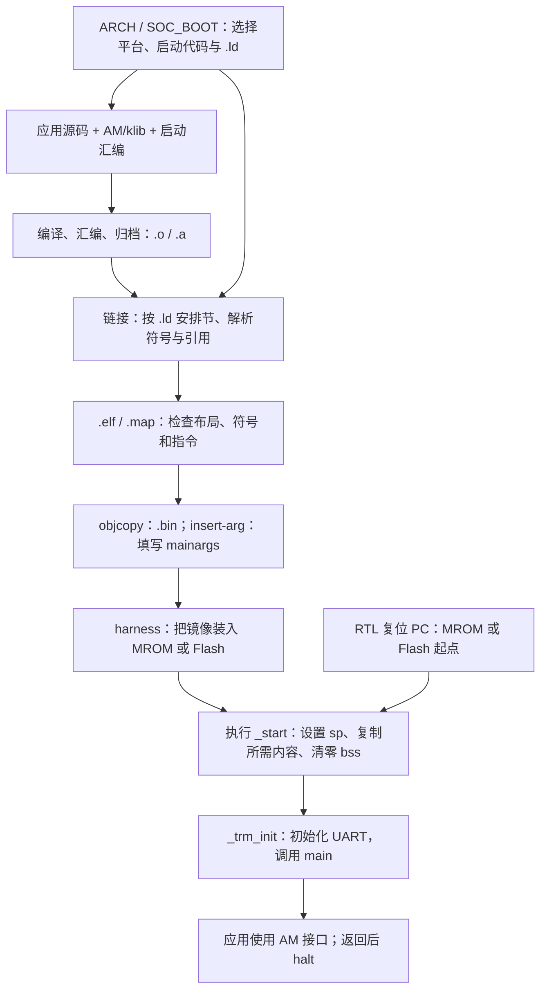

# SoC 裸机程序的构建、存储布局与启动：M5 S3/S4 源码阅读笔记

2026-10-27 建立。本文以当前源码为阅读起点，整理需要追踪的文件、配置和问题，后续在末尾追加自己的阅读收获、疑问与感受。

## 1. 本次想解决的问题

> 硬件接入更多存储器，如 Flash、PSRAM 后，如何配置软件，使程序能从指定存储启动，并使用新增 RAM 正常运行？

具体目标是：结合已经学习的 section、symbol、ELF 和链接知识，梳理**构建配置 → 链接布局 → 镜像装载 → CPU 复位 → 启动汇编 → AM → 应用程序**的完整过程，理解 M5 S3/S4。

当前硬件已提供 Flash XIP 和 PSRAM 的内存映射访问：CPU 的普通取指、load/store 经控制器转换为串行事务。因此本次重点阅读软件如何使用这些地址、安排初值和运行空间。控制器如何实现 SPI/PSRAM 事务，可以在需要时沿 [S4 实现文档](../post-c/5-ysyx-soc-integration/4-boot-memory.md) 继续向下追踪。

已有知识入口：

- [符号、ELF 与重定位基础](symbols-elf-and-relocation-basics.md)：查符号来源、节类型、工具命令，以及文件字节和运行时空间的区别。
- [裸机程序如何启动](bare-metal-linker-script-and-startup.md)：查 `.ld` 语法、VMA/LMA、链接器符号与 S3 布局。
- [M5 S3](../post-c/5-ysyx-soc-integration/3-runtime-difftest.md)、[M5 S4](../post-c/5-ysyx-soc-integration/4-boot-memory.md)：查阶段实现、测试与验收证据。

## 2. 各阶段实际使用哪些文件

| 配置 | 链接脚本 | 启动汇编 |
| --- | --- | --- |
| 旧 NPC，`ARCH=riscv32e-npc` | [linker.ld](../../../abstract-machine/scripts/linker.ld) | [npc/start.S](../../../abstract-machine/am/src/riscv/npc/start.S) |
| MROM＋SRAM，`SOC_BOOT=mrom` | [ysyxsoc.ld](../../../abstract-machine/scripts/ysyxsoc.ld) | [ysyxsoc/start.S](../../../abstract-machine/am/src/riscv/ysyxsoc/start.S) |
| Flash＋SRAM，`SOC_BOOT=flash-sram` | [ysyxsoc-flash-sram.ld](../../../abstract-machine/scripts/ysyxsoc-flash-sram.ld) | [flash-start.S](../../../abstract-machine/am/src/riscv/ysyxsoc/flash-start.S) |
| Flash＋PSRAM，`SOC_BOOT=flash-psram` | [ysyxsoc-flash-psram.ld](../../../abstract-machine/scripts/ysyxsoc-flash-psram.ld) | 同一份 `flash-start.S` |

后三种均使用 `ARCH=riscv32e-ysyxsoc`，AM 默认 `SOC_BOOT=mrom`。旧 B1 还在通用 `linker.ld` 之外加入 [npc-b1.ld](../../../abstract-machine/scripts/npc-b1.ld)，检查 SRAM 容量。旧 NPC/B1 文件用于历史对照；当前 [NPC Makefile](../../../npc/Makefile) 已退役其运行入口。

**选择这些文件的地方，也属于 build flow。** 先看 [AM Makefile](../../../abstract-machine/Makefile) 中的 `ARCH_BUILD`、`SOC_BOOT` 和 `include scripts/$(ARCH).mk`，再跟进 [riscv32e-ysyxsoc.mk](../../../abstract-machine/scripts/riscv32e-ysyxsoc.mk) 与 [platform/ysyxsoc.mk](../../../abstract-machine/scripts/platform/ysyxsoc.mk)。后者通过 `AM_SRCS` 和 `LDSCRIPTS` 选择启动源码与链接脚本；不同启动配置的对象、库和镜像路径分开。

## 3. 三种 SoC 配置的布局与启动动作

| 要观察的内容 | MROM＋SRAM | Flash＋SRAM | Flash＋PSRAM |
| --- | --- | --- | --- |
| CPU 复位入口 | MROM `0x20000000` | Flash `0x30000000` | Flash `0x30000000` |
| 启动代码所在输出节 | MROM `.text` 中的入口部分 | Flash `.boot` | Flash `.boot` |
| 应用代码与只读数据的运行位置 | MROM 的 `.text/.rodata` | SRAM 的 `.text`，包含 rodata | PSRAM 的 `.text`，包含 rodata |
| 应用代码是否需要搬运 | 否 | Flash → SRAM | Flash → PSRAM |
| `.data` 初值与运行位置 | MROM → SRAM | Flash → SRAM | Flash → PSRAM |
| `.bss`、heap、stack | SRAM | SRAM | PSRAM |
| RAM 起点／容量 | `0x0f000000`／8 KiB | `0x0f000000`／8 KiB | `0x80000000`／4 MiB |
| 链接脚本预留栈 | 2 KiB | 2 KiB | 64 KiB |

MROM 配置的应用代码始终从 MROM 执行，不把整个程序搬进 SRAM。两个 Flash 配置则先用 XIP 执行小型启动代码，搬好应用代码和数据后，再进入 RAM 中的 `_trm_init`。

**`flash-psram` 时 SRAM 硬件仍存在，但当前链接布局没有默认使用它。** 应用代码、数据、堆和栈统一安排到 PSRAM，并不是自动把它们分摊到 SRAM 与 PSRAM。

对比两个 Flash `.ld`，重点看 `ram` 的起点、容量和栈大小；再观察其余符号约定如何保持一致。`flash-start.S` 读取 `_text_load/_text_start/_text_end`、`_data_load/_data_start/_data_end` 等符号，因此同一套复制循环可以使用不同的 RAM 目标地址。

## 4. 按源码追踪完整链路



### 4.1 先读旧 NPC，建立对照

按 [platform/npc.mk](../../../abstract-machine/scripts/platform/npc.mk) → `linker.ld` → `npc/start.S` 阅读，回答：

1. `_pmem_start` 和 `_entry_offset` 从哪里传给链接器？程序为什么从 `0x80000000` 开始布局？
2. `_stack_top`、`_stack_pointer` 分别怎样计算？为什么这份启动汇编使用 `_stack_pointer` 设置 `sp`？
3. 启动汇编没有复制 data、清零 bss 的循环，镜像构建和装载承担了什么工作？

第三个问题要对照 `npc.mk` 的 `objcopy` 参数：

```make
--set-section-flags .bss=alloc,contents
```

旧流程将 `.bss` 作为有内容的节导出到 BIN。SoC 的 `ysyxsoc.mk` 不再使用这个参数，转而在启动代码中清零。比较启动实现时，应同时检查 `.ld`、`.S` 和镜像导出规则。

### 4.2 阅读 MROM → SRAM 的 data 初始化

对照 `ysyxsoc.ld` 与 `ysyxsoc/start.S`，逐一找出：

- `.text/.rodata` 为什么留在 MROM，而 `.data` 使用 `> sram AT> mrom`。
- `_data_load`、`_data_start`、`_data_end` 怎样分别成为复制源、目标和结束边界。
- `_bss_start/_bss_end` 怎样确定清零范围。
- `_stack_top/_stack_bottom` 和 `_heap_start/_heap_end` 怎样划分剩余 SRAM。
- S3 poison 循环在哪里，为什么要在 data-copy 和 bss-clear 之前执行；它属于验证手段，复制和清零负责建立程序运行环境。

### 4.3 阅读 Flash → RAM 的代码与数据搬运

先读 `ysyxsoc-flash-sram.ld` 与 `flash-start.S`，再对比 `ysyxsoc-flash-psram.ld`：

- `entry` 输入节为什么被放入独立的 Flash `.boot`？
- 为什么把应用 `.rodata` 也收集进 RAM `.text` 输出节？这使哪个复制范围同时覆盖它？
- `_text_load/_text_start/_text_end` 如何决定代码复制的来源、去向和范围？
- 设置 `sp` 后，为什么要等 RAM 初始化结束才调用 C？实际首次跳入 RAM 的位置在哪里？
- 改用 PSRAM 后，哪些链接器符号值改变了，为什么复制循环无需改写？

当前 `flash-start.S` 在 Flash 中完成静态目标区域的 poison、text/rodata 复制、data 复制与 bss 清零，然后调用 RAM 中的 `_trm_init`。读循环时将 `t0/t1/t2` 与 `.ld` 符号逐一对应。

### 4.4 阅读 AM 如何把启动代码接到应用

三种 SoC 配置共用以下平台实现：

| 源码 | 需要理解的作用 |
| --- | --- |
| [ysyxsoc/trm.c](../../../abstract-machine/am/src/riscv/ysyxsoc/trm.c) | 用链接器边界定义 `heap`；实现 `putch/halt`；在 `_trm_init` 中配置 UART 并调用 `main(mainargs)` |
| [ysyxsoc/ioe.c](../../../abstract-machine/am/src/riscv/ysyxsoc/ioe.c) | 提供当前支持的设备查询与 CLINT 时间读取 |
| [platform/ysyxsoc.mk](../../../abstract-machine/scripts/platform/ysyxsoc.mk) | 选择这些实现，并复用 NPC 的异常入口等源码 |

这里是**同一套 AM 接口的 ysyxSoC 平台实现**。普通应用仍通过 `putch`、`heap`、AM I/O 等接口工作，不必直接知道 RAM 选的是 SRAM 还是 PSRAM。

### 4.5 最后核对复位入口与镜像装载

| 位置 | 追踪的问题 |
| --- | --- |
| [npc/scripts/soc.mk](../../../npc/scripts/soc.mk) | 如何选择 `NPC_FLASH_BOOT`、仿真器构建目录和 `--mrom/--flash` 参数？ |
| [ysyx_25030087.sv](../../../npc/vsrc/top/ysyx_25030087.sv) | `PC_RST` 如何选择 `0x20000000` 或 `0x30000000`？ |
| [harness main.cpp](../../../npc/csrc/soc/main.cpp) | `load()` 将哪个 BIN 装入哪个存储模型？如何核对首条 PC 和指令？ |

**`.ld` 的 `ENTRY(_start)` 记录 ELF 入口，CPU 的复位 PC 由 RTL 决定。** 两者与镜像装载位置需要对应起来。

AM 的 `SOC_BOOT` 有 `mrom/flash-sram/flash-psram` 三种；NPC 硬件构建只区分 `mrom/flash` 两种复位入口。AM 的 `run` 规则负责把两个 Flash 软件配置都转换为 NPC 的 `SOC_BOOT=flash`。

harness 只加载 MROM/Flash 初始镜像，RAM 的代码和数据初始化由 CPU 执行。当前启动汇编使用普通访存，XIP/PSRAM 控制器完成串行协议转换；软件手动操作 SPI 寄存器属于另一条测试路径。

## 5. 哪些 testcase 可以复用

[CPU tests](../../../am-kernels/tests/cpu-tests/tests) 中的普通测试源码可以复用，但每种布局需要重新编译、链接，不能直接复用旧 BIN。S3 受 MROM/SRAM 容量和验收范围限制运行部分用例；S4 使用 PSRAM 扩大运行集合，`unalign` 仍因当前未对齐访问策略被排除。

阶段专用测试则不同：[soc-runtime](../../../npc/tests/soc-runtime) 主要覆盖 S3 运行环境；[soc-boot](../../../npc/tests/soc-boot) 增加 SPI、PSRAM、Flash 启动等测试。可从 [m5_s3_test.py](../../../npc/tests/m5_s3_test.py) 和 [m5_s4_test.py](../../../npc/tests/m5_s4_test.py) 的 `build` 与运行入口确认“使用哪个源码、选择哪个配置、传入哪个镜像、检查什么”。

## 6. 阅读时留下哪些证据

先用同一个小程序对比三种 SoC 配置，减少应用内容变化带来的干扰。配置好 `AM_HOME` 后，可从工程根目录分别构建现有 `hello.c`：

```bash
make -C npc/tests/soc-runtime ARCH=riscv32e-ysyxsoc SOC_BOOT=mrom insert-arg
make -C npc/tests/soc-runtime ARCH=riscv32e-ysyxsoc SOC_BOOT=flash-sram insert-arg
make -C npc/tests/soc-runtime ARCH=riscv32e-ysyxsoc SOC_BOOT=flash-psram insert-arg
```

对应 ELF 为 `npc/tests/soc-runtime/build/` 下的：

```text
soc-runtime-riscv32e-ysyxsoc.elf
soc-runtime-riscv32e-ysyxsoc-flash-sram.elf
soc-runtime-riscv32e-ysyxsoc-flash-psram.elf
```

阅读某一份产物时，将文件路径赋给 `boot_elf`：

```bash
boot_elf=npc/tests/soc-runtime/build/soc-runtime-riscv32e-ysyxsoc-flash-psram.elf
readelf -SW "$boot_elf"
riscv64-linux-gnu-objdump -h "$boot_elf"
riscv64-linux-gnu-nm -n "$boot_elf"
riscv64-linux-gnu-objdump -d "$boot_elf"
```

每种配置至少记录：`_start`、`_trm_init`、`main` 的位置；主要节的 VMA/LMA/大小；复制和清零的边界；栈与堆边界。再用同次构建的 `.map` 将输出布局追溯回输入文件。运行观察步骤和已有 commit/bus 证据见 S3/S4 阶段文档。

完成阅读后，希望能够用自己的话沿着一张流程图解释整个启动过程，并能指着源码和 ELF 输出说明每一步的依据。

## 7. 我的源码阅读记录

本节留作后续追加。每次阅读可以按下面的格式记录，不要求一次填完全部问题。

### 阅读记录模板：日期／本次关注的问题

- **读了哪些文件、使用哪种配置：**
- **我现在的理解：** 用自己的话描述这段配置或代码怎样工作。
- **源码与产物证据：** 记录函数／标签／规则、符号值、节布局或关键输出。
- **与此前理解不同的地方：**
- **仍未解决的问题、下一步准备查哪里：**
- **阅读感受：** 哪些地方理解顺畅，哪些基础知识仍然阻碍阅读。

<!-- 后续在此追加实际阅读记录；模板中的内容不表示已经完成阅读。 -->

### 26-10-27 阅读 

本次阅读了 4 种场景下的链接脚本, 启动汇编. 
- 旧 npc
- MROM + SRAM
- Flash + SRAM
- Flash + PSRAM

主要包括: 
linking scripts:
- `abstract-machine/scripts/linker.ld`
- `abstract-machine/scripts/ysyxsoc.ld`
- `abstract-machine/scripts/ysyxsoc-flash-sram.ld`
- `abstract-machine/scripts/ysyxsoc-flash-psram.ld`

Startup code: 
- `abstract-machine/am/src/riscv/npc/start.S`
- `abstract-machine/am/src/riscv/ysyxsoc/start.S`
- `abstract-machine/am/src/riscv/ysyxsoc/flash-start.S`

现在已经可以: 
- 根据 linker script 画出内存地址布局. 
- 懂得如何定义 LMA, VMA 并在 startup code 配合进行拷贝节以及区域初始化. 
- 懂得 stack, heap 的定义以及生长方向. 

我今天对于 ”XIP 如何实现“ 的理解: 
- 按照我的理解, PC_RST 被设置为 0x3000_0000 落入了 flash 空间, 会被 core+SoC 路由到 ysyxSoC/perip/spi/rtl/spi_top_apb.v 模块中. 最终访问 ysyxSoC 中例化的 flash 模块, flash 内部通过 DPI-C 访问 Cpp RTL-harness 中模拟的 flash 数组中内容 (仿真时已模拟加载好)
- 所以说不需要将指令存入内存? 直接从 flash 中读出, SPI 返回完成 APB/AXI 响应后进入 CPU IFU 执行? 按照我的理解, flash 中的 .boot section 也就是 abstract-machine/am/src/riscv/ysyxsoc/flash-start.S 中的 entry 节. XIP 只执行 .boot 节, boot 节执行完了 剩下的 .text .data 节 就已经被搬完了. 主要的 testcase 程序内容 (.text) 依旧是后续访问内存 (SRAM/PSRAM) 执行. 只有 .boot 节是直接从 flash 读出并执行的, 对吗? ——对的. 

#### 阅读评论与补充

这次记录中的启动主线与当前源码一致：已经把链接脚本给出的地址布局，与启动汇编实际进行的复制、清零和跳转联系起来了。`.ld` 决定“放在哪里、边界在哪里”，`.S` 使用这些符号完成运行时初始化；可以用这个分工解释为什么切换 SRAM/PSRAM 时能复用同一份 `flash-start.S`。

几个细节补充：

1. **`entry` 是输入节，`.boot` 是输出节。** `flash-start.S` 用 `.section entry, "ax"` 产生输入节；两个 Flash 链接脚本用 `.boot : { KEEP(*(entry)) … } > flash` 收集它。当前整个启动例程都在这里。执行到 `__am_runtime_ready` 时，`.text`（包括收集进来的 rodata）和 `.data` 已复制到 RAM，`.bss` 已清零；接着 `call _trm_init`，才进入 RAM 中的 C 代码。

2. **XIP 不需要先把启动指令复制到 SRAM/PSRAM。** 更准确地说，IFU 接收指令，后续译码、执行逻辑负责执行。[spi_top_apb.v](../../../ysyxSoC/perip/spi/rtl/spi_top_apb.v) 自动把映射读取转换为 `0x03 + 24 位地址 + 32 位数据` 的 SPI 事务。[Flash 模型](../../../ysyxSoC/perip/flash/flash.v) 解析命令、地址后才调用 DPI-C 获取内容，再通过 MISO 串行返回；控制器收齐数据后完成 APB/AXI 响应。因此仿真中的 SPI 通信过程也实际经过了 RTL。

3. **“只有 `.boot` 从 Flash 取指”是当前软件方案的选择。** XIP 硬件按地址处理读取，并不知道 section 名称。复制循环中的 `lw` 同样通过 Flash 映射读取 `.text/.data` 的初值，只是这时读取的是待搬运内容。程序进入 RAM 后，应用从 RAM 取指；并不是 XIP 硬件只能支持启动代码。

4. **栈、堆的边界与生长方式分别看。** `.ld` 划出范围，启动代码用 `_stack_top` 设置 `sp`；当前 RISC-V 调用约定下，函数通过减小 `sp` 分配栈空间。堆怎样分配则由分配器实现决定，不能仅从 `_heap_start/_heap_end` 推出它必然如何生长。
