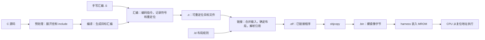
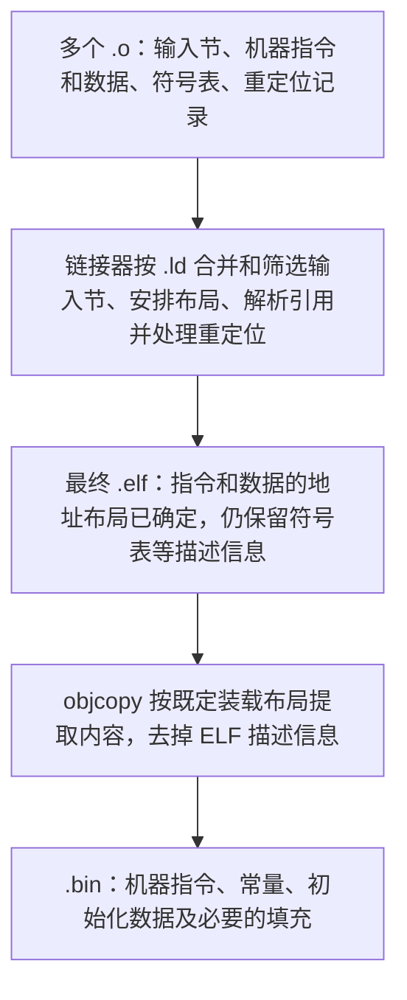

# 从源码名字到机器指令：汇编标签、符号表、ELF 与重定位入门

2026-10-25。面向已经接触 C 和处理器 RTL、但尚不熟悉汇编工具链的读者。示例使用本工程的 RV32E、GNU 工具链和 M5 S3 启动测试。

读完后应能解释：`__am_data_copy` 是什么、工具如何知道它的地址、为什么 `.o` 中有些地址尚未确定，以及 Python 如何把一条启动 store 替换成 NOP。

本文先建立“名字如何变成地址和字节”的基础。如何安排 ROM/RAM、编写 `.ld` 并建立 C 运行环境，接着阅读 [裸机程序如何启动](bare-metal-linker-script-and-startup.md)。阶段实现和验收仍以 [M5 S3](../post-c/5-ysyx-soc-integration/3-runtime-difftest.md) 为准。

## 1. 这些知识属于什么领域

它们主要属于**计算机系统中的程序表示、汇编与链接、可执行文件格式，以及裸机运行时**。可以按下面的关系学习：

| 领域 | 主要问题 | 本工程的对应内容 |
| --- | --- | --- |
| 指令集与程序的机器级表示 | 一条指令怎样编码？CPU 如何取指、跳转、访存？ | RV32E 的 `lw/sw/addi/jalr` |
| 编译工具链 | C/汇编怎样变成机器码？多个文件如何连接？ | GCC、GNU as、GNU ld |
| 目标文件格式与链接 | 名字、地址和待修正的引用怎样记录？ | ELF、符号表、重定位 |
| ABI 与运行时 | 函数如何传参、返回？谁准备栈和全局变量？ | `a0/sp/ra`、AM、`start.S` |
| 装载与调试 | 文件中的字节如何进入内存？如何观察运行结果？ | raw BIN、MROM backing、commit trace |

编译原理也会涉及其中一部分，但当前可以先掌握工具链的输入输出及各阶段的职责，再深入语法分析、优化算法等编译器内部实现。

建议分三轮阅读：先读第 2～6 节建立概念；亲手完成第 7 节的小实验；最后用第 8 节对照本工程源码。遇到具体名词时，先问：**这是给哪个工具看的？它描述名字、地址、文件内容，还是 CPU 动作？**

## 2. CPU 执行字节，人通过名字组织程序

先看一小段汇编：

```asm
.globl add_one
add_one:
  addi a0, a0, 1
  ret
```

其中有三类东西：

| 写法 | 类别 | 作用 |
| --- | --- | --- |
| `.globl add_one` | 汇编器指令 / directive，常称伪指令 | 声明符号的全局绑定属性 |
| `add_one:` | 标签 / label | 给当前位置取名 |
| `addi a0, a0, 1` | ISA 指令 | CPU 将寄存器中的值加一 |
| `ret` | 伪指令 / pseudoinstruction | 汇编器将其展开为实际指令，当前无 C 扩展时可对应 `jalr x0, 0(ra)` |

中文资料有时把 directive 和 pseudoinstruction 都称为“伪指令”，阅读时要根据作用区分。`.globl` 描述工具链元信息；`ret` 最终会变成 CPU 执行的指令。另一些 directive，例如 `.word`，会直接产生数据字节。

`a0` 是寄存器 `x10` 的 ABI 别名，不是符号表中的普通变量名。`ra` 是返回地址寄存器的别名。`add_one` 则是程序员取的符号名，链接器会给它确定位置。

在最终反汇编中，可能看到：

```text
20000018 <add_one>:
20000018: 00150513    addi a0,a0,1
2000001c: 00008067    ret
```

分别对应地址、机器码及便于人阅读的指令文本。`<add_one>` 是反汇编工具结合符号表添加的说明，CPU 不读取这串名字。

标签本身不占指令空间；删除一个没有被其他代码引用的标签，不等于删除它后面的机器指令。GNU 汇编器对标签的定义见 [Labels](https://sourceware.org/binutils/docs/as/Labels.html)。

## 3. 一份程序经过哪些阶段



`.S` 会先经过预处理，再汇编；图中省略了这条支路上的预处理框。GCC 是驱动程序，可以按参数调用多个阶段，并不只负责把 C 直接变成一个完整可执行文件。参见 [GCC：Overall Options](https://gcc.gnu.org/onlinedocs/gcc/Overall-Options.html)。

| 文件 / 选项 | 阅读时应怎样理解 |
| --- | --- |
| `.c` | C 源码 |
| `.s` / `.S` | 汇编文本；大写 `.S` 通常先做预处理 |
| `gcc -E` | 停在预处理结果 |
| `gcc -S` | 停在汇编文本 |
| `gcc -c` | 生成 `.o`，不做最终链接 |
| `.o` | 本工具链中通常也是 ELF，只是类型为可重定位文件 |
| `.a` | 多个目标文件组成的静态库归档，链接器按需要取用成员 |
| `.elf` | 本工程约定的已链接程序文件名；ELF 是格式，不只属于这一后缀 |
| `.bin` | 没有 ELF 头、节表、符号表的 raw image；装载器必须另外知道基地址 |
| `.map` | 链接器生成的文本布局报告，适合追踪内容来自哪个输入文件 |

**`.o` 已经可以包含机器码，但尚不能认为所有地址引用都已确定。** 多文件程序中，某文件引用的函数可能定义在另一个文件里，链接器需要把它们接起来。

## 4. 符号、标签、变量与 section 的区别

### 4.1 符号是工具链用来记录名字及其含义的对象

可以先将符号理解为一条记录：名字是什么、在哪里定义、对应什么值、属于哪个节、能否被其他文件引用。

符号可能来自不同地方：

| 来源 | 示例 | 最终通常表示什么 |
| --- | --- | --- |
| C 函数定义 | `int add_one(int x) { return x + 1; }` | 函数入口位置 |
| C 全局对象定义 | `int counter = 3;` | 对象的存储位置 |
| 汇编标签 | `__am_data_copy:` | 当前指令或数据的位置 |
| 链接脚本赋值 | `_stack_top = ORIGIN(sram) + LENGTH(sram);` | 脚本计算的边界值 |
| 对外部对象的引用 | `extern int counter;` 并在代码中使用它 | 尚待其他输入提供的定义 |

符号不保证都能在最终文件中找到：优化可能移除对象，链接可能回收节，strip 也可以删除符号信息。函数内的局部变量也不一定有独立的 ELF 链接符号，调试信息与链接符号表是不同机制。

### 4.2 声明、定义和引用

下面两个 C 文件可以帮助理解链接要完成的工作：

```c
/* reader.c */
extern int counter;
int read_counter(void) {
  return counter;
}
```

```c
/* storage.c */
int counter = 3;
```

`extern int counter;` 告诉编译器如何理解这个名字；真正的对象定义在 `storage.c`。`reader.o` 可以记录“需要 counter”，`storage.o` 则提供它的定义。最终链接时，引用被连接到对象的地址。

如果把第二份定义改成文件作用域的 `static int counter = 3;`，它具有内部链接，不能满足其他翻译单元对外部 `counter` 的引用。这里讨论的是普通静态链接，暂不展开动态库符号解析。

### 4.3 标签是定义符号的一种办法，不自动定义函数或区域

当前 [start.S](../../../abstract-machine/am/src/riscv/ysyxsoc/start.S) 中：

```asm
__am_data_copy:
  # 数据复制代码
__am_bss_clear:
  # BSS 清零代码
```

两个标签各自标记一个位置。它们不会自动生成调用、返回或范围检查。CPU 顺序执行到标签所在位置时，继续执行该地址处的机器指令。

Python 将 `[__am_data_copy, __am_bss_clear)` 当作一个范围，是**测试脚本与启动代码之间的约定**；汇编器没有因此建立一个叫 `__am_data_copy` 的独立 section。

### 4.4 section 是内容的组织单位

```asm
.section entry, "ax"
```

这条 GNU as directive 把后续内容放入名为 `entry` 的输入节；ELF 属性 `a` 表示需要分配运行空间，`x` 表示可执行内容。节名 `entry` 是工程自定义的。

本工程链接脚本用：

```ld
.text : { KEEP(*(entry)) *(.text .text.*) } > mrom
```

将 `entry` 等输入节收集进输出节 `.text`。所以在 `start.o` 里，启动标签与 `entry` 相关；在最终 ELF 里，它们位于 `.text`。

section 包含内容并有布局属性；symbol 则给内容中的位置或计算出的值命名。它们都可以有字符串名字，但属于不同对象。参见 [GNU as：Section](https://sourceware.org/binutils/docs/as/Section.html) 和 [GNU ld：Basic Script Concepts](https://sourceware.org/binutils/docs/ld/Basic-Script-Concepts.html)。

### 4.5 链接器符号不一定对应一个被分配的变量

`_stack_top` 的赋值不会创建一个存放栈顶地址的四字节变量。启动代码中的 `la sp, _stack_top` 取得边界值；不会从该地址读取一个“栈顶变量”。

在 C 中引用这种地址符号时，常用 `extern char _stack_top;` 配合 `&_stack_top`，或将边界声明为数组。具体正确/错误示例见 [启动笔记 §6](bare-metal-linker-script-and-startup.md#6-_stack_top-到底是什么c-和汇编如何使用它)，工具链规则见 [GNU ld：Source Code Reference](https://sourceware.org/binutils/docs/ld/Source-Code-Reference.html)。

## 5. 读懂汇编里的点号、下划线与局部标签

### 5.1 常见写法由谁解释

| 写法 | 含义 | 是否自动形成 CPU 动作 |
| --- | --- | --- |
| `.section entry, "ax"` | 选择输入节及其属性 | 否 |
| `.globl name` / `.global name` | 声明全局符号，使其他输入可引用该定义 | 否 |
| `.type name, @function` | 将符号类型记为函数 | 不会生成函数序言或调用 |
| `.size name, . - name` | 根据当前位置与起点之差记录字节大小 | 不会生成返回指令 |
| `.balign 4` | 对齐到 4 字节边界，必要时产生 padding | padding 会影响最终布局 |
| `.word 41` | 在本 RISC-V 实验中输出一个 32 位数据值 | 产生数据字节，不代表 CPU 执行“赋值 41” |
| `name:` | 定义当前位置的标签 | 不占指令字节 |
| `la t0, name` | 加载地址的伪指令 | 展开为实际指令；具体序列与工具链选项有关 |
| `lw a0, 0(t0)` | 从 `t0` 指向的地址读取一个 word | 是 |

`.globl` 设置的是链接绑定属性，不是自动保留所有符号的保证；局部符号也可能出现在 `nm` 中。`KEEP`、节垃圾回收和 strip 是另外的问题。详细定义见 GNU as 的 [Global](https://sourceware.org/binutils/docs/as/Global.html)、[Type](https://sourceware.org/binutils/docs/as/Type.html)、[Size](https://sourceware.org/binutils/docs/as/Size.html)、[Balign](https://sourceware.org/binutils/docs/as/Balign.html)。

### 5.2 `__am_data_copy` 的双下划线不是一种对象类型

可将这个名字读为“AM 运行时内部的数据复制位置”。`__` 是命名约定，不能决定它是函数、变量、标签还是宏；要查看定义语法。

例如 `__am_data_copy:` 是汇编标签，而 `__FILE__` 是 C 预处理器提供的宏，后者在预处理阶段展开。不能仅凭双下划线把二者归为一类。参见 [GCC：Standard Predefined Macros](https://gcc.gnu.org/onlinedocs/cpp/Standard-Predefined-Macros.html)。

C 中双下划线开头等名称属于实现保留名称，普通应用代码应避免自行使用；本工程这里是在底层运行时中定义符号约定。参见 [GNU C Library：Reserved Names](https://sourceware.org/glibc/manual/latest/html_node/Reserved-Names.html)。

### 5.3 `1:`、`1b`、`3f` 是另一套明确的汇编语法

当前 poison 循环中：

```asm
1:
  sw t1, 0(t0)
  addi t0, t0, 4
  bltu t0, sp, 1b
```

`1:` 是数字局部标签；`1b` 表示向后找最近的 `1:`，`3f` 表示向前找最近的 `3:`。`b/f` 分别是 backward/forward。数字标签可在文件中重复用于不同局部控制流，汇编器负责区分。

GNU ELF 工具链还常用 `.Lxxx` 表示临时局部标签，它们通常不会作为普通可见符号保留；这是工具识别的前缀规则，与 `__am_` 的工程命名约定不同。参见 [GNU as：Symbol Names](https://sourceware.org/binutils/docs/as/Symbol-Names.html)。

## 6. ELF 怎样记录符号和尚未确定的引用

### 6.1 先认识 ELF 的几类信息

| 内容 | 作用 | 查看命令 |
| --- | --- | --- |
| ELF header | 文件类型、目标机器、入口等总体信息 | `readelf -h` |
| Section headers | 各节的类型、地址、大小、文件偏移等 | `readelf -SW` |
| 符号表 `.symtab` | 名字对应的值、类型、绑定、所属节等 | `readelf -sW` / `nm` |
| 重定位节，如 `.rela.text.entry` | 记录哪些位置需要按符号地址修正 | `readelf -rW` |
| Program headers | 运行装载所使用的 segment 描述 | `readelf -lW` |
| `.text/.rodata/.data` 等内容 | 指令、常量和数据字节 | `objdump -d` / `objdump -s` |

本实验 `.o` 的文件类型为 `REL`，链接后的 `.elf` 为 `EXEC`。一般 ELF 还可以表示共享对象等类型；初学时先弄清当前静态裸机程序即可。

### 6.2 符号表里有哪些字段

`readelf -sW` 的常见列为：

```text
Num: Value  Size  Type  Bind  Vis  Ndx  Name
```

- `Value`：符号值；在可重定位对象中常是节内偏移，在最终可执行文件中常是地址。
- `Size`：关联对象的大小；未标注或未知时可以为 0。
- `Type`：如 `FUNC`、`OBJECT`、`NOTYPE`。
- `Bind`：如 `LOCAL`、`GLOBAL`、`WEAK`，描述链接时的绑定关系。
- `Vis`：符号可见性属性，与绑定是不同字段。
- `Ndx`：所属节索引，或 `UND`（未定义）、`ABS`（绝对符号）等特殊值。

具体数据结构由 [ELF：Symbol Table](https://gabi.xinuos.com/elf/05-symtab.html) 定义。这里的符号表不是 CPU 内部硬件表。

当前 S3 `memory` 的 ELF 中，`__am_data_copy` 是值为 `0x20000028`、大小为 0 的 `NOTYPE GLOBAL` 符号。它标记代码位置，但没有被 `.type` 声明为函数，也没有通过 `.size` 声明复制区域大小。因此脚本需要另一个标签作为结束边界。

### 6.3 `nm` 字母表示什么

| 常见字母 | 含义 |
| --- | --- |
| `U` | 本对象中未定义，需要其他输入提供定义 |
| `T/t` | 位于代码节 |
| `R/r` | 位于只读数据节 |
| `D/d` | 位于有初值的数据节 |
| `B/b` | 与 BSS 节关联 |
| `A` | 绝对符号 |

大小写通常对应全局/局部，但存在特例。`nm` 的字母是工具的归类，和 `readelf` 的 `Type` 列不是同一个字段。例如 `NOTYPE` 的代码位置标记也能显示为 `T`。参见 [GNU nm](https://sourceware.org/binutils/docs/binutils/nm.html)。

特别注意：当前实际 S3 ELF 的 `nm` 输出包括 `0f002000 B _stack_top`。它仍是脚本定义的栈顶边界，没有因此分配一个 BSS 变量。**应结合定义、节索引和最终地址解读，不应把字母直接等同于 C 对象类型。** 绝对/节相对符号的细节见 [启动笔记 §6.4](bare-metal-linker-script-and-startup.md#64-绝对符号与节相对符号)。

### 6.4 重定位：把符号引用落实到具体指令或数据

假设 `entry.S` 调用 `add_one`，而函数定义在 `helper.S`。独立汇编 `entry.S` 时，还不知道最终两个节会被放到哪里；汇编器仍可生成指令框架，并记录待链接器处理的重定位项。

一条重定位记录主要回答三个问题：

1. **改哪里？** 某个输入节内的字节偏移。
2. **引用谁？** 目标符号或相关位置符号。
3. **怎样算、怎样写？** 由重定位类型决定，例如绝对地址、PC 相对位移，以及写入哪些指令位域。

链接器完成布局后，解析符号并应用这些规则。例如 `call add_one` 可以由一组 PC 相对指令实现；`la t0, value` 可以由 `auipc/addi` 实现。并非每个引用都直接塞入一个完整 32 位绝对地址，RISC-V 的成对高/低位重定位也有专门配合规则。

这里的“重定位”是在生成程序时修正地址引用；启动时把 `.data` 从 ROM 复制到 RAM 是另一件事。两者可能共同参与裸机启动，但不能混用概念。参见 [ELF：Relocation](https://gabi.xinuos.com/elf/06-reloc.html)。

## 7. 小实验：亲眼观察名字变成地址

这个实验只做汇编、链接和文件检查，不依赖 SoC 仿真。下面几段命令应在同一个 Bash 会话中按顺序执行。需要本工程使用的 `riscv64-linux-gnu-*` 工具；虽然前缀包含 64，参数会选择 RV32E 和 ELF32。

### 7.1 创建两个汇编文件和布局脚本

```bash
symbols_lab=$(mktemp -d /tmp/npc-symbols-lab.XXXXXX)

cat > "$symbols_lab/entry.S" <<'EOF'
.section .text.entry, "ax", @progbits
.globl _start
.type _start, @function
_start:
  la t0, value
  lw a0, 0(t0)
  call add_one
  ebreak
.size _start, . - _start
EOF

cat > "$symbols_lab/helper.S" <<'EOF'
.section .text.add_one, "ax", @progbits
.globl add_one
.type add_one, @function
add_one:
  addi a0, a0, 1
  ret
.size add_one, . - add_one

.section .rodata.value, "a", @progbits
.balign 4
.globl value
.type value, @object
value:
  .word 41
.size value, . - value
EOF

cat > "$symbols_lab/layout.ld" <<'EOF'
ENTRY(_start)
SECTIONS {
  . = 0x20000000;
  .text : { *(.text.entry) *(.text .text.*) }
  .rodata : { *(.rodata .rodata.*) }
}
EOF
```

`entry.S` 引用另外一个文件里的 `value/add_one`。`value` 的标签记录数据位置，真正产生四字节初值的是 `.word 41`。`@progbits` 表示该节有实际内容；`.type value, @object` 则设置符号类型，这两者也不是同一个属性。

这个最小布局脚本只为实验安排地址，没有当前 AM 完整的 RAM、栈、设备初始化或退出协议。本文不将它作为 M5 验收程序运行。

### 7.2 只汇编，还不链接

```bash
riscv64-linux-gnu-gcc -march=rv32e_zicsr -mabi=ilp32e \
  -fno-pic -mno-relax -c "$symbols_lab/entry.S" -o "$symbols_lab/entry.o"
riscv64-linux-gnu-gcc -march=rv32e_zicsr -mabi=ilp32e \
  -fno-pic -mno-relax -c "$symbols_lab/helper.S" -o "$symbols_lab/helper.o"

riscv64-linux-gnu-nm "$symbols_lab/entry.o" "$symbols_lab/helper.o"
riscv64-linux-gnu-readelf -rW "$symbols_lab/entry.o"
riscv64-linux-gnu-objdump -dr "$symbols_lab/entry.o"
```

本地验证时，`nm` 的关键输出为：

```text
entry.o:
00000000 T _start
         U add_one
         U value

helper.o:
00000000 T add_one
00000000 R value
```

`U` 表明 `entry.o` 引用了两个外部定义。`helper.o` 中两个符号都显示零，不表示它们占同一运行地址：它们各自在不同输入节的偏移 0，最终地址尚未分配。

重定位表中可以看到与 `value` 相关的 `R_RISCV_PCREL_HI20`、配对的 `R_RISCV_PCREL_LO12_I`，以及与 `add_one` 相关的 `R_RISCV_CALL`。工具链版本可能使用其他等价的调用重定位类型，或附带 `R_RISCV_RELAX` 等辅助记录；先观察引用目标及需要修正的位置。

### 7.3 链接后，再看地址与指令

```bash
riscv64-linux-gnu-ld -melf32lriscv --no-relax \
  -T "$symbols_lab/layout.ld" -Map="$symbols_lab/demo.map" \
  "$symbols_lab/entry.o" "$symbols_lab/helper.o" -o "$symbols_lab/demo.elf"

riscv64-linux-gnu-nm -n "$symbols_lab/demo.elf"
riscv64-linux-gnu-readelf -sW "$symbols_lab/demo.elf"
riscv64-linux-gnu-objdump -d -M no-aliases "$symbols_lab/demo.elf"
```

`--no-relax` 在链接阶段关闭 relaxation，即某些指令序列的缩短/改写，便于本次逐条对照；这是教学实验的选项，不是在要求修改项目的优化策略。

本地输出为：

```text
20000000 T _start
20000018 T add_one
20000020 R value
```

在当前选项下，反汇编中最值得观察的部分是：

```asm
# 原来的 la t0, value
20000000: 00000297    auipc t0,0
20000004: 02028293    addi  t0,t0,32

# 原来的 lw a0, 0(t0)
20000008: 0002a503    lw    a0,0(t0)

# 原来的 call add_one
2000000c: 00000097    auipc ra,0
20000010: 00c080e7    jalr  ra,12(ra)
```

这是反汇编摘录，不是可以直接汇编的源文本。第一组指令得到 `0x20000000 + 32 = 0x20000020`，随后 `lw` 才读取该地址处保存的 `41`。调用指令组的目标是 `0x2000000c + 12 = 0x20000018`。

因此：**取得 value 的地址、读取 value 的内容、跳到 add_one 执行，是三种不同动作。**

### 7.4 ELF 转成 BIN 后，名字到哪里去了

```bash
riscv64-linux-gnu-objcopy -O binary \
  "$symbols_lab/demo.elf" "$symbols_lab/demo.bin"
od -An -tx1 -v "$symbols_lab/demo.bin"
wc -c "$symbols_lab/demo.bin"
```

当前实验 BIN 为 36 B，最后四字节是 `29 00 00 00`：十进制 41 即十六进制 `0x29`，按小端序保存。

这份 raw BIN 不包含 `_start/add_one/value` 的符号表。地址引用在链接时已经确定，CPU 执行不依赖这些名字。调试/补丁脚本若还想按名字定位，就需要保留对应 ELF、map 或另行导出的地址信息。参见 [GNU objcopy：binary 输出](https://sourceware.org/binutils/docs/binutils/objcopy.html)。

## 8. 把基础知识用于 S3：从标签找到要替换的 store

### 8.1 poison 与负例各在哪里

| 内容 | 源码入口 | 具体作用 |
| --- | --- | --- |
| poison | [start.S](../../../abstract-machine/am/src/riscv/ysyxsoc/start.S) 的第一个循环 | CPU 向 SRAM 的 2048 个 word 写入 `0xa5a5a5a5` |
| 获取符号地址 | [m5_s3_test.py](../../../npc/tests/m5_s3_test.py) 的 `symbols()` | 调用 `nm` 读取 ELF，生成名字到数值的字典 |
| 生成启动负例 | 同一脚本的 `negatives()` | 复制原始 BIN，再分别替换两段循环里的 store |
| C 自检 | [memory.c](../../../npc/tests/soc-runtime/memory.c) 的 `check()` 与 `main()` | 检查 data 初值和 bss 零值等，不符合预期则 `halt(1)` |
| 失败码与退出 | [trm.c](../../../abstract-machine/am/src/riscv/ysyxsoc/trm.c) 的 `halt()` | 将 code 放进 `a0`，执行 `ebreak` |
| 观察 GPR 与提交 | [soc_monitor.sv](../../../npc/sim/soc_monitor.sv)、[main.cpp](../../../npc/csrc/soc/main.cpp) | 从 x10 取得 a0，记录提交；在退出时检查非零状态 |

poison 是“先填入特定图案以暴露未初始化使用”的验证方法。当前它直接写在启动汇编中，不是 Python 偷偷预填 SRAM，也没有单独的 poison 开关。正常程序和被修改后的两个启动负例都会先执行它。

负例是有意制造错误、预期被检查发现的测试。两个启动负例分别命名为 `missing-data-copy` 和 `missing-bss-clear`；它们互相独立，每个都从未修改的 memory 镜像开始生成。

### 8.2 标签地址、BIN 偏移和指令编码如何对应

当前 S3 `memory` 镜像的关键值如下，修改程序后应重新从对应 ELF 获取，不能固定抄用：

| 内容 | 地址 / 编码 |
| --- | --- |
| `__am_data_copy` | `0x20000028` |
| `__am_bss_clear` | `0x20000058` |
| `__am_runtime_ready` | `0x20000078` |
| data-copy 的 `sw a0, 0(t1)` | PC `0x20000048`，机器码 `0x00a32023` |
| bss-clear 的 `sw zero, 0(t0)` | PC `0x2000006c`，机器码 `0x0002a023` |

脚本先从 ELF 得到区间，再按下面的逻辑处理 BIN：

```python
for pc in range(sym[start], sym[end], 4):
    offset = pc - 0x20000000
    ins = int.from_bytes(data[offset:offset + 4], "little")
    if (ins & 0x7f) == 0x23:
        data[offset:offset + 4] = (0x00000013).to_bytes(4, "little")
        count += 1
assert count == 1
```

每一步的含义为：

1. 当前 ISA 不含压缩指令，所选区间全部是 32 位指令，因此按 4 B 遍历。
2. 当前这段代码的 VMA = LMA，BIN 的起点对应 `0x20000000`，所以 `pc - 0x20000000` 得到文件偏移。
3. 小端解码把四个文件字节恢复为一个 32 位指令值。
4. `ins & 0x7f` 取指令最低 7 位 opcode；`0x23` 对应整数 store 类指令。这里的两个受控区间各只有一条 `sw`，脚本检查替换数必须为 1。
5. `0x00000013` 是 `addi x0, x0, 0`，即标准 NOP。写回四字节而不是删除四字节，使后续地址和分支布局保持不变。NOP 仍会执行并推进 PC。

NOP 的定义可查 [RISC-V RV32I：NOP Instruction](https://docs.riscv.org/reference/isa/v20260120/unpriv/rv32.html#_nop_instruction)。

以 data-copy store 为例：

```text
PC 0x20000048 → BIN offset 0x48
原始字节：23 20 a3 00 → 指令值 0x00a32023 → sw a0,0(t1)
修改字节：13 00 00 00 → 指令值 0x00000013 → nop
```

这不是通用的任意 ELF 补丁器。换成压缩指令、代码与数据混排、不同 VMA/LMA 或不同 raw image 基址时，上述假设要重新核查。只用 opcode 匹配也不能在任意二进制范围中可靠识别指令边界。

**脚本读取 ELF 的符号信息，修改的是新生成的 BIN 副本；没有修改原始 `.S` 或 ELF。** 因此反汇编原始 ELF 仍会看到原来的 `sw`。两个 store 都在循环体内，替换一次机器指令，就会使该循环的每一轮都缺少相应写入。

### 8.3 为什么出现非零 a0

| 负例 | 未初始化后的数据 | 首个自检条件 |
| --- | --- | --- |
| missing-data-copy | `initialized[0]` 仍为 `0xa5a5a5a5` | `initialized[0] == 0x01234567` 为假 |
| missing-bss-clear | `zeros[0]` 仍为 `0xa5` | `zeros[0] == 0` 为假 |

随后执行：

```text
check(false)
  → halt(1)
  → mv a0, 1；ebreak
  → harness 报 ebreak with nonzero a0
  → 仿真器进程返回非零
```

这里直接调用 `halt(1)`，没有走到 `main()` 的 `return`。正常返回时还有 `_trm_init` 中的 `halt(main(mainargs))` 这条路径。

“ebreak 时用 a0 表示成功/失败”是本工程的运行环境约定，不是所有 RISC-V 程序都遵循的退出语义。DUT 和 NEMU 执行同一份被破坏的程序时可以保持一致；上述错误由程序中独立的预期值检查发现。

Python 的 `run(..., expected=...)` 同时检查非零进程状态及指定报错文本。只有以预期方式失败，才将该负例测试记为 PASS；任意超时或崩溃并不等价。

### 8.4 实际运行和观察 a0

回到工程根目录、配置好 `AM_HOME/NPC_HOME` 后，完整入口是：

```bash
make -C npc s3-test
```

它先构建 SoC 仿真器与 NEMU 参考库，再执行 `m5_s3_test.py`。两个负例镜像生成在 `npc/build/m5-s3/`。这个脚本组织 S3 主测试套件；S2 完整回归、独立 AM run 入口检查等另有执行入口。

已有镜像时，可以单独记录一个负例的提交轨迹：

```bash
case_name=missing-data-copy
# 将上面改为 missing-bss-clear，可检查另一负例。

npc/build/ysyxsoc/VysyxSoCFull \
  --mrom "npc/build/m5-s3/${case_name}.bin" \
  --diff nemu/build/ysyxsoc/nemu-ref.so \
  --commit-trace "npc/build/m5-s3/${case_name}.commit.csv"

tail -n 1 "npc/build/m5-s3/${case_name}.commit.csv"
```

仿真命令预期返回 1；在普通交互式 Bash 中继续执行 `tail`，不要用要求前一条成功的 `&&` 串接。若在启用了 `set -e` 的自动脚本中运行，应显式接收这个预期失败。

CSV 没有表头，字段顺序为 `时间, PC, 指令, a0, flags, cause, 访存地址`。时间为十进制，其余为十六进制；最后一行的第三列应为 `100073`（ebreak），第四列应为 `1`。

2026-10-25 对现有两个负例镜像分别开启 commit trace 重跑，二者最后一条提交均为 PC `0x20000378`、指令 `0x00100073`、`a0=1`，并以 `ebreak with nonzero a0` 退出。原 S3 [data-copy 负例日志](../post-c/5-ysyx-soc-integration/s3-validation/missing-data-copy.log) 和 [bss-clear 负例日志](../post-c/5-ysyx-soc-integration/s3-validation/missing-bss-clear.log) 只记录非零判定，没有直接打印 a0 数值。

poison 的检查则看 `startup_evidence()`：它从实际总线记录核对前 2048 个 SRAM word 写入的地址、数据、写掩码及响应。原始结果摘要在 [startup.json](../post-c/5-ysyx-soc-integration/s3-validation/startup.json)。

## 9. 自己检查是否理解了

建议先独立回答，再看右列。

| 问题 | 检查要点 |
| --- | --- |
| 给 `__am_data_copy` 换名字，CPU 行为会自动改变吗？ | 同步修改所有引用、保持生成指令不变时不会；但遗漏 Python 对标签名字的依赖会使测试失败 |
| `.globl` 能让 CPU 调用某段代码吗？ | 不能；调用需要实际跳转指令 |
| `.type foo, @function` 会自动补 `ret` 吗？ | 不会，它设置符号类型元信息 |
| 为什么 `.o` 中两处 `00000000` 不一定是同一位置？ | 可能分别是不同输入节的起点；需结合文件和所属节理解 |
| 为什么看起来已经有机器码，还需要重定位？ | 外部目标和最终布局尚未确定，需要修正指令/数据中的地址引用 |
| BIN 没有符号表，Python 为什么仍能按名字找到指令？ | 地址来自同一次构建的 ELF，之后转换为 BIN 偏移 |
| `_stack_top` 在 nm 中显示 B，说明有一个 BSS 变量吗？ | 不能这样判断；要看脚本定义，符号的节关联不代表额外分配存储 |
| 替换 store 为 NOP 与直接删掉四字节有什么不同？ | 等长替换保持布局；删除会移动后续字节，使既有地址和位移失效 |
| 两个负例为什么不能只靠 DUT/REF 相等验收？ | 二者可以一致地执行有缺陷的软件；程序需要用独立预期判断初始化是否正确 |

继续读工程源码时，可以沿这条路线：`start.S → ysyxsoc.ld → memory ELF 的 nm/objdump → m5_s3_test.py 的 symbols()/negatives() → memory.c 的 check() → trm.c 的 halt() → C++ 的退出检查`。每到一处，说明它接收什么、产生什么，以及下一层如何使用这些信息。

## 10. 阅读疑问补充：符号是什么，ELF 转 BIN 到底去掉什么

2026-10-26 补充。围绕实际阅读符号表时的疑问整理，可先读本节建立概念，再回看前面的重定位实验。本节的最终 ELF 指本工程**已经完成静态链接的裸机程序**；`.o` 也是 ELF，但其中的地址引用可能尚待链接处理。

### 10.1 符号与符号表的定义

在汇编、链接和 ELF 的语境中：

- **符号（symbol）**：工具链用于标识、描述或引用某个对象、位置、数值等的信息项，通常有名称。例如 `main` 代表函数入口，`ans` 代表数组，`_stack_top` 代表地址边界；ELF 还用特定类型的符号描述节和文件来源。
- **符号表（symbol table）**：集中保存符号记录的表。每条记录包含名称关联、数值、大小、类型、绑定属性、可见性和节关联等信息。`.symtab` 是 ELF 中保存这类记录的一个节，`readelf -sW` 展示的就是其中的条目。名称字符串实际存放在关联的字符串表中，条目记录名称的索引。

这些信息既供人查看，也供工具使用：链接器利用符号解析跨文件引用、处理重定位；调试器利用符号按名称定位；本工程的测试脚本读取符号地址来定位要修改的指令。参见 [GNU as：Symbols](https://sourceware.org/binutils/docs/as/Symbols.html) 和 [ELF：Symbol Table](https://gabi.xinuos.com/elf/05-symtab.html)。

**程序内容和描述它的符号记录分别存在。** 不能把“生成符号”理解为“函数或数组本身被转换成符号”：

| 来源 | 实际程序内容或作用 | 对应的符号记录 |
| --- | --- | --- |
| C 函数 `main` | 编译得到的机器指令，位于代码节 | 名称、入口位置、类型 `FUNC` 等 |
| C 数组 `ans` | 数据存储空间及初始化数据 | 名称、存储位置、大小、类型 `OBJECT` 等 |
| 汇编标签 `__am_data_copy:` | 给当前代码位置取名，本身不生成指令 | 名称、位置，这里类型为 `NOTYPE` |
| 链接脚本中的 `_stack_top = ...` | 计算一个边界值，不额外分配保存该值的变量 | 名称、计算出的值等 |
| 文件来源名称 `add.c` | 为工具提供来源信息 | 类型为 `FILE` 的记录 |

工具链可以为这些对象建立符号记录，但不是每个源码元素都一定在最终符号表中有一个条目，原因见 §4.1。

### 10.2 符号有哪些类型，分别描述什么

下面按 `readelf -sW` 的 **`Type` 列**分类。前五类出现在本节的 S3 示例中，后两类只需知道名称，暂不展开。

| 类型 | 描述的内容 | 示例及阅读重点 |
| --- | --- | --- |
| `FUNC` | 函数或可执行代码入口 | `main`、`_start`、`halt`；在当前已链接 ELF 中，值通常是入口地址 |
| `OBJECT` | 数据对象，如变量、数组 | `ans`、`test_data`、`mainargs`；值通常是对象地址，不是变量中保存的数据 |
| `SECTION` | 一个节 | `.text`、`.data` 等节的符号，主要供重定位等工具处理使用 |
| `FILE` | 文件来源名称 | `add.c`、`trm.c`、`start.o`；不表示把这个源文件或目标文件整体装入某个运行地址 |
| `NOTYPE` | 没有指定具体类型 | 常见于汇编位置标签、链接脚本边界符号；也包括下述 `$x` |
| `TLS` | 线程局部存储对象 | 各线程具有独立实例，符号值涉及 TLS 偏移；当前示例没有 |
| `COMMON` | 未初始化的公共数据对象 | 可重定位文件中涉及链接时的存储分配；当前示例没有 |

完整定义见 [ELF：Symbol Type](https://gabi.xinuos.com/elf/05-symtab.html#symbol-type)。`LOCAL/GLOBAL/WEAK` 是 **`Bind` 绑定属性**，`UND/ABS` 是 **`Ndx` 的特殊值**，都不是上表中的 `Type`。

**标签（label）是定义位置符号的一种方式，不是独立的 ELF 符号类型。** 例如 `__am_data_copy:` 产生的位置符号在这里是 `NOTYPE`；`_start:` 配合 `.type _start, @function`，则标注为 `FUNC`。

**`$x` 是 RISC-V 的映射符号（mapping symbol），表示一段指令从这里开始。** 它帮助反汇编等工具区分内容，类型为 `NOTYPE`、绑定为 `LOCAL`、大小为 0。它不是 CPU 的 `x0/x1` 等寄存器，也不是一个 C 变量。类似的 `$d` 标记数据序列的开始。参见 [RISC-V psABI：Mapping Symbol](https://riscv-non-isa.github.io/riscv-elf-psabi-doc/#_mapping_symbol)。

因此，在符号表语境下，将函数符号、节符号、文件符号等**统称为“符号”是正确的**。第 4.4 节区分 section 和 symbol，强调的是“节本身”和“描述该节的符号记录”有区别，并不排除 ELF 中存在 `SECTION` 类型的符号。

### 10.3 用实际输出区分“符号值”和“对象内容”

在工程根目录查看 S3 的 `cpu-add` 镜像：

```bash
readelf -sW npc/build/m5-s3/programs/cpu-add/build/cpu-add-riscv32e-ysyxsoc.elf
```

2026-10-26 核对的关键条目如下；程序或构建选项变化后，数值可能变化。

```text
Num:    Value  Size Type    Bind   Vis      Ndx Name
  1: 20000000     0 SECTION LOCAL  DEFAULT    1 .text
  8: 00000000     0 FILE    LOCAL  DEFAULT  ABS add.c
 21: 0f002000     0 NOTYPE  GLOBAL DEFAULT    3 _stack_top
 22: 20000028     0 NOTYPE  GLOBAL DEFAULT    1 __am_data_copy
 31: 20000098   200 FUNC    GLOBAL HIDDEN     1 main
 32: 0f000000   256 OBJECT  GLOBAL HIDDEN     3 ans
```

- `ans`：数组运行地址是 `0x0f000000`，占 256 字节，关联第 3 节 `.data`。符号表没有在这一行列出数组元素的值；要看元素内容，应查看数据节或运行时内存。
- `main`：入口地址是 `0x20000098`，记录的代码大小是 200 字节；机器指令保存在 `.text` 中。
- `_stack_top`：值为 `0x0f002000` 的边界符号。`Ndx=3` 的节关联不表示额外创建了一个 `.data` 变量，更不表示它存放在 CPU 的 `sp` 寄存器中；需要启动指令将这个值装入 `sp`。
- `.text`：这里是描述该节的符号。此符号的 `Size=0` 不等于节大小为零；查看节大小使用 `readelf -SW`。
- `FILE add.c`：记录文件来源。`Value=0` 不表示 `add.c` 被放在 CPU 地址零处。

**`Value` 是“符号值”，不是对所有条目都适用的“地址”或“变量内容”。** 要结合文件阶段、类型和节索引解释它。

### 10.4 section 来自哪里，是 `.ld` 创建的吗

**编译／汇编阶段产生输入节；链接阶段按规则将输入节组织成输出节，并安排布局。**

编译器通常将函数代码、常量、可写初值等安排到不同节，并通过生成的汇编表达出来。汇编器把内容写入 `.o` 的相应节。手写汇编也能直接指定节，例如 [start.S](../../../abstract-machine/am/src/riscv/ysyxsoc/start.S) 中的：

```asm
.section entry, "ax"
```

汇编后，`start.o` 中已经有名为 `entry` 的输入节，不需要等到最终链接才出现。当前 [ysyxsoc.mk](../../../abstract-machine/scripts/platform/ysyxsoc.mk) 还启用了 `-ffunction-sections -fdata-sections`，使编译器将函数和数据对象分别放入更细的输入节，例如 `.text.main`。

[ysyxsoc.ld](../../../abstract-machine/scripts/ysyxsoc.ld) 再使用：

```ld
.text : { KEEP(*(entry)) *(.text .text.*) } > mrom
```

其中外面的 `.text` 是**输出节**；`*(entry)` 和 `*(.text .text.*)` 选择各输入文件中的**输入节**。它们被收集进输出 `.text`，并被安排在 `mrom` 区域；`KEEP` 防止匹配的启动节被节垃圾回收删除。输入节和输出节不必同名，也不必一一对应。

`.symtab`、关联的字符串表等工具信息通常由工具链自动生成，不需要在 `.ld` 中逐个定义。查看节用 `readelf -SW`，查看符号用 `readelf -sW`：前者回答“有哪些节及其布局”，后者回答“有哪些符号及其属性”。参见 [GNU as：Section](https://sourceware.org/binutils/docs/as/Section.html) 和 [GNU ld：SECTIONS](https://sourceware.org/binutils/docs/ld/SECTIONS.html)。

### 10.5 ELF 转 BIN：去掉描述信息，引用在链接时已经落实

对于当前静态裸机程序，可以采用下面的表述：

> **链接阶段确定程序布局并解析符号引用；ELF → BIN 时，按既定装载布局提取指令和初始化数据，去掉符号表等描述信息。**

以 `la sp, _stack_top` 为例，汇编器生成相应指令及所需重定位信息；链接器确定 `_stack_top` 的值并处理重定位，使最终指令能够得到正确地址。随后转成 BIN 时，初始化 `sp` 的机器指令保留，`_stack_top` 的符号记录不再保留。**不能理解成 ELF → BIN 时才将名字落实到地址，也不需要为“删除符号”额外生成 CPU 指令。**

| ELF 中的内容 | 转成当前 raw BIN 后 |
| --- | --- |
| 被选中输出的代码和初始化数据 | 按装载布局保留对应字节 |
| `.symtab` 中的函数、对象、标签、节、文件等符号记录 | 不保留；不影响已经解析好的指令和数据引用 |
| ELF 头、节头、程序头等结构化描述 | 不作为这些 ELF 表结构保留 |
| `.bss` 等仅占运行时空间的区域 | 当前流程不输出其初始化字节；启动代码负责 BSS 清零 |

**`FILE add.c` 可以直接丢弃。** 不需要为这条来源记录分配运行时内存或执行额外操作。`add.c` 编译出来的 `main` 指令和 `ans` 数据分别保存在相应节中，丢弃文件符号不会连带删除这些程序内容。

这里的“布局”还需要区分运行地址（VMA）和装载地址（LMA）。上述 `cpu-add` 的实际结果为：

| 节 | VMA：运行时地址 | LMA：镜像装载地址 | BIN 中的起始偏移 |
| --- | --- | --- | --- |
| `.text` | `0x20000000` | `0x20000000` | `0x0` |
| `.rodata` | `0x200001bc` | `0x200001bc` | `0x1bc` |
| `.data` | `0x0f000000` | `0x200001fc` | `0x1fc` |

这些值可用 `riscv64-linux-gnu-objdump -h <elf>` 检查。此例 `.data` 大小为 `0x120`，BIN 共 `0x31c`（796）字节；`.bss` 恰好为空。BIN 中 `.data` 的初值排在 ROM 镜像中，启动代码再将它复制到 SRAM。因此，不能对任意符号都用“符号运行地址减去 ROM 基址”计算 BIN 偏移；§8.2 的代码补丁成立，是因为那段代码 VMA 与 LMA 相同。

GNU `objcopy -O binary` 以所复制节的最低装载地址为镜像起点，丢弃符号和重定位信息。BIN 自身不再携带 ELF 的入口地址或装载地址说明，harness 必须另行知道把镜像加载到哪里。参见 [GNU objcopy：binary 输出](https://sourceware.org/binutils/docs/binutils/objcopy.html)。

因此，“ELF → BIN 时去掉符号等描述信息”可以使用；如果需要按名称调试、定位或打补丁，则保留同一次构建的 ELF。符号表提供名字到对象／数值的联系，BIN 保存当前运行所需的镜像字节，两者用途不同。

## 11. 输入节速查：常见程度、类型，以及怎样控制节划分

2026-10-26 补充。本节以本工程的 GCC、GNU as/ld、RISC-V ELF 裸机程序为背景，重点回答：`.c → .o` 会产生什么节，以及如何主动影响这些节。

### 11.1 谁规定这些规则，节名和节类型有什么区别

**节的名字和数量并不固定。** C 语言规定初始化、存储期等程序语义；ELF 和目标平台 ABI 规定文件结构与互操作约定；编译器结合这些约定、编译选项和源码属性决定如何组织内容，汇编器将其落实到 `.o`。普通 `.c → .o` 阶段不读取本工程的 `.ld`，后续链接才使用它安排输出节。

读取 `readelf -SW` 时，分清三个字段：

| 字段 | 回答的问题 | 例子 |
| --- | --- | --- |
| `Name`：节名 | 这一组内容叫什么？ | `.text.main`、`.data.ans`，也可以是自定义名字 |
| `Type`：ELF 节类型 | 内容按什么格式／语义解释？ | `PROGBITS`、`NOBITS`、`SYMTAB`、`RELA` |
| `Flg`：属性标志 | 是否需要运行时空间，是否可写、可执行？ | `A`：分配运行时空间；`W`：可写；`X`：可执行 |

例如 `.text` 和 `.data` 都可以是 `PROGBITS`，分别通过 `AX` 和 `WA` 表达代码与可写数据属性；`.bss` 是 `NOBITS`，其 `Size` 表示需要的空间，文件中不保存同样数量的初始字节。节名可以扩展，`Type` 有标准定义及扩展范围。这里的节类型也不同于 `readelf -sW` 中的 `FUNC/OBJECT/SECTION` **符号类型**。参见 [ELF：Sections](https://gabi.xinuos.com/elf/03-sheader.html)。

### 11.2 常见节名、类型、用途与本地出现频度

下面的数字来自 2026-10-26 对 `npc/build/m5-s3/programs/*/build/riscv32e-ysyxsoc/*.o` 的统计，共 **45 个应用目标文件**，包含现存正例、负例构建输入，不含 AM/klib 归档成员。使用 `readelf -SW`，同类名称如 `.text` 和 `.text.*` 合并计数，每个 `.o` 对每类最多计一次。

按**非零 Size**计数；`.bss` 的 Size 是所需内存空间。`.note.GNU-stack` 本身是空标记节，单独按存在计数。频度分为：**几乎必有 ≥90%，常见 25%～<90%，不常见 5%～<25%，少见 <5%**。这组数字用于理解当前输入文件；学习时仍应优先掌握 `.text/.rodata/.data/.bss` 四类。

| 节名或节名族 | ELF 类型 | 保存／描述什么 | 本地频度 |
| --- | --- | --- | --- |
| `.text`、`.text.*` | `PROGBITS` | 函数机器指令；通常 `AX` | **几乎必有**，43/45，96% |
| `.data`、`.data.*` | `PROGBITS` | 可写静态对象的初值，如全局 `int count = 3;`；通常 `WA` | **常见**，26/45，58% |
| `.bss`、`.bss.*` | `NOBITS` | 运行前需要清零的静态对象，如全局 `int count = 0;`；通常 `WA` | **常见**，13/45，29% |
| `.rodata`、`.rodata.*` | `PROGBITS` | 字符串字面量、需要存储的只读常量；通常 `A` | **不常见**，6/45，13% |
| `.sdata`、`.sdata.*` | `PROGBITS` | 目标平台小数据策略选择的有初值对象 | **不常见**，6/45，13% |
| `.sbss`、`.sbss.*` | `NOBITS` | 小数据策略选择的零初始化对象 | **不常见**，9/45，20% |
| `.srodata`、`.srodata.*` | `PROGBITS` | 小型只读数据 | **少见**，0/45 |
| `.rela.*`；部分架构使用 `.rel.*` | `RELA`／`REL` | 尚待链接处理的重定位记录 | **几乎必有**，42/45，93% |
| `.symtab` | `SYMTAB` | 符号记录 | **几乎必有**，45/45，100% |
| `.strtab` | `STRTAB` | 符号名称字符串 | **几乎必有**，45/45，100% |
| `.shstrtab` | `STRTAB` | 节名称字符串 | **几乎必有**，45/45，100% |
| `.riscv.attributes` | `RISCV_ATTRIBUTES` | ISA、栈对齐等 RISC-V 对象属性 | **几乎必有**，45/45，100% |
| `.comment` | `PROGBITS` | 编译器标识／版本等文字信息 | **几乎必有**，42/45，93% |
| `.note.GNU-stack` | `PROGBITS` | 供链接器判断可执行栈需求的标记，不是实际栈空间 | **几乎必有**，42/45，93%；空节 |
| `.debug_info`、`.debug_line` 等 `.debug_*` | 通常 `PROGBITS` | 源码行号、类型、变量等调试信息；启用 `-g` 后常见 | **少见**，当前 0/45 |
| `.eh_frame` | `PROGBITS` | 栈展开所需的信息；本工程关闭了异步展开表生成 | **少见**，当前 0/45 |
| `.init_array`、`.fini_array` 及其子节 | `INIT_ARRAY`／`FINI_ARRAY` | 初始化／结束函数指针数组，C++ 构造析构等场景会使用 | **少见**，当前 0/45 |
| `.tdata`、`.tbss` 及其子节 | `PROGBITS`／`NOBITS` | 有初值／零初始化的线程局部存储对象 | **少见**，当前 0/45 |
| `.group` | `GROUP` | 关联节分组；常见于 C++ 模板、内联函数的 COMDAT 处理 | **少见**，当前 0/45 |

`.text/.data/.bss` 的**节头本身在这 45 个 `.o` 中全部存在**；上表统计的是有实际代码、数据或空间需求的文件数。例如只定义函数的源文件，也可能有 Size 为零的 `.data/.bss` 节头。`0/45` 则表示当前构建没有用到对应功能；如要调试源码，增加 `-g` 就会改变 `.debug_*` 的出现情况。

普通函数内的自动局部变量主要使用寄存器或运行时栈空间，不会每声明一个变量就生成一个 `.data` 对象。零初始化的全局／`static` 对象与这些局部变量也要分开理解。

阅读 Linux 可执行文件或共享库时，还可能看到以下节；在当前裸机流程中属于**少见／未使用**，通常要到链接动态程序时才出现，不应期待每个 `.o` 都有：

| 常见节名 | ELF 类型 | 用途 |
| --- | --- | --- |
| `.got`、`.plt` | `PROGBITS` | 间接地址表、函数跳转入口，常与位置无关代码和动态链接配合 |
| `.dynsym`、`.dynstr` | `DYNSYM`／`STRTAB` | 动态链接使用的符号及名称 |
| `.dynamic` | `DYNAMIC` | 动态链接器需要处理的条目 |
| `.interp` | `PROGBITS` | 指定程序解释器／动态加载器路径 |

节用途与类型可查 [ELF：Special Sections](https://gabi.xinuos.com/elf/03-sheader.html#special-sections)，RISC-V 特有属性可查 [RISC-V psABI：Attributes](https://riscv-non-isa.github.io/riscv-elf-psabi-doc/#_attributes)。

### 11.3 使用编译器选项和 C 属性影响输入节

| 控制方式 | 对节划分的主要影响 | 本工程中的联系 |
| --- | --- | --- |
| `-ffunction-sections` | 每个函数单独形成输入节，如 `.text.add`、`.text.startup.main` | ysyxSoC 平台已开启 |
| `-fdata-sections` | 每个数据对象单独形成输入节，如 `.data.ans`、`.bss.zero` | ysyxSoC 平台已开启 |
| `-g` | 增加调试信息节 | 用于源码级调试 |
| `-msmall-data-limit=N` | 调整 RISC-V 小数据分类阈值；设为 0 可关闭这类大小驱动的选择 | 解释为何有些对象进入 `.sdata/.sbss` |
| `-fno-common` | 对全局暂定定义，如文件作用域 `int count;`，直接安排 BSS 存储；`-fcommon` 则可先产生 common 符号 | common 符号不应误读为已存在一个叫 `COMMON` 的输入节 |
| `-fno-asynchronous-unwind-tables` | 关闭异步栈展开表生成 | AM 当前使用此选项；并不等于关闭所有调试信息 |
| `-O0/-O2/-Os` 等优化等级 | 改变函数和数据是否保留、是否合并，以及最终内容大小 | 因而也会影响实际输入节集合 |

对应选项见 [GCC：函数／数据独立节](https://gcc.gnu.org/onlinedocs/gcc/Optimize-Options.html#index-ffunction-sections)、[RISC-V 小数据选项](https://gcc.gnu.org/onlinedocs/gcc/RISC-V-Options.html#index-msmall-data-limit)、[代码生成选项](https://gcc.gnu.org/onlinedocs/gcc/Code-Gen-Options.html)。本工程的设置入口为 [AM Makefile](../../../abstract-machine/Makefile) 和 [ysyxsoc.mk](../../../abstract-machine/scripts/platform/ysyxsoc.mk)。

在 C 中还可以显式指定自定义节，例如文件作用域定义：

```c
int device_config
  __attribute__((section("device_config_data"), used)) = 3;
```

`section(...)` 要求编译器将对象放进 `device_config_data` 输入节；`used` 要求编译器输出这个对象。**`used` 管编译器是否输出，链接器是否保留还要看引用和 `KEEP` 等规则。** 这是 GCC 扩展，函数也可以使用 `section` 属性。参见 [GCC：section / used](https://gcc.gnu.org/onlinedocs/gcc-15.2.0/gcc/Common-Variable-Attributes.html)。

### 11.4 在汇编中直接选择输入节

同一个数据对象也可以由汇编定义，下面是上一段 C 定义的替代写法，不要将二者同时链接：

```asm
.section device_config_data, "aw", @progbits
.balign 4
.globl device_config
.type device_config, @object
device_config:
  .word 3
.size device_config, . - device_config
```

这里 `.section` 设置**节名、节属性、节类型**；`.type device_config, @object` 设置**符号类型**；`.word 3` 才是实际数据。后续内容继续进入当前节，直到另一个 `.section` 或 `.text/.data/.bss` 等切换指令出现。若要预留零初始化空间，可使用 `"aw", @nobits` 的节配合 `.zero`。参见 [GNU as：Section](https://sourceware.org/binutils/docs/as/Section.html)。

### 11.5 在 `.ld` 中合并、排序、保留和丢弃输入节

有了 `device_config_data` 输入节后，可将它并入工程已有 `.data` 输出节，并放在普通数据之前。下面的片段用于**替换现有 `.data` 规则**：

```ld
.data : {
  _data_start = .;
  KEEP(*(device_config_data))
  *(.data .data.* .sdata .sdata.*)
  . = ALIGN(4);
  _data_end = .;
} > sram AT> mrom
```

输入名字 `device_config_data` 不必出现在最终节表里：它的内容现在属于输出 `.data`，而 `device_config` 对象符号仍可指向其中的数据。放进现有 `_data_start/_data_end` 范围，也使它自然纳入 S3 启动代码的数据复制范围；现有 `_data_load = LOADADDR(.data)` 继续适用。

| 链接规则 | 控制的内容 |
| --- | --- |
| `.text : { *(.text .text.*) }` | 收集许多输入节，合并为一个输出节；输出节名由外面的 `.text` 决定 |
| 将 `KEEP(*(entry))` 写在其他代码匹配项前面 | 让启动输入节先进入输出代码节 |
| `KEEP(*(device_config_data))` | 即使启用 `--gc-sections`，也保留匹配的输入节 |
| `. = ALIGN(4)` | 推进当前位置到 4 字节边界，必要时产生填充 |
| `> sram AT> mrom` | 分配运行区域和镜像装载区域 |
| `/DISCARD/ : { *(.comment) }` | 从输出中删除匹配的输入节 |

本工程实际使用 `-ffunction-sections -fdata-sections` 配合链接选项 `--gc-sections`：前者在 `.o` 阶段把内容分细，后者在链接阶段按引用关系回收不需要的节，剩余内容再按 `.ld` 汇总。因此，最终 ELF 只有一个 `.text`，不妨碍链接器之前按 `.text.add` 等输入节做过取舍。

`.ld` 也可以通过 `LONG(数值)` 等命令直接添加数据，通过推进位置计数器预留空间；它不只是被动给既有节改地址。当前先掌握上表这些与启动布局直接相关的操作。参见 [GNU ld：SECTIONS](https://sourceware.org/binutils/docs/ld/SECTIONS.html)、[KEEP](https://sourceware.org/binutils/docs/ld/Input-Section-Keep.html)、[丢弃节](https://sourceware.org/binutils/docs/ld/Output-Section-Discarding.html)。

### 11.6 用当前工程检查这些控制是否生效

从工程根目录读取现有产物：

```bash
# 输入节：编译器／汇编器已经完成的划分
readelf -SW npc/build/m5-s3/programs/cpu-add/build/riscv32e-ysyxsoc/source0.o

# 输出节：链接脚本合并、布局之后的结果
readelf -SW npc/build/m5-s3/programs/cpu-add/build/cpu-add-riscv32e-ysyxsoc.elf

# 输出节的 VMA/LMA；定位“运行在哪里、初值存在哪里”
riscv64-linux-gnu-objdump -h \
  npc/build/m5-s3/programs/cpu-add/build/cpu-add-riscv32e-ysyxsoc.elf
```

当前 `.o` 可见 `.text.check`、`.text.add`、`.text.startup.main`、`.data.ans`、`.data.test_data`；最终 ELF 中相应内容被组织进 `.text/.data`，不再为每个函数、数组保留独立输出节。要确认哪些输入被保留或丢弃，可继续查看同次构建的 `.map` 文件。

本节 C 自定义节、汇编替代定义、函数／数据拆节、`-g`、链接 `KEEP` 与并入 `.data` 的片段，已于 2026-10-26 使用本地 RISC-V GNU 工具链在 `/tmp` 的独立示例中验证。

## 12. 节类型与空间：文件里的字节，和运行时内存有什么关系

2026-10-26 补充。阅读 §11 的节名表后，接着回答四种节类型的含义，以及 `.o → ELF → BIN` 各阶段保留什么。下面的运行实例仍采用 S3 的静态裸机程序。

### 12.1 `PROGBITS`、`NOBITS`、`SYMTAB`、`RELA` 分别是什么意思

它们是 `readelf -SW` 的 **`Type` 列**，规定节内容按什么格式或语义解释。

| 类型 | 名称理解 | 描述什么 | 常见例子 |
| --- | --- | --- | --- |
| `PROGBITS` | Program bits，程序内容字节 | 文件中保存实际内容字节；其具体含义由程序和使用它的工具决定 | `.text` 指令、`.data` 初值、`.rodata` 常量，也包括 `.comment` 等工具信息 |
| `NOBITS` | No bits，没有内容字节 | 节有大小，但文件中不保存对应数量的内容字节 | `.bss` 的空间需求 |
| `SYMTAB` | Symbol table，符号表 | 一组按 ELF 格式组织的符号记录 | `.symtab` |
| `RELA` | 带显式 addend 的 relocation | 一组重定位记录，描述修正位置、引用符号、修正类型和加数 | `.rela.text`、`.rela.text.main` |

`PROGBITS` 不是“代码专用类型”；指令、数组初值、字符串等都可以用它保存。`SYMTAB` 和 `RELA` 也占文件字节，只是它们的内容有专门的数据结构，工具知道怎样逐条解析。定义见 [ELF：Section Type](https://gabi.xinuos.com/elf/03-sheader.html#section-type)。

`RELA` 中的 **addend（加数）**可先理解为引用附带的偏移。例如要引用“数组起点 + 4”，这个 `4` 可以记录为加数。`RELA` 在重定位记录中显式保存加数；另一种类型 `REL` 从待修正位置的内容取得隐含加数。加数最终如何参与计算、怎样写入指令或数据，由具体重定位类型决定，继续阅读 §6.4。参见 [ELF：Relocation](https://gabi.xinuos.com/elf/06-reloc.html)。

### 12.2 `.o → ELF → BIN`：哪些内容被处理，哪些仍然保留

当前流程可以这样串起来：



**`.o` 本身也是 ELF，已经可以含有机器指令和符号表。** 本工程使用 `.elf` 后缀表示完成链接的程序，并不表示符号和机器码到这一步才出现。

“`SYMTAB` 和 `RELA` 到最终 ELF 就都被解决了”需要分开理解：

- **符号引用被解析后，符号表记录仍可保留。** 当前最终 ELF 中仍有 `.symtab`，可以继续按 `main`、`_stack_top` 等名字定位。它在转 raw BIN 时才不再随镜像输出。
- **重定位记录在当前静态链接中已处理完成，最终 ELF 不再需要这些记录。** 本节的 `memory` 最终 ELF 有 `.symtab`，没有 `.rela.*` 节；相关指令和数据已经包含正确的数值或位移。

**BIN 是裸二进制镜像，不是“全部都是机器指令”。** 数组初值、字符串等也可以在里面。它也不是整个运行时内存的完整副本：ROM 中需要保存哪些字节，和 SRAM 运行时需要多少空间，是两个问题。BIN 不携带 ELF 的装载地址说明，harness 另行知道应将它装到哪里。

### 12.3 有文件字节，是否就一定占运行时内存

要把两个问题分别看：

1. **文件中有没有该节的内容字节？** `PROGBITS` 有；`NOBITS` 没有对应数量的内容字节。
2. **该节是否属于运行时内存映像？** 看 `Flg` 中的 **`A`（`SHF_ALLOC`）**，不能仅凭 `PROGBITS/NOBITS` 判断。

| 节 | 类型 | 典型属性 | 文件中保存内容字节？ | 占运行时内存？ |
| --- | --- | --- | --- | --- |
| `.text` | `PROGBITS` | `AX` | 是，机器指令 | 是 |
| `.rodata` | `PROGBITS` | `A` | 是，只读数据 | 是 |
| `.data` | `PROGBITS` | `WA` | 是，初始化数据 | 是 |
| `.bss` | `NOBITS` | `WA` | 否，但 ELF 节头记录所需大小 | 是 |
| `.comment` | `PROGBITS` | 无 `A` | 是，编译器标识等文字 | 否 |

因此，“`PROGBITS` 和 `NOBITS` 都有空间，只是有没有具体数据不同”，对于前四类运行时节，可以改成：**它们都占运行时内存，区别是文件中是否保存对应的内容字节。** `.bss` 运行时也有数据，初始零值由启动代码写入，后续程序可以继续修改。

对于链接后保留的可分配节，链接器安排的是**地址范围和对齐关系**；物理存储由实际 ROM、SRAM 等硬件提供。链接器不会因为分配了地址，就创造新的物理内存。节属性也不会让 CPU 自动执行复制或清零。

`PROGBITS` 同样不保证进入 BIN：本工程提取代码和初始化数据，`.comment` 在链接时被丢弃，调试信息在镜像导出时也不保留。是否属于运行映像、如何选取输出内容，要结合节属性和工具参数；具体入口见 [ysyxsoc.ld](../../../abstract-machine/scripts/ysyxsoc.ld) 与 [ysyxsoc.mk](../../../abstract-machine/scripts/platform/ysyxsoc.mk)。

### 12.4 实例：`.bss` 不在 BIN 中补空间，48 B SRAM 从哪里来

2026-10-26 核对 S3 `memory` 程序，得到以下实际布局。这里“ELF 内容字节”不包含节头、符号表等描述开销：

| 节 | 类型 | Size | ELF 内容字节 | BIN 内容字节 | 运行地址 VMA |
| --- | --- | --- | --- | --- | --- |
| `.text` | `PROGBITS` | `0x3bc`，956 B | 956 B | 956 B | `0x20000000` |
| `.rodata` | `PROGBITS` | `0x40`，64 B | 64 B | 64 B | `0x200003bc` |
| `.data` | `PROGBITS` | `0x20`，32 B | 32 B | 32 B | `0x0f000000` |
| `.bss` | `NOBITS` | `0x30`，48 B | 0 B | 0 B | `0x0f000020` |

这份镜像中前三个节的装载内容连续，BIN 的实际大小为：

```text
956 + 64 + 32 = 1052 B = 0x41c B
```

**没有再加上 `.bss` 的 48 B。** `.data` 的初值位于 MROM 装载地址 `0x200003fc`；`.bss` 没有需要放进镜像的初值。链接器在 SRAM 中安排的是：

```text
.data：[0x0f000000, 0x0f000020)，32 B
.bss ：[0x0f000020, 0x0f000050)，48 B
```

启动时，[start.S](../../../abstract-machine/am/src/riscv/ysyxsoc/start.S) 利用链接脚本给出的边界符号建立运行环境：

1. harness 将 1052 B 的 BIN 加载到 MROM。
2. CPU 执行启动代码，将 `.data` 的 32 B 初值从 MROM 复制到 SRAM。
3. CPU 根据 `_bss_start/_bss_end`，将上述 48 B SRAM 写零。

S3 还在复制和清零之前执行 poison，用来证明初始化确实生效，见 §8。这里的 SRAM 早已由硬件模型提供；所谓“给 `.bss` 分配空间”，就是在这块现有 SRAM 中划定一段由程序使用的地址范围。**它在 BIN 中没有对应字节，在运行时内存中有明确位置，初始化后也有明确的零值。**

可以在工程根目录用以下命令复查：

```bash
readelf -SW npc/build/m5-s3/programs/memory/build/memory-riscv32e-ysyxsoc.elf
riscv64-linux-gnu-objdump -h \
  npc/build/m5-s3/programs/memory/build/memory-riscv32e-ysyxsoc.elf
wc -c npc/build/m5-s3/programs/memory/build/memory-riscv32e-ysyxsoc.bin
```

这也解释了为什么保留 ELF 很有用：BIN 负责提供镜像字节，ELF 则还能告诉人和工具，程序运行时额外需要哪些内存区域、它们多大、叫什么。

## 13. 2026-10-26 学习总结：认识对象、使用工具、控制布局

今天实际补齐的主要缺口是三项具体知识：**认识符号表中的对象，掌握查看 ELF 的命令，理解 section 并能够控制其布局。** 复习时，以能独立查看、解释和修改工程为目标。

### 13.1 明确 symbol 是什么，符号表中能看到什么

需要建立“看到一个条目，能够解释并追溯来源”的能力：

- 知道符号与符号表的定义，以及符号信息如何被链接器、调试器和测试脚本使用。
- 认识函数、变量／数组、汇编 label、linker-defined symbol、节符号、文件来源标记等常见来源。能回到 C 定义、汇编标签或 `.ld` 赋值等位置查看它们怎样产生。
- 能结合 `Value/Size/Type/Bind/Vis/Ndx` 解释一行记录，例如 `ans`、`__am_data_copy`、`_stack_top`、`FILE add.c` 分别描述什么。

复习入口：§4、§6.2～6.3、§10.1～10.3。实际练习是选取 `cpu-add` ELF 的几行符号，逐条说明“是什么、从哪里来、各字段表示什么”。

### 13.2 知道想看什么时，应使用哪个命令

| 想查看的内容 | 工具入口 |
| --- | --- |
| ELF 总体信息，如文件类型、目标机器、入口 | `readelf -hW <elf>` |
| 节名、大小、类型、属性、地址和文件偏移 | `readelf -SW <elf>` |
| 符号及其值、类型、节关联等 | `readelf -sW <elf>`；快速按地址浏览可用 `nm -n <elf>` |
| 重定位记录 | `readelf -rW <object>` |
| 机器指令和反汇编 | `riscv64-linux-gnu-objdump -d <elf>` |
| 节的 VMA/LMA | `riscv64-linux-gnu-objdump -h <elf>` |
| 各输入文件和输入节如何组成最终布局 | 查看同次链接生成的 `.map` 文件 |

`<object>/<elf>` 是要替换的文件路径。`readelf` 的大写 `-S` 看节，小写 `-s` 看符号；`-W` 使用宽输出。工具命令的价值是让查阅有明确入口：先说清要查的内容，再选择工具和字段。

复习入口：§6～7、§11.6。实际练习是对同一程序的 `.o` 和最终 ELF 各查一次节表，再查符号和反汇编，把输出与源码对应起来。

### 13.3 理解 section，能够用编译器、汇编和 `.ld` 控制它

需要掌握的内容包括：

- **常见节名和用途**：先熟悉 `.text/.rodata/.data/.bss`，再识别 `.symtab`、`.rela.*` 等工具信息节。
- **类型与属性**：能读懂 `PROGBITS/NOBITS/SYMTAB/RELA` 和 `A/W/X`，知道它们分别描述什么。
- **输入节的来源与划分**：知道编译选项、C 的 `section` 属性、汇编 `.section` 怎样影响 `.o`。
- **输出节的组织与摆放**：能够读懂 `.ld` 的匹配与收集规则，以及排序、对齐、`KEEP`、`/DISCARD/`、`> sram AT> mrom` 等操作。

复习入口：§10.4、§11～12。实际练习是解释 `*(.text .text.*)` 收集哪些内容，再沿 §11 的 `device_config_data` 示例说明如何产生输入节、将其放入输出 `.data`、确认其运行地址和镜像装载地址。

### 13.4 后续基础教程采用的组织方式

后续这类学习材料应先介绍**具体对象、常见名称／取值和来源**，再给出**查看命令、控制语法与工程实例**。概念之间的区别放在对应实例中辅助理解。以“能读懂一行输出、找到定义、选对命令、修改一条布局规则并验证结果”作为掌握程度的判断，比只记住抽象结论更适合当前学习阶段。
