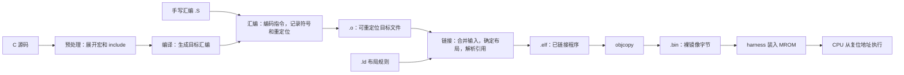

# 从源码名字到机器指令：汇编标签、符号表、ELF 与重定位入门

2026-10-25。面向已经接触 C 和处理器 RTL、但尚不熟悉汇编工具链的读者。示例使用本工程的 RV32E、GNU 工具链和 M5 S3 启动测试。

读完后应能解释：`__am_data_copy` 是什么、工具如何知道它的地址、为什么 `.o` 中有些地址尚未确定，以及 Python 如何把一条启动 store 替换成 NOP。

本文先建立“名字如何变成地址和字节”的基础。如何安排 ROM/RAM、编写 `.ld` 并建立 C 运行环境，接着阅读 [裸机程序如何启动](bare-metal-linker-script-and-startup.md)。阶段实现和验收仍以 [M5 S3](../post-c/5-ysyx-soc-integration/3-runtime-difftest.md) 为准。

## 1. 这些知识属于什么领域

它们主要属于**计算机系统中的程序表示、汇编与链接、可执行文件格式，以及裸机运行时**。可以按下面的关系学习：

| 领域 | 主要问题 | 本工程的对应内容 |
| --- | --- | --- |
| 指令集与程序的机器级表示 | 一条指令怎样编码？CPU 如何取指、跳转、访存？ | RV32E 的 `lw/sw/addi/jalr` |
| 编译工具链 | C/汇编怎样变成机器码？多个文件如何连接？ | GCC、GNU as、GNU ld |
| 目标文件格式与链接 | 名字、地址和待修正的引用怎样记录？ | ELF、符号表、重定位 |
| ABI 与运行时 | 函数如何传参、返回？谁准备栈和全局变量？ | `a0/sp/ra`、AM、`start.S` |
| 装载与调试 | 文件中的字节如何进入内存？如何观察运行结果？ | raw BIN、MROM backing、commit trace |

编译原理也会涉及其中一部分，但当前可以先掌握工具链的输入输出及各阶段的职责，再深入语法分析、优化算法等编译器内部实现。

建议分三轮阅读：先读第 2～6 节建立概念；亲手完成第 7 节的小实验；最后用第 8 节对照本工程源码。遇到具体名词时，先问：**这是给哪个工具看的？它描述名字、地址、文件内容，还是 CPU 动作？**

## 2. CPU 执行字节，人通过名字组织程序

先看一小段汇编：

```asm
.globl add_one
add_one:
  addi a0, a0, 1
  ret
```

其中有三类东西：

| 写法 | 类别 | 作用 |
| --- | --- | --- |
| `.globl add_one` | 汇编器指令 / directive，常称伪指令 | 声明符号的全局绑定属性 |
| `add_one:` | 标签 / label | 给当前位置取名 |
| `addi a0, a0, 1` | ISA 指令 | CPU 将寄存器中的值加一 |
| `ret` | 伪指令 / pseudoinstruction | 汇编器将其展开为实际指令，当前无 C 扩展时可对应 `jalr x0, 0(ra)` |

中文资料有时把 directive 和 pseudoinstruction 都称为“伪指令”，阅读时要根据作用区分。`.globl` 描述工具链元信息；`ret` 最终会变成 CPU 执行的指令。另一些 directive，例如 `.word`，会直接产生数据字节。

`a0` 是寄存器 `x10` 的 ABI 别名，不是符号表中的普通变量名。`ra` 是返回地址寄存器的别名。`add_one` 则是程序员取的符号名，链接器会给它确定位置。

在最终反汇编中，可能看到：

```text
20000018 <add_one>:
20000018: 00150513    addi a0,a0,1
2000001c: 00008067    ret
```

分别对应地址、机器码及便于人阅读的指令文本。`<add_one>` 是反汇编工具结合符号表添加的说明，CPU 不读取这串名字。

标签本身不占指令空间；删除一个没有被其他代码引用的标签，不等于删除它后面的机器指令。GNU 汇编器对标签的定义见 [Labels](https://sourceware.org/binutils/docs/as/Labels.html)。

## 3. 一份程序经过哪些阶段



`.S` 会先经过预处理，再汇编；图中省略了这条支路上的预处理框。GCC 是驱动程序，可以按参数调用多个阶段，并不只负责把 C 直接变成一个完整可执行文件。参见 [GCC：Overall Options](https://gcc.gnu.org/onlinedocs/gcc/Overall-Options.html)。

| 文件 / 选项 | 阅读时应怎样理解 |
| --- | --- |
| `.c` | C 源码 |
| `.s` / `.S` | 汇编文本；大写 `.S` 通常先做预处理 |
| `gcc -E` | 停在预处理结果 |
| `gcc -S` | 停在汇编文本 |
| `gcc -c` | 生成 `.o`，不做最终链接 |
| `.o` | 本工具链中通常也是 ELF，只是类型为可重定位文件 |
| `.a` | 多个目标文件组成的静态库归档，链接器按需要取用成员 |
| `.elf` | 本工程约定的已链接程序文件名；ELF 是格式，不只属于这一后缀 |
| `.bin` | 没有 ELF 头、节表、符号表的 raw image；装载器必须另外知道基地址 |
| `.map` | 链接器生成的文本布局报告，适合追踪内容来自哪个输入文件 |

**`.o` 已经可以包含机器码，但尚不能认为所有地址引用都已确定。** 多文件程序中，某文件引用的函数可能定义在另一个文件里，链接器需要把它们接起来。

## 4. 符号、标签、变量与 section 的区别

### 4.1 符号是工具链用来记录名字及其含义的对象

可以先将符号理解为一条记录：名字是什么、在哪里定义、对应什么值、属于哪个节、能否被其他文件引用。

符号可能来自不同地方：

| 来源 | 示例 | 最终通常表示什么 |
| --- | --- | --- |
| C 函数定义 | `int add_one(int x) { return x + 1; }` | 函数入口位置 |
| C 全局对象定义 | `int counter = 3;` | 对象的存储位置 |
| 汇编标签 | `__am_data_copy:` | 当前指令或数据的位置 |
| 链接脚本赋值 | `_stack_top = ORIGIN(sram) + LENGTH(sram);` | 脚本计算的边界值 |
| 对外部对象的引用 | `extern int counter;` 并在代码中使用它 | 尚待其他输入提供的定义 |

符号不保证都能在最终文件中找到：优化可能移除对象，链接可能回收节，strip 也可以删除符号信息。函数内的局部变量也不一定有独立的 ELF 链接符号，调试信息与链接符号表是不同机制。

### 4.2 声明、定义和引用

下面两个 C 文件可以帮助理解链接要完成的工作：

```c
/* reader.c */
extern int counter;
int read_counter(void) {
  return counter;
}
```

```c
/* storage.c */
int counter = 3;
```

`extern int counter;` 告诉编译器如何理解这个名字；真正的对象定义在 `storage.c`。`reader.o` 可以记录“需要 counter”，`storage.o` 则提供它的定义。最终链接时，引用被连接到对象的地址。

如果把第二份定义改成文件作用域的 `static int counter = 3;`，它具有内部链接，不能满足其他翻译单元对外部 `counter` 的引用。这里讨论的是普通静态链接，暂不展开动态库符号解析。

### 4.3 标签是定义符号的一种办法，不自动定义函数或区域

当前 [start.S](../../../abstract-machine/am/src/riscv/ysyxsoc/start.S) 中：

```asm
__am_data_copy:
  # 数据复制代码
__am_bss_clear:
  # BSS 清零代码
```

两个标签各自标记一个位置。它们不会自动生成调用、返回或范围检查。CPU 顺序执行到标签所在位置时，继续执行该地址处的机器指令。

Python 将 `[__am_data_copy, __am_bss_clear)` 当作一个范围，是**测试脚本与启动代码之间的约定**；汇编器没有因此建立一个叫 `__am_data_copy` 的独立 section。

### 4.4 section 是内容的组织单位

```asm
.section entry, "ax"
```

这条 GNU as directive 把后续内容放入名为 `entry` 的输入节；ELF 属性 `a` 表示需要分配运行空间，`x` 表示可执行内容。节名 `entry` 是工程自定义的。

本工程链接脚本用：

```ld
.text : { KEEP(*(entry)) *(.text .text.*) } > mrom
```

将 `entry` 等输入节收集进输出节 `.text`。所以在 `start.o` 里，启动标签与 `entry` 相关；在最终 ELF 里，它们位于 `.text`。

section 包含内容并有布局属性；symbol 则给内容中的位置或计算出的值命名。它们都可以有字符串名字，但属于不同对象。参见 [GNU as：Section](https://sourceware.org/binutils/docs/as/Section.html) 和 [GNU ld：Basic Script Concepts](https://sourceware.org/binutils/docs/ld/Basic-Script-Concepts.html)。

### 4.5 链接器符号不一定对应一个被分配的变量

`_stack_top` 的赋值不会创建一个存放栈顶地址的四字节变量。启动代码中的 `la sp, _stack_top` 取得边界值；不会从该地址读取一个“栈顶变量”。

在 C 中引用这种地址符号时，常用 `extern char _stack_top;` 配合 `&_stack_top`，或将边界声明为数组。具体正确/错误示例见 [启动笔记 §6](bare-metal-linker-script-and-startup.md#6-_stack_top-到底是什么c-和汇编如何使用它)，工具链规则见 [GNU ld：Source Code Reference](https://sourceware.org/binutils/docs/ld/Source-Code-Reference.html)。

## 5. 读懂汇编里的点号、下划线与局部标签

### 5.1 常见写法由谁解释

| 写法 | 含义 | 是否自动形成 CPU 动作 |
| --- | --- | --- |
| `.section entry, "ax"` | 选择输入节及其属性 | 否 |
| `.globl name` / `.global name` | 声明全局符号，使其他输入可引用该定义 | 否 |
| `.type name, @function` | 将符号类型记为函数 | 不会生成函数序言或调用 |
| `.size name, . - name` | 根据当前位置与起点之差记录字节大小 | 不会生成返回指令 |
| `.balign 4` | 对齐到 4 字节边界，必要时产生 padding | padding 会影响最终布局 |
| `.word 41` | 在本 RISC-V 实验中输出一个 32 位数据值 | 产生数据字节，不代表 CPU 执行“赋值 41” |
| `name:` | 定义当前位置的标签 | 不占指令字节 |
| `la t0, name` | 加载地址的伪指令 | 展开为实际指令；具体序列与工具链选项有关 |
| `lw a0, 0(t0)` | 从 `t0` 指向的地址读取一个 word | 是 |

`.globl` 设置的是链接绑定属性，不是自动保留所有符号的保证；局部符号也可能出现在 `nm` 中。`KEEP`、节垃圾回收和 strip 是另外的问题。详细定义见 GNU as 的 [Global](https://sourceware.org/binutils/docs/as/Global.html)、[Type](https://sourceware.org/binutils/docs/as/Type.html)、[Size](https://sourceware.org/binutils/docs/as/Size.html)、[Balign](https://sourceware.org/binutils/docs/as/Balign.html)。

### 5.2 `__am_data_copy` 的双下划线不是一种对象类型

可将这个名字读为“AM 运行时内部的数据复制位置”。`__` 是命名约定，不能决定它是函数、变量、标签还是宏；要查看定义语法。

例如 `__am_data_copy:` 是汇编标签，而 `__FILE__` 是 C 预处理器提供的宏，后者在预处理阶段展开。不能仅凭双下划线把二者归为一类。参见 [GCC：Standard Predefined Macros](https://gcc.gnu.org/onlinedocs/cpp/Standard-Predefined-Macros.html)。

C 中双下划线开头等名称属于实现保留名称，普通应用代码应避免自行使用；本工程这里是在底层运行时中定义符号约定。参见 [GNU C Library：Reserved Names](https://sourceware.org/glibc/manual/latest/html_node/Reserved-Names.html)。

### 5.3 `1:`、`1b`、`3f` 是另一套明确的汇编语法

当前 poison 循环中：

```asm
1:
  sw t1, 0(t0)
  addi t0, t0, 4
  bltu t0, sp, 1b
```

`1:` 是数字局部标签；`1b` 表示向后找最近的 `1:`，`3f` 表示向前找最近的 `3:`。`b/f` 分别是 backward/forward。数字标签可在文件中重复用于不同局部控制流，汇编器负责区分。

GNU ELF 工具链还常用 `.Lxxx` 表示临时局部标签，它们通常不会作为普通可见符号保留；这是工具识别的前缀规则，与 `__am_` 的工程命名约定不同。参见 [GNU as：Symbol Names](https://sourceware.org/binutils/docs/as/Symbol-Names.html)。

## 6. ELF 怎样记录符号和尚未确定的引用

### 6.1 先认识 ELF 的几类信息

| 内容 | 作用 | 查看命令 |
| --- | --- | --- |
| ELF header | 文件类型、目标机器、入口等总体信息 | `readelf -h` |
| Section headers | 各节的类型、地址、大小、文件偏移等 | `readelf -SW` |
| 符号表 `.symtab` | 名字对应的值、类型、绑定、所属节等 | `readelf -sW` / `nm` |
| 重定位节，如 `.rela.text.entry` | 记录哪些位置需要按符号地址修正 | `readelf -rW` |
| Program headers | 运行装载所使用的 segment 描述 | `readelf -lW` |
| `.text/.rodata/.data` 等内容 | 指令、常量和数据字节 | `objdump -d` / `objdump -s` |

本实验 `.o` 的文件类型为 `REL`，链接后的 `.elf` 为 `EXEC`。一般 ELF 还可以表示共享对象等类型；初学时先弄清当前静态裸机程序即可。

### 6.2 符号表里有哪些字段

`readelf -sW` 的常见列为：

```text
Num: Value  Size  Type  Bind  Vis  Ndx  Name
```

- `Value`：符号值；在可重定位对象中常是节内偏移，在最终可执行文件中常是地址。
- `Size`：关联对象的大小；未标注或未知时可以为 0。
- `Type`：如 `FUNC`、`OBJECT`、`NOTYPE`。
- `Bind`：如 `LOCAL`、`GLOBAL`、`WEAK`，描述链接时的绑定关系。
- `Vis`：符号可见性属性，与绑定是不同字段。
- `Ndx`：所属节索引，或 `UND`（未定义）、`ABS`（绝对符号）等特殊值。

具体数据结构由 [ELF：Symbol Table](https://gabi.xinuos.com/elf/05-symtab.html) 定义。这里的符号表不是 CPU 内部硬件表。

当前 S3 `memory` 的 ELF 中，`__am_data_copy` 是值为 `0x20000028`、大小为 0 的 `NOTYPE GLOBAL` 符号。它标记代码位置，但没有被 `.type` 声明为函数，也没有通过 `.size` 声明复制区域大小。因此脚本需要另一个标签作为结束边界。

### 6.3 `nm` 字母表示什么

| 常见字母 | 含义 |
| --- | --- |
| `U` | 本对象中未定义，需要其他输入提供定义 |
| `T/t` | 位于代码节 |
| `R/r` | 位于只读数据节 |
| `D/d` | 位于有初值的数据节 |
| `B/b` | 与 BSS 节关联 |
| `A` | 绝对符号 |

大小写通常对应全局/局部，但存在特例。`nm` 的字母是工具的归类，和 `readelf` 的 `Type` 列不是同一个字段。例如 `NOTYPE` 的代码位置标记也能显示为 `T`。参见 [GNU nm](https://sourceware.org/binutils/docs/binutils/nm.html)。

特别注意：当前实际 S3 ELF 的 `nm` 输出包括 `0f002000 B _stack_top`。它仍是脚本定义的栈顶边界，没有因此分配一个 BSS 变量。**应结合定义、节索引和最终地址解读，不应把字母直接等同于 C 对象类型。** 绝对/节相对符号的细节见 [启动笔记 §6.4](bare-metal-linker-script-and-startup.md#64-绝对符号与节相对符号)。

### 6.4 重定位：把符号引用落实到具体指令或数据

假设 `entry.S` 调用 `add_one`，而函数定义在 `helper.S`。独立汇编 `entry.S` 时，还不知道最终两个节会被放到哪里；汇编器仍可生成指令框架，并记录待链接器处理的重定位项。

一条重定位记录主要回答三个问题：

1. **改哪里？** 某个输入节内的字节偏移。
2. **引用谁？** 目标符号或相关位置符号。
3. **怎样算、怎样写？** 由重定位类型决定，例如绝对地址、PC 相对位移，以及写入哪些指令位域。

链接器完成布局后，解析符号并应用这些规则。例如 `call add_one` 可以由一组 PC 相对指令实现；`la t0, value` 可以由 `auipc/addi` 实现。并非每个引用都直接塞入一个完整 32 位绝对地址，RISC-V 的成对高/低位重定位也有专门配合规则。

这里的“重定位”是在生成程序时修正地址引用；启动时把 `.data` 从 ROM 复制到 RAM 是另一件事。两者可能共同参与裸机启动，但不能混用概念。参见 [ELF：Relocation](https://gabi.xinuos.com/elf/06-reloc.html)。

## 7. 小实验：亲眼观察名字变成地址

这个实验只做汇编、链接和文件检查，不依赖 SoC 仿真。下面几段命令应在同一个 Bash 会话中按顺序执行。需要本工程使用的 `riscv64-linux-gnu-*` 工具；虽然前缀包含 64，参数会选择 RV32E 和 ELF32。

### 7.1 创建两个汇编文件和布局脚本

```bash
symbols_lab=$(mktemp -d /tmp/npc-symbols-lab.XXXXXX)

cat > "$symbols_lab/entry.S" <<'EOF'
.section .text.entry, "ax", @progbits
.globl _start
.type _start, @function
_start:
  la t0, value
  lw a0, 0(t0)
  call add_one
  ebreak
.size _start, . - _start
EOF

cat > "$symbols_lab/helper.S" <<'EOF'
.section .text.add_one, "ax", @progbits
.globl add_one
.type add_one, @function
add_one:
  addi a0, a0, 1
  ret
.size add_one, . - add_one

.section .rodata.value, "a", @progbits
.balign 4
.globl value
.type value, @object
value:
  .word 41
.size value, . - value
EOF

cat > "$symbols_lab/layout.ld" <<'EOF'
ENTRY(_start)
SECTIONS {
  . = 0x20000000;
  .text : { *(.text.entry) *(.text .text.*) }
  .rodata : { *(.rodata .rodata.*) }
}
EOF
```

`entry.S` 引用另外一个文件里的 `value/add_one`。`value` 的标签记录数据位置，真正产生四字节初值的是 `.word 41`。`@progbits` 表示该节有实际内容；`.type value, @object` 则设置符号类型，这两者也不是同一个属性。

这个最小布局脚本只为实验安排地址，没有当前 AM 完整的 RAM、栈、设备初始化或退出协议。本文不将它作为 M5 验收程序运行。

### 7.2 只汇编，还不链接

```bash
riscv64-linux-gnu-gcc -march=rv32e_zicsr -mabi=ilp32e \
  -fno-pic -mno-relax -c "$symbols_lab/entry.S" -o "$symbols_lab/entry.o"
riscv64-linux-gnu-gcc -march=rv32e_zicsr -mabi=ilp32e \
  -fno-pic -mno-relax -c "$symbols_lab/helper.S" -o "$symbols_lab/helper.o"

riscv64-linux-gnu-nm "$symbols_lab/entry.o" "$symbols_lab/helper.o"
riscv64-linux-gnu-readelf -rW "$symbols_lab/entry.o"
riscv64-linux-gnu-objdump -dr "$symbols_lab/entry.o"
```

本地验证时，`nm` 的关键输出为：

```text
entry.o:
00000000 T _start
         U add_one
         U value

helper.o:
00000000 T add_one
00000000 R value
```

`U` 表明 `entry.o` 引用了两个外部定义。`helper.o` 中两个符号都显示零，不表示它们占同一运行地址：它们各自在不同输入节的偏移 0，最终地址尚未分配。

重定位表中可以看到与 `value` 相关的 `R_RISCV_PCREL_HI20`、配对的 `R_RISCV_PCREL_LO12_I`，以及与 `add_one` 相关的 `R_RISCV_CALL`。工具链版本可能使用其他等价的调用重定位类型，或附带 `R_RISCV_RELAX` 等辅助记录；先观察引用目标及需要修正的位置。

### 7.3 链接后，再看地址与指令

```bash
riscv64-linux-gnu-ld -melf32lriscv --no-relax \
  -T "$symbols_lab/layout.ld" -Map="$symbols_lab/demo.map" \
  "$symbols_lab/entry.o" "$symbols_lab/helper.o" -o "$symbols_lab/demo.elf"

riscv64-linux-gnu-nm -n "$symbols_lab/demo.elf"
riscv64-linux-gnu-readelf -sW "$symbols_lab/demo.elf"
riscv64-linux-gnu-objdump -d -M no-aliases "$symbols_lab/demo.elf"
```

`--no-relax` 在链接阶段关闭 relaxation，即某些指令序列的缩短/改写，便于本次逐条对照；这是教学实验的选项，不是在要求修改项目的优化策略。

本地输出为：

```text
20000000 T _start
20000018 T add_one
20000020 R value
```

在当前选项下，反汇编中最值得观察的部分是：

```asm
# 原来的 la t0, value
20000000: 00000297    auipc t0,0
20000004: 02028293    addi  t0,t0,32

# 原来的 lw a0, 0(t0)
20000008: 0002a503    lw    a0,0(t0)

# 原来的 call add_one
2000000c: 00000097    auipc ra,0
20000010: 00c080e7    jalr  ra,12(ra)
```

这是反汇编摘录，不是可以直接汇编的源文本。第一组指令得到 `0x20000000 + 32 = 0x20000020`，随后 `lw` 才读取该地址处保存的 `41`。调用指令组的目标是 `0x2000000c + 12 = 0x20000018`。

因此：**取得 value 的地址、读取 value 的内容、跳到 add_one 执行，是三种不同动作。**

### 7.4 ELF 转成 BIN 后，名字到哪里去了

```bash
riscv64-linux-gnu-objcopy -O binary \
  "$symbols_lab/demo.elf" "$symbols_lab/demo.bin"
od -An -tx1 -v "$symbols_lab/demo.bin"
wc -c "$symbols_lab/demo.bin"
```

当前实验 BIN 为 36 B，最后四字节是 `29 00 00 00`：十进制 41 即十六进制 `0x29`，按小端序保存。

这份 raw BIN 不包含 `_start/add_one/value` 的符号表。地址引用在链接时已经确定，CPU 执行不依赖这些名字。调试/补丁脚本若还想按名字定位，就需要保留对应 ELF、map 或另行导出的地址信息。参见 [GNU objcopy：binary 输出](https://sourceware.org/binutils/docs/binutils/objcopy.html)。

## 8. 把基础知识用于 S3：从标签找到要替换的 store

### 8.1 poison 与负例各在哪里

| 内容 | 源码入口 | 具体作用 |
| --- | --- | --- |
| poison | [start.S](../../../abstract-machine/am/src/riscv/ysyxsoc/start.S) 的第一个循环 | CPU 向 SRAM 的 2048 个 word 写入 `0xa5a5a5a5` |
| 获取符号地址 | [m5_s3_test.py](../../../npc/tests/m5_s3_test.py) 的 `symbols()` | 调用 `nm` 读取 ELF，生成名字到数值的字典 |
| 生成启动负例 | 同一脚本的 `negatives()` | 复制原始 BIN，再分别替换两段循环里的 store |
| C 自检 | [memory.c](../../../npc/tests/soc-runtime/memory.c) 的 `check()` 与 `main()` | 检查 data 初值和 bss 零值等，不符合预期则 `halt(1)` |
| 失败码与退出 | [trm.c](../../../abstract-machine/am/src/riscv/ysyxsoc/trm.c) 的 `halt()` | 将 code 放进 `a0`，执行 `ebreak` |
| 观察 GPR 与提交 | [soc_monitor.sv](../../../npc/sim/soc_monitor.sv)、[main.cpp](../../../npc/csrc/soc/main.cpp) | 从 x10 取得 a0，记录提交；在退出时检查非零状态 |

poison 是“先填入特定图案以暴露未初始化使用”的验证方法。当前它直接写在启动汇编中，不是 Python 偷偷预填 SRAM，也没有单独的 poison 开关。正常程序和被修改后的两个启动负例都会先执行它。

负例是有意制造错误、预期被检查发现的测试。两个启动负例分别命名为 `missing-data-copy` 和 `missing-bss-clear`；它们互相独立，每个都从未修改的 memory 镜像开始生成。

### 8.2 标签地址、BIN 偏移和指令编码如何对应

当前 S3 `memory` 镜像的关键值如下，修改程序后应重新从对应 ELF 获取，不能固定抄用：

| 内容 | 地址 / 编码 |
| --- | --- |
| `__am_data_copy` | `0x20000028` |
| `__am_bss_clear` | `0x20000058` |
| `__am_runtime_ready` | `0x20000078` |
| data-copy 的 `sw a0, 0(t1)` | PC `0x20000048`，机器码 `0x00a32023` |
| bss-clear 的 `sw zero, 0(t0)` | PC `0x2000006c`，机器码 `0x0002a023` |

脚本先从 ELF 得到区间，再按下面的逻辑处理 BIN：

```python
for pc in range(sym[start], sym[end], 4):
    offset = pc - 0x20000000
    ins = int.from_bytes(data[offset:offset + 4], "little")
    if (ins & 0x7f) == 0x23:
        data[offset:offset + 4] = (0x00000013).to_bytes(4, "little")
        count += 1
assert count == 1
```

每一步的含义为：

1. 当前 ISA 不含压缩指令，所选区间全部是 32 位指令，因此按 4 B 遍历。
2. 当前这段代码的 VMA = LMA，BIN 的起点对应 `0x20000000`，所以 `pc - 0x20000000` 得到文件偏移。
3. 小端解码把四个文件字节恢复为一个 32 位指令值。
4. `ins & 0x7f` 取指令最低 7 位 opcode；`0x23` 对应整数 store 类指令。这里的两个受控区间各只有一条 `sw`，脚本检查替换数必须为 1。
5. `0x00000013` 是 `addi x0, x0, 0`，即标准 NOP。写回四字节而不是删除四字节，使后续地址和分支布局保持不变。NOP 仍会执行并推进 PC。

NOP 的定义可查 [RISC-V RV32I：NOP Instruction](https://docs.riscv.org/reference/isa/v20260120/unpriv/rv32.html#_nop_instruction)。

以 data-copy store 为例：

```text
PC 0x20000048 → BIN offset 0x48
原始字节：23 20 a3 00 → 指令值 0x00a32023 → sw a0,0(t1)
修改字节：13 00 00 00 → 指令值 0x00000013 → nop
```

这不是通用的任意 ELF 补丁器。换成压缩指令、代码与数据混排、不同 VMA/LMA 或不同 raw image 基址时，上述假设要重新核查。只用 opcode 匹配也不能在任意二进制范围中可靠识别指令边界。

**脚本读取 ELF 的符号信息，修改的是新生成的 BIN 副本；没有修改原始 `.S` 或 ELF。** 因此反汇编原始 ELF 仍会看到原来的 `sw`。两个 store 都在循环体内，替换一次机器指令，就会使该循环的每一轮都缺少相应写入。

### 8.3 为什么出现非零 a0

| 负例 | 未初始化后的数据 | 首个自检条件 |
| --- | --- | --- |
| missing-data-copy | `initialized[0]` 仍为 `0xa5a5a5a5` | `initialized[0] == 0x01234567` 为假 |
| missing-bss-clear | `zeros[0]` 仍为 `0xa5` | `zeros[0] == 0` 为假 |

随后执行：

```text
check(false)
  → halt(1)
  → mv a0, 1；ebreak
  → harness 报 ebreak with nonzero a0
  → 仿真器进程返回非零
```

这里直接调用 `halt(1)`，没有走到 `main()` 的 `return`。正常返回时还有 `_trm_init` 中的 `halt(main(mainargs))` 这条路径。

“ebreak 时用 a0 表示成功/失败”是本工程的运行环境约定，不是所有 RISC-V 程序都遵循的退出语义。DUT 和 NEMU 执行同一份被破坏的程序时可以保持一致；上述错误由程序中独立的预期值检查发现。

Python 的 `run(..., expected=...)` 同时检查非零进程状态及指定报错文本。只有以预期方式失败，才将该负例测试记为 PASS；任意超时或崩溃并不等价。

### 8.4 实际运行和观察 a0

回到工程根目录、配置好 `AM_HOME/NPC_HOME` 后，完整入口是：

```bash
make -C npc s3-test
```

它先构建 SoC 仿真器与 NEMU 参考库，再执行 `m5_s3_test.py`。两个负例镜像生成在 `npc/build/m5-s3/`。这个脚本组织 S3 主测试套件；S2 完整回归、独立 AM run 入口检查等另有执行入口。

已有镜像时，可以单独记录一个负例的提交轨迹：

```bash
case_name=missing-data-copy
# 将上面改为 missing-bss-clear，可检查另一负例。

npc/build/ysyxsoc/VysyxSoCFull \
  --mrom "npc/build/m5-s3/${case_name}.bin" \
  --diff nemu/build/ysyxsoc/nemu-ref.so \
  --commit-trace "npc/build/m5-s3/${case_name}.commit.csv"

tail -n 1 "npc/build/m5-s3/${case_name}.commit.csv"
```

仿真命令预期返回 1；在普通交互式 Bash 中继续执行 `tail`，不要用要求前一条成功的 `&&` 串接。若在启用了 `set -e` 的自动脚本中运行，应显式接收这个预期失败。

CSV 没有表头，字段顺序为 `时间, PC, 指令, a0, flags, cause, 访存地址`。时间为十进制，其余为十六进制；最后一行的第三列应为 `100073`（ebreak），第四列应为 `1`。

2026-10-25 对现有两个负例镜像分别开启 commit trace 重跑，二者最后一条提交均为 PC `0x20000378`、指令 `0x00100073`、`a0=1`，并以 `ebreak with nonzero a0` 退出。原 S3 [data-copy 负例日志](../post-c/5-ysyx-soc-integration/s3-validation/missing-data-copy.log) 和 [bss-clear 负例日志](../post-c/5-ysyx-soc-integration/s3-validation/missing-bss-clear.log) 只记录非零判定，没有直接打印 a0 数值。

poison 的检查则看 `startup_evidence()`：它从实际总线记录核对前 2048 个 SRAM word 写入的地址、数据、写掩码及响应。原始结果摘要在 [startup.json](../post-c/5-ysyx-soc-integration/s3-validation/startup.json)。

## 9. 自己检查是否理解了

建议先独立回答，再看右列。

| 问题 | 检查要点 |
| --- | --- |
| 给 `__am_data_copy` 换名字，CPU 行为会自动改变吗？ | 同步修改所有引用、保持生成指令不变时不会；但遗漏 Python 对标签名字的依赖会使测试失败 |
| `.globl` 能让 CPU 调用某段代码吗？ | 不能；调用需要实际跳转指令 |
| `.type foo, @function` 会自动补 `ret` 吗？ | 不会，它设置符号类型元信息 |
| 为什么 `.o` 中两处 `00000000` 不一定是同一位置？ | 可能分别是不同输入节的起点；需结合文件和所属节理解 |
| 为什么看起来已经有机器码，还需要重定位？ | 外部目标和最终布局尚未确定，需要修正指令/数据中的地址引用 |
| BIN 没有符号表，Python 为什么仍能按名字找到指令？ | 地址来自同一次构建的 ELF，之后转换为 BIN 偏移 |
| `_stack_top` 在 nm 中显示 B，说明有一个 BSS 变量吗？ | 不能这样判断；要看脚本定义，符号的节关联不代表额外分配存储 |
| 替换 store 为 NOP 与直接删掉四字节有什么不同？ | 等长替换保持布局；删除会移动后续字节，使既有地址和位移失效 |
| 两个负例为什么不能只靠 DUT/REF 相等验收？ | 二者可以一致地执行有缺陷的软件；程序需要用独立预期判断初始化是否正确 |

继续读工程源码时，可以沿这条路线：`start.S → ysyxsoc.ld → memory ELF 的 nm/objdump → m5_s3_test.py 的 symbols()/negatives() → memory.c 的 check() → trm.c 的 halt() → C++ 的退出检查`。每到一处，说明它接收什么、产生什么，以及下一层如何使用这些信息。
