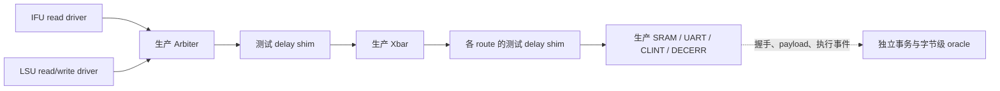
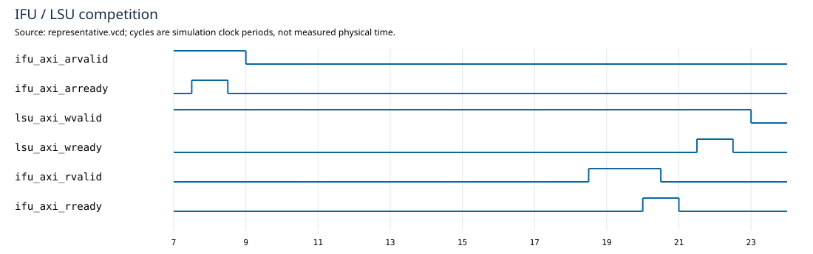
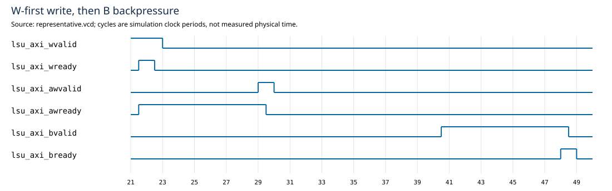
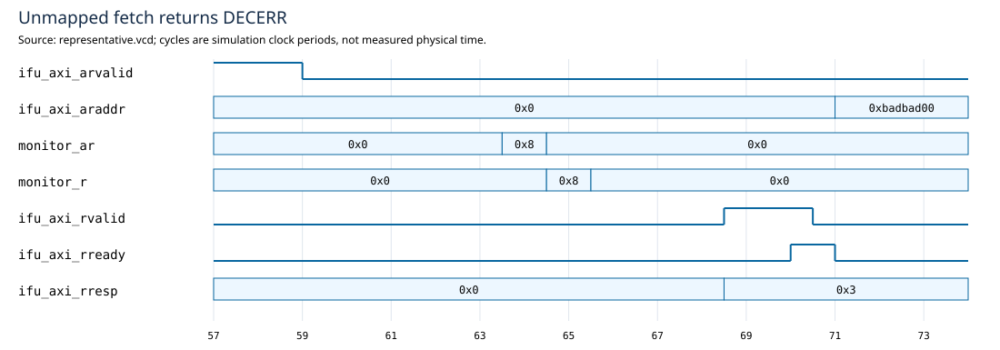

# M3 S5：完整互联、RT-Thread 与覆盖收尾

2026-10-15；**S5 PASS，无未解决的功能阻塞**。起点 `5947ffddd01b20df581e52375c8e7e8b3dcb52d1`，初始工作区干净。M3 的功能/协议仿真验收结论见 [signoff.md](signoff.md)，候选源码和原始证据见 [s5-manifest.json](s5-manifest.json)。不包含 formal、四值、综合/STA 或物理实现 sign-off。

## 1. 测试架构与延迟契约

新增 [axi4lite_delay_shim.sv](../../../../npc/tests/axi4lite_delay_shim.sv)：AR/AW/W/R/B 各有独立的一项 payload buffer。空槽且 accept_enable 时接收，按接收时锁存的 delay 等待，发布后保持 VALID/data 到握手；两侧不要求同时握手，不逐周期随机撤销 VALID。



[完整 fabric top](../../../../npc/tests/axi4lite_fabric_test_top.sv) 使用真实 Arbiter/Xbar/slaves，容量为 **12 KiB**，包含非 2 的幂次边界。两端的独立延迟使上游发布顺序、Xbar ingress 顺序和实际设备 AW/W 接受顺序都可变化。只在 Arbiter 后加 shim 不足以改变设备侧顺序：Xbar 收齐写后会再次同时发布 AW/W，本轮发现该覆盖 hole 后增加设备边界 shim，再用实际握手顺序检查关闭。

真实 Core 则用 `NPC_PLATFORM=b1 B1_SIM_SHIM=1` 构建测试变体，只在 Core wrapper 单 master 输出与 Xbar 之间加 shim。默认生产配置不实例化它；变体输出到独立的 `build/b1-1048576-1000000-shim/`。host 使用 MT19937，`NPC_SHIM_SEED` 固定 seed，每通道延迟 0–7，接收门控每周期独立取位（约 50%），每 8 周期强制开放一次。延迟参数只在握手时采样。原 `--ram-*` 参数仍不用于 B1。

## 2. 独立 scoreboard 与结果

[fabric TB](../../../../npc/tests/axi4lite_fabric_tb.cpp) 的 oracle 不以 DUT target 或 error 决策生成预期：按完整地址、PROT、WSTRB 独立计算 route/resp，维护字节数组和独立 64-bit 时钟计数。上下游握手检查唯一 owner、payload、响应次序、RR 和重复接收；每个有效 R 周期都核对预期值。

SRAM 执行时刻由设备接口接受 AW/W 的边沿推导，实际写执行脉冲另外观察并逐周期比较；读回及 drain/reset 时全数组扫描检查 byte mask、越界别名和错误副作用。UART 输出事件逐周期核对，CLINT 按设备 AR 边沿采样更新前时钟值。reset 丢弃控制状态和在途请求，保留已发生的 SRAM/UART effect，参考计数按 epoch 记账。

| 检查 | 最终结果 |
| --- | --- |
| 随机 | seeds 1–10，每 seed 至少 **1000 笔完成**；每 100 笔 drain 后另发一笔并在随机阶段 reset |
| 全部事务记账 | **10510 accepted = 10350 completed + 160 reset-aborted**；最终无 outstanding |
| 副作用 | 780 次成功非零 strobe 写，其中 704 次 SRAM 实际执行、76 次 UART 字节事件；错误/zero-strobe 无副作用 |
| 运行量 | 371658 cycles；导出 **284 个有命中计数的 bin** |
| 五通道 stall | 施加 0/1/7/64/129 周期；实际等到该通道 VALID 才阻塞，检查指定 stall 已施加完毕；129 是超出常规 64 上限的长停顿用例 |
| AW/W | 上游发布/接受与下游接受均命中 AW-first/W-first/same；实际上游握手 gap 命中 0/1/7/64/129 |
| 竞争与守恒 | 两个 winner × LSU read/write，RR 顺序逐笔检查；read/write transition × 合法 owner 全命中 |
| 地址/错误 | 两个 master 的合法 type × 四 route × 所有允许的 response 共 17 个必测组合；首末 word、region 前后、非对齐和保留地址 |
| SRAM lane | 首/末 word × 16 个 WSTRB，32 bins；随机地址/数据与全内存核对 |
| reset | idle 1 例；LSU 四 route × 12 阶段；IFU 四 route × 5 阶段，合计 **69 场景** |
| timer | low-word rollover 实际触发 high-low-high 重试；拼接值等于独立 oracle 在 low AR 边沿记录的完整 64-bit 值 |

reset 阶段覆盖 owner 预留、上游 AR/AW-only/W-only/AW+W、设备收齐写但未执行、写已执行、上游 R/B holding、设备 read 已采样、下游响应已进入 buffer 尚未返回 master。不能把 69 场景说成所有内部状态的全笛卡尔覆盖；阶段定义、合法组合与 checker 才是验收边界。

fabric 的单事务阶段等待收紧至 1024 周期，队首请求服务/持续竞争进度窗口收紧至 2048 周期。当前最长定向组合的保守上界为控制开销 64 + 请求 gap 129 + 接收门控 129 + 两层通道 delay 258 + 上游 response hold 129 = 709 周期，取 768 留余量；两 master 的轮转服务小于 1536，均低于 watchdog。随机场景的 delay/gap 只有 0–7。redirect 小型 TB 另有每场景 4096 周期保护。此结论依赖有限 channel stall、补齐 AW/W 和最终接收响应的环境；不宣称外部无限拒收时仍能完成。全局单事务及各级 buffer 深度不变，未通过放宽 watchdog 掩盖 hang。

## 3. redirect 与真实软件

[redirect TB](../../../../npc/tests/axi4lite_redirect_tb.cpp) 连接真实 IFU、adapter 和 Arbiter，用 LSU read/write 占用总线，再控制 IFU 响应。三阶段 × OKAY/SLVERR/DECERR × 两类 LSU 竞争，共 **18 bins PASS**：

1. IFU 已发布 AR，等待被 LSU 占用的 Arbiter；
2. 旧 AR 已接受，尚未返回 R；
3. IFU adapter 的 R 握手与 redirect 同拍。

所有组合均检查旧指令不进入 IFQ、新目标 PC/NOP/prediction/error 正确。错误响应由 read-only scripted slave 在产生响应前选择，不先执行写再改 BRESP。保留原 M2 IFU+adapter 定向测试；真实 Core 的 SRAM 末端 stale DECERR 程序仍通过。

系统回归全部打开 GPR/CSR DiffTest 与现有 RTL assertions：

| workload | 结果 |
| --- | --- |
| S4 系统入口 | **53/53 PASS**，包括 34 CPU、hello、lanes、uptime、yield-os、14 精确异常、末端 redirect |
| yield-os 加强 | 每上下文 100 次，共严格 `AB` × 100；201 个 cause 11；23933 commits / 395282 cycles |
| 随机 Core | add、bubble-sort 各 seeds 1–10，**20/20 PASS**，每次架构 trace hash 与固定配置一致 |
| hello 参数 | `I-love-ysyx` 与空 mainargs 均逐字匹配；空参数为 383 commits / 6245 cycles |
| RT-Thread | 固定配置和 shim seed 42 各一轮 PASS；两轮架构 trace hash 完全相同 |
| S5 补充系统总数 | 20 随机 CPU + 2 RT-Thread + 1 空参数 hello，**23/23 PASS** |
| 兼容性 | legacy 固定 add 架构 trace PASS；不是重新宣称本轮跑了全部 legacy CPU tests |

### RT-Thread 冻结输入与进度判据

本地 RT-Thread revision 为 `beb7fa16e7d282c9409cfbb78225249d193e276e`（5.0.1）。[独立配置/Makefile/workload](../../../../npc/tests/b1-rtthread/) 使用该仓库 kernel 和 AM BSP 的 `context.c`，自行提供最小启动和无硬件中断的 hooks。未改动上游 BSP，不依赖其本机绝对路径 `files.mk`，也不运行 shell、伪 RX、文件系统或 timer-preemptive scheduling。

两个相同优先级线程使用 8 KiB 静态栈，每线程分配 128 byte，逐轮检查局部计数、另一个线程进度及全部 128 byte 内容；各执行 100 次有标记迭代，严格输出 `AB` × 100。释放后检查 heap used 回到启动基线、peak 确实增加且未超总容量，最后输出 `RTTHREAD PASS iterations=100,100 heap_restored=1` 并 GOOD TRAP。

默认 1 MiB 满足本 workload 的静态区、链接栈和 heap 检查；ELF 布局与镜像归档，不推广成所有 RT-Thread 配置都能放入 1 MiB。两轮均为 **262561 commits、203 个 cause 11**；固定时序 3771422 cycles，shim seed 42 为 7598355 cycles。首次测试因误以为新线程插到同优先级队尾而在进度断言失败，按本地 scheduler 的实际 ready-list 行为反序 startup 后通过；这是 workload 调度假设修正，没有改 scheduler 来迎合输出。

## 4. 覆盖、静态检查与波形

[覆盖 checker](../../../../npc/tests/b1_coverage_check.py) 枚举必测合法 bin，缺失即失败；不能用随机 seed 数代替命中率。汇总见 [s5-coverage-summary.csv](s5-coverage-summary.csv)，结构性 N/A 见 [s5-exclusions.csv](s5-exclusions.csv)。IFU write、UART read OKAY、CLINT write OKAY、default OKAY/SLVERR、生产 EXOKAY 等不属于合法 bin；未激励的合法行为不能改成 N/A。

原 Arbiter/Xbar/slave 定向、随机和参数守卫重跑通过，提供完整系统中无法自然触发的直接 PROT、slave 内部 reset/rollover 等证据。S3 曾跑过的额外容量不假称本轮全部重跑。三种生产顶层 lint 仅保留已知 immediate 未使用位告警；新 fabric/redirect 构建使用 strict warnings，定向豁免 reset/SVA 的 SYNCASYNCNET 与测试 shim 同文件双 module 的 DECLFILENAME。host LLVM 头的旧宏重复告警未扩展成新 RTL 问题。

三段图来自实际 VCD，不是示意波形。原始 `representative.vcd` 及 [转换脚本](../../../../npc/tests/b1_waveforms.py) 一起归档；[index.json](waveforms/index.json) 记录源文件 hash、信号和截取范围。每周期先记录沿前输入，再记录上升沿后的寄存输出，因此能够观察有效握手条件；横轴为仿真周期，不是物理时序测量。







本机未发现 `sby`、`yosys`、`iverilog`；formal 和四值仿真明确未运行。VCD/周期计数不构成 STA；未执行 DC/PT、门级仿真、功耗或 PnR。这些不在本阶段功能仿真 PASS 内。

## 5. 周期基线与复现

| workload | commits | B1 固定 cycles | shim seeds 1–10 cycles |
| --- | --- | --- | --- |
| add | 1095 | 16402 | 32972–33260，均值 33107.1 |
| bubble-sort | 2871 | 47889 | 97433–97826，均值 97641.1 |
| hello（I-love-ysyx） | 460 | 7609 | 未做 10-seed 实验 |

这些是同镜像、相同架构提交的时序模型对照，额外寄存 buffer 和延迟会增加 CPI，不是优化收益。seed 相同也不代表 legacy C++ RAM 与新 shim 给出了同一延迟序列。软件在 commit ebreak 停机，统计不混入强行 drain；fabric TB 则必须 drain 后无 outstanding。

补充 host 速率观察：本轮带 commit trace 的固定 RT-Thread 进程为约 3.27 秒 / 3771422 ticks，约 1.15 Mticks/s；shim 约 6.56 秒 / 7598355 ticks，约 1.16 Mticks/s。窗口包含进程启动/初始化，精确原值见 commands.json，不是稳定的时钟校准或 Fmax。确定性回归仍统一 MTIME_HZ=1 MHz；需要贴近 host wall time 时应另选稳定运行窗口校准并重建 AM，不改回 host timer 数据源。

```bash
# 一条聚合入口：lint -> module/directed -> fabric -> system -> coverage
make -C npc b1-signoff

# 可单独复现的子集
make -C npc b1-directed-regress
make -C npc b1-random-regress
make -C npc b1-system-regress
make -C npc b1-coverage-check

# 从实际 VCD 重新导出三段图
python3 npc/tests/b1_waveforms.py \
  npc/build/b1-fabric-test/representative.vcd \
  docs/notes/post-c/3-axi4-lite-interconnect/waveforms
```

聚合入口通过后，因补强 reset 阶段、实际 AW/W gap、SRAM effect 与精确 timer sample，单独重跑最终 fabric/coverage 子集；最终原始日志以 manifest 指定的最终文件为准，不将早期较小测试计数混入结果。首次编译遇 ccache 沙箱权限，授权后解决；开发过程中修正 TB 的波形时间类型和采样位置、未使用观察信号与覆盖缺口，未发现新的生产 RTL 功能 mismatch。

原始源码、BSP/config、ELF/bin、reference、日志、CSV、VCD/SVG 与命令保存到 `artifacts/m3-s5-20261015.tar.gz`，目前为本地归档。**下一步 M4：最小综合/STA flow、工具和工艺输入审计以及首版面积/时序基线；本轮没有提前给出 PPA 数字。**
