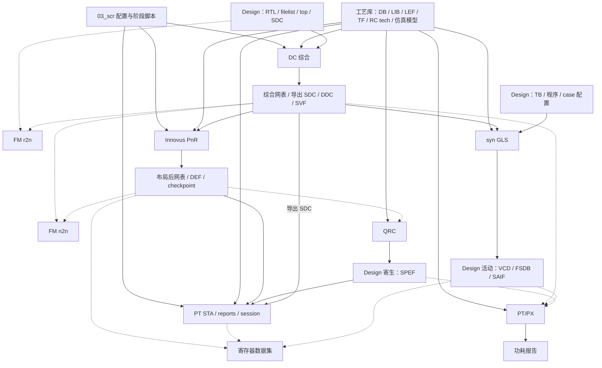

# S0：ref-flow 流程图与逐级输入输出

2026-10-15；依据本地裁剪快照静态阅读，**未复现运行**。本地任务是理解并蒸馏 flow；PDK/标准单元/SRAM 库等已由用户确认保留在服务器，沿用脚本中的路径，不要求本地补拷。本文中的路径相对 `npc/ref-flow/`，绝对库路径以 `03_scr/env/auto.tcl` 为准。

> 补拷状态更新：本文保留首次阅读时的契约与推断；`run.sta`、`run.qrc` 和部分 GLS 入口现已补齐，最新状态见 [missing-files.csv](missing-files.csv)。本文旧缺失标注不作为当前待补清单。

## 1. 两种关系：执行顺序与数据流

下面是根 `Makefile` 的默认依赖顺序，箭头表示先执行什么，不能据此推断后一阶段消费前一阶段的全部产物。`*_single` 可以跳过 make 依赖；`pv` 只是打印待实现提示，不属于 `all` 链。

下面按脚本读取的文件画实际数据流。FM 主入口、QRC launcher、默认 PX 入口和 dataset driver 缺失的部分，用虚线标为推断/待补脚本核对；其余是当前可读脚本的配置关系，不表示已经验证文件之间版本一致。

图中 `NET → STA` 指导出的 SDC，STA 网表来自 `PHY`。PX 的实际输入选择有两条证据：根 Makefile 调用的 `time_based_power.tcl` 尚缺；现有 `pt_power_param.tcl` 默认读 `openC906_syn_sg.v`、`openC906_func.sdc`、`coremark_sg.vcd`，且寄生读取默认关闭。不能把它描述为根链已确认的“post-route 网表 + SPEF 功耗”。同样，`sim` 根目标固定调用 `11_sim/syn` 并设 `SRAM_IMPL=fpga`，其 DUT 是综合网表，并不消费 STA session。

## 2. 输入分类规则

| 类型 | 例子 | NPC 蒸馏时如何处理 |
| --- | --- | --- |
| **工艺库相关** | 标准单元/SRAM `.db`、`.lib`、cell `.v` 模型；LEF、TF、Milkyway reference、TLU+、QRC tech | 保留服务器路径与配置变量；本地无需存在，也不进入 missing-files。使用哪个库/corner 是配置选择 |
| **Design 相关** | top、RTL/filelist、SDC、UPF、floorplan/PG/CTS 约束、网表、DEF、SPEF、TB、程序、波形 | 分清手写输入和生成物；NPC 需要替换设计内容或自己生成，不能复用 C906 数据 |
| **Flow 控制相关** | Makefile、launcher、Tcl/Python 驱动、Kconfig、阶段配置、report parser | 直接学习/裁剪的对象；被引用但未拷贝的脚本进入 missing-files |
| **工具环境相关** | DC/PT/FM/Innovus/QRC/VCS/Verdi、license、DesignWare 安装资源 | 服务器执行时核对；不以本地缺工具阻塞 S0，不列作漏拷脚本 |

特别注意：**SPEF 是该 design 的布线提取结果，不是通用 PDK 文件**。SRAM 的单元视图属于库，选择哪种宏、如何连接/分 bank 属于 design。`auto.tcl` 同时包含上述各类信息；`timing_margin.tcl`、`dontuse.tcl`、tap/PG/CTS 脚本也常混合工艺 cell 名、设计时钟和工程策略，应逐项分类，不能只按文件夹归类。

## 3. 主 flow 各级的输入输出

`确认` 表示存在可读脚本；`推断` 表示入口缺失，只能依据调用者/README/消费者推导契约。详细缺口见 [missing-files.csv](missing-files.csv)。

| 阶段 / 入口 | 工艺库相关输入 | Design 相关输入 | 输出及去向 | 证据与蒸馏决策 |
| --- | --- | --- | --- | --- |
| 00_indata 输入区 | DB/LIB/VLG、TF/LEF/MW/QRC | C906 RTL、filelist、`SDC/C906_TOP.sdc`；条件 UPF | 向各阶段提供原始输入，本身不是执行阶段 | `03_scr/env/auto.tcl`；保留库路径，NPC 替换设计输入 |
| 03_scr 配置 | 库路径、PVT/corner 与物理技术选择 | top、RTL/SDC、FLOW_TAG、netlist/wave 路径 | `auto.tcl` 变量供 syn/PNR/STA/PX 使用；Kconfig 分支生成配置 | `env/auto.tcl`、Kconfig Makefile；初版 NPC 使用小配置，不要求迁移 Kconfig |
| 04_syn / `00_flow_entry.tcl` | STD/SRAM DB；TOPO 时 MW/TF/TLU+ | RTL list/top/define、SDC；LOW_POWER_MODE 时 UPF；可选物理约束 | `05_output/<TAG>/` 下网表、DDC、SDC、SVF；TOPO 时 DEF；`01_middata/<TAG>/{NETLIST,SDC,DDC,...}` 与 QoR/timing/power 报告 | **确认**：00–05 Tcl；保留分步与报告，蒸馏为非 TOPO 的 NPC 综合 |
| 05_fm / `run_r2n_formality.tcl` | 预期需要匹配逻辑库 | 预期 reference RTL 与 implementation 综合网表、top、SVF/模式约束 | 预期 match/verify 和失败点报告；根 make 用退出码决定继续 | **推断**：launcher 缺失。现有 `sg_formality_n2n.tcl` 是另一条 SG n2n，不能当作 r2n 实现 |
| 06_pnr / `script/99_runall.tcl` | TLEF、STD/SRAM/IP LEF、LIB、QRC tech；tap/tie/clock 等 cell 选择 | `NETLIST/openC906_syn.v`、导出 SDC、top、电源网、floorplan/halo/blockage/PG/CTS 策略 | 各级 `.enc` checkpoint、`pr/netlist/<step>.v.gz`、`pr/def/<step>.def.gz`，最终 postroute 网表/DEF | **确认**：00–06、view_definition；本次只学习接口，不移植到 NPC 近期主线 |
| 05_fm / `run_n2n_formality.tcl` | 预期需要匹配逻辑库 | 预期综合前后物理变换网表、top/模式约束 | 预期等价结果/诊断；根 make 控制进入 QRC | **推断**：launcher 缺失，具体 reference/implementation 选择和 waiver 未知 |
| 07_qrc / `c904_2_4/run.qrc` | RC extraction tech；可能的 LEF 等辅助视图，参数未见 | route DEF；可能需要配套网表/映射，入口未见 | `output/openC906_<RC>.spef.gz`；STA 消费 typical_25、rcworst_T_125、cbest_0 | **部分推断**：README 明确 DEF→三 corner SPEF，精确输出名来自 STA 消费者；不迁移为初版依赖 |
| 08_sta / `run.sta` → `scripts/sta.tcl` | `STA_STD_DB_files`、`STA_SRAM_DB_files`，按 SCENARIO 选择 | `pr/netlist/postroute.v.gz`、导出 SDC、对应 SPEF、top、timing_margin | `report/<scenario>_qor_summary.rpt`、`session/<scenario>`；更完整 timing 报告需 NPC 增加 | **确认 Tcl / launcher 缺失**：sta_setup/sta；NPC 改为综合后网表、ideal clock、显式 pre-layout 模型 |
| 11_sim/syn / Makefile | STD/IO/SRAM cell 模型；`SRAM_IMPL=fpga` 时不加载 SRAM 模型 | 综合 netlist、TB/filelist、smart_run 程序构建、case、SRAM 实现选择 | sim 日志/结果；`waves/{vcd,fsdb,saif}/<CASE>.*` 和归档波形 | **确认 Makefile / runner 缺失**；NPC 使用自己的 AXI 环境与 workload，独立决定初始化策略 |
| 09_px / `time_based_power.tcl` | timing/power DB | 原主入口确切 netlist/波形/寄生选择未知 | 预期功耗报告；根目标关联 `02_outdata/<TAG>` | **入口缺失**，只作为待补接口，不声称已读到其实现 |
| 09_px / `pt_power_param.tcl`（已有替代参考） | `search_path/link_library` DB | 默认 syn_sg 网表、SDC、RTL VCD 与硬编码 strip_path；可选 SPEF | `coremark_power_param.rpt`、PT session；可选功耗 FSDB | **确认**：适合蒸馏参数覆盖/可选寄生机制；NPC 重设活动层次与映射检查 |
| 10_pv / 根 `pv` | 未定义实际使用的工艺 rule deck | 未定义实际版图输入 | 无实际产物定义，只 echo “To be implemented” | 不据空目录推断已有 DRC/LVS flow；不列想象中的脚本缺口 |
| 12_dataset / `test_npi.py`；目录 Makefile 用 `main.py` | README 描述通过库模型/NPI 解析实例 | 网表、FSDB、PnR 位置与 STA slack/ICG 报告/session | README 定义 `dataset/<design>/<fsdb_name>/dataset.parquet`、JSON 元数据及日志 | **文档契约，driver 缺失**；根 Makefile 和目录入口不一致；不属于 NPC 首次 PPA 必需链 |

`01_middata`、`02_outdata` 是产物组织目录，不是独立工具阶段；前者保存交接网表/约束/物理数据和日志，后者在 PX 配置中作为结果根。`logs/<FLOW_TAG>` 由根 Makefile 归档阶段日志和耗时，不能作为运行 PASS 的唯一判据。

## 4. 综合内部六步

| 脚本 | 输入 → 输出/状态 | 分类与迁移注意 |
| --- | --- | --- |
| 00_flow_entry | auto.tcl、工具选项 → WORK/目录/SVF、调用各步 | flow 控制；原顺序先 02 后 01，NPC 必须先设置库再 elaborate/link |
| 01_lib_setting | STD/SRAM DB → target/link library；TOPO 输入 → physical library；check_library | 工艺资源 + flow 选择；库原路径保留，不需要本地检查存在性 |
| 02_read_verilog | RTL filelist、top、SYNTHESIS define → analyze/elaborate/link、设计检查、活动映射起点 | design + flow；NPC 要 SV/filelist/DPI 边界适配 |
| 03_read_sdc | design SDC → 已约束的当前 design | 时钟/IO/例外均 design 相关，不能沿用旧对象 |
| 04_read_upf | 可选 design UPF、gating 参数 → 电源/优化设置 | 工艺 cell 能力与 design 电源策略混合；LOW_POWER_MODE=0 也非“所有 gating 关闭” |
| 05_run_compile | 当前 design/库/约束 → 映射网表、DDC、SDC、可选 DEF、映射文件及报告 | 生成物属于 design；参考 compile/power 选项逐项裁剪 |

## 5. PnR 内部七步（学习范围）

`99_runall.tcl` 实际是依次调用 Innovus 的 shell 命令，根 Makefile 用 bash 执行它，不能仅凭 `.tcl` 扩展名判定解释器。每步保存 checkpoint、网表和 DEF，后一步恢复前一步 checkpoint。

| 步骤 | 主要输入 | 主要输出 |
| --- | --- | --- |
| 00_initial | 综合网表；LEF/LIB/RC；MMMC view、SDC、top/PG net | `enc/00_initial.enc`，initial 网表/DEF |
| 01_floorplan | initial checkpoint；设计 floorplan、halo、PG、blockage；工艺 tap/cell/layer | `enc/01_floorplan.enc`，floorplan 网表/DEF |
| 02_place | floorplan checkpoint；placement/优化与 tie-cell 设置 | `enc/02_place.enc`，place 网表/DEF、placement 报告 |
| 03_cts | place checkpoint；clock cell、routing layer、clock/CCOpt 策略 | `enc/03_cts.enc`，cts 网表/DEF；`cts.spec` 在本步先生成再 source，不是漏拷脚本 |
| 04_postcts | CTS checkpoint；path group/margin/优化策略 | `enc/04_postcts.enc`，postcts 网表/DEF |
| 05_route | postcts checkpoint；routing/优化设置 | `enc/05_route.enc`，route 网表/DEF |
| 06_postroute | route checkpoint；布线后优化设置 | `enc/06_postroute.enc`，postroute 网表/DEF，供后续 QRC/STA 使用 |

证据：`06_pnr/c906_2_4/script/00_initial.tcl` 至 `06_postroute.tcl`。脚本引用的 PDK cell/layer 是工艺相关，时钟网络/实例/面积布局策略是 design 相关。当前 `view_definition.tcl` 只建立 slow_libs/ssg_rcmax，并将同一个 view 用于 setup/hold；不能因 auto.tcl 有 TT/SS/FF 列表就声称 PnR 已做完整多角分析。

## 6. 主链以外的目录

`13_selfgating`、`14_eco`/`14_eco_refactor`、`15_lossfunc` 属于 SG 优化实验：按 README，消费 design 数据集/聚类/ECO plan/功耗对比，生成 ECO Tcl、修改网表与预测/评估结果；工艺相关的是 cell 选择及损失参数标定。`19_dc_builtin_sg_eval` 是独立的 DC self-gating → PnR/SIM/QRC/PX 对比链。它们不在根默认主链中，也不作为 NPC 最小 flow 的依赖。

`16_toggle_analysis`、`17_result`、`18_slack`、`19_verify` 等历史实验/结果目录本次没有逐个建立输入输出契约，不能仅凭编号连成工艺阶段。若以后蒸馏其中能力，再限定入口并补脚本清单；当前 missing-files 的检查范围是上述主链及配置/仿真入口。

## 7. 蒸馏后的 NPC 路径（当前计划）

本地 S0 的出口是本图、各阶段契约、复用取舍和缺失 flow 脚本清单；不以本地安装工具、补 PDK、原样复现旧 flow 为出口。后续服务器运行能力与结果在 S2/S3 确认，不能由静态蒸馏推导出工具 PASS。原 NPC 四值/GLS/PTPX 支线已按用户范围决定延后；上文 ref-flow 全链保留作学习资料，不等于本工程必需实现范围。
