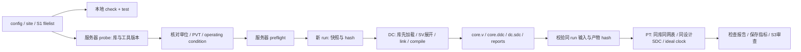

# M4 S2：最小 DC/PT flow 与服务器交接

2026-10-16：**S2 本地实现和验证完成**。输入 HEAD：`235f60619d2ae32a57ee2520cfd76f1a6a9f326f`，开始时工作区干净。未改 RTL、ref-flow 或服务器库路径，未运行 DC/PT。本地验证使用 Tcl/模拟工具，不能据此宣称 EDA flow 已在真实工具上跑通。

2026-10-18 补记：新 run 报告按 environment/summary/checks/timing/area/power 分类，
`constraints.rpt` 改为 `checks/constraint_violations.rpt`；[当前报告索引](../../../../npc/flow/README.md#报告目录与阅读顺序)列出文件用途和旧 run 的检查方式。本页下方保留 S2 初始实现记录；已有归档不迁移。

## 1. 实现范围与裁剪决定

入口：[npc/flow/README.md](../../../../npc/flow/README.md)、[Makefile](../../../../npc/flow/Makefile)。沿用 S1 的 `ysyx_core_axi4lite`、16 项 SV filelist 和观察端口策略。只搭建一个 top、一个配置、一个库/角的 DC → PT 链，没有新增 PnR、FM、GLS 或活动仿真依赖。



| 实现 | 输入 / 输出及依据 |
| --- | --- |
| `00_indata/configs/npc_core.tcl` | top/filelist/宏、时钟与 I/O 数值假设、并行度、可选功耗开关；配置键缺失或拼写错误即失败 |
| `00_indata/configs/site.example.tcl` | 默认从 `00_indata/DB/STD_NEW/` 选单个 RVT/TT 候选，支持外部绝对路径；实际 site 单独复制为忽略文件，不将文件名当作已核对的库内部属性 |
| `01_common/flow.py` | 配置加载、路径/文件检查、输入快照、Git/库/工具 hash、独立 run、退出码与报告检查；不依赖第三方 Python 包 |
| `01_common/setup.tcl` | 共享库、operating condition、WLM 设置和报告；所有 EDA 输入来自快照 |
| `00_indata/constraints/core.sdc` | 覆盖 clock、reset、全部 AXI 与 commit/monitor 输出；DC/PT 重放同一文件 |
| `02_syn/probe.tcl` | 仅加载候选 DB，输出实际工具版本和 `report_lib`，为 site 填值提供依据 |
| `02_syn/run.tcl` | 库配置先于 SV analyze/elaborate/link；WORK/run 隔离；普通 compile；导出网表/DDC/SDC、area/QoR/resources/reference/max/min/check 报告 |
| `03_sta/run.tcl` | 同一 run 的 `core.v` 和库，重新应用相同设计约束；无 SPEF/propagated clock；输出 coverage、约束、路径分组与指标 |
| `04_tests/` | SDC 端口覆盖与失败注入；模拟工具执行真实 Tcl 控制流程，验证的是脚本编排而非 EDA 语义 |

保留参考 flow 的阶段划分、日志/报告归档和失败传播思想，重写旧 top/库混选、文件清单、路径和约束。DC 采用 `compile -map_effort medium`，首轮不依赖 `compile_ultra`、Graphical 或额外 Foundation 库；不传 `-gate_clock`，不启用参考脚本中的 datapath gating。这样得到的是明确编译策略下的初始基线，之后换优化策略需要独立命名和重测。

## 2. 数值 SDC 与适用边界

2026-10-18 更新：下表保留 S2 初始 10 ns 假设；当前配置已将周期改为 **5 ns / 200 MHz**；03 已完成该周期的真实 DC/PT。随后按用户决定移除 reset release delay 并新增精确 reset false path，见 [reset TODO](reset-timing-todo.md)，其余数据接口数值不变。该目标根据 02 实验的 2.27 ns Reg2Out 到达时间、2.0 ns 输出预算及 0.2 ns uncertainty 选择，新 reset 评估范围已在 [04 基线](synthesis-results/04-200mhz-baseline/README.md)中完成分类审查；推算和命令见 [S3 重跑说明](s3-rerun.md#3-同步与执行)。

| 参数 | 初值 | 理由 / 限制 |
| --- | --- | --- |
| 周期 | 10 ns | 100 MHz 试探目标，便于开始观察关键路径；不是测得频率，也不保证组合 div 路径满足 |
| input / output delay | min 0.2 ns、max 2.0 ns | 同时钟外部环境的起始预算；最大值为周期的 20%，非真实板级/SoC 提取 |
| reset release delay | min 0.2 ns、max 2.0 ns | 外部负责相对 clk 同步释放；保留 recovery/removal 与 reset→握手输出组合路径 |
| setup / hold uncertainty | 0.2 / 0.05 ns | 明确的初始裕量；不伪装成 CTS 或硅后抖动测量 |
| clock / input transition | 0.1 ns | 用显式 slew 建模外部驱动，不猜测 driving cell 名称 |
| output load | 0.01 pF | 10 fF 初始接口假设，含观察端口；先核对库单位 |
| source latency min/max | 0 / 0 ns | 单 ideal clock、无外部插入延迟估计 |

当前 34 个命名端口全部进入对象检查：8 个数据输入和 24 个输出保留双边 delay 与相应 slew/load，rst_n 保留 slew，仅使用 `set_false_path -from [get_ports rst_n]` 暂缓其时序验收。原表的 reset release delay 为历史假设，不再生效。没有 multicycle 或 reset case analysis；功耗的 reset 静态活动仍只是活动假设。

[S1 逐端口表](s1-port-budget.csv)保留原始对象/预算意图；其中 reset timing 项已由上述早期例外替代，当前数值与范围以配置、SDC 和 reset TODO 为准。库单位目前只支持经核对的 ns/pF，其他单位必须显式换算再修改配置，不能只改标签。cell area 单位由 `report_lib`/服务器说明确认，不默认称 µm²。

PT 使用同一冻结的设计 SDC，而不直接 source DC 导出的环境约束；`dc.sdc` 同时导出、hash，并在 S3 交叉检查。这样避免 DC 特有环境设置混入 PT，也不依赖原 C906 SDC。DC 若改变端口命名或裁剪了常量端口，必须从实际工具报告核对覆盖，不能只用本地端口计数断言综合网表 coverage 完整。

## 3. 工艺库与互连模型

site 示例选取参考配置中的一个 RVT/TT 文件，目录仍为 `/15T/Projects/c906-project-delivery/00_indata/DB/STD_NEW/`。没有 broad glob，不加载 SRAM/HVT/LVT 全集。`library_reviewed=0`、空 `operating_condition` 会阻止正式综合，先通过 probe 查到真实库内部名称、条件和单位，再更新 site。

DC/PT 都关闭 area-based 自动 WLM 选择，使用 top mode。默认策略显式命名为 **library_default**：读取同一个已选库的默认模型，并分别保存 design/library/wire-load 报告。它不等于“已经确认使用零线延迟”，也不能假定库一定有 WLM。若无默认模型，需在结果中记录工具实际无模型行为及乐观性；若选择具体命名模型，则两工具使用同一名称。无 SPEF，不复制 C906 的寄生或 margin。

PDK 在服务器，不属于 missing-files；本次未改该清单。服务器的库内部信息和工具/license 待验是 S3 运行前的输入确认，不构成本地 S2 蒸馏阻塞。

## 4. 失败、证据与结果口径

每个 run 创建一次，阶段尝试后不能覆盖；失败后改配置开新 run。manifest 保存有效配置、源码/include/flow/SDC hash、Git HEAD/status/dirty patch、库和工具可执行文件 hash、工具 argv/退出码、实际版本报告和产物 hash。库仅记录 hash，不复制工艺数据。

PT 只能从本 run 的成功 DC 阶段读取网表；输入或已导出网表/SDC/DDC/报告变化即失败。工具退出 0 但出现 Error、缺完成标记、缺报告、无有效 cell area 或 top 缺失也失败。DC 另查 link、check_design、未映射 cell 和非预期 latch。负 slack 保存为 `TIMING_FAIL`，不把失败基线丢掉。

PT 的 max/min 指标对负 slack 的 endpoint 去重：WNS 为最坏负值（无违例时为 0），TNS 为每个违例 endpoint 的最坏负 slack 之和，另有违例 endpoint 数；路径数量达到采集上限即报错。max/min 的具体 check 类型以报告为准，reset recovery/removal 不能被“只统计 setup/hold”的口径忽略。四组 Reg2Reg/In2Reg/Reg2Out/In2Out 保存代表路径，并保留 coverage 的全部 check 统计。

`COMPLETE` 仅表示执行与产物检查完成。即便 WNS=0，结果仍是 `REVIEW_REQUIRED`，**脚本不自动签出 timing/signoff PASS**。所有 warning、untested/constant、无约束端点、组合环、disabled arc、时钟和 DRV 仍需 S3 审查；未知 coverage 格式明确失败，不能解析失败后填零。当前退出码用于编排成功/失败；负 slack 不阻断产物归档，应读取 assessment 字段与原始报告。

DC 会读取安装/用户 setup 文件：driver hash 已发现的 HOME/install/SYNOPSYS setup，启动 cwd 独立；PT 用 `-no_init`。DC setup 内递归 source 的自定义依赖仍需在 S3 逐项确认/记录。这不是完全隔离的 EDA 容器，也不承诺环境任意变化时结果不变。

可选 DC 功耗默认关闭；打开后按 0.1 toggles/clock period、概率 0.5 标注数据输入，clock 为 2 toggles/period，reset 为 inactive/0 toggles。内部活动依赖工具默认/传播，并输出可用的 activity/power 报告。功耗命令在导出时序产物后单独尝试，错误留在日志并标记未评估，不阻塞 A/时序；成功也需核对单位、活动和模型，不能称 workload 功耗。该部分 User Guide 缺少完整普通模式命令说明，须按服务器帮助确认后再开启。

## 5. 本地验证与未验部分

```bash
make -C npc/flow check test
```

结果：**28 个测试通过**，包括：

- 配置缺键、错误 top/宏、非法数值/预算、缺 SDC/filelist/库/工具；本地 check 不依赖 PDK，服务器 preflight 不静默跳过。
- 重复 run、STA 无前置 synth、改动快照/库/网表、重复 stage；输入路径含空格及 Tcl 特殊字符。
- 非零退出、错误文本但退出 0、缺完成标记/报告、零面积、未知 coverage 格式、负 slack 与 untested 状态。
- 删除 output min delay 必须失败；全顶层 SDC 对象检查通过。
- 真实 Tcl 脚本在显式 mock 命令下执行：库先读、snapshot 路径与阶段输出正确，endpoint 重复被去重，optional power 不可用不阻断主流程。

工具：本地 Python/Tcl，mock 的 `.db`/网表/报告明确不是实际设计产物。日志归档 `artifacts/m4-s2-20261016/`。未执行 EDA、未重复无关 RTL 回归；功能证据沿用 S1。本地验证不能代替服务器的 analyze/elaborate/link、真实库属性/单位、工具版本/feature、时序 coverage 或面积结果。

## 6. 手册依据与待核对项

通过 [本地分页缓存](manual-index.md)查阅，下表页码均为实际 PDF 页，版本分别为 DC P-2019.03 / PT L-2016.06：

| 用途 | 手册位置 |
| --- | --- |
| DC setup 自动加载、非隔离启动环境 | DC 正文 2-9，PDF 63 |
| 标准 synthetic library 与 search path | DC 正文 4-10，PDF 120 |
| SV / analyze / elaborate / link | DC 正文 6-3–6-5，PDF 153–155；S1 已核对 |
| WLM 优先级、无模型的乐观性；关闭自动选择/top mode | DC 正文 7-11、7-15，PDF 203、207 |
| PT 启动 `-no_init` | PT 正文 2-2，PDF 52 |
| PT 默认 WLM / 显式命名 / 关闭自动选择 | PT 正文 5-9–5-10，PDF 153–154 |
| operating condition 必须来自所选库 | PT 正文 8-4，PDF 274 |
| coverage / untested 与恢复移除检查 | PT 正文 17-24–17-26，PDF 656–658 |
| power 活动参数示例及其模式局限 | DC 正文 20-22、20-77，PDF 582、637；这些例子处于 Graphical/多场景上下文，不能当作普通 DC 已验证证据 |

服务器需确认 `compile`/报告命令选项、collection/attribute（如 `is_unmapped`、timing path endpoint）、版本差异和报告格式；不支持时脚本应明确失败并据工具帮助调整，不替换成空报告或默认成功。

## 7. 下一步与阻塞

**无本地 S2 未解决阻塞**。以下为 S2 交接时的服务器 S3 操作步骤；当前已完成，结果见 [S3 基线](3-synthesis-sta.md)，S6 已完成，最终状态见 [M4 验收](signoff.md)，下一步为 M5；以下保留服务器操作顺序：

1. 同步已提交版本与候选 site，配置真实 DC/PT 路径，执行 probe，核对库属性/单位/PVT/模型并填写 operating condition。
2. 运行 preflight，再用全新 run 执行 synth/sta；记录版本/license 和真实命令兼容性，处理所有结构与约束问题。
3. 根据真实报告保存面积、时序/coverage、warning 处置及关键路径分析；目标不满足时保留 FAIL 实验记录，不自动认定为正式基线。功耗按需开启，不作为必做出口。

服务器实测与 I01/I06–I08 的当前验收状态见[验收矩阵](test-plan.md)；不将原 S2 本地 mock 验证等同于这些实测证据。
