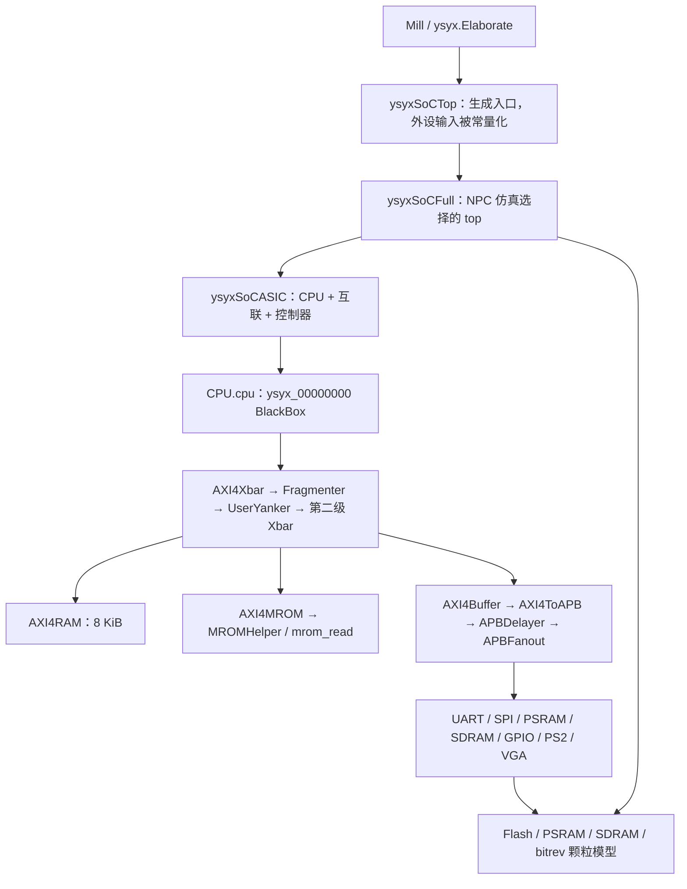

# M5 S0：上游版本与平台契约

> 2026-10-19：**S0 出口通过，下一步 S1**。已重新生成 SoC、核对 CPU ABI、审查地址/模型/reset/IRQ 和容量；尚未接入 NPC、运行 SoC 程序或进行新 scope 的综合。
> 输入 workbench：`30bc679d02a45f4179ffaf738977c87254931bb7`；[验收矩阵](test-plan.md) M01/M02 的 S0 范围通过。已知功能缺口列在第 7 节，分别阻塞后续 S2/S4/S5 的出口，不阻塞当前契约冻结。

> 2026-10-20 交接更新：S1 改为直接升级现有接口，不再要求 B1/SoC 双路径兼容。下文的上游版本、生成检查、地址与模型事实及 `s0-validation/` 原始证据保持原样；实施路径以更新后的 [计划](plan.md)为准。

> S2 命名更新：当前 CPU 集成文件/模块已改为 `ysyx_25030087.sv` / `ysyx_25030087`，Scala BlackBox 同步改名；61-port ABI 不变。下文 `ysyx_00000000` 是 S0 时的占位名，最新验证见 [S2 改名复验](s2-validation/rename-check.json)。

## 1. 固定的源码、工具与生成结果

| 项目 | 本次实际值 |
| --- | --- |
| ysyxSoC | `df38a4d93d1d71e621fe91b106d088bd33af984a`；本地分支 `npc-integration` 跟踪 `origin/npc-integration` |
| origin / upstream | `git@github.com:waxberry-chen/ysyxSoC.git` / `git@github.com:OSCPU/ysyxSoC.git` |
| Rocket Chip | `d0c6b50fdefcdbe121e9788433ea51f7efaf1d32` + 上游 `patch/rocket-chip.patch`；实际 diff 与补丁一致，reverse check 通过 |
| 递归依赖 | cde `52768c9`、chisel `e3bcc90`、diplomacy `edf3753`、hardfloat `d93aa57`、softfloat `5c06db3`、testfloat `06b2007`；完整 SHA 见 manifest |
| 工具 | OpenJDK `17.0.20.1`、Mill `0.12.4`、firtool `1.105.0`、Verilator `5.008` |
| 构建库 | `build.sc` 指定 Scala `2.13.14`、Chisel Maven artifact `7.0.0-M2`；不要将依赖目录里的 chisel 子模块版本等同于实际构建 Chisel 版本 |
| 生成配置 | `Config.hasChipLink=false`，`Config.sdramUseAXI=false`；静态展开未定义 `FAST_FLASH` |
| 本地 SoC 修改 | 用户已添加 `.gitignore` 的 `/patch/firtool`；已保存该 diff，未代用户提交；没有修改功能源码 |

本次执行 `make -B -C ysyxSoC verilog`，真实返回 0；不是只对现有文件执行一次 make no-op。日志见 [generation.log](s0-validation/generation.log)。它运行 firtool 检查、`mill -i ysyxsoc.runMain ysyx.Elaborate --target-dir build`，随后重命名并整理 AXI 端口名称。

输出：`ysyxSoC/build/ysyxSoCFull.v`，SHA256：

```text
dbcd69976731a6ea547877eeecd1b5dda4fac543929ca7b64c133339efd68844
```

该 hash 是本次本地生成产物的标识；生成文件带绝对路径注释，换目录/工具环境重建时不承诺逐字节相同。源码、补丁、配置及端口合同才是跨机器核查的基础。

版本与输入 hash 见 [manifest](s0-validation/manifest.json)。主仓库的 `m ysyxSoC` 来自 fork 中已有的 `.gitignore` 修改及递归传播的 Rocket Chip 补丁 dirty 状态。保留补丁；不为了清理状态将其恢复掉，也不需要另外 fork Rocket Chip。日后修改 Rocket Chip 时必须与该预期 diff 区分。

## 2. 层次和构建入口



主要源码入口：[SoC.scala](../../../../ysyxSoC/src/SoC.scala)、[Top.scala](../../../../ysyxSoC/src/Top.scala)、[CPU.scala](../../../../ysyxSoC/src/CPU.scala)。

- **生成 top** 为 `ysyxSoCTop`；它把 UART RX、PS2 等输入固定为 0，不适合实际 UART 验证。
- **仿真 top 冻结为 `ysyxSoCFull`**，显式驱动 `clock/reset`、`externalPins_uart_rx=1`（空闲）、PS2 clock/data=1、GPIO input=0；输出由 harness 观察。颗粒模型已经在 Full 内实例化，不能重复添加。
- **CPU 集成模块暂定 `ysyx_00000000`**，与实际生成 BlackBox 保持一致。这是本地集成占位名，不冒充真实学号；正式课程提交需要另行落实命名要求，不阻塞当前 M5。CPU debug/commit 信号通过专用仿真绑定/监测取得，不随意增加这个正式 ABI 的端口。
- **S7 综合 top 另立**，仅覆盖 NPC 核与 transport/router/CLINT/wrapper；Full 中有 DPI 及空颗粒模型，不能拿来宣称完整 SoC 可综合。
- 目标平台入口为 `NPC_PLATFORM=ysyxsoc`、AM `ARCH=riscv32e-ysyxsoc`；入口在 S1–S3 实现，当前仍不存在。按2026-10-20决定，它们承接当前工程，不要求继续支持旧 B1/legacy 硬件配置。SoC filelist 包含生成文件、CPU wrapper、明确的外围源和 UART/SPI include path，不复用 B1 的设备列表。

## 3. 实际 CPU 端口合同

上游 [接口表](../../../../ysyxSoC/spec/cpu-interface.md)与本次生成实例的 **61 个端口**已逐项核对；完整名称/方向/宽度/连接见 [cpu-ports.csv](s0-validation/cpu-ports.csv)。方向以 CPU 为观察对象。

| 通道 | CPU master 输出 | CPU master 输入 |
| --- | --- | --- |
| AW | valid、addr[31:0]、id[3:0]、len[7:0]、size[2:0]、burst[1:0] | ready |
| W | valid、data[31:0]、strb[3:0]、last | ready |
| B | ready | valid、id[3:0]、resp[1:0] |
| AR | valid、addr[31:0]、id[3:0]、len[7:0]、size[2:0]、burst[1:0] | ready |
| R | ready | valid、data[31:0]、id[3:0]、resp[1:0]、last |

另外有 `clock/reset/io_interrupt`，以及方向相反、同宽度的 slave 接口。单 bit 信号在表中省略宽度。上游补丁将 `lock/cache/prot/qos` 位宽置零，因此这些信号不在实际 CPU ABI 中。

本轮 S1 master：全局一笔外部 outstanding、ID=0、LEN=0、BURST=INCR、WLAST=1；IFU SIZE=2，LSU SIZE=0/1/2；维持 raw byte address 与正确 WSTRB/WDATA/RDATA lane。上游 APB bridge 检查单拍且 size≤2，SRAM 和 APB 写端可能等待 AW/W 同时有效，**不能等 AWREADY 才发 WVALID**。

关闭 ChipLink 后，生成实例的所有 slave 输入均为 0，slave 输出不连接；`io_interrupt=0`。本轮 wrapper 可将 slave 的输出全部固定为 0，并在仿真断言外部不发 slave 请求；这不是实现了通用 AXI slave。若开启 ChipLink，需要重做接口/复位/地址与回归合同。

UART 的实际寄存器地址使用 `in_paddr[2:0]`，读值复制到四个 byte lane，写入按低两位地址选对应数据 lane。它并未利用 PSTRB 来弥补错误地址；将 byte 访问提前 word 对齐会选错寄存器。APB 没有读 size，正确的 byte address 必须一路保留；普通 RAM 的整 word 返回也须由 CPU 正确选 lane。

## 4. 实际地址与容量

下表来自冻结的 `SoC.scala`，优先于讲义的大窗口示意；**被映射不等于功能已经实现**。

| 设备 | 实际声明的地址范围（含首尾） | 容量 / 当前状态 |
| --- | --- | --- |
| CPU CLINT | **新增合同** `0x02000000–0x0200ffff` | 上游没有 CLINT；由 CPU 内部 router 处理 |
| SRAM | `0x0f000000–0x0f001fff` | 8 KiB；生成 RAM 为 2048×32 bit，byte write；无 memory macro |
| UART16550 | `0x10000000–0x10000fff` | 4 KiB 译码窗口，寄存器按低 3 bit 选择，UART 实现存在 |
| SPI controller | `0x10001000–0x10001fff` | 4 KiB 窗口，底层 controller 只接地址低 5 bit |
| GPIO | `0x10002000–0x1000200f` | 16 B；APB/输出为空壳 |
| PS2 | `0x10011000–0x10011007` | 8 B；APB/输出为空壳 |
| MROM | `0x20000000–0x20000fff` | 4 KiB；DPI backing 待 NPC harness 实现 |
| VGA | `0x21000000–0x211fffff` | 2 MiB 窗口；空壳，不代表已实现 framebuffer |
| Flash XIP | `0x30000000–0x3fffffff` | 256 MiB 声明窗口；真实 SPI 模型地址只有 24 bit，普通路径尚无 XIP 转换 |
| PSRAM | `0x80000000–0x803fffff` | 4 MiB；控制器存在，颗粒模型仅 `dio=Z` |
| SDRAM | `0xa0000000–0xa1ffffff` | 32 MiB；APB 控制器存在，颗粒模型仅 `dq=Z`；本轮不访问 |
| ChipLink | 未实例化 | 不承诺旧讲义 ChipLink 窗口可访问 |

**错误路径限制**：当前没有显式全地址 default responder。Xbar/APBFanout 使用简化的地址选择，不能由声明范围推断所有洞/越界都会返回 DECERR；部分地址可能别名到设备、无响应或表现不同。SRAM 自身有范围检查和 DECERR 路径，但不构成整个 SoC 的保证。MROM 写端不接收 AW/W，且对 write valid 有断言，并非正常返回写 access fault。

S2 要在 **SoC 侧**落实基于冻结地址表的确定译码/错误处理：未映射访问返回 DECERR，禁用设备/只读区域写入返回定义的错误；禁止误写到别名设备。CPU 除 CLINT 外继续向 SoC 发请求，不在 CPU 中散布旧平台 RAM 白名单。adapter 的错误传播在 S1 用独立 responder 验证，真实默认错误路径到 S2 再验证；仿真 timeout 只作诊断，不能冒充硬件错误响应。

### CPU 内部 CLINT 与运行参数（待 S1/S5 实现）

- `mtimecmp`：`0x02004000/04`，64 位读写；`mtime`：`0x0200bff8/bffc`，64 位读写；第一版只接受 word 对齐的 32 位访问，其余宽度/offset 返回访问错误。两个寄存器的分字写只更新对应半字。
- `mtime` 复位为 0，`mtimecmp` 复位为全 1；本轮不实现 MSIP。S1 先提供 mtime 路径，S5 完成比较器、CSR mask 和中断。
- SoC 仿真默认 `SOC_CLOCK_HZ=100000000`（10 ns）；timer 每个 CPU 时钟递增一次，`MTIME_HZ=SOC_CLOCK_HZ`，不沿用 B1 的 1 MHz 换算。RT-Thread tick=100 Hz 时，名义间隔为 1,000,000 tick；周期变更必须同步时间和 UART divisor。
- CLINT 单字写 mtime 时写入优先于当拍递增，未写半字保持；软件需用 high/low/high 读取防跨字翻转，更新 mtimecmp 时使用避免中间小值的写序列。S5 对竞态做定向验收。
- 上述 100 MHz 是仿真时间标尺；S7 初始综合目标仍为 200 MHz，不能混淆时间模型和频率达标结果。

## 5. reset / IRQ / ISA 与软件边界

| 对象 | 实际发现及本项目合同 |
| --- | --- |
| 外部 reset | `ysyxSoCFull.reset` 高有效，CPU 与外设共用同一时钟；不同上游模块有同步/异步 reset 混用 |
| CPU reset | `SynchronizerShiftReg(reset,10) OR reset`；生成的是无 reset 的 10 级移位寄存器，外部保持高必须足够填满链 |
| 仿真驱动 | 约定在 clock 低电平时改变外部 reset，初始/重启至少保持 20 个上升沿；释放后 CPU reset 再延后 10 个上升沿，按实际 CPU reset 信号判断可开始请求 |
| NPC 映射 | wrapper 将上述 CPU 高有效 reset 转为 `rst_n`，core/transport/router/CLINT 一起复位；不在此配置叠加第二套任意延时链 |
| 重启边界 | 只验收整个 SoC 共同复位；reset 前已发生的 RAM/MMIO 写不会自动回滚，RAM 也不因控制复位自动清零；不支持仅 CPU 热复位后的旧响应重接收 |
| 外部 IRQ | Full 固定来源为 0；UART interrupt 留在控制器内部，SPI IRQ 没连 CPU；本轮不开放 machine external interrupt |
| timer IRQ | NPC CLINT 自己产生 MTIP；与 `io_interrupt` 分开。S5 添加 `mie/mip` 及 precise trap 接受逻辑 |
| 物理 reset | 10 级数字链和仿真保持周期不是 recovery/removal、脉宽、RDC 的物理证明。S7 按新边界复查 M4 reset 例外，不直接复制其 untested 数量 |

初期 reset PC=`0x20000000`；S4 完成真实 XIP 后，外部启动配置切换到 `0x30000000`，MROM 留作独立诊断配置。当前 CPU BlackBox 没有 boot-address 输入，选择通过 wrapper/core 参数与构建 profile 实现，不新增未经匹配的端口。

软件继续 `-march=rv32e_zicsr -mabi=ilp32e`，不引入 M/C/x16–x31。当前 AM trap 汇编支持 16 GPR 的布局，使用 `mstatus/mtvec/mepc/mcause`，不依赖 mscratch；但 AM 中断开关为空，RT-Thread 的 timer event 直接返回、`rt_hw_context_switch_interrupt()` 会 assert，S5 必须一起补齐。新增 CSR 清单先限定 `mie=0x304`、`mip=0x344` 的 timer 位，不宣称完整特权架构。

讲义的身份 CSR 输出不是当前 AM 必须项，本轮不伪造学号，保持未支持 CSR 的非法访问策略；正式身份/课程输出作为独立补充。测试结束继续采用已有 ebreak/harness 协议，不在 S0 改变 breakpoint 合规边界。

## 6. 存储模型和启动容量决策

**本轮确定需要 PSRAM，S4 纳入其颗粒模型与启动验证。** 不再将“是否能压进 8 KiB”留作不确定前置。

对现有 B1 RT-Thread ELF 做静态检查，结果见 [rtt-budget.txt](s0-validation/rtt-budget.txt)：text 17,976 B，rodata 3,544 B，初始化数据 80 B，BSS 21,332 B，合计 **42,932 B**，尚未包括启动主栈和 heap。静态线程栈 16 KiB、idle 栈 4 KiB 已包含在 BSS；现有链接布局还保留 32 KiB 主栈，heap 从偏移 `0x13000` 开始，fixture 要求 heap >32 KiB。这是已有 ELF 的容量证据，不是新的 SoC/抢占 workload 实测。

S3 最小 MROM 程序限制：MROM 代码/只读及 data LMA 总计≤4 KiB；SRAM 可写段、临时栈和余量合计≤8 KiB。必须新增 linker，原 AM 脚本默认 32 KiB 栈、把 BSS 填入 binary，不可原样沿用。

S4 路线：

1. 用 MROM 中的小程序驱动 SPI controller，验证 Flash `0x03` 读命令；Flash 颗粒模型已经支持该命令，但 backing 函数待补。
2. 在 SPI/APB 层实现真实 XIP 转换，再验证 Flash → SRAM 小程序复制、清 BSS、跳转。`FAST_FLASH` 只可作为单独调试配置，不计作 SPI/XIP 实现通过。
3. PSRAM 颗粒先实现现有控制器所用的 `0xeb` read、`0x38` write：命令单线、地址/数据四线；不要误把它当作已经需要 QPI 模式命令。做完 byte mask、地址首尾、延迟与容量测试后，运行 Flash → PSRAM 的 RT-Thread。

容量预算先给出可执行上限：Flash backing **16 MiB**（24 bit 可寻址范围，超出范围禁止别名），PSRAM **4 MiB**。RT-Thread 初始预算为 text/rodata/data ≤256 KiB、BSS（含线程静态栈）≤64 KiB、主/trap 栈 32 KiB、heap 至少128 KiB，总计≤480 KiB；超预算时明确调整并保留 map。正式 SoC ELF、stack watermark 与 heap 余量在 S4/S6 实测，S0 不提前宣称通过。RT-Thread 运行栈放 PSRAM，8 KiB SRAM 只承担小启动程序/临时栈，避免强行套用“所有栈放 SRAM”。

加载 API 冻结：`mrom_read(int raddr, int *rdata)` 接收 CPU 物理地址，按 MROM base 做边界检查；`flash_read(int addr, int *data)` 的 addr 是 SPI 模型传来的 **颗粒 offset**，不是 `0x30000000` 物理地址。用独立 backing 存储镜像；CPU 负责从启动介质复制到 RAM，不能由 harness 代做 data/BSS 初始化后声称 boot 成功。未启用 Flash 的 S2 仍须提供函数符号并对意外调用报诊断，不能只给空返回值隐藏访问。

## 7. 缺口与分阶段处置

| ID | 已核实的缺口 / 风险 | 影响出口与既定处置 |
| --- | --- | --- |
| G01 | CPU `ysyx_00000000` 目前没有 NPC 实现 | S1 直接升级现有接口并接出 wrapper；本次仅用自动生成的无事务 stub 检查 ABI |
| G02 | `mrom_read/flash_read` 无 NPC SoC backing，harness 地址和 MMIO 判断仍为旧平台 | S2/S3 将运行入口迁移到 SoC，更新加载范围、设备分类和 DiffTest；不能用 `0xa...` 继续判设备 |
| G03 | 未映射/禁用设备/MROM 写没有统一确定的错误响应 | S2 添加 SoC 侧错误路由与测试；CPU adapter 只负责正常传播错误 |
| G04 | GPIO/PS2/VGA 控制器为空，24 个输出未驱动；SDRAM 颗粒为空 | S2 将本轮禁用外设隔离/提供确定的错误应答及静态输出；不实现其完整功能；禁止把全 top lint 返回 0 当作这些设备可用 |
| G05 | SPI 普通路径没有 XIP，`FAST_FLASH` 直接经 DPI 跳过 serial transfer | S4 完成 XIP RTL，拒绝对只读 Flash 的写；验收关闭 FAST_FLASH |
| G06 | PSRAM 模型仅三态，控制器 APB/WB 转换仍需功能验证 | S4 实现 4 MiB 颗粒及读写协议，测试读 word/写 byte-lane 和 APB setup/enable，不默认当作已验证 IP |
| G07 | UART/SPI 有 `#1/#Tp` 延时，旧 NPC 使用 `--no-timing` | S2 为 SoC 独立选择 `--timing`、明确 timescale 并推进 event scheduler；不得只切一个编译选项却不修改 harness 时间推进 |
| G08 | CLINT/machine IRQ/AM 与 RTT 抢占链缺失 | S1/S5 按本合同分步实现；S6 用非主动 yield workload 验证，不复用协作 PASS |

以上为已分配到后续阶段的实现工作，**当前没有需要用户补充信息或外部环境才能继续 S1 的阻塞**。若 S2 错误路由或 S4 颗粒/启动未完成，将阻塞相应阶段验收；不能以 S0 已通过掩盖这些事项。

## 8. S0 检查结果、复现与交接

本次新增 [接口检查脚本](../../../../npc/tests/ysyx_soc_contract_check.py)：从上游 spec 独立提取方向/宽度，核对生成 CPU 实例的连接，校验 Rocket Chip 补丁，生成无事务 CPU stub，再用真实外围源做 Verilator 静态展开。

```bash
# 从 workbench 根目录执行；已有补丁的 checkout 不重复 dev-init
make -B -C ysyxSoC verilog
python3 npc/tests/ysyx_soc_contract_check.py
```

检查结果：61 个 CPU 端口一致，Rocket Chip diff 一致，static elaboration 返回 0；无缺失模块、端口/位宽错误或本次 lint 报出的 latch/组合环。**这不是实际 CPU 集成测试，也不是完整 SoC lint clean**。242 条警告的分类为：

| 分类 | 数量 | 本次判断 |
| --- | ---: | --- |
| UNDRIVEN | 24 | 全部位于 GPIO/PS2/VGA 空壳，G04；S2 必须处理 |
| SYNCASYNCNET | 2 | reset 同步/异步使用混合；UART 的延时组合数据和 SPI 时序采样共享 pwdata。前者进入 reset 审查，后者随 G07 验证 |
| BLKSEQ / DEFPARAM | 1 / 2 | UART 旧写法，保留诊断，功能测试前不宣称无风险 |
| TIMESCALEMOD | 43 | 生成和外围文件 timescale 不统一；S2 定义一致仿真时间配置 |
| DECLFILENAME / PINCONNECTEMPTY | 5 / 13 | 多模块文件/生成 wrapper 的命名与空连接；CPU slave 输出等为预期空接 |
| UNUSEDSIGNAL / UNUSEDPARAM | 149 / 3 | 含空 CPU、禁用外围与未使用属性；仅接受为 S0 静态诊断，不作为后续全局 waiver |

精选原始诊断见 [elaboration-diagnostics.txt](s0-validation/elaboration-diagnostics.txt)；完整 log、stub、命令和运行 manifest 在 `npc/build/m5-s0/contract-check/`，未提交生成 RTL 或二进制。历史证据 manifest 记录真实 hash；后续 run 不应覆盖这次归档。

S1 的输入已明确：使用本次 61-port ABI、CPU 内部 CLINT 地址、共同 reset 规则和本地 req/rsp 语义，直接升级现有 adapter/仲裁/顶层，迁移 CPU/协议检查；不保留 B1 兼容接口。先验证 raw byte address 的 AXI4 单拍路径，再接入 S2 的真实 SoC。S0 不需要 DC/PT 或 memory compiler；M4 04/05 归档保持不变，复现使用其历史 Git revision。


## 2026-10-20 S1 交接更新

[S1](1-axi4-interface.md)已完成本页冻结 ABI 的实际 wrapper、单拍 AXI4、仲裁后 CLINT 路由及 mtime 子集；真实 wrapper 静态展开与独立 CPU/协议回归通过。S0 原始 manifest/生成结果保持不变，mtimecmp/IRQ 仍为 S5，真实 SoC 功能启动为下一步 S2。
