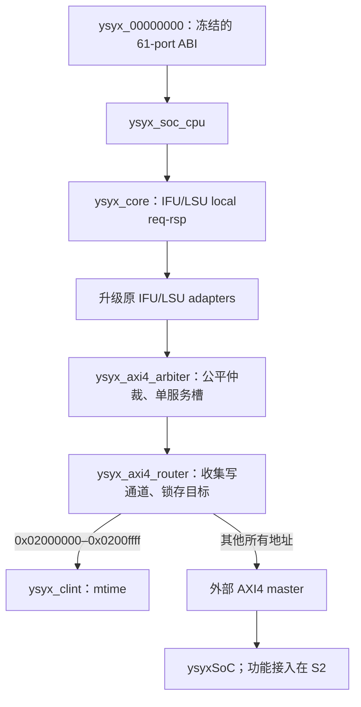

# M5 S1：直接升级 AXI4 单拍接口

> 2026-10-20：S1 完成。M03–M05、M16 的 S1 范围通过；当前没有阻塞。下一步 S2 真实 SoC bring-up。
> 本步使用独立 responder 运行 CPU，并将真实 wrapper 与生成 SoC 静态展开；尚未完成 SoC 功能启动、AM/DiffTest 或新 scope DC/PT。

## 1. 实现边界与选择依据



直接重命名并升级原 adapters、arbiter 和 `ysyx_core_axi4lite`，不复制流水线，不保留 Lite/SoC 双配置。原公平仲裁机制与请求/响应持有规则继续使用。外部 CPU wrapper 不增加 commit/DPI 端口；测试用 `axi4_cpu_test_top` 暴露必要观察。

路由放在仲裁后，原因是已有结构就是两个 adapter → 一个仲裁端口，保留这一边界能减少 IFU/LSU 语义变化。仲裁器负责 requester owner，router 负责 target；二者都把响应缓存在寄存器中。额外路由寄存器增加延迟，这是本步为清晰的握手/目标边界选择的实现，尚未进行性能优化或 DC/PT 评价。

`filelist-soc.f` 是新 CPU 子系统源闭包，包含 core、两个 adapter、仲裁器、router、CLINT、三个集成 top；不包含 B1 SRAM/UART、仿真 memory backing 或上游 SoC 颗粒模型。

## 2. 信号合同

| 项目 | 已实现行为 |
| --- | --- |
| AXI 地址/数据 | 32 bit；地址保留低位，不向下取整 |
| `AxSIZE` | IFU 固定 2；LSU 为 0/1/2，分别表示 byte/halfword/word |
| 事务形状 | ID=0、LEN=0、BURST=INCR、WLAST=1；只发普通单拍事务 |
| 并行度 | 外部读写合计最多一笔 outstanding；IFU/LSU local 端可各自持有待服务请求 |
| 公平性 | 沿用服务完成后更新下一次竞争优先级；两端持续请求、响应有界且能被消费时不会饥饿 |
| lane | LSU adapter 做一次写数据左移/WSTRB 生成、一次读数据右移；仲裁/router 不重复移位 |
| 对齐 | 继续保留原 CPU misaligned 异常策略；byte 任意地址、halfword 2 字节对齐、word 4 字节对齐 |
| 错误 | SLVERR/DECERR 传回 adapter/LSU，产生精确 access fault；EXOKAY 仍作为不支持的错误处理 |
| 非法响应 | RID/BID 非 0 或 RLAST 非 1：仿真断言失败；综合逻辑将该返回标成 SLVERR，不作为成功数据 |
| 固定配置 | ChipLink 关闭、外部 IRQ 为 0；CPU slave 输出 tie-off，活动请求/IRQ 触发断言 |

内部 adapter 接口只携带变化的 address/SIZE/PROT 与数据/response；固定 ID/LEN/BURST/LAST 在共享 master 仲裁器统一生成。它是本项目固定单拍合同下的内部通道子集，不能把 adapter 单独当作具有任意 AXI4 能力的 IP。对外 `ysyx_00000000` 与冻结 ABI 完全一致；该 ABI 不包含 PROT，内部 PROT 只供分类/检查使用。

ID/LAST 断言用于发现协议违规；综合侧错误标记不是任意损坏总线的恢复机制。例如非法多拍响应后的排空不属于本实现合同。

## 3. 状态机、写路由与复位

- **IFU adapter**：IDLE → SEND_AR → WAIT_R → HOLD_RSP；redirect 不撤销已接受的总线事务，原 IFU 继续丢弃 stale response。
- **LSU adapter**：读同上；写 SEND_WRITE 独立跟踪 AW/W，均握手后进入 WAIT_B，再交还 local response。
- **仲裁器**：先保留 owner，再 COLLECT_R/W；写地址/数据分别捕获；SEND/WAIT 后到 RESP，响应交还上游后释放服务槽并轮换优先级。
- **router**：读捕获地址后 DISPATCH_R；写先 COLLECT_W 收齐 AW/W，再 DISPATCH_W。CLINT 只在 DISPATCH 状态执行一次；外部请求经 SEND/WAIT 后缓存响应。RESP 被消费后才重新接受事务。

尤其不能在 W 先到时按“当前 AWADDR”组合选择设备。W 本身没有地址，router 必须等待 AW 并锁存完整写请求。当前结构在仲裁器与 router 都使用收集寄存器，换来独立、明确的状态边界。

AXI VALID/payload 和 READY 均由本地寄存状态决定，没有 AXI 输入到 AXI 输出的组合路径。R/B 反压期间响应固定，CLINT 不会因等待 READY 重复读写。

wrapper 将高有效 reset 转为内部 `rst_n`；CPU、仲裁、router、CLINT 共同清空。只支持整个事务域共同复位，已发生的存储写不回滚；不承诺 CPU 单独热复位后接收旧响应。S1 standalone 测试使用 20 周期初始复位；上游额外 10 周期 CPU 释放延迟的真实系统行为在 S2 验证。

## 4. CLINT 子集

- router 拦截整个 `0x02000000–0x0200ffff` 窗口，其余所有地址向外转发，不添加 CPU RAM 白名单。
- `mtime` low/high：`0x0200bff8` / `0x0200bffc`，只接受对齐 word 读写；写 strobe 必须为 `1111`。
- reset=0，每个 CPU 时钟递增一次；合法写优先于整次递增，只更新目标半字，另一半保持。
- 返回数据在 DISPATCH 时采样；未知 offset、不支持的宽度/写 strobe 返回 SLVERR，无写副作用。
- `mtimecmp`、MSIP、MTIP 均未实现；包括 `0x02004000/04` 在内的未实现 offset 当前返回 SLVERR。mtimecmp 与 IRQ 在 S5 增加，不冒充完整 CLINT。

## 5. 验证及实际结果

完整命令：

```sh
make -C npc s1-test
```

| 验证 | 实际结果与独立预期 |
| --- | --- |
| primitive / IFU / LSU / EXU | 原模块定向检查全部通过 |
| GPR/CSR | simulation 与 SYNTHESIS+NPC_SIM_DPI 两种配置下的 reset/state 检查通过 |
| IDU | 360,192 项独立合法编码检查通过 |
| IFU/LSU adapters | 原握手/反压/错误/部分写复位检查迁移；LSU 地址预期由向下对齐改为原始地址，新增 SIZE 检查 |
| 仲裁器 | 10 seed × 1000 随机事务，另加顺序/错误/公平性/复位定向项；10143 accepted = 10132 completed + 11 reset-aborted，74 coverage bins |
| 仲裁器＋router | 同一独立 pin scoreboard 再运行上述完整场景；同样 10132 completed / 11 aborted / 74 bins |
| 协议负例 | 两种测试 top 分别注入 RID/BID/RLAST 错误，6 项均因预期诊断失败；不是作为正常访问计 PASS |
| redirect | IFU adapter＋仲裁下的旧响应丢弃检查通过 |
| CLINT | word 读写、跨低字溢出、写优先/另一半保持、非法宽度/strobe/offset、reset 通过 |
| CLINT 路由 | AW-first/W-first/同时到达、源 payload 改变、R 快照保持、20周期 B 背压无重复写、非法访问与局部待响应共同复位通过 |
| wrapper | 61-port 表逐项核对；默认 MROM 首取指 `0x20000000`、反压保持与 reset/tie-off 动态检查通过；外部 IRQ/slave 活动各一项负例通过 |
| CPU ISA/CSR | 97 个非法编码的 trap site/cause/EPC/副作用预期与合法 CSR 自检，在 seed 1/7 下通过 |
| CPU access fault | fetch/load/store 分别用 SLVERR/DECERR，6 项精确异常通过；load/store misaligned 不发出数据事务 |
| CPU memory | 10 seed：byte 全部 lane、halfword 两个位置、word、符号扩展、字节寄存器读写及 CLINT；每次恰好一次外部设备读与一次设备写 |
| 展开 | 真实 wrapper 在 simulation/SYNTHESIS 配置下 lint；真实生成 SoC + 实际 NPC wrapper 静态展开通过 |

协议数据源使用独立事务描述符和副作用计数；CPU 程序自行检查结果/cause/EPC，runner 再检查 trap trace 与数据访问次数。S1 没有用 NEMU 作为唯一预期，也没有执行 SoC DiffTest。

测试 CPU top 的 reset PC 显式设为 `0x80000000`，方便复用既有 ISA 定向程序；这是独立 responder 的测试内存，不是 SoC PSRAM 已接通的结论。正式 wrapper 默认 PC=`0x20000000`，由单独 wrapper 测试验证。

精选证据在 [s1-validation](s1-validation/README.md)。完整日志、coverage、生成文件和代表性 `memory-1.fst` 留在 `npc/build/m5-s1/`。波形可观察 `dut.cpu.core`、`dut.cpu.arbiter` 和 `dut.router`。

展开告警没有隐藏为“全 SoC lint clean”：simulation CPU 有13项未连接观察端口、16项 unused signal；SYNTHESIS 有13/28项。真实 SoC 展开共193项，其中24项未驱动仍来自上游空 GPIO/PS2/VGA，归 S2 处置；其余为 unused、空连接、文件命名、defparam 和上游 blocking clock assignment。WIDTH、PINMISSING、PINNOTFOUND、LATCH、UNOPTFLAT 已设为 fatal。

## 6. 旧检查点与入口迁移

| 原入口/检查 | 当前处理 |
| --- | --- |
| Lite adapter 定向测试 | 改名 AXI4，保留原检查并更新 raw address/SIZE 预期 |
| B1 arbiter、redirect | 升级 payload，保留公平性、owner、AW/W 顺序、反压、reset、stale fetch 检查 |
| B1 xbar/设备/fabric | 原 SRAM/UART 地址和完整 B1 fixture 退役；通用事务检查迁移到 AXI4 fabric，CLINT 用新地址专门测试 |
| ISA contract | 保留原97项非法编码与合法CSR程序，改用新 CPU responder；trap/副作用检查继续执行 |
| access-fault / misaligned | 复用原汇编，在新接口下运行；旧 make 名称映射到 S1 CPU 回归 |
| GPR/CSR/IDU/IFU/LSU/EXU | 继续直接运行，不依赖旧平台 |
| B1/legacy harness、AM/DiffTest、RTT 系统测试 | 原入口明确停用；实际 SoC harness 在 S2、AM/DiffTest 在 S3、系统闭环在 S6；未运行项不计 PASS |
| M4 synthesis-scope / flow | 不把新 RTL 填进旧端口预算；旧 scope 明确拒绝新 run，历史用 Git revision，已有 run 可 inspect；新 scope/SDC 为 S7 |

旧 B1 设备/fixture、旧 `csrc` 与 filelist 留作迁移参考，不在当前源闭包或构建入口中。没有维护第二套可运行硬件接口。上游 ysyxSoC 及嵌套 Rocket Chip 本次没有修改。

## 7. S2 交接

S1 无未关闭阻塞。S2 需要接入真实 `ysyxSoCFull` harness、MROM/Flash DPI backing、外围 `--timing` 驱动和复位时序，先运行 MROM ebreak / UART A。同时落实 SoC 侧未映射/禁用设备/只读写错误响应与空外设处理。

`commit_is_mmio` 仍保留旧分类，当前 S1 responder 不依赖它；必须在 S2/S3 与地址表、NEMU/AM/harness 一起迁移，不能直接接旧 DiffTest 后用该标志跳过 UART/RAM。S5 timer IRQ、S7 DC/PT 亦未提前验收。
