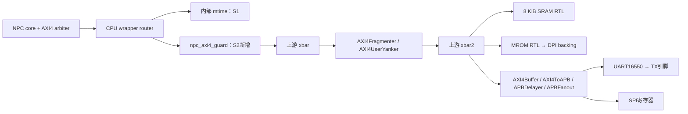

# S2：真实 SoC 最小启动——实现与源码导读

> 2026-10-20：S2 本地验收通过，无当前阻塞。真实 `ysyxSoCFull` 从 MROM 执行指令，UART TX 引脚输出一个 `A`；下一步 S3 AM/SRAM runtime/DiffTest。
> 当前 CPU 顶层为 `ysyx_25030087.sv` / `ysyx_25030087`。改名后已重新生成 SoC，S2、完整 S1 与61-port接口检查均通过；四个程序的统计及精选 CSV 与改名前一致。证据见 [S2 归档](s2-validation/README.md)和[改名复验](s2-validation/rename-check.json)。

本文按“功能 → 实现位置 → 工作过程 → 验证方式”组织。源码链接定位到文件中的起始行，同时给出函数/信号名；后续源码移动时以符号定位为准。本次验证对应的源文件 hash 见 [manifest](s2-validation/manifest.json)。

建议先读第1节掌握本步改了什么，再沿第3节走完一次取指、第5节走完一次 UART 发送，最后阅读第4节的错误路径。第7节可用于对照测试复核结论。

## 1. S2 新增了什么，哪些部分来自前一阶段

S1 已有可独立运行的 CPU、AXI4 adapters/arbiter、CPU 内部 CLINT/router 和正式 wrapper。S2 将它们接到真实生成的 SoC，补齐仿真环境及 SoC 错误处理，形成可以运行小程序的系统。

| 功能/变化 | 本步动作 | 主要源码入口及应关注的符号 | 对应验证 |
| --- | --- | --- | --- |
| 真实 SoC 构建和运行 | 新增 `soc.mk`，恢复 `build/run/sim` | [soc.mk](../../../../npc/scripts/soc.mk#L7)：`SOC_FLAGS`、`soc-build`、`run`、`s2-test`；[Makefile](../../../../npc/Makefile#L18) 引入它 | S2 实际编译、链接及四个程序运行 |
| MROM 镜像与 Flash backing | 新增 C++ 数据存储及 DPI 函数 | [main.cpp](../../../../npc/csrc/soc/main.cpp#L32)：`load()`、`word()`、`mrom_read()`、`flash_read()` | MROM 首指令/窄读/末字节、镜像负例；Flash 路径尚未功能验收 |
| 时钟、复位、延迟事件调度 | 新增真实 top 的驱动循环 | [main.cpp](../../../../npc/csrc/soc/main.cpp#L111)：模型创建、复位、`nextTimeSlot()`、`eval()` | release/首AR/首commit时间；真实 UART 程序 |
| SoC 侧地址及错误保护 | 新增 Scala 接线层和 Verilog 状态机，修改 SoC 连接 | [NPCAXI4Guard.scala](../../../../ysyxSoC/src/amba/NPCAXI4Guard.scala#L10)、[npc_axi4_guard.v](../../../../ysyxSoC/perip/amba/npc_axi4_guard.v#L63)、[SoC.scala](../../../../ysyxSoC/src/SoC.scala#L56) | 1261笔 guard 完成事务、7类复位终止、真实CPU的32次异常 |
| 禁用外设确定输出 | 补 GPIO/PS2/VGA 空壳 | [GPIO](../../../../ysyxSoC/perip/gpio/gpio_top_apb.v)、[PS2](../../../../ysyxSoC/perip/ps2/ps2_top_apb.v)、[VGA](../../../../ysyxSoC/perip/vga/vga_top_apb.v)：文件末尾 `assign` | 全 top 未驱动输出检查；CPU访问由guard返回错误 |
| commit/AXI/UART 观察 | 新增仿真绑定及 DPI 记录 | [soc_monitor.sv](../../../../npc/sim/soc_monitor.sv#L2)；[main.cpp](../../../../npc/csrc/soc/main.cpp#L61)：三个 `npc_soc_*()` 回调 | CSV、事务计数、首指令、trap与设备副作用 |
| 实际串口接收 | 新增 TX 引脚的8N1解码 | [main.cpp](../../../../npc/csrc/soc/main.cpp#L137)：`serial_bit`、`sample`、`tx_bytes` | `uart.tx` 必须精确为一个字节 `A` |
| 设备访问分类 | 修正 EXU 原有观察信号 | [ysyx_exu.sv](../../../../npc/vsrc/core/ysyx_exu.sv#L202)：`device_address`、`commit_is_mmio` | UART提交标记为设备，SDRAM地址的fault不标为设备 |
| CPU 顶层正式命名 | S2后将占位名改为 `ysyx_25030087` | [RTL wrapper](../../../../npc/vsrc/top/ysyx_25030087.sv#L3)、[CPU.scala](../../../../ysyxSoC/src/CPU.scala#L16)、[filelist](../../../../npc/filelist-soc.f#L25)、monitor/test引用 | 61-port核对、S1/S2复验 |

以下是本步使用的已有实现，阅读时不要把它们误记为 S2 新写的功能：

- **S1 CPU 接口和复位PC透传**：wrapper → `ysyx_soc_cpu` → `ysyx_core_axi4` → core/IFU；S2 首次用真实 MROM 动态验证整条路径。
- **上游 MROM/SRAM/UART及总线转换器**：保留原实现，S2提供镜像数据、CPU连接、时钟/复位和观察环境。没有新写 UART16550 或 SRAM。
- **Rocket Chip 的接口裁剪补丁**：[rocket-chip.patch](../../../../ysyxSoC/patch/rocket-chip.patch)由上游 `make dev-init` 应用，将 `lock/cache/prot/qos` 的位宽设为0，以匹配课程CPU接口。它在S0已存在，S2未新增嵌套Rocket Chip修改。

当前硬件关键路径如下。图中省略的配置分支可在 [SoC.scala 的连接区](../../../../ysyxSoC/src/SoC.scala#L50)继续查看；CLINT留在CPU wrapper内部。



## 2. 从 make 到真实 SoC 模型

**入口与源文件范围。** [npc/Makefile](../../../../npc/Makefile#L17)包含测试入口及 `scripts/soc.mk`。执行 `make -C npc s2-test` 时依次发生：

1. `soc-verilog` 调用 [ysyxSoC/Makefile](../../../../ysyxSoC/Makefile#L9) 的 `verilog`。Scala源发生变化时，用Mill生成RTL，并完成接口字段重命名，得到 `ysyxSoC/build/ysyxSoCFull.v`。
2. `soc-build` 将生成top、[filelist-soc.f](../../../../npc/filelist-soc.f)中的CPU源、上游`perip/*.v`、`soc_monitor.sv`以及**唯一的新harness源 `csrc/soc/main.cpp`**交给Verilator。
3. Verilator生成并编译C++模型，得到 `npc/build/ysyxsoc/VysyxSoCFull`。
4. [m5_s2_test.py](../../../../npc/tests/m5_s2_test.py#L189)编译测试镜像，运行guard、正常程序、fault程序和harness负例。

旧 `npc/csrc` 下的其他harness文件不在这组构建输入内。`--top-module ysyxSoCFull` 是完整仿真顶层；`ysyx_25030087` 是其中的CPU模块，两者不能互换。生成RTL是检查接线的产物，功能修改应回到Scala或手写RTL源。

**关键编译选项。** `SOC_FLAGS`启用`--timing --assert --trace-fst`，统一`1ns/1ps`；WIDTH、PINMISSING、PINNOTFOUND、LATCH、UNOPTFLAT、UNDRIVEN设为致命诊断。其余上游告警保留并分类，不把 `-Wno-fatal` 的返回0描述为全SoC lint clean。

## 3. 一次 MROM 启动如何完成

### 3.1 先准备镜像内容

[compile_image()](../../../../npc/tests/m5_s2_test.py#L34)把汇编按RV32E/Zicsr编译，以 `-Wl,-Ttext=0x20000000` 链接，再用 `objcopy -O binary` 输出raw binary。入口在 `.text` 最开始；当前harness没有ELF解析器，也不会读取ELF entry后自动设置PC。

`make run IMG=...` 把路径传为 `--mrom`。[main()加载区](../../../../npc/csrc/soc/main.cpp#L111)在第一次 `eval()` 前执行：

```cpp
load(image, rom, 4096, 0);
```

`load()`先检查非空、容量和读取结果，再把文件放到 `rom[0]` 开始的位置，剩余字节填0。这里的 **backing** 指保存仿真ROM内容的C++数组；物理地址映射由SoC及DPI函数约定，数组本身不含`0x20000000`大小的前置空间。

### 3.2 再由 RTL reset 初始化 PC

PC_RST透传来自S1，当前源码顺序为：

| 层次 | 源码入口 | 作用 |
| --- | --- | --- |
| 正式CPU wrapper | [ysyx_25030087.sv](../../../../npc/vsrc/top/ysyx_25030087.sv#L3) 的 `PC_RST`；第79行实例 | 默认`0x20000000`，传给`subsystem`；高有效`reset`转换为`rst_n` |
| CPU子系统 | [ysyx_soc_cpu.sv](../../../../npc/vsrc/top/ysyx_soc_cpu.sv#L70) 的 `cpu` | 继续传给core+arbiter顶层 |
| core+arbiter | [ysyx_core_axi4.sv](../../../../npc/vsrc/top/ysyx_core_axi4.sv#L80) 的 `core` | 传给core |
| core | [ysyx_core.sv](../../../../npc/vsrc/core/ysyx_core.sv#L193) 的 `u_arch_pc`、`u_ifu` | 架构PC寄存器和IFU都使用同一个复位值 |
| IFU | [ysyx_ifu.sv](../../../../npc/vsrc/core/ysyx_ifu.sv#L85) 的复位分支 | `fetch_pc_q/request_pc_q <= PC_RST`；`imem_req_addr = fetch_pc_q` |

底层core/IFU的参数默认值仍为`0x80000000`，当前实例被上层显式覆盖。**加载MROM内容和设置复位PC是两条独立配置链**：启动地址改变时，必须一起核对链接地址、SoC地址图、guard范围、C++的`RomBase`、RTL的`PC_RST`及首地址测试。

### 3.3 第一笔取指怎样得到数据

1. IFU从`fetch_pc_q`发请求，经S1的adapter/arbiter/router到达CPU AXI master；MROM不属于内部CLINT，送往外部SoC。
2. 新guard允许MROM读，再由上游互联选中 [SoC.scala中的lmrom](../../../../ysyxSoC/src/SoC.scala#L43)，窗口为`0x20000000–0x20000fff`。
3. 上游 [MROM.scala](../../../../ysyxSoC/src/device/MROM.scala#L56)在`in.ar.fire`时使能`MROMHelper`；helper调用DPI函数 `mrom_read(raddr,rdata)`。
4. [C++ mrom_read()](../../../../npc/csrc/soc/main.cpp#L50)计算 `a = uint32_t(raddr) & ~3u`，检查边界，以`a - RomBase`为偏移，小端组合四个字节。
5. MROM的`RegEnable`锁存数据和ID，R通道保持到握手；响应回到CPU，IFU入队，指令执行并提交。

例如`ebreak.bin`开头四字节为`73 00 10 00`，DPI返回word `0x00100073`。这是经过真实AXI取指的结果；harness只提供MROM内容，没有替CPU直接返回一次“执行成功”。

| 存储对象 | 实现和限制 |
| --- | --- |
| MROM | 物理地址入参、word对齐、4KiB backing，尾部填0；组合DPI可能重复求值，调用次数不等于AXI事务数 |
| Flash | [flash_read()](../../../../npc/csrc/soc/main.cpp#L55)接受byte offset，可选镜像≤16MiB、尾部填`0xff`；未加载却调用或越界会失败。本步运行中的调用数全为0，未验收SPI读取/XIP |
| SRAM | 使用上游8KiB RTL，没有C++ backing，也不由harness加载镜像；本步测试由CPU执行store写入。S3还需验证data/bss初始化 |

### 3.4 时钟、复位和内部延迟事件

[main()事件循环](../../../../npc/csrc/soc/main.cpp#L117)先设置外部clock=0/reset=1、UART RX=1、PS2输入空闲，再按ps时间推进。`HalfPeriod=5000`，所以周期10ns，即100MHz；这不是M4/S7的200MHz综合目标。

每次在“下个时钟边沿`edge`、内部事件`nextTimeSlot()`、串口采样点`sample`”中选择最早时间，设置仿真时间后调用`eval()`。上游 [UART byte lane选择](../../../../ysyxSoC/perip/uart16550/rtl/uart_top_apb.v#L41)带`#1`，SPI也有延时；因此需要编译选项和事件循环共同支持，不能只切换`--timing`。

外部reset保持20个完整周期，在200ns下降沿释放；[SoC.scala](../../../../ysyxSoC/src/SoC.scala#L62)原有10级延迟再决定CPU何时释放。实际记录为：首次CPU释放采样305ns → 首AR355ns → 首R395ns → 首commit445ns。guard使用SoC reset，CPU使用延迟后的reset。本步真实SoC验证的是初始共同复位；中途事务复位由S1和新增guard独立测试覆盖，没有宣称完成完整SoC中途复位或物理reset时序验证。

**这一节怎么验：** [simulate()](../../../../npc/tests/m5_s2_test.py#L51)检查release时间、首PC和镜像首word；[smoke()](../../../../npc/tests/m5_s2_test.py#L79)对ebreak再检查只提交1条、AR/R各1且无写。原始观察见[取指CSV](s2-validation/ebreak.bus.csv)与[commit CSV](s2-validation/ebreak.commit.csv)。

## 4. 地址错误与禁用设备如何处理

### 4.1 Scala负责接入，Verilog负责检查和状态机

S0发现上游优化译码不能保证每个洞地址均返回DECERR，MROM写原本触发断言，部分设备为空壳。S2在 **CPU wrapper外、上游crossbar前**补确定应答，避免把整个SoC地址图写成CPU内部白名单。

| 文件/符号 | 具体责任 |
| --- | --- |
| [NPCAXI4Guard.scala](../../../../ysyxSoC/src/amba/NPCAXI4Guard.scala#L10)：`class npc_axi4_guard extends BlackBox` | 声明手写RTL的名称、clock/reset及输入/输出AXI接口；本身不实现译码 |
| 同文件`class NPCAXI4Guard extends LazyModule`、`AXI4IdentityNode()` | 接入Diplomacy连接图，实例化BlackBox并连接两端；Identity指参数透传，实际数据仍经过guard状态机 |
| [SoC.scala](../../../../ysyxSoC/src/SoC.scala#L56)：`xbar := npcGuard.node := cpu.masterNode` | 请求方向为CPU → guard → xbar；返回响应沿反方向 |
| [npc_axi4_guard.v](../../../../ysyxSoC/perip/amba/npc_axi4_guard.v#L63) | 锁存请求、检查范围/形态、控制转发、缓存正常或错误响应，直到CPU接受 |

### 4.2 先看组合检查，再看状态转移

[组合检查区](../../../../ysyxSoC/perip/amba/npc_axi4_guard.v#L73)的阅读顺序：

| 符号 | 判断内容 |
| --- | --- |
| `last_addr` | 33位计算`addr + 2^size - 1`，同时检查访问末字节，避免32位加法溢出绕回 |
| `sram/mrom/uart/spi`、`disabled` | 当前允许的完整窗口与明确禁用窗口 |
| `aligned`、`byte_mask`、`shape_ok` | size只允许0/1/2及自然对齐；BURST为FIXED/INCR；写必须WLAST=1且WSTRB不越出目标字节范围 |
| `device_ok` | UART只接受byte且写strobe精确匹配lane；SPI寄存器只接受word且写strobe=1111 |
| `reject`、`reject_resp` | 决定是否转发及错误码：未映射且非禁用窗口为DECERR，其余拒绝为SLVERR |

LEN非零通过独立SVA报协议诊断，没有实现多拍错误响应或排空机制。不要将它理解为“任意AXI请求均可安全拒绝”的通用组件。

读路径位于 [IDLE/DISPATCH_R/SEND_R/WAIT_R](../../../../ysyxSoC/perip/amba/npc_axi4_guard.v#L139)：

```text
IDLE --接收AR并锁存地址/size/ID/burst--> DISPATCH_R
  合法：SEND_R --下游AR握手--> WAIT_R --锁存下游R--> RESP_R
  拒绝：直接准备 RDATA=0、原ID、RLAST=1及错误码 --> RESP_R
RESP_R --上游R握手--> IDLE
```

写路径要额外处理AW/W独立握手：

```text
IDLE --看到AW或W valid--> COLLECT_W
COLLECT_W --分别接收AW/W，两个都齐全--> DISPATCH_W
  合法：SEND_W --下游AW/W分别握手、都完成--> WAIT_B --> RESP_B
  拒绝：不向下游发AW/W，直接准备原ID和错误码 --> RESP_B
RESP_B --上游B握手--> IDLE
```

`aw_have_q/w_have_q`记录从CPU收到了什么，`aw_sent_q/w_sent_q`记录向下游发出了什么。两组标志分别解决入口和出口的AW-first/W-first。响应保存在`rdata_q/resp_q/id_q/last_q`中，背压时不重新访问设备；[SVA区](../../../../ysyxSoC/perip/amba/npc_axi4_guard.v#L190)检查请求/响应稳定、单拍与异常响应。

例如CPU写MROM：guard收齐AW/W → `mrom && writing`使`reject=1` → 本地B返回SLVERR → S1 LSU/EXU按既有逻辑产生store access fault。MROM模块不会收到写请求，其原有写断言不会被触发。

### 4.3 当前地址策略

| 资源/范围（闭区间） | S2策略 |
| --- | --- |
| SRAM `0x0f000000–0x0f001fff` | 自然对齐byte/halfword/word；写strobe可以是目标字节范围的子集 |
| MROM `0x20000000–0x20000fff` | 上述宽度只读；写SLVERR |
| UART `0x10000000–0x10000fff` | byte访问，写strobe精确匹配lane |
| SPI寄存器 `0x10001000–0x10001fff` | 对齐word访问，写四个strobe |
| GPIO `0x10002000–0x1000200f`、PS2 `0x10011000–0x10011007`、VGA `0x21000000–0x211fffff` | 禁用，SLVERR |
| Flash XIP `0x30000000–0x3fffffff`、PSRAM `0x80000000–0x803fffff` | S4实现验证后再开放，目前SLVERR |
| SDRAM `0xa0000000–0xa1ffffff` | 本轮范围外，SLVERR |
| 未映射地址 | DECERR；有效窗口内不支持的访问形态通常为SLVERR，跨窗口被判未映射时为DECERR，具体以`reject_resp`为准 |

UART/SPI保留上游声明的窗口与低位寄存器镜像。CPU的未对齐异常仍先于发总线请求；guard检查的是SoC边界输入。

### 4.4 空外设为什么还要改

guard阻止当前CPU访问禁用设备；空外设自身也需要确定的输出，避免未驱动信号进入整个top。三个文件末尾补了`PREADY = PSEL && PENABLE`、`PRDATA=0`、`PSLVERR=1`；GPIO输出0/数码管`0xff`，VGA RGB=0、sync=1、valid=0。它们仍没有设备功能。

本步CPU错误访问由guard截断，因此不能用这些CPU测试宣称已动态验证空壳自身的APB错误握手；静态展开证明未驱动输出消除，功能范围保持禁用。

**这一节怎么验：** [guard_tb.cpp](../../../../npc/tests/soc/guard_tb.cpp#L23)用独立期望检查是否向下游转发、响应码/ID/数据、重复事务及稳定性；[faults()](../../../../npc/tests/m5_s2_test.py#L107)再用真实CPU验证cause/EPC及无副作用，详见第7节。

## 5. UART 的 A 从程序走到 TX 引脚

程序入口是 [uart.S](../../../../npc/tests/soc/uart.S#L4)。读源码时按下面顺序对应寄存器：

| 程序动作 | 对应寄存器/意图 |
| --- | --- |
| 写offset3=0x80，再写offset0=1、offset1=0 | LCR.DLAB=1，设置DLL/DLM，divisor=1 |
| 写offset3=3，再写offset2=7 | 8N1、DLAB=0，设置FCR并复位FIFO |
| 写/读offset7=0x5a | scratch往返验证byte地址与lane3 |
| 读offset5，等bit5=1 | LSR.THRE表示发送保持寄存器可写 |
| 写offset0=65 | DLAB=0时该地址是THR，发送ASCII `A` |
| 读offset5，等bit6=1 | LSR.TEMT，等待FIFO及移位器发送完成，再ebreak |

硬件路径为LSU → guard → AXI/APB互联 → 上游UART。需要特别看 [uart_top_apb.v](../../../../ysyxSoC/perip/uart16550/rtl/uart_top_apb.v#L35)：

- `reg_adr = in_paddr[2:0]`，因此offset5必须仍然是5，不能先按word对齐变成4。
- 默认小端配置按`in_paddr[1:0]`从32位WDATA选取一个byte，并带`#1`延时；读值则复制为`{4{reg_dat8_r}}`。
- `reg_we/reg_re`在APB setup阶段产生，该实现没有用PSTRB限定副作用，因此guard在进入它之前限制width/strobe。

验证分成三个观察层：

1. CPU外部AXI monitor记录原始地址、SIZE、WSTRB和握手，确认请求形态。
2. [UART bind](../../../../npc/sim/soc_monitor.sv#L42)观察真正的`reg_we/reg_re/reg_adr/reg_dat8_w`；[npc_soc_uart()](../../../../npc/csrc/soc/main.cpp#L84)跟踪LCR.DLAB，区分DLL写与THR写。此次7次寄存器写只有1次是THR写。
3. [C++串行接收器](../../../../npc/csrc/soc/main.cpp#L137)读取顶层`externalPins_uart_tx`：检测下降沿，在半bit处检查start低，再按每bit采8个LSB-first数据位，检查stop高后写入`tx_bytes`。

默认100MHz、每bit16周期，与divisor1一致；接收器只支持当前8N1，`--uart-bit-cycles`可调整采样周期，不自动跟随UART寄存器。UART RX固定空闲高，没有本步接收测试。

**这一节怎么验：** `smoke()`要求寄存器写序列精确匹配、scratch读回90、确有offset5读、THR写次数与串行byte数均为1，并检查`uart.tx == b'A'`。原始寄存器事件见 [uart.uart.csv](s2-validation/uart.uart.csv)。上游`$write`只是辅助打印，不作为TX通过依据。

## 6. 如何观察提交、判定退出与分类 MMIO

### 6.1 monitor 与功能逻辑的边界

[soc_monitor.sv](../../../../npc/sim/soc_monitor.sv#L24)用SystemVerilog `bind`将观察模块挂到`ysyx_25030087`及`uart_top_apb`中。它读取内部commit端口、GPR中的a0和总线握手，在上升沿调用C++；没有给正式CPU接口增加调试端口。该文件只属于仿真构建，不在CPU综合源闭包内。

三个回调的责任不同：

| 回调 | 记录/检查 |
| --- | --- |
| `npc_soc_commit()` | 首PC/inst、逐条提交、异常cause、内存地址及flags；识别非异常ebreak |
| `npc_soc_bus()` | AR/AW/W/R/B实际握手，记录CPU释放和首AR时间；pending标志检查读写重叠、无请求响应、reset期间传输 |
| `npc_soc_uart()` | 实际UART寄存器事件，区分DLL与THR，统计读与发送写 |

这些记录提供观察，不组成完整DiffTest。尤其是`npc_soc_bus()`覆盖CPU的外部AXI master，内部CLINT访问已经被router截走，不会出现在这份外部bus CSV中。

### 6.2 正常退出和失败怎样传给 make

[退出检查](../../../../npc/csrc/soc/main.cpp#L151)沿用当前仿真约定：提交非异常`ebreak`停止执行，a0=0成功、非零失败；同时核对首AR/PC为RomBase、首inst等于镜像首word。这里不新增ebreak架构异常语义。

`fail()`保留第一个失败原因，主循环看到error后停止；timeout、意外RTL finish、镜像错误、串口帧错误等产生非零退出码。[run()](../../../../npc/tests/m5_s2_test.py#L20)再检查进程返回值；预期失败项还必须包含指定诊断，避免任意崩溃被算作负例通过。

### 6.3 `commit_is_mmio` 的修改只影响分类

[EXU分类逻辑](../../../../npc/vsrc/core/ysyx_exu.sv#L202)将旧的`addr[31:28]==0xa`替换为当前CLINT/UART/SPI/GPIO/PS2/VGA范围。原判断会漏掉`0x10000000`的UART，却把`0xa0000000`的SDRAM当设备。

新判断仅生成观察flags，不阻止CPU发请求，不绕过guard，也没有自动实现NEMU skip。Flash/PSRAM/SDRAM保持普通存储分类；是否出现异常由真正的响应决定。S3须在此基础上建立DiffTest设备同步规则。

## 7. 测试入口、独立预期与已有证据

总入口 [m5_s2_test.py](../../../../npc/tests/m5_s2_test.py#L189)依次执行以下组。每个进程timeout为240秒，真实SoC测试限定30000个周期；失败会保留对应日志。

| 测试及源码 | 独立预期/检查重点 | 实际结果与证据 |
| --- | --- | --- |
| `smoke()` + [ebreak.S](../../../../npc/tests/soc/ebreak.S) | 镜像首word、首PC、只提交一条、仅1次AR/R | 44完整周期，1commit；[summary](s2-validation/ebreak.json)、取指/commit CSV |
| `smoke()` + [uart.S](../../../../npc/tests/soc/uart.S) | 固定寄存器写序列、byte地址/读size、设备flags、实际TX=`A` | 695周期、36commit、7次写、1次THR；[summary](s2-validation/uart.json)、UART/AXI/commit CSV |
| `smoke()` + [memory.S](../../../../npc/tests/soc/memory.S) | MROM byte/halfword读；SRAM word/byte/halfword写合并为`0x88778011`、byte符号扩展、首尾边界 | 745周期、46commit、4次写；[summary](s2-validation/memory.json)；没有使用AM、栈或data/bss |
| `faults()`生成程序 | 31次数据错误：7个未映射地址读写、6个禁用窗口读写、MROM写、UART word读写、SPI byte读写；另1次取指错误 | 7576周期、464commit、32exceptions；[预期表](s2-validation/faults-expected.json)、[trap记录](s2-validation/faults.exceptions.csv) |
| `guard()` + [guard_tb.cpp](../../../../npc/tests/soc/guard_tb.cpp#L83) | 28个显式case在入口/出口AW-first、W-first、同时到达的9种配置下执行；seed27再随机抽取case与时序；检查不该转发的请求绝不外发 | 252定向 + 1000随机 + 2下游错误 + 7复位后恢复 =1261笔完成；[guard.log](s2-validation/guard.log) |
| 同一guard测试的复位分支 | 入口仅AW/仅W、出口仅AW/仅W、等B、等R、响应被背压共7个阶段；共同清除模拟双方事务，检查无旧响应并完成新读 | 7笔终止、7次恢复；不模拟CPU单独复位 |
| [negative()](../../../../npc/tests/m5_s2_test.py#L175) | 空镜像、4097B镜像、缺失文件、无限循环、非零a0，每项检查预期诊断 | 5类预期失败通过；[results.json](s2-validation/results.json) |
| S1回归、接口审计 | 原协议/ISA/CPU行为、正式61-port、改名后的真实SoC展开 | [S1回归](s2-validation/s1-regression-results.json)、[改名复验](s2-validation/rename-check.json) |

`faults()`有两层独立核对：程序trap handler读mcause/mepc，与预先放入寄存器的期望比较；Python通过ELF符号得到每个fault指令地址，再核对commit CSV与AXI响应序列。它还先向SRAM首word写`0x87654321`，最后读回，证明越界写没有别名覆盖；检查UART事件为空，证明非法请求没有触发UART寄存器操作。

对SPI非法访问，现有证据是guard“不向下游转发”的独立检查及真实CPU得到fault；没有另外统计SPI内部寄存器副作用，不应将UART事件为空等同于SPI内部监测。

**本步遇到并处理的问题：**

| 问题/观察 | 如何定位与处理 |
| --- | --- |
| 上游未映射地址/MROM写不能保证正常错误应答 | 对照上游译码和MROM写断言，新增SoC guard，再用真实CPU的cause/EPC与副作用验证 |
| GPIO/PS2/VGA未驱动输出 | 在空壳补确定响应/输出，保留设备禁用；最终编译UNDRIVEN为0 |
| UART带内部延时，旧harness时间模型不适用 | 新事件循环尊重`nextTimeSlot()`；实际寄存器事件与TX解码证明当前程序通路有效 |
| 原MMIO地址分类仍为旧平台 | 修正EXU观察范围，测试UART及SDRAM分类 |
| 取指错误有两个DECERR但只有一个trap | IFU在`0x20001000`之后可能已预取`0x20001004`；redirect丢弃后者。脚本允许这一笔后续错误响应，但必须只提交一次cause1。CPU逻辑无需为此改动 |

Flash backing的越界/缺镜像分支、完整SoC中途复位、真实SoC随机延迟、UART RX/长字符串以及未覆盖的协议形态都未因本表而被计为通过。复位、协议和错误测试是有边界的定向证据，完整范围见[验收矩阵](test-plan.md)。

## 8. 复现、观察与下一步修改入口

在仓库根目录执行：

```sh
make -C npc s2-test
make -C npc s1-test
python3 npc/tests/ysyx_soc_contract_check.py

# s2-test 已生成镜像；run/build 自动检查 SoC 生成依赖
make -C npc run IMG="$PWD/npc/build/m5-s2/uart.bin" \
  ARGS="--trace build/m5-s2/manual-uart.fst --uart-log build/m5-s2/manual-uart.tx"
```

依赖S0的Java/Mill/firtool、Verilator `--timing`、C++17、Python3及RISC-V gcc/objcopy/nm。`IMG`是MROM raw binary；产物在`npc/build/ysyxsoc`和`npc/build/m5-s2`，日志/FST/生成RTL不作为手写源码提交。

| 想确认什么 | 从哪里开始看 |
| --- | --- |
| 为什么没有第一条取指 | FST中外部reset → `asic.cpu.cpu`的reset → IFU的`fetch_pc_q` → CPU AR → guard状态；对照`ebreak.bus.csv` |
| 镜像读出的指令不对 | `compile_image()`的链接地址/objcopy结果 → `load()` → `mrom_read()`偏移/小端组装 → MROM RDATA |
| UART为什么没有字符 | CPU byte访问 → UART `reg_we/reg_adr/reg_dat8_w` → LCR/DLL/LSR → 顶层`externalPins_uart_tx`及串行采样；查看`uart.uart.csv` |
| 错误请求卡住或错误码不对 | guard的`COLLECT_W`、`reject_resp`、`WAIT_R/WAIT_B`与`RESP_R/RESP_B`；再查看CPU异常提交 |
| 改CPU顶层名 | RTL文件/模块、`CPU.scala`、filelist、Makefile lint、bind、wrapper测试及接口检查脚本一起更新，再生成SoC |
| S3加入AM与DiffTest | 从现有harness的镜像加载/commit回调及EXU设备分类接入；新增AM/linker、SRAM stack、data/bss与参考端多区域同步 |
| S4开放Flash/PSRAM | 同时核对SoC地址图、真实控制器/模型、backing、guard策略及测试；不能只删掉禁用条件 |
| M6增加burst | 扩展/替换单拍guard、CPU事务合同与独立协议测试，不能只修改CPU的AxLEN |

CSV列与数值进制见 [S2归档说明](s2-validation/README.md)。FST包括`ebreak.fst`、`uart.fst`、`memory.fst`、`faults.fst`；本步缓冲层增加的访问延迟属于真实测量路径，后续性能统计要包含它。

G02的harness/backing/设备分类部分、G03默认错误、G04本轮禁用设备安全状态、G07仿真延时处理已关闭。G02的DiffTest交S3；Flash XIP/PSRAM交S4；timer IRQ/系统软件/新scope综合依计划推进。当前无阻塞，下一步S3，不能将本步汇编smoke算作AM、DiffTest或整个M5完成。
