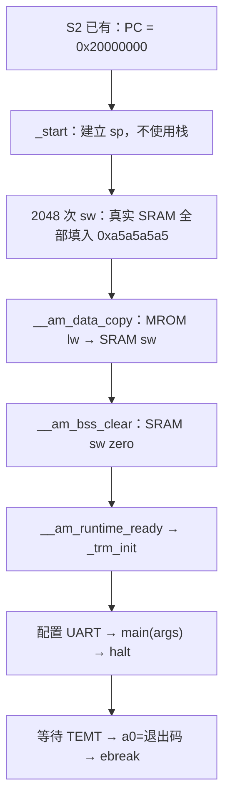

# M5 S3：AM、SRAM 启动与逐指令 DiffTest

> 2026-10-20；S3 完成，M07/M08 的 MROM/SRAM 范围通过，无当前阻塞。
> 前置为 [S2 真实 SoC](2-bringup.md)，本次证据见 [s3-validation](s3-validation/README.md)。
> 下一步 S4：Flash XIP、Flash → SRAM，然后 PSRAM 容量闭环。Flash 尚未纳入本次差分。

## 1. 这一步新增了什么

S2 的程序主要是手写汇编，验证取指、总线和设备。本次让 C 程序通过 **AbstractMachine 平台运行时**在真实 ysyxSoC 上运行，并且每次提交都由 NEMU 执行相应指令作比较。这里没有新增 CPU 功能 RTL，也没有修改 ysyxSoC/嵌套 Rocket Chip。

| 新功能 | 实现入口与阅读重点 |
| --- | --- |
| `ARCH=riscv32e-ysyxsoc` | [arch 配置](../../../../abstract-machine/scripts/riscv32e-ysyxsoc.mk)、[platform 配置](../../../../abstract-machine/scripts/platform/ysyxsoc.mk)：选择源文件、ISA/ABI、链接脚本和运行入口 |
| MROM/SRAM 分离链接 | [ysyxsoc.ld](../../../../abstract-machine/scripts/ysyxsoc.ld)：`.data > sram AT> mrom`、NOLOAD bss、heap/stack 和容量断言 |
| CPU 完成初始化 | [start.S](../../../../abstract-machine/am/src/riscv/ysyxsoc/start.S)：poison → data copy → bss clear → `_trm_init`，三个全局标签便于定位启动阶段 |
| AM 输出和退出 | [trm.c](../../../../abstract-machine/am/src/riscv/ysyxsoc/trm.c)：UART divisor/8N1、THRE 轮询、TEMT 排空、main/ebreak |
| AM 读取时间 | [ioe.c](../../../../abstract-machine/am/src/riscv/ysyxsoc/ioe.c)：mtime 高/低/高读取、100 MHz tick 换算；不提供 timer IRQ |
| 提交后的架构状态 | [soc_monitor.sv](../../../../npc/sim/soc_monitor.sv)：`npc_soc_state` 和 `npc_soc_sram_word`；[main.cpp](../../../../npc/csrc/soc/main.cpp)：`commit_pending` 在 `eval()` 后处理 |
| 逐指令比较、设备输入同步 | [difftest.h](../../../../npc/csrc/soc/difftest.h)、[difftest.cpp](../../../../npc/csrc/soc/difftest.cpp)：`SocDiff::init/step/memory` |
| 独立 NEMU 平台配置 | [ysyxsoc.mk](../../../../nemu/scripts/ysyxsoc.mk)、[ysyxsoc-ref.h](../../../../nemu/configs/ysyxsoc-ref.h)：单独生成配置/对象/共享库 |
| 参考端地址图和边界 | [ysyxsoc.c](../../../../nemu/src/memory/ysyxsoc.c)、[paddr.h](../../../../nemu/include/memory/paddr.h)、[ref.c](../../../../nemu/src/cpu/difftest/ref.c)：双内存区、整段边界检查、一次性设备输入 |
| 独立推导访存异常 | [inst.c 的 `isa_exec_once`](../../../../nemu/src/isa/riscv32/inst.c)：仅 SoC profile 启用，对参考端 PC/有效地址检查对齐、容量和权限 |
| 可重复验收 | [m5_s3_test.py](../../../../npc/tests/m5_s3_test.py)、[测试程序](../../../../npc/tests/soc-runtime/)；[soc.mk](../../../../npc/scripts/soc.mk) 增加 `soc-ref/s3-test` |

沿用的部分包括：S1 的 RV32E/四 CSR/精确异常及内部 mtime，S2 的实际 MROM/SRAM/UART、guard、镜像 backing、事件调度和串行接收器。软件乘除法仍复用 `riscv/npc/libgcc`；`cte.c/trap.S` 暂复用既有同步异常/ECALL 实现，S3 的异常验收使用独立汇编 handler，完整 AM 中断/context 验收属于 S5。

## 2. C 程序为什么需要新的链接与启动过程

### 2.1 VMA、LMA 和 binary 不是同一概念

- **VMA** 是程序运行时访问的地址。例如 `initialized[0]` 必须位于可写 SRAM。
- **LMA** 是启动镜像中保存该段初值的位置。本轮初值放在 MROM，CPU 上电后复制到 VMA。
- `objcopy -O binary` 按需要装载的段生成 raw image；本轮文件 offset 0 对应 MROM `0x20000000`。harness 只把它装入 ROM backing。
- `.bss` 没有文件初值，使用 `NOLOAD`，由 CPU 清零。不能像旧 NPC 脚本那样把 bss 变成镜像内容，也不能先把 data/bss 从宿主机写入 SRAM。

| 区域/段 | 运行位置 | 初始内容来源 |
| --- | --- | --- |
| MROM `.text/.rodata` | `0x20000000` 起，最多 4 KiB（还要容纳 data 初值） | raw binary |
| SRAM `.data` | `0x0f000000` 起 | MROM 的 `_data_load`，复制到 `_data_start.._data_end` |
| SRAM `.bss` | data 后，结束对齐到 16 B | CPU 写零至 `_bss_end` |
| heap | `_heap_start..0x0f001800` | 留给程序，不能覆盖全局变量或栈 |
| stack | `0x0f001800..0x0f002000`，预留 2 KiB | sp 从 SRAM 顶向下增长 |

链接器断言检查 ROM 文件内容不超过 4 KiB，data/bss 不侵占预留栈。2 KiB 是当前小程序预算，不是静态证明任意 C 程序不会栈溢出；测试还记录运行时最小 SRAM sp。heap 的导出也不等于实现了通用 `malloc`：microbench smoke 使用有边界检查的小型 bump allocator。

以 `memory` 镜像为例：binary 为 **1052 B**；data 为 **32 B**，VMA `0x0f000000`、LMA `0x200003fc`；bss 为 **48 B**；heap 从 `0x0f000050` 到 `0x0f001800`，可用 **6064 B**；实测栈使用 **420 B**。具体段地址与文件映射见 [layout](s3-validation/memory-layout.txt)。

### 2.2 沿着一次复位读启动代码



poison 是 **S3 为验证启动特意保留的软件前导步骤**。它发生在第一次函数调用之前，只使用寄存器，不会破坏活动栈。整块 SRAM 的 2048 个 word 都经过 CPU → LSU → AXI → 真实 RAM 写入；monitor 没有代写。

为什么先写非零？Verilator 中 SRAM 初值可能恰好是零，遗漏 bss 清零仍可能“通过”。非零预填使错误可见；同样能检测 data 未复制。测试除了检查 C 变量，还从总线记录核对前 2048 个写的地址、数据、WSTRB 和响应，并按启动标签核对后续复制/清零的范围。本轮 data 复制 8 个 word，bss 清零 12 个 word。

两个负例分别将 binary 中的 data-copy store、bss-clear store 替换为 NOP，两者都在程序自检时以非零 a0 失败。NEMU 同样执行这个被破坏的程序，所以这里的检测依据是**独立的程序预期**，不是仅靠 DUT/REF 相等。

poison 对小程序运行时间占比较大，因此本轮 cycles 是功能验收数据，不能直接作为应用性能成绩。S4 应将启动验证图案与正式启动时间统计口径明确区分。

## 3. UART 和时间接口怎样连接 AM

`_trm_init` 先设置 UART LCR.DLAB，再写 DLL=1/DLM=0，之后 LCR=3 选择 8N1 并恢复普通寄存器地址，关闭 UART 中断。当前仿真为 100 MHz，因此 TX 每 bit 16 个时钟；这沿用 S2 接收器的约定。

`putch` 等 LSR.THRE 再写 THR，避免覆盖尚未发送的数据。`halt` 等 LSR.TEMT，确保最后一个字符已经从引脚发出，再执行 ebreak。hello 的验收匹配实际 TX 解码出的 **16 字节 `Hello, ysyxSoC!\n`**，不使用上游 UART 的 `$write` 打印作为证据。

`ioe_read(AM_TIMER_UPTIME)` 读内部 CLINT 的 `0x0200bffc/0x0200bff8/0x0200bffc`。如果两次高字不同就重试，避免低字溢出造成拼接错误；64 位 tick 除以 100 得到 us。S3 验证两次读取单调且非零；跨低字溢出、比较器、mask 和精确 IRQ 仍按 S5 的专门矩阵验证。`AM_TIMER_CONFIG` 声明有计时器、无 RTC；未实现设备不假报 present。

## 4. DiffTest 为什么这样采样和同步

### 4.1 比较必须使用“同一条指令之后”的状态

RTL monitor 在提交上升沿采样该条指令的 PC、instruction、访存/异常元数据。此时 GPR/CSR 的非阻塞赋值尚未全部生效，不能立即把这些旧值和执行了一条指令的 NEMU 比较。

本次先在 DPI callback 中暂存 `SocCommit`，等 C++ 的 `dut->eval()` 返回，再调用绑定模块导出的 `npc_soc_state(index)`，取得更新后的：

```text
x0..x15, next-PC, mstatus, mtvec, mepc, mcause   共 21 × 32 bit
```

其中 next-PC 来自 core 的 `u_arch_pc`：它在 commit 时更新为 `commit_npc`，不同于该条指令原来的 PC，也不同于预取中的 PC。比较流程是：

1. 检查 REF 当前 PC 等于提交 PC。
2. 从 REF 普通内存读取 instruction，检查提交 instruction 一致。
3. 必要时提供单次设备读输入。
4. NEMU 执行一条；逐项比较全部 16 GPR、下一 PC 和四 CSR。
5. 正常结束时，通过只读 SRAM bind 读取真实 2048-word 数组，与 REF 的整块 SRAM 比较一次。

后者能发现“写坏一个暂时没有再次读取的地址”。binding 只属于仿真文件列表，CPU BlackBox 61-port ABI 和功能数据通路没有变化；重新生成时若上游 `mem_2048x32.Memory` 结构改变，binding 必须随契约审查，不能无声换成宿主机影子 RAM。

### 4.2 NEMU 的独立 profile 保留普通平台

`make -C npc soc-ref` 调用专用 Makefile，输出 `nemu/build/ysyxsoc/nemu-ref.so`。它复用 NEMU 的 interpreter、CPU/CSR 状态和 DiffTest API，但从本地 profile header 构建 16 GPR 配置，并将单一 pmem 后端替换为：

| REF 区域 | 大小和权限 | CPU 与 REF 初始化 |
| --- | --- | --- |
| MROM `0x20000000` | 4096 B；运行中只读 | 同一 binary，仅加载 ROM |
| SRAM `0x0f000000` | 8192 B；读写/可取指 | 参考数组初值为零；两侧执行同样的 CPU poison/copy/clear |
| UART `0x10000000..07` | 本轮允许 byte 寄存器访问 | 一次性设备输入/写数据 token |
| mtime `0x0200bff8/bffc` | 本轮差分同步只开放 word 读 | 每次读的输入同步，不模拟指令步进与 CPU 周期的对应关系 |

共享库先通过 `difftest_soc_abi` 校验版本/21-word 布局，避免误载普通 32 GPR NEMU 库。`difftest_memcpy` 检查整个跨度位于同一区域，不能只检查首地址。

这一路不改 `.config`、`include/generated/autoconf.h`，不经过根 Makefile 的 tracer 自动提交。普通 NEMU 的新源文件分支为空，原单区域行为保持。另做普通构建与 32 GPR/M 指令 smoke 通过；原普通 shared target 的 readline 装载依赖由测试宿主预加载解决，未在本轮改写普通构建系统。

### 4.3 设备数据不可预测，不代表整条指令都不用检查

CPU 执行一条 UART LSR byte load 时，NEMU 与 RTL 的设备周期不同，不能要求两个独立 UART 模型恰好返回同一状态位。本轮让 host 根据 **REF 的 instruction、前态 GPR 和有效地址**识别设备访问，再提供读值：

- UART byte、mtime word 的成功访问才可同步。普通 ROM/SRAM 不满足条件。
- 输入 token 只可消费一次；地址、宽度、读写方向必须匹配。未消费或多消费直接失败。
- 读数据来自 DUT 的目的寄存器，再由 REF 执行符号/零扩展和写回；其他 GPR、PC、CSR 仍正常比较。`rd=x0` 时结果被丢弃，不能通过差分证明设备读值。
- 写操作仍由 REF 执行，并校验 token 的地址/宽度/数据；真实设备副作用由 UART strobe/TX 和程序预期验证。

因此本轮 **整状态 skip 为 0**。`diff_device_reads/writes` 记录输入同步次数，`diff_steps == commits` 是每个成功 workload 的硬检查。

边界也必须说清：把 DUT 读值作为 REF 输入，不能独立证明 UART/mtime 返回值正确；S2 的串行/寄存器检查和 S1/S5 的 timer 定向测试提供另一层依据。未来 Flash/PSRAM 应增加为普通存储区域，不能整段归为设备同步来绕过差分。

### 4.4 异常不是把 DUT cause 抄给 NEMU

SoC profile 的 `isa_exec_once` 在参考执行前，用 REF 的 PC、指令和源寄存器计算地址，对照自己的区域表推导 fetch/data 访问错误、data misalignment；发生 fault 时更新 cause/EPC/mstatus 并跳向 mtvec。ECALL/MRET 继续由 NEMU 指令实现处理。host 不调用 `difftest_raise_intr(DUT cause)`。

`traps.S` 另有自己的预期标签和 cause，逐次核对 handler 读到的 CSR，返回后检查故障 load 未写目的寄存器、故障 store 未改合法内存；Python 再核对提交记录中的 cause/EPC。因此并非两侧相同就算异常正确。

本 profile 只补当前平台访存合同，不声称完整特权 ISA 一致性：NEMU 既有 decoder 与 NPC 的全部保留编码策略不完全相同，M/高寄存器等非法编码继续以 S1 独立译码/异常测试为依据；timer IRQ 的参考端同步属于 S5。S3 程序统一编译为 RV32E + Zicsr、无 M/C；软件乘除法不等于新增硬件 M。

## 5. 验收结果和实际范围

| 检查 | 预期与本轮结果 |
| --- | --- |
| AM hello | 实际 TX 精确匹配 16 B；6356 次提交全部差分通过 |
| SRAM runtime | 2048-word 非零预填、data/bss、全局改写、heap 全遍历、byte/half/word lane、软件 64 位数据、递归栈；24626 commits |
| 区域首尾 | 复用 S2 memory 汇编，加上逐指令差分和最终 SRAM 比较：46 commits，覆盖 SRAM 首 word/末 word/末 byte、MROM 末 byte |
| 异常 | `lh/lw` cause4、`sh/sw` cause6、SRAM 越界读5/写7、MROM 写7、ECALL11；8 次；独立标签核对 EPC，MRET 后继续 |
| 计时 | AM 配置与 uptime；两次高/低/高共6次mtime读取，全部指令继续差分 |
| CPU tests | **24/35 PASS**；1 项 `hello-str` 超 MROM 3912 B；其余10项构建通过但不在本轮固定运行子集。完整名单见 [cpu-tests.json](s3-validation/cpu-tests.json) |
| microbench smoke | 直接链接原 `sieve.c`/`fib.c`，分别使用 SIEVE_S/FIB_S，固定 checksum `0x19`/`0x7cfeddf0`；不是完整 microbench 框架或评分 |
| 差分负例 | 第5次提交 `addi t0,t0,-12` 的比较快照 x5 翻转1 bit，报告 PC `0x20000010` 的 GPR mismatch |
| 启动负例 | 分别移除 data-copy/bss-clear store，两者均被 C 自检拒绝 |
| 容量负例 | 超4KiB ROM、data/bss侵占预留栈均在链接时失败 |
| 回归 | S2 全套通过；普通 NEMU 32 GPR/M smoke 通过，原 `.config` 保持 |

`load-store.c` 中的非对齐 C 表达式在本次编译下通过，不代表 CPU 实现非对齐 word 访问；硬件策略以显式 `lh/lw/sh/sw` 汇编异常用例为准。没有把“源码写了某种表达式”当成一定生成某种指令的证明。

本轮 31 个正向 workload 均检查最终整块 SRAM；Flash/PSRAM/RT-Thread、系统随机延迟和 timer IRQ 未混入 PASS。S2 已有的外围告警边界继续有效，不宣称全 SoC lint clean。

## 6. 复现、产物和下一步

工程根目录执行：

```sh
make -C npc s3-test
make -C npc s2-test

# 独立使用新 AM 平台，run 自动构建/装载 SoC reference
make -C npc/tests/soc-runtime ARCH=riscv32e-ysyxsoc run
```

S3 runner 将35个CPU test逐一构建后分类，运行固定子集，失败即停止；依赖 `AM_HOME`/`NPC_HOME` 指向本工程。`npc/build/m5-s3/programs/<name>/build/` 中保留 ELF、map、反汇编和 raw binary；上层保留 summary、commit/bus CSV、负例日志、image hash/布局及分类 JSON。大波形和生成文件留在 build，精选证据归档到 [s3-validation](s3-validation/README.md)。

原始 `make -C npc run IMG=...` 仍允许 S2 无差分定向运行；使用 `--diff /absolute/path/nemu-ref.so` 才启用新差分。AM `run` 默认开启，S3 测试也强制开启。

当前没有 S3 外部阻塞。下一步 S4 必须先接通真实 Flash 路径，再开放 guard 与 reference 普通存储映射；完成 Flash → SRAM 小闭环后实施 S0 已确定的4MiB PSRAM路线。不要通过放大当前4KiB/8KiB限制来搬入 `hello-str`、完整 benchmark 或 RT-Thread。
