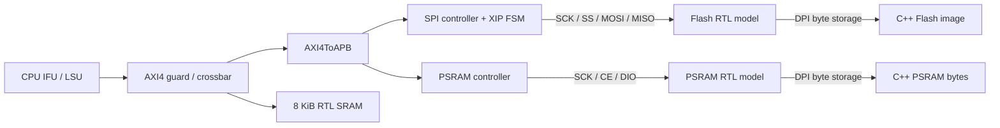

# M5 S4：Flash 启动、PSRAM 与容量闭环

> 2026-10-26；S4 / M09 / M10 通过。41 个正向 workload、965,839 次提交全部差分，9 个启动/容量负例有效；S1/S2/S3 回归通过，无当前阻塞。下一步 S5。

S3 的程序从 MROM 执行，只有 data/bss/stack 在 8 KiB SRAM 中。S4 增加两个能力：CPU 能通过真实串行控制器读取 Flash；CPU 能从 Flash 自行搬运程序到 SRAM 或 4 MiB PSRAM，再在那里执行。PSRAM 用于容纳较大的程序，不改变 CPU 的单拍、单 outstanding 总线合同。

## 1. 先把各层的职责对上

| 层次 | 本步实现/修改 | 源码入口 |
| --- | --- | --- |
| CPU RTL | 复用原 IFU/LSU/AXI4；增加 Flash 复位 PC 的构建选择，61-port ABI 不变 | [ysyx_25030087.sv](../../../../npc/vsrc/top/ysyx_25030087.sv)，`NPC_FLASH_BOOT`、`PC_RST` |
| SoC 可综合 RTL | XIP 请求转换为 SPI 寄存器序列；放行实际存储范围；修正 PSRAM 事务结束时序与 APB access-phase 启动 | [spi_top_apb.v](../../../../ysyxSoC/perip/spi/rtl/spi_top_apb.v)、[guard](../../../../ysyxSoC/perip/amba/npc_axi4_guard.v)、[psram_top_apb.v](../../../../ysyxSoC/perip/psram/psram_top_apb.v)、[EF_PSRAM_CTRL.v](../../../../ysyxSoC/perip/psram/efabless/EF_PSRAM_CTRL.v) |
| 外部器件仿真模型 | 复用已有 Flash 模型；补 PSRAM 的命令/地址/dummy/data 解码，DPI 按串行事务读写 backing | [flash.v](../../../../ysyxSoC/perip/flash/flash.v)、[psram.v](../../../../ysyxSoC/perip/psram/psram.v) |
| C++ harness | 加载非易失镜像、保存 PSRAM 字节、记录访问计数；核对首次 PC、逐指令状态、最终 RAM | [main.cpp](../../../../npc/csrc/soc/main.cpp)、[difftest.cpp](../../../../npc/csrc/soc/difftest.cpp) |
| NEMU 参考端 | 扩展普通存储映射与只读权限；初始化 Flash 镜像、选择 reset PC；仅 SPI **寄存器**使用单次设备输入同步 | [ysyxsoc.c](../../../../nemu/src/memory/ysyxsoc.c)，`soc_memory_span/writable`、`soc_device_access` |
| AM 软件栈 | Flash 启动汇编、两份 linker script、独立 profile 构建目录 | [flash-start.S](../../../../abstract-machine/am/src/riscv/ysyxsoc/flash-start.S)、[SRAM linker](../../../../abstract-machine/scripts/ysyxsoc-flash-sram.ld)、[PSRAM linker](../../../../abstract-machine/scripts/ysyxsoc-flash-psram.ld) |
| 验证软件与编排 | 寄存器读 Flash、PSRAM 数据完整性、启动正反例、CPU tests、RT-Thread 容量 smoke | [soc-boot/](../../../../npc/tests/soc-boot/)、[m5_s4_test.py](../../../../npc/tests/m5_s4_test.py) |

没有改生成的 `ysyxSoCFull.v`，也没有新建并行 CPU transport。SoC 与外部 Flash/PSRAM 的连接已经由上游 Scala 生成；本步补的是这些连接后面的实现。原有 Rocket Chip 工作区补丁保持不变。



图中 CPU 到存储模型之间的事务全部经过 RTL。DPI 位于器件模型内部，不能由 CPU load/store 直接调用，也不负责代 CPU 执行启动搬运。

## 2. 三种“从 Flash 读”的区别

### 2.1 软件操作 SPI 寄存器

先从 MROM 执行 [spi.c](../../../../npc/tests/soc-boot/spi.c)。程序向 `0x10001000` 的 SPI 寄存器块写入 divider、SS、TX 数据和控制字，轮询 GO/BUSY，再读 RX。

本轮一次读 4 字节，共传输 64 bit：`03h command + 24-bit byte address + 32-bit receive data`。TX1 保存 command/address，TX0 提供后半段时钟；控制字 `0x2540` 表示 ASS、TX_NEGEDGE、GO 和长度 64。SS0 接 Flash，divider=1 对应当前控制器的 SCK=bus clock/4。

用固定内容 `12 34 56 78` 作独立预期：SPI 接收移位寄存器是 `0x12345678`。这个测试能检查控制器/引脚/颗粒模型；仅把 DUT 的设备读值同步给 NEMU 不能独立证明 SPI 返回的数据正确，所以必须保留这个已知内容自检。

### 2.2 XIP：普通取指/读取转换为 SPI 事务

`spi_top_apb.v` 识别 `0x30000000` 起的 Flash 访问，并暂缓 APB `PREADY`。内部 FSM：

1. 等待前一个 SPI 事务空闲。
2. 设置 divider、SS0、TX1 的 `03 + aligned address` 和 TX0。
3. 写控制字启动 64-bit 传输。
4. 轮询 BUSY，完成后读取 RX0。
5. 转换成 little-endian word，返回 APB 响应。

每两个内部 Wishbone 操作之间插入 GAP，让注册的 ACK 清零，避免把上一笔应答误当成下一笔完成。APB 请求等待期间只启动一次转换，不因 `PSEL/PENABLE` 连续有效而重复启动。

CPU 读取上述地址时应得到 `0x78563412`；byte/half load 再由既有 LSU 选择字节。XIP 内部对齐到 word 读取，不改变 CPU 发出的原始 byte address/SIZE。Flash write 不受支持，在 guard 被拒绝。

本实现没有 `FAST_FLASH` 旁路。`flash_read()` 的调用来自真实 `03h` 引脚事务解码，不是 APB 地址命中后的直接读取。

**共享控制器边界**：XIP 会重写 SPI 控制寄存器，不能同时把这些寄存器当成由软件独占的状态。手工 SPI 测试从 MROM 运行；以后需要 Flash 编程/复杂 SPI 驱动时，应把驱动及相关中断处理放在 RAM，并明确控制器所有权。当前只做只读 Flash 启动。

### 2.3 Flash → RAM：XIP 只承担启动阶段

直接从 Flash 执行每条指令较慢。本轮两个正式 AM profile 都先在 Flash 执行小型 boot routine，再将应用 `.text/.rodata` 与 `.data` 搬到 RAM，清 `.bss`，最后跳到 RAM 中的 `_trm_init`。

因此，“XIP 能运行”和“应用已从 RAM 运行”是两个独立验收点。两条指令的 XIP smoke 证明 Flash reset fetch；带数据、递归调用、UART 的启动程序证明搬运后真的进入 RAM。

## 3. PSRAM：已有控制器，新增外部颗粒模型

当前 PSRAM 是 SoC 外部存储，CPU 看到普通地址空间，控制器把 APB 操作转换为串行传输。颗粒模型保存在 C++ 的独立 4 MiB 数组里；它与 NEMU 的 4 MiB 数组不是同一块内存。

本轮实现与现有控制器匹配的子集：

| 操作 | Command | 地址阶段 | 后续阶段 |
| --- | --- | --- | --- |
| Quad read | `0xeb`，DIO0 上 8 个时钟 | 24-bit 地址，4 线、6 个时钟 | 6 个 dummy clock，然后 4 线读数据 |
| Quad write | `0x38`，DIO0 上 8 个时钟 | 同上 | 无 dummy，4 线写 1/2/4 字节 |

这不是 command 也走 4 线的 QPI 模式。read 控制器固定读取一个对齐 word；write 根据 strobe 选择长度并压缩有效 byte lane，保留原 byte address。guard 拒绝 PSRAM 不支持的非连续/不完整写掩码。

模型在每个串行字节完成后调用 `psram_write`；读取调用 `psram_read`，返回的值再逐 nibble 送回引脚。既有控制器在 SCK 下降阶段采样，因此功能模型在前一个上升阶段提供数据。它验证本控制器的功能事务，不宣称完整商用颗粒协议、刷新/掉电行为或器件 AC 时序模型。

### 实际发现并修复的问题

首尾地址测试在 `0x803ffffc` 读最后一个 word 时，最初触发 backing 越界。原因不是容量应该再放大，而是 reader 的 DONE 已经到达，CE 仍因寄存器更新晚一拍保持有效，SCK 又多产生了一个上升沿；模型开始准备第五字节。

修复位于 `EF_PSRAM_CTRL.v`：reader/writer 在 DONE 时停止 SCK 并释放 CE。另把 `psram_top_apb.v` 的 WB 启动条件改为 `PSEL && PENABLE`，明确只在 APB access phase 发事务。没有放宽模型的越界检查来让测试通过。

## 4. 容量、权限与错误必须一致

| 对象 | 合法字节地址 | 权限/说明 |
| --- | --- | --- |
| MROM | `0x20000000..0x20000fff` | 4 KiB，只读，保留诊断启动 |
| SRAM | `0x0f000000..0x0f001fff` | 8 KiB，普通 RAM |
| Flash | `0x30000000..0x30ffffff` | 16 MiB，只读 |
| PSRAM | `0x80000000..0x803fffff` | 4 MiB，普通 RAM |
| SPI 寄存器 | `0x10001000..0x10001018` 的 word 地址 | 仅对齐 word；寄存器块剩余地址拒绝，防止低位译码别名 |

上游声明的 Flash 总线窗口是 256 MiB，本轮器件只有 24-bit 地址，即 16 MiB。guard 在地址截断前检查范围，`0x31000000` 不得绕回 Flash 首地址。Flash 保留窗口/只读写等返回 SLVERR，未映射的 PSRAM 上界外返回 DECERR；CPU 转换为精确 access fault。未对齐请求由 CPU 报 address-misaligned。

这些判断在 REF 侧由自身地址、宽度与访问方向独立计算；不从 DUT 的 `mcause` 复制结论。

## 5. 启动代码与 linker 怎样配合

两个 linker profile 共享布局方式，只改变 RAM 起点/容量和预留栈：

| 区域 | VMA（运行地址） | LMA（镜像中原始字节） |
| --- | --- | --- |
| `.boot` | Flash `0x30000000` | 同 VMA |
| `.text`（包含 rodata） | SRAM 或 PSRAM 起点 | 紧跟 Flash boot |
| `.data` | RAM text 之后 | 紧跟 Flash text 的镜像 |
| `.bss` | RAM data 之后 | `NOLOAD`，不占镜像字节 |
| heap | bss 末尾至保留栈底 | 不占镜像 |
| stack | RAM 顶端向下 | SRAM 2 KiB；PSRAM 64 KiB |

`objcopy -O binary` 按 LMA 生成紧凑 Flash 镜像，不会生成从 Flash 地址到 PSRAM 地址的巨大空洞。`_text_load/start/end`、`_data_load/start/end` 等是 linker symbol，汇编使用其地址来构造复制范围。

`flash-start.S` 全部位于 Flash `.boot`，按如下次序执行：

1. 设置 SP 的数值，但尚不访问 stack、不调用 C。
2. 将未来静态 RAM 区间 `[_text_start, _bss_end)` 写为 `0xa5a5a5a5`。
3. 复制 text/rodata、复制 data、清零 bss。
4. 调用 RAM 地址的 `_trm_init`，进入既有 UART/AM/main/halt 流程。

这里 poison 只用于让遗漏初始化可观察；它发生在目标 RAM 代码/数据尚未生效时。**不是在已搬到 RAM 的 C 程序中再次清整块 RAM**，也不为了验证遍历全部 4 MiB heap。性能比较时应划定启动和 workload 区间，不能把 poison 计数当成 CPU benchmark 成绩。

## 6. DiffTest 新增了什么检查

C++ 与 NEMU 各自装载相同的 Flash/MROM 初始镜像，RAM 都从模型的确定初值开始。每一条复制指令、每一次 store、RAM 中取出的每条指令均逐提交比较，最终再比较完整 8 KiB SRAM 和 4 MiB PSRAM。

所以，普通 Flash/PSRAM load/store **不会**被标成 MMIO 或跳过；RAM 中复制错一个字节，可以由后续取指/读数据比较或最终内存比较发现。最终全内存比较也能发现不被软件再次读出的错误写入。

SPI 寄存器、UART、mtime 仍采用单次设备输入 token：REF 执行指令，独立核对 PC、其他 GPR/CSR 与 store 值。它没有实现一份周期精确 SPI 控制器，SPI 自身的数据正确性由已知 Flash pattern、XIP 对照和串行模型检查承担。

## 7. 运行、观察与证据

先从项目根目录运行：

```bash
make -C npc s4-test
```

该入口构建 NEMU reference、MROM/Flash 两份仿真器，再运行四组测试。排查时可在完成构建后单独运行：

```bash
python3 npc/tests/m5_s4_test.py --only smoke
python3 npc/tests/m5_s4_test.py --only boot
python3 npc/tests/m5_s4_test.py --only cpu
python3 npc/tests/m5_s4_test.py --only capacity
```

`--only` 仅重跑所选组，不代表整项验收。所有二进制、ELF/map、commit/bus CSV 和日志留在 `npc/build/m5-s4/`；长期保存的摘要另归档到 `s4-validation/`。

普通 AM 应用仍使用 `ARCH=riscv32e-ysyxsoc`，增加启动 profile：

```bash
# 在 AM 应用目录中：
make ARCH=riscv32e-ysyxsoc SOC_BOOT=flash-sram run
make ARCH=riscv32e-ysyxsoc SOC_BOOT=flash-psram run
```

AM 的 `SOC_BOOT` 有 `mrom / flash-sram / flash-psram` 三种；NPC 硬件只区分 `mrom / flash` 两种复位入口。AM run 规则负责转换。两层的构建目录都隔离，切换配置不复用错误的旧 object/library。

手工运行已生成的 Flash 镜像：

```bash
make -C npc run SOC_BOOT=flash IMG=/path/to/flash.bin \
  ARGS="--diff $PWD/nemu/build/ysyxsoc/nemu-ref.so --summary /tmp/run.json"
```

观察启动时，先看 ELF/map 的 `_start`、`_text_load`、`_text_start` 和 `_trm_init`。再在 `boot-flash-psram.commit.csv` 中核对首 PC 为 `0x30000000`、复制 store 的目标为 `0x80000000` 起的地址、随后提交 PC 进入 PSRAM。`*-startup.json` 列出 poison/text/data/bss 的逐地址 store 核对数量；`*.json` 中 `diff_steps == commits` 和两个 `diff_*_checks == 1` 表示相应比较执行过，仍需程序 PASS 与 UART 自检同时成立。

测试修改二进制中的 data-copy/bss-clear store 为 NOP，不修改源码。这两个负例由 [runtime.c](../../../../npc/tests/soc-boot/runtime.c) 检查初始化全局变量/零数组时发现，调用 `halt(1)`，最终 harness 报 `ebreak with nonzero a0`。两个模型执行同一份错误启动代码仍可能差分一致，因此软件自检负例不可由“DiffTest PASS”替代。

## 8. 本步出口与后续范围

验收结果与容量实测见 [精选证据](s4-validation/README.md)。适用的 34 个 CPU tests 已全部运行通过；`unalign` 因当前 ISA 对未对齐访问报异常而排除，不能把它算作已通过。

既有 RT-Thread 协作式 workload 用于证明真实装载、线程栈、heap 和上下文切换可以放入 PSRAM。它的中断开关仍是占位实现，不构成 timer IRQ 或抢占验收；S5/S6 继续完成这条链。Flash erase/program、SDRAM、cache、burst/multi-outstanding、器件 AC 时序和全 SoC 中途复位恢复不在本步完成声明内。

S5 的交接重点：给内部 CLINT 增加 mtimecmp/MTIP，补 CPU 的中断使能与精确中断入口，并扩展 reference 的中断边界同步；AM `iset/ienabled` 和 RT-Thread timer hook 的占位不能继续当成中断支持。后续系统 workload 优先使用 `flash-psram`，保留 MROM 小程序作为定向诊断入口。
