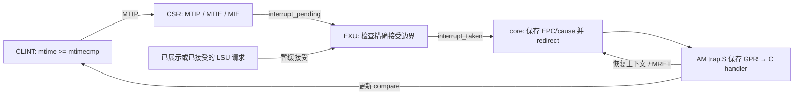

# M5 S5：从计时器读数到精确定时器中断

> 2026-10-28；实现与验证记录。验收结果以 [S5 精选证据](s5-validation/README.md) 为准。

S4 的程序可以读取时间，但 CPU 不会因为时间到期而主动转去处理任务。S5 增加这条通路：**CLINT 比较时间 → CPU 判断使能和可接受边界 → 保存下一条指令的 PC → AM 保存上下文、调用 handler → MRET 恢复执行**。软件可以周期性设置下一次 deadline，RT-Thread 因而能够推进 tick。

本步只实现单核、M-mode 的 machine timer interrupt。外部 `io_interrupt` 仍不支持，61-port CPU BlackBox ABI 不变；没有 MSIP、PLIC、S-mode、MMU、WFI 或中断嵌套。S6 继续完整的双线程抢占、阻塞唤醒及栈/heap 水位验收。



## 相关术语

### 中断从产生到处理

| 术语 | 含义与本步对应 |
| --- | --- |
| IRQ（Interrupt Request） | 中断请求。本步的源是 CLINT 的 `timer_irq`，表示计时器已经到期。 |
| Pending（挂起） | 中断源的条件仍成立。本步即 `mtime >= mtimecmp`，反映在 `mip.MTIP`。即使关闭使能，或已经进入 handler，pending 也可能仍为 1；它不等于“CPU 已接受中断”。 |
| Enable / mask（使能 / 屏蔽） | 决定 CPU 是否允许响应请求。关闭 MIE 或 MTIE 会屏蔽 timer IRQ，但不会停止计时或清除到期条件。 |
| Taken（接受中断） | CPU 在允许的指令边界实际进入中断，本工程用 `interrupt_taken` 表示。这时才保存恢复 PC、更新 CSR 并跳转。 |
| Exception / interrupt / trap | exception 是执行当前指令引起的同步异常，如非法指令、ECALL；interrupt 是相对于指令执行异步产生的请求，如 timer 到期。trap 是二者使 CPU 转入处理入口的统称。 |
| ISR（Interrupt Service Routine）/ handler | 中断服务程序 / 处理函数。这里完整处理路线包含 `trap.S` 保存现场、C handler 处理事件、汇编恢复现场；C handler 只是其中一段。 |
| 精确中断（precise interrupt） | 入口状态能对应一个明确的指令边界：之前的指令已完成，下一条尚未执行，返回后不遗漏或重复指令的副作用。不能简单地理解为“IRQ 来了立刻跳转”。 |
| NMI（Non-Maskable Interrupt） | 不可屏蔽中断，不受普通中断使能控制。**本工程未实现 NMI**；timer IRQ 是可屏蔽中断。 |

### 本步用到的硬件名称

| 术语 | 含义与本步对应 |
| --- | --- |
| CLINT（Core-Local Interruptor） | 核本地中断模块。本工程保留 CPU 子系统内部的 CLINT，只实现计时部分：`mtime` 是当前计数，`mtimecmp` 是比较阈值，二者比较产生 timer IRQ。 |
| M-mode / CSR | M-mode 是 RISC-V 机器特权态；本 CPU 只实现这一特权态。CSR（Control and Status Register）是控制与状态寄存器，通过 CSR 指令访问，不是普通 RAM 地址。 |
| MTIP / MTIE / MIE | 分别为 Machine Timer Interrupt Pending、Machine Timer Interrupt Enable、Machine Interrupt Enable。对应 `mip.MTIP` 的到期状态、`mie.MTIE` 的 timer 单独开关、`mstatus.MIE` 的全局开关。注意小写 `mie` 是一个 CSR 的名字，大写 `MIE` 是 `mstatus` 中的一位。 |
| MPIE / MPP | `mstatus` 中的 Machine Previous Interrupt Enable / Machine Previous Privilege。MPIE 保存进入 trap 前的 MIE，供返回时恢复；MPP 表示 trap 前的特权态，本实现固定为 M。 |
| EPC / cause / vector | EPC（Exception Program Counter）记录 trap 相关的程序位置；对本步 timer IRQ，它是恢复执行的位置，存入 `mepc`。cause 是进入原因，存入 `mcause`；trap vector 是处理入口，由 `mtvec` 指定。当前 direct 模式表示所有 trap 都跳到同一入口，再由软件按 cause 分发。 |
| ECALL / MRET | ECALL 是主动请求环境服务的指令，会引发同步异常；MRET 是从 M-mode trap 返回的指令，恢复 PC 和中断使能。普通 C 函数的 `return` 不能代替 MRET。 |
| Commit / architectural state | commit（提交）表示一条指令的架构效果正式生效；architectural state（架构状态）包括 GPR、CSR、下一架构 PC 等程序可观察状态，不包括取指队列等内部暂存状态。这里保存的“下一架构 PC”不一定等于 IFU 正在取指的地址。 |

### 软件与验证中的名称

| 术语 | 含义与本步对应 |
| --- | --- |
| Deadline / rearm | deadline 是下一次到期的计数值，即写入 `mtimecmp` 的目标；rearm 是重新设置这个目标，使计时器等待下一次到期。 |
| Timer tick / OS tick | 本文中硬件计数器每加 1 是一个 timer tick，当前为 10 ns；RT-Thread 每推进一次内核节拍是一个 OS tick，目标间隔为 10 ms。二者相差 1,000,000 个硬件计数，不能混用。 |
| Context / trap frame | Context 是保存恢复执行所需状态的数据结构；trap frame 是 trap 汇编在栈上建立的保存区域。当前 RV32E 使用 80 字节，两者布局相对应。GPR 是通用寄存器，SP 是栈指针（x2）。 |
| CTE / BSP | CTE（Context Extension）是 AM 的上下文、中断与异常管理扩展，提供 `cte_init/iset/ienabled` 等；BSP 是板级支持包（Board Support Package），本工程在 RT-Thread BSP 中把 AM 事件接到内核 tick 和上下文切换。 |
| 临界区 / 抢占 / 协作式调度 | 临界区是需要保护、避免并发打断的代码段，本步使用保存旧状态并关中断的方式保护。抢占允许 timer 到期后切走未主动让出的线程；协作式调度依赖线程主动 yield 或阻塞。S5 接通所需机制，完整抢占验收留 S6。 |
| DUT / REF / DiffTest | DUT 是被测 RTL CPU，REF 是 NEMU 参考执行模型；DiffTest 比较二者执行后的架构状态。本步既比较指令提交，也单独比较中断入口。 |
| Harness / monitor / oracle | harness 是驱动仿真的 C++ 程序；monitor 是采集 RTL 信号的观察模块；oracle 是独立计算预期结果的检查模型。本步的 timer oracle 是 `SocTimer`，自己计时和处理寄存器访问，再检查 DUT。 |
| Snapshot / ABI | snapshot 是某一采样时刻的状态快照；ABI（Application Binary Interface）是跨模块交互的数据布局、参数等约定。文中的 61-port ABI 指 CPU 与 SoC 的端口约定；23-word ABI 指 SoC DiffTest 的状态传输布局，两者是不同接口。 |

文中“未实现”的 MSIP 是机器软件中断挂起位，PLIC 是平台级中断控制器，S-mode 是监管态，MMU 是内存管理单元，WFI 是等待中断指令。它们不属于本次 timer IRQ 的实现范围。仿真调度、测试和编译器相关术语在后文使用处解释。

## 1. 先把各层的改动对上

| 层次 | S4 的基础 | S5 实现/修改 |
| --- | --- | --- |
| 可综合 RTL：CPU 与内部 CLINT | 可以读 `mtime`；已有同步异常、CSR 和 MRET 通路 | 扩展可写 timer/compare，连入 IRQ；增加使能和挂起状态；在精确边界接受中断，修复连续 redirect |
| RTL monitor 与 C++ harness | 采集普通指令提交，驱动逐指令 DiffTest | 采集中断入口和 CLINT 事务；独立逐周期计时；区分边沿前后状态，分别比较指令和 IRQ |
| NEMU 参考端 | 解释指令，维护自己的 GPR/CSR 和存储 | 支持新增 CSR、timer 状态输入和独立 IRQ 入口；扩展 SoC 状态传输布局 |
| AM 软件栈 | 已有 trap 保存/恢复和 ECALL 分发；中断开关为空实现 | 增加 timer 事件、真实使能开关、安全访问 64 位 timer 的接口；补齐 Context 观察字段 |
| RT-Thread BSP | 已能通过 AM 运行协作式 workload | timer 驱动内核 tick；修复临界区旧状态恢复；支持在 IRQ 退出时恢复调度器指定的 Context |
| 测试程序、脚本与构建 | 已有三种启动/存储布局和 S1–S4 回归 | 增加裸机与 AM/RTT 中断程序、单元测试、随机访存延迟和必须失败的负例；统一 `s5-test` 入口 |

### 1.1 可综合 RTL：产生、传递并接受中断

- **计时器本身**：[ysyx_clint.sv](../../../../npc/vsrc/periph/ysyx_clint.sv) 扩展原有 `mtime_q`，加入 `mtimecmp_q`、高低 32 位读写和 `timer_irq` 比较输出。之前只能用时间读数判断“过了多久”，现在可以由硬件给出“已经到期”的电平。寄存器访问合同见第 2 节。
- **内部连线**：[router](../../../../npc/vsrc/bus/ysyx_axi4_router.sv) 引出本地 CLINT 的 IRQ，经 [soc_cpu](../../../../npc/vsrc/top/ysyx_soc_cpu.sv) 和 [core_axi4](../../../../npc/vsrc/top/ysyx_core_axi4.sv) 连入 core。软件配置 timer 仍走访存通路，IRQ 则是独立信号线，不需要等一次 AXI 读响应才通知 CPU。
- **CSR 与译码**：[CSR](../../../../npc/vsrc/core/ysyx_csr.sv) 增加 `mie/mip` 及 timer 使能、挂起和入口状态更新；[IDU](../../../../npc/vsrc/core/ysyx_idu.sv) 将新增 CSR 纳入合法地址检查。软件由此可以开关 timer IRQ、观察 pending，并在 trap 中读取 cause/EPC。
- **执行与取指**：[EXU](../../../../npc/vsrc/core/ysyx_exu.sv) 用 `mem_offer_q/mem_wait_q` 判断能否接受中断；[core](../../../../npc/vsrc/core/ysyx_core.sv) 用 `u_arch_pc` 提供保存点，清除未执行的指令并 redirect（重定向取指地址）；[IFU](../../../../npc/vsrc/core/ysyx_ifu.sv) 修复连续 redirect 时旧响应的排空。它们共同保证中断返回后不会漏执行或重复执行指令，详见第 3–4 节。

本步新增硬件位于 `npc/vsrc/`。继续使用 CPU 内部 CLINT，没有接入 Rocket Chip 的另一套 CLINT，也不需要修改 ysyxSoC 外设或 Flash/PSRAM 器件模型。

### 1.2 仿真观察与 C++ harness：让中断可以被检查

- [soc_monitor.sv](../../../../npc/sim/soc_monitor.sv) 通过已有的 `bind` 观察机制挂到 RTL 层次上，增加 IRQ、CLINT 请求及 `mie/mip` 的采样；通过 DPI-C（SystemVerilog 与 C/C++ 的调用接口）交给 harness。它属于仿真观察逻辑，不是生成 IRQ 的硬件。
- 新增 [timer.h](../../../../npc/csrc/soc/timer.h) 中的 `SocTimer`，根据时钟边沿和实际 CLINT 请求独立计算 time/compare/MTIP，再核对 RTL。它解决“CPU 的时间按周期走，NEMU 按指令执行”的差异。
- [main.cpp](../../../../npc/csrc/soc/main.cpp) 区分普通提交与 IRQ 事件；[difftest.cpp](../../../../npc/csrc/soc/difftest.cpp) 的 `SocDiff::step/interrupt` 分别处理两类事件，并向参考端提供边沿前后的 timer 状态。[difftest.h](../../../../npc/csrc/soc/difftest.h) 同步扩展状态数组和接口声明。具体采样顺序见第 6 节。

### 1.3 NEMU：独立执行参考指令与中断入口

- [inst.c](../../../../nemu/src/isa/riscv32/inst.c) 补齐新增 CSR 的读写语义；[ysyxsoc.c](../../../../nemu/src/memory/ysyxsoc.c) 增加 `difftest_soc_timer()` 和 `difftest_soc_interrupt()`。前者输入 timer pending 状态，后者使用参考端自己的 PC/CSR 判断使能、保存 EPC 和生成 timer cause。
- [isa-def.h](../../../../nemu/src/isa/riscv32/include/isa-def.h) 与 [difftest-def.h](../../../../nemu/include/difftest-def.h) 将 SoC profile 的状态从 21 个 32 位 word 扩展到 23 个，加入 `mie/mip`；与 monitor/C++ 的传输布局对应。NEMU 不模拟 RTL 流水线，不能用它单独证明中断接受边沿正确，验证分工见第 6.3 节。

### 1.4 AM：把硬件 trap 变成程序可用的事件

- [cte.c](../../../../abstract-machine/am/src/riscv/npc/cte.c) 将 timer cause 分发为 `EVENT_IRQ_TIMER`，保留恢复 PC；实现 `iset/ienabled`，实际读写 MIE。[trap.S](../../../../abstract-machine/am/src/riscv/npc/trap.S) 复用原有保存/恢复路线，并填充 Context 中的 x0、进入前 SP，供自检观察。虽然文件位于 `riscv/npc/`，当前 ysyxSoC 构建复用这套 CTE/trap 实现。
- 新增平台头文件 [ysyxsoc.h](../../../../abstract-machine/am/include/ysyxsoc.h)，提供稳定读取 64 位 `mtime`、分次更新 `mtimecmp`、控制 MTIE 的 helper。程序通过这组接口配置中断源，再通过通用 AM 接口开启全局中断。

启动汇编和 `.ld` 继续复用 S3/S4 的三种存储布局；本步软件增量主要发生在启动之后的异常/中断运行时，调用路线见第 5.1 节。

### 1.5 RT-Thread BSP：让 timer 驱动内核时间

- [context.c](../../../../rt-thread-am/bsp/abstract-machine/src/context.c) 增加 `__am_timer_init()` 和 timer 事件处理，重装 compare 后调用内核 tick；中断内的切换请求先记录目标，在 AM handler 返回时选择恢复哪个 Context。
- [interrupt.c](../../../../rt-thread-am/bsp/abstract-machine/src/interrupt.c) 将原先直接 `iset(0/1)`、不保留旧状态的调用改为“保存旧使能状态、关闭、退出时恢复旧值”，使嵌套临界区正确工作。主仓库用 [rtthread-bsp.patch](../../../../npc/tests/soc-timer/rtthread-bsp.patch) 保存这两个独立仓库文件的修改，详细行为和复现方式见第 5.2、8 节。

### 1.6 测试与编排：分别验证硬件、运行时和检查器

- 扩展 [CLINT 测试](../../../../npc/tests/ysyx_clint_tb.sv)、[架构状态测试](../../../../npc/tests/ysyx_architectural_state_tb.sv)、[EXU 测试](../../../../npc/tests/ysyx_exu_tb.sv) 和 [IFU 集成测试](../../../../npc/tests/ysyx_ifu_axi4_adapter_integ_tb.sv)，检查寄存器、使能、精确边界和连续重定向。[soc-timer/](../../../../npc/tests/soc-timer/README.md) 中新增裸机汇编、AM 和 RTT 程序，覆盖实际 trap/MRET 路线。
- [m5_s5_test.py](../../../../npc/tests/m5_s5_test.py) 组织程序构建、随机延迟和正反例判断；[soc.mk](../../../../npc/scripts/soc.mk) 提供 `make -C npc s5-test` 入口。fixture 指供测试使用的专门程序或输入；smoke 指先检查基本通路能运行的测试，不代表完整系统验收。

建议按第 2–4 节理解硬件，再读第 5 节的 `.S → C → .S` 路线，最后看第 6 节验证。第 1 节用于定位“哪一层改了什么”，后续各节解释这些改动怎样一起工作。

## 2. 冻结的 timer/CSR 合同

### 2.1 CLINT 是内存映射设备

| 地址 | 寄存器 | reset | 行为 |
| --- | --- | --- | --- |
| `0x0200bff8 / 0x0200bffc` | `mtime` 低/高 32 位 | 0 | 每个非复位 CPU 周期加 1；软件可写 |
| `0x02004000 / 0x02004004` | `mtimecmp` 低/高 32 位 | `0xffffffffffffffff` | 比较 deadline；软件可读写 |

只接受对齐的 32-bit word 访问；写必须 `WSTRB=1111`，其他地址/宽度/部分写返回 SLVERR。router 在实际派发本地请求时仅发一次 `req_valid`，返回数据锁存后才等待 RREADY/BREADY，所以背压不会重复写寄存器。

写 `mtime` 的那个周期，写入优先于整个 64-bit 计数器加一，另一半保持不变；写 `mtimecmp` 时 `mtime` 仍正常走时。比较是无符号 `mtime >= mtimecmp`：结果作为持续电平接到 `mip.MTIP`。这里没有独立的 pending 锁存器。把 compare 改到将来即可撤销 pending；仅关闭使能不会清除 pending。

目前仿真 CPU 是 100 MHz，`mtime` 每加 1 对应 10 ns，AM 的 `YSYXSOC_TIMER_HZ=100000000` 与此一致。这是硬件计数单位，不是第 5.2 节中 10 ms 一次的 RT-Thread OS tick。这个值描述仿真时钟；M4 的 200 MHz 综合约束不是本仿真时基。以后改变实际运行时钟，应同时调整 timer 时基或引入固定频率源/分频。

RV32 无法用一条普通 load/store 访问 64 位寄存器。因此 [ysyxsoc.h](../../../../abstract-machine/am/include/ysyxsoc.h) 提供：

- `ysyxsoc_mtime()`：高 → 低 → 高，两个高半部不同就重读，避免低位溢出时拼接错误。
- `ysyxsoc_timer_deadline(value)`：先把 compare 低 32 位写全 1，再写高 32 位，再写最终低 32 位，避免分次更新临时组成更早的 deadline。这里每次写 32 位；不是 RISC-V 中称为 halfword 的 16 位访问。
- `ysyxsoc_timer_enable(enable)`：只设置/清除 MTIE；不改变全局 MIE。

这些原则对应 [RISC-V Machine-Level ISA 的 machine timer 与 interrupt 章节](https://docs.riscv.org/reference/isa/priv/machine.html)。寄存器地址、写 `mtime` 时的 tick 优先级和 reset 值是本平台的明确约定。

### 2.2 CSR 是 CPU 内部状态

`mtime/mtimecmp` 用 `lw/sw` 访问；`mie/mip/mstatus` 用 `csrr*/csrw*` 访问，二者地址空间不同。

| CSR | 本工程实现 |
| --- | --- |
| `mstatus=0x300` | MIE(bit3)、MPIE(bit7) 可写；MPP 固定 M，其余位零 |
| `mie=0x304` | 只有 MTIE(bit7) 可写，其余位零；reset 0 |
| `mip=0x344` | 只有 MTIP(bit7)，来自 CLINT；写不改变它，其余位零 |
| `mtvec=0x305` | direct 模式，低两位清零 |
| `mepc=0x341` | 保存恢复 PC，低两位清零；IALIGN=32 表示指令地址按 32 bit（4 字节）对齐 |
| `mcause=0x342` | 同步异常原有 cause；timer IRQ 为 `0x80000007` |

`mip` 地址是合法 CSR；“某一位只读”不等于“访问该 CSR 必须 illegal”。写 MTIP 会被忽略。`misa=0x301` 等未实现地址仍触发 cause 2；译码测试继续检查 RV32E 的非法高寄存器编码。

仅在 `mstatus.MIE && mie.MTIE && mip.MTIP` 时 CPU 有待接受的 timer IRQ。RTL 的 `interrupt_pending` 信号已经包含这三个条件，名称中的 pending 不要与单独的 `mip.MTIP` 混淆。三个条件都是真仍不表示可以撤回已经在执行的访存。

## 3. 精确中断边界：哪条指令算已经执行

### 3.1 `mepc` 必须指向下一条未执行的指令

core 的 `u_arch_pc` 保存下一条需要执行的架构 PC；接口名称沿用 `commit_pc`。普通提交时它改为 `commit_npc`。中断入口时，它的旧值写入 `mepc`，新值变成 `mtvec`。

S5 将 IRQ 定义为独立事件，`interrupt_taken` 与 `commit_valid` 互斥。opbuf 是译码后、等待 EXU 执行的指令缓冲；入口这个边沿不执行其中的指令，不写普通 GPR/CSR，不产生新 LSU 请求。core 消耗并清空未执行的 opbuf 项，同时 IFU redirect 清空取指队列，并处理已经发出的旧取指请求。

opbuf 通过 `out_ready = op_ready || interrupt_taken` 在边沿丢弃当前项，前端 redirect 使同周期 `in_valid=0`。没有把 IRQ 接到 opbuf 的组合 flush：IRQ 判定本身要读取 `op_valid` 和异常条件，组合 flush 又会改变 `op_valid`，容易形成反馈。

### 3.2 为什么要等访存完成

store 可能已被总线从设备执行，但 B 响应尚未回到 CPU。此时若保存 store 的 PC 并进中断，MRET 后重做 store 就可能重复写外设。EXU 为此维护两个阶段：

1. `mem_offer_q`：请求已经向 LSU 展示，但 READY 尚未接受。VALID 和 payload（请求携带的地址、数据、控制信息）必须继续保持，不能因为 IRQ 撤回。
2. `mem_wait_q`：LSU 已接受，请求必须等到响应，并以成功或同步异常完成这条指令。

两者都为空，才有资格接受 IRQ。一个等待中的 load/store 完成时仍先处理它；下一周期再根据新的 PC、CSR 和 MTIP 判断中断。这个等待可增加中断延迟，但保留了正确的副作用顺序。

### 3.3 本实现优先级

| 当前情况 | 行为与保存点 |
| --- | --- |
| reset | 清空流水状态；timer/CSR 复位 |
| LSU 请求展示或等待响应 | 保持请求/等待；有响应时先完成当前访存 |
| opbuf 已知同步异常：取指错误、illegal/ECALL、未对齐，或已返回的访存错误 | 同步异常优先；保存故障指令 PC；trap 清 MIE 后重新判断 IRQ |
| 无在途访存，IRQ 满足条件，opbuf 是 ALU/branch/CSR 或为空 | 接受 IRQ；尚未执行的指令不提交，保存下一架构 PC |
| 无上述条件 | 按原顺序执行/提交 |

若 branch 已提交，下一架构 PC 已是分支目标；此时的 IRQ 保存分支目标。若 IRQ 在 branch 执行前胜出，保存 branch 自身的 PC，返回后再执行 branch。

写使能 CSR 的指令按写入前状态判断是否被中断；写完成后下一周期检查新使能。`MRET` 恢复 MIE 后如果仍 pending，下一周期立即重新进入，不额外执行一条普通指令。这里的“立即”是无额外架构指令，不表示 trap handler 零周期取到指令。

## 4. Trap 入口与 MRET 的硬件动作

接受 timer IRQ 时，CSR 执行：

```text
mepc    <- 下一条未执行指令的 PC
mcause  <- 0x80000007
MPIE    <- 原 MIE
MIE     <- 0
PC      <- mtvec
```

`MRET` 执行 `PC <- mepc`、`MIE <- MPIE`、`MPIE <- 1`。硬件没有自动保存通用寄存器和栈；这由 AM trap 汇编承担。timer 是电平源，handler 应设置下一 deadline 或关闭 MTIE，否则 MRET 后可以再次进入。

## 5. 软件层怎样接上

### 5.1 AM：汇编保存，C 分发，汇编恢复

1. `cte_init(handler)` 将 `__am_asm_trap` 写入 mtvec。
2. 程序设置 deadline、开启 MTIE，再调用 `iset(true)` 开启 MIE。
3. 硬件进入 trap；[trap.S](../../../../abstract-machine/am/src/riscv/npc/trap.S) 在当前栈上建立 RV32E 的 80-byte Context，保存 x1、x3–x15、mcause/mstatus/mepc；x0 和进入前 SP 也填入 Context，供 C 检查。
4. `__am_irq_handle()` 将 `0x80000007` 分发为 `EVENT_IRQ_TIMER`，调用用户 handler。timer 不改 `c->mepc`；ECALL 仍加 4，以越过已执行的 ECALL。
5. 汇编用 handler 返回的 Context 恢复状态，拆除栈帧，再执行 MRET。返回另一 Context 可用于切换线程。

`ienabled()` 读取实际 MIE；`iset()` 用 CSR 指令设置/清除 MIE，并带编译器 memory clobber（内联汇编中的 `"memory"` 声明）。这个声明形成编译器层面的内存屏障，防止编译器把受保护的内存访问移到开关中断操作的另一侧；它本身不生成硬件 `FENCE` 指令。原来的空函数已经替换。Context 的 SP 槽是观察值；恢复 SP 仍通过当前 Context 指针加 80 完成，这与已有 `kcontext()` 布局一致。

最小用法见 [am-timer.c](../../../../npc/tests/soc-timer/am-timer.c)。该 fixture 用短 deadline 制造频繁中断，handler 第四次关闭源；[registers.S](../../../../npc/tests/soc-timer/registers.S) 在被中断代码中保留寄存器哨兵，即预先写入约定值，返回后检查这些值是否被破坏。它不是性能测试，也不把 handler 来不及返回前再次 pending 当作丢中断。

### 5.2 RT-Thread：本步先接通 tick 与正确的临界区

本地 RT-Thread 是已有的独立 Git checkout，主仓库忽略其目录。本步修改两个 BSP 文件，并在主仓库保存以 `beb7fa16e7d282c9409cfbb78225249d193e276e` 为基础的 [补丁](../../../../npc/tests/soc-timer/rtthread-bsp.patch)，避免只靠本机未提交文件复现。

- `rt_hw_interrupt_disable()` 返回旧使能状态并关闭中断；`enable(level)` 恢复旧值。内层临界区退出不会错误打开外层关掉的中断。
- `__am_timer_init()` 显式开启 timer tick，必须在 kernel 初始化后调用；单独安装 handler 不自动启动 tick，S4 协作 workload 因而仍可运行。
- timer event 重新设置 compare，再 `rt_interrupt_enter → rt_tick_increase → rt_interrupt_leave`。当前 `RT_TICK_PER_SECOND=100`，每个 OS tick 的目标间隔为 10 ms，即 1,000,000 个 timer 计数周期。采用“当前时间 + period”重装，不实现漏 tick 补偿或高精度周期校正。
- 调度器在中断内请求切换时，BSP 记录原线程 SP 保存地址和最新目标，退出 AM handler 时返回目标 Context。不能在硬中断里另发 ECALL 完成切换。
- `rt_hw_context_switch_interrupt` 改为该 RT-Thread 单核配置真实使用的四参数原型；新线程初始 Context 的 MPIE=1，使第一次 MRET 后允许中断。

[rtthread-tick.c](../../../../npc/tests/soc-timer/rtthread-tick.c) 检查真实 tick、嵌套开关与 IRQ nest 归零。IRQ nest 是内核记录“当前处于几层中断处理”的计数，本实现无嵌套中断，应在进入/退出时经历 `0 → 1 → 0`。嵌套临界区是多层保存/恢复开关，与“中断里又进入另一个中断”不同。完整的两个忙线程抢占、sleep 唤醒与资源水位属于 S6，不能用此 smoke 代替。

## 6. 如何验证，而不是“给参考端一个 cause 就算通过”

### 6.1 三层证据

| 层 | 独立预期与检查 |
| --- | --- |
| 单元/协议 | CLINT 阈值、低位溢出、高低 32 位分次写/非法写；CSR 可写位掩码/只读位；EXU 空闲、ALU/branch、同步异常、请求背压与错误响应优先级；连续 redirect 排空 |
| 软件自检 | 手写 handler 直接比较固定 cause 和标签地址 EPC；MRET pending 连续两次回到同一 PC；三种存储布局的 AM 寄存器/事件检查；RTT tick/临界区 |
| harness/reference | 独立逐周期 timer 模型，全部指令/IRQ 的架构状态比较，10 个随机延迟 seed 下 200 次物理 store/200 次 load 与提交数对照 |

seed 是伪随机数种子；固定种子可以复现同一组总线等待序列。这里的物理 store/load 数是测试从设备实际接受的事务数，用来检查中断前后是否出现重复或丢失的访存。

### 6.2 时间同步分成边沿前后

NEMU 是逐指令解释器，不能把“执行一条指令”当成“经过一个 CPU 周期”。[SocTimer](../../../../npc/csrc/soc/timer.h) 根据每个 CPU 边沿和已接受的 CLINT 请求维护自己的 time/compare，并检查 RTL 的计数、比较结果及寄存器读值。

一次边沿分成：

```text
pre-edge：读旧 time/compare，计算 MTIP；CSR 读和 IRQ 判定看到这个值
edge：执行可能的 CLINT 写或 timer tick；执行普通提交或 IRQ 入口
post-edge：得到新 MTIP；Verilator eval 完成 NBA 后读取全部架构状态
```

pre-edge / post-edge 分别指时钟边沿更新前、更新后的状态。NBA（Nonblocking Assignment）是 Verilog 非阻塞赋值 `<=` 的更新阶段；`eval()` 是 Verilator 推进模型求值的接口。边沿触发的观察代码可能读到寄存器旧值，因此提交后的快照需要在本次 `eval()` 完成更新后读取。

参考端先接收模型的 pre-MTIP，执行一条指令或一次 IRQ，再接收 post-MTIP，最后比较 snapshot。若只给同一个 MTIP 值，恰好跨过阈值的 `csrr mip` 会把“该指令读到的旧值”和“提交后 CSR 的新值”混为一谈。

CLINT load 的输入使用模型在本地请求时计算的读值，并核对 RTL 响应；不是从 load 写回目标寄存器反推，所以 `lw x0,...` 也可检查。每条 CLINT 指令还核对实际请求的次数、地址、方向；store 用实际总线写数据与 NEMU 自己的源寄存器比较，避免把 REF 的期望值喂回 REF 后进行无效的自比较。普通 SRAM/PSRAM load/store 继续由 NEMU 独立执行；结束时比较两个 RAM 的全部内容。

### 6.3 IRQ 是另一类架构事件

monitor 在入口边沿记录 IRQ 保存点；harness 检查 timer 模型与 MIE/MTIE 条件，随后调用 NEMU 的 SoC IRQ 接口。参考端用自己的 PC/CSR 检查使能，独立生成固定 timer cause 和 EPC，不接收 DUT 的 mcause/mepc 作为期望值。

NEMU 不模拟流水线，IRQ 接受的具体边沿仍由 DUT 事件告知。是否遗漏事件、边界优先级和恰好一次的访存，依靠单元测试、固定 EPC 程序、独立物理事务计数及超时补充，不能只凭 IRQ 差分宣称完整时序仲裁证明。

SoC ABI 从 21 个 32 位 word 改为 23 个：`x0..x15, next-PC, mstatus, mtvec, mepc, mcause, mie, mip`，magic 改为 `0x534f4317`。magic 是双方核对接口版本/布局的约定标识值；`regcpy` 是传输寄存器状态的接口。NEMU 的 SoC CPU_state、regcpy 长度、DPI snapshot、C++ 数组全部同步，并加入编译期长度检查（static assert，不匹配时构建直接失败）；普通 NEMU 配置仍保留原 ABI。

统计中 `commits == diff_steps`，另外统计 `interrupts == diff_interrupts`。IRQ 不冒充一条指令，也不整状态 skip。

### 6.4 必须失败的负例

- `irq-epc-negative`：只把提交后取样的 mepc 加扰动，DUT/参考执行本身不变；IRQ comparator 必须报告 EPC mismatch。
- `context-negative`：复制 AM MROM 镜像，将 trap epilogue（恢复现场的收尾部分）的 `lw t0,20(sp)` 替换成 NOP。两个机器运行同一错误软件，所以指令 DiffTest 可以一致；寄存器哨兵必须以非零 a0 失败。这证明需要软件合同自检，不能只看两台机器是否一致。

## 7. 本轮发现并解决的问题

| 现象 | 根因 | 修复与保留的验证 |
| --- | --- | --- |
| MRET 后立即第二次 IRQ，进入后停止提交 | IFU 已在 DROP，第二次 redirect 错误转回 REQ，未排空的旧响应无人接收 | WAIT 或 DROP 都在响应未到时保持 DROP；集成测试追加连续 redirect，手写程序验证连续 pending IRQ |
| `mip` 差分始终读成 0 | 扩展了 CPU_state，但 NEMU `DIFFTEST_REG_SIZE` 仍按 4 CSR memcpy | SoC profile 改为 6 CSR，并 static assert regcpy 长度等于 CPU_state |
| 最小 AM timer 程序无法放入 4 KiB MROM | 测试 assert 与 CTE assert 引入完整格式化打印 | fixture 使用带失败行号的 halt；CTE 空 Context 直接 halt；保留真实容量断言 |
| RTT smoke 在启动复制阶段超时，尚无 IRQ | 原 20M 周期预算不够真实 SPI 搬运和 RAM 初始化 | 根据 Flash/PSRAM 启动成本扩大有限预算，未绕过搬运或预加载 RAM |

## 8. 复现与后续

在已有工具和固定 ysyxSoC 环境下，运行 `make -C npc s5-test`。第一次准备 RT-Thread checkout 时，按 [fixture README](../../../../npc/tests/soc-timer/README.md) 核对基础 revision、应用 BSP patch；测试不会擅自覆盖该 checkout 的其他改动。

完整 ELF/bin/map、反汇编、CSV/FST 和日志位于 `npc/build/m5-s5/`。精选报告及源码版本在 [s5-validation](s5-validation/README.md)；完整 S1–S4 回归仍使用各自入口，结果与历史归档分开。

下一步 S6 使用已接通的 tick/中断上下文建立完整系统验收，尤其补齐真实的双线程非主动 yield 抢占、阻塞唤醒、各栈水位和 heap 数据。新 IRQ/CLINT 逻辑的 DC/PT 留给 S7，不沿用 M4 数字作为新设计结果。
