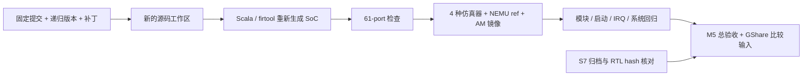

# S8：干净功能复现与 M5 交接

> 2026-10-30：完成。验收依据为干净构建主运行的已完成组 + ISA 入口路径修复后的受影响组补测；[原始记录与统计](s8-validation/README.md)、[M5 总验收](signoff.md)。无未处置阻塞，本次没有运行 DC/PT。

## 1. 本步解决什么问题

S0–S6 的测试曾在开发过程中分组执行，原工作目录也保留了生成 RTL、编译对象和软件库。S8 从固定源码另建工作目录，重新生成、构建并运行验收，检查最终版本能否独立走通这些步骤。用户明确本步不复现 DC/PT，S7 使用已归档的 cap90 基线。

阅读术语：**干净构建**指开始时没有该设计的生成 RTL、对象文件、仿真可执行文件、AM 库和程序镜像；安装好的编译工具、下载依赖和 Git 对象可以复用。**源码快照**由提交号加已记录的修改补丁确定。**provenance（产物来源）**记录源码、命令、工具及产物 hash，帮助从一份结果追到实际输入。**signoff（验收结论）**是对约定范围逐项判断，不等于所有未来功能都已实现。

## 2. 改在哪里，如何工作

| 层次 | 本步改动 | 工作方式 |
| --- | --- | --- |
| CPU/SoC RTL、C++ harness、NEMU、AM、软件 fixture | 无功能修改 | 用现有实现和独立预期重新验收 |
| 验收组织 | [`m5_s8_test.py`](../../../../npc/tests/m5_s8_test.py)：`snapshot()`、`main()` | 本地 clone 主仓库、ysyxSoC/递归依赖及独立的 am-kernels、RT-Thread；应用记录的 tracked diff；新工作目录内调用已有测试 |
| ISA 检查入口修复 | [`m5_s1_test.py`](../../../../npc/tests/m5_s1_test.py) 的 `cpu()`；[`isa_contract_test.py`](../../../../npc/tests/isa_contract_test.py) 的 `--cpu-exe` | 调用者传入刚构建的测试器，记录路径/hash；S6 改变输出目录时也检查正确的 DUT |
| 构建入口 | [`npc/Makefile`](../../../../npc/Makefile) 的 `s8-test`；`.gitignore` | 一条命令执行，显式指定新的结果目录；维护脚本纳入版本管理 |
| 文档与证据 | 本页、[总验收](signoff.md)、[S8 归档](s8-validation/README.md) | 区分本次重跑、历史 S7 复用和未实施范围；为 GShare 交接固定输入 |

`snapshot()` 克隆本地 Git 对象，不访问远端。每级 submodule 的实际 HEAD 必须等于父仓库记录的 gitlink；Rocket Chip 的接口补丁通过普通 diff 带入，不能为了“干净”把它删除。am-kernels 和 RT-Thread 都不是主仓库 submodule，因此单独克隆并冻结其提交。最终运行设置 `CCACHE_DISABLE=1`，C/C++ 对象也重新编译。

脚本只复制两类额外输入：安装好的 firtool，以及 NEMU 原 `.config`。前者属于生成工具，后者仅供既有测试验证“不改动普通 NEMU 配置”；SoC reference 真正使用 [`configs/ysyxsoc-ref.h`](../../../../nemu/configs/ysyxsoc-ref.h)。AM_HOME/NPC_HOME/NEMU_HOME 都指向新工作区，避免借用旧 AM 库或 reference。新创建但尚未入库的功能源码不会被 Git clone 带入；复现前应先提交这类文件。



## 3. 实际复现入口与范围

在主仓库根目录执行，`--out` 必须尚不存在；失败的运行保留，不能覆盖成 PASS：

```bash
make -C npc s8-test S8_ARGS="--out /绝对路径/新的S8目录"
```

需要当前已安装的 Java/Mill/firtool、Scala 依赖、Verilator/C++、RISC-V GCC/binutils、Python、Make、Tcl；本地各依赖仓库已初始化。结果在 `<out>/manifest.json`、`logs/`、`patches/` 和 `workspace/` 中。Git clone 使用本地共享对象，运行目录是本机复现工作区，不是可脱离原仓库直接分发的发布包。

| 顺序/日志名 | 重新执行的内容 | 为什么需要 |
| --- | --- | --- |
| `soc-generation`、`soc-contract` | 没有旧 `build/`/`out/` 的 Scala 生成、61-port ABI 和补丁检查 | 消除旧生成物掩盖源码/接口缺口的可能 |
| `simulators-and-reference` | MROM/Flash × 正常/AXI 延迟四种仿真器、NEMU `.so` | 后续测试全部使用本次构建的 RTL/harness/ref |
| `unit-and-elaboration` | primitive、IFU/LSU/EXU、寄存器/CSR、独立译码、真实 wrapper 展开 | 检查基础逻辑及仿真/综合宏配置 |
| `s2-bringup` | MROM、UART、访存端点、真实默认错误、退出/timeout 负例 | 覆盖最小系统独立预期 |
| `s3-runtime` | MROM/SRAM、CPU poison、copy/clear 负例、DiffTest 扰动、容量断言 | S6 系统回归没有重新执行这些全部启动负例 |
| `s4-boot`、`s4-capacity` | Flash→SRAM/PSRAM、启动/容量负例、有限协作 RTT | 补齐另一组链接布局和真实大程序装载 |
| `s5-interrupt` | CLINT、精确异常/IRQ、三种 AM 布局、上下文负例、10 seed 访存等待 | 不能仅以 RTT 能运行代替独立 IRQ 预期 |
| `delay-unit`、`s6-system` | 延迟通道单测、RTT/UART/随机等待/协议与 CPU 回归四组 | 主运行使用 S6 全组入口；回归组发现下述路径问题后补测。S1 协议/CPU、S4 SPI/PSRAM 和 34 项 CPU tests 由此覆盖 |
| `flow-local` | Python/Tcl flow 检查、测试、综合 scope 展开 | 不调用 DC/PT，不重新生成 PPA 结论 |

每步非零返回立即停下并记录失败阶段。具体数量、原始日志与版本见 [S8 归档](s8-validation/README.md)，逐项最终判断见 [signoff](signoff.md)。

本次保留了两次未完成尝试：`m5-s8` 在 ccache 写 `/run/user/1000` 临时文件时受沙箱权限限制；`m5-s8-repro` 因入口漏克隆独立的 am-kernels 而在 microbench 构建时找不到 `benchmark.h`。前者属于执行环境，后者是本次新增复现入口的依赖遗漏，均非 DUT 仿真失败。补齐依赖、关闭编译缓存后，在新的 `m5-s8-final` 目录重新从头运行；不覆盖前两次 FAIL manifest。

### 干净回归暴露的旧可执行文件依赖

`m5-s8-final` 的 S6 前三组完成后，regression 在 ISA 检查中停下。`m5_s1_test.cpu()` 已在 S6 指定的 `OUT/cpu` 构建 DUT，但 `isa_contract_test.py` 仍硬编码 `build/m5-s1/cpu/Vaxi4_cpu_test_top`。旧目录若有残留文件，就可能测试了别的构建；本次空目录明确以 FileNotFoundError 暴露缺口。

修复为 `cpu()` 通过 `--cpu-exe` 传入它实际构建的路径；ISA runner 在运行前检查文件，并输出 `cpu-executable.json` 保存路径和 SHA256。软件测试程序、RTL 和正确性预期都不变。单独直接调用脚本时仍默认使用 S1 路径；由 S1/S6 组织执行时显式指定。

本次在同一干净构建的工作区应用两文件补丁，补跑 `python3 npc/tests/m5_s6_test.py --only regression`，随后执行 flow 本地检查。调用时 AM_HOME/NEMU_HOME/NPC_HOME 仍指向该工作区。**验收证据由主运行已经完成的组与修复后的受影响组复测组成**；原主运行及 S6 的 FAIL manifest 保留，续跑 manifest/补丁见 [S8 归档](s8-validation/README.md)。续跑前后都确认旧 S1 可执行文件不存在，ISA 实际使用 S6 的新构建；不通过复制或链接旧文件掩盖路径问题。

### 一个实际差异：源码相同，镜像大小为何改变？

S5 的 `rtthread-tick` 在原目录的镜像为 21436 B，本次为 21500 B。`RT_ASSERT` 使用的 C 宏 `__FILE__` 会把源码文件路径变成字符串；这里 fixture 与 BSP context 的两个路径各增长 32 字节，进入 `.rodata`，并被链接进运行时 `.text` 区间。

因此 `_text_end` 和 `_bss_end` 各后移 64 B。[`flash-start.S`](../../../../abstract-machine/am/src/riscv/ysyxsoc/flash-start.S) 的 poison 循环多处理 16 word（每 word 4 条指令），text-copy 循环也多处理 16 word（每 word 6 条），正好增加 `16 × (4 + 6) = 160` 条提交：112799 → 112959；仍完成 3 次 IRQ，差分与终态检查通过。

这不是 CPU 新增了指令或程序失败，也不应要求本次所有历史周期逐字相等。定位方法是同时看 ELF 符号、镜像字符串、启动循环和实际计数。后续性能对照固定 BIN hash；若要做跨目录可重复构建，可另行固定编译路径映射，并给前后两组一起重建，不在本次验收中改变软件编译策略。

## 4. 与 S7 的对应关系

S7 的 72 份归档原件重新核验 hash；其中 21 份 RTL/include 与本次源码比较，20 份逐字节相同，`ysyx_csr.sv` 只多两处注释。`ysyx_core.sv` 的声明顺序修复 `9912da3` 已在 cap90 冻结输入中；19 份 flow 脚本/配置全部逐字节相同。续跑只修改上述两个测试组织脚本，对应关系记录到 S8 review。

因此本次复用 S7 的 CPU 子系统面积/时序结论，保留原工具 `CONSTRAINT_FAIL` / `REVIEW_REQUIRED`、leakage 零目标处置和 reset 物理时序暂缓。本步功能复现没有提供新的网表等价或物理时序证据。

## 5. 后续比较和个人复盘

[GShare 交接条件](comparison-contract.md)固定程序、镜像 hash、存储、时钟和计数边界。当前没有预测准确率计数器；预测器设计计划应先定义预测/更新时机、错误恢复、准确率和有效收益的独立验证，再实施增量。不能将 S7 相对 M4 的面积变化直接当成优化收益。

M5 完成后不自动进入 I-cache、SDRAM 或交互 shell。限定 GShare 验收并冻结后，执行 **[JOB-PREP-01：理解考察与简历 v1](../../output/interview-readiness.md)**；工程通过与个人理解分别检查。
