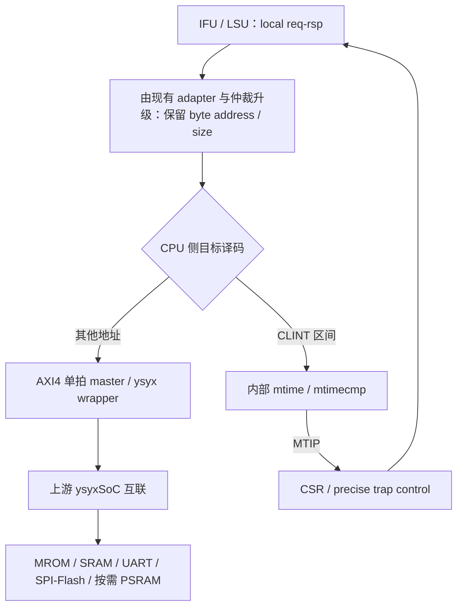

# M5 设计与验收计划

> 2026-10-20；状态：S0–[S3](3-runtime-difftest.md)完成，S4–S8 待实施。AM 的 MROM/SRAM 启动、逐指令 DiffTest 与限定软件子集通过；完整系统软件验收尚未完成。
> 本地规划输入：`d7c5b139eca8f6ffc467ecea472d4395998b1cea`；前置为 [M4 signoff](../4-pre-soc-signoff/signoff.md)。该 commit 是本地输入，不是 ysyxSoC revision。
> 配套：[验收矩阵](test-plan.md)、[开发日志](dev-log.md)、[Q&A](qa/README.md)、[总路线](../roadmap.md)。

> 2026-10-20 范围调整：按用户决定，直接将当前 Lite 接口升级为面向 ysyxSoC 的 AXI4 单拍接口，不并行维护 B1/SoC 两套 transport。B1 是已完成的接入前系统测试，旧版本通过 Git 和历史验收记录复现；范围调整后已完成 S1 RTL 与定向验收，见 [S1 实施记录](1-axi4-interface.md)。

## 1. 依据、目标与范围

主要参考 [2607 C5：SoC 计算机系统](https://ysyx.oscc.cc/docs/2607/c/5.html)，辅以 [2306 B2 原文](https://ysyx.oscc.cc/docs/2306/basic/1.8.html)和[本地 B 阶段重组讲义](../../../lectures/ysyx/ysyx2306-b-stage.md)。本次核对的两个在线章节，其 SoC 接口、启动与设备学习主线基本一致；旧版本 URL 不代表冻结的历史环境。实际实现以 S0 固定的上游源码和生成结果为准。

M5 的出口是 **CPU 接入真实 SoC 总线和设备、启动过程可验证、系统软件与中断可运行**。保留 RV32E 的 16 项 GPR、无 M/C、顺序提交、无 cache；补齐本阶段确实需要的机器态能力，不借此重写流水线或宣称完整特权架构合规。

| 范围 | 本轮安排 |
| --- | --- |
| CPU 接口 | 在现有 adapter/仲裁/顶层基础上升级为 AXI4 单拍 master，加入 SoC wrapper 与内部 CLINT；只维护这一条接口路径 |
| 最小系统 | 上游 MROM、SRAM、UART16550；AM runtime、linker、DiffTest、访问错误传播 |
| 外部启动 | 必做 Flash → SRAM 小程序闭环；RT-Thread 容量不足时接通 PSRAM 并完成 Flash → PSRAM 启动 |
| 中断 | `mtime/mtimecmp`、machine timer interrupt、必要 CSR、精确 trap/MRET、AM/RT-Thread tick |
| 系统验证 | hello、适用 CPU tests、限定 microbench smoke、有限 RT-Thread 抢占/阻塞唤醒测试、随机延迟与错误注入 |
| 实现评估 | 对 CPU + 升级后的 adapter/仲裁/router + CLINT + wrapper 的明确可综合边界运行 DC/PT；服务器仍由用户手动同步和运行 |
| 延后 | SDRAM、AXI burst、多 outstanding、cache、GPIO/PS2/VGA、完整图形/NVBoard 展示、ChipLink、外部中断控制器、完整交互 shell |

UART 最终需要初始化波特率并验证实际串行 TX；自动化串行接收器即可，不强制引入 NVBoard。RX 与交互 shell 可另立扩展，不作为本轮 timer/RT-Thread 的前提。原讲义的 PSRAM/QPI、SDRAM、图形等练习有各自学习价值；这里的范围裁剪不能表述成“整章 C5/B2 全部完成”。

## 2. S0 时的基础与缺口

下表保留迁移前的诊断输入；S1 已解决接口、mtime 和 wrapper 部分，当前实现及剩余项以 [S1 交接](1-axi4-interface.md#7-s2-交接)为准。

| 本地事实 | M5 需要做什么 |
| --- | --- |
| `ysyx_core` 内部已有 IFU/LSU local req/rsp，但 Lite adapters 也实例化在内部；`ysyx_core_axi4lite` 外层再仲裁 | 直接升级现有 adapters、仲裁 payload 与顶层连接；保留 local 语义边界，不引入 Lite/AXI4 双配置或额外兼容层 |
| LSU Lite adapter 将地址按 word 对齐，Lite 读通道没有 size | 修改 adapter 保留原始 byte address 与访问宽度；对 UART 窄读不能先读整字再截取 |
| core 的 `PC_RST` 默认 `0x80000000`，当前 Lite 顶层没有透传该参数 | 透传 SoC 启动地址，MROM/Flash 启动分别配置；旧平台默认值不作为兼容要求 |
| B1 CLINT 只有只读 `mtime`，地址为 `0xa0000048/4c`，没有 `mtimecmp` 或 IRQ | 改用 SoC 合同的 CPU 内部 CLINT 地址及寄存器，分步补比较器/IRQ；不保留旧地址别名或 B1 兼容配置 |
| CSR 当前为 `mstatus/mtvec/mepc/mcause`；AM `ienabled()` 返回 false、`iset()` 为空 | 明确扩展 CSR 清单、硬件中断入口、AM 上下文/事件与 RT-Thread interrupt hooks |
| EXU 以地址最高半字节等于 `0xa` 标记 MMIO；harness 据此跳过参考执行 | 必须按平台修正。SoC UART 不在该区间，SDRAM 却在其中；不能让未来 RAM 访问整体逃过 DiffTest |
| 当前 harness/AM/NEMU 配置面向 legacy/B1 地址与镜像加载 | 将 NPC 运行入口迁移到 SoC，更新存储区域、启动加载和参考内存同步；不把镜像仍装到旧 `0x80000000`，也不影响 NEMU 其他平台用途 |
| B1 RT-Thread 是协作调度，两个静态栈合计 16 KiB，并要求 heap > 32 KiB | 不能直接迁移到 8 KiB SRAM，也不能将协作调度通过当成 timer interrupt 通过 |
| M4 04/05 为 core Lite 边界、TT/5 ns、ideal clock/ZeroWireload，reset 时序 deferred | 新接口和 CLINT 改变 scope/端口，另建 flow 配置；复查实际 reset 机制和旧例外，不覆写 M4 基线 |

源码核对入口：[core](../../../../npc/vsrc/core/ysyx_core.sv)、[当前 AXI4 顶层](../../../../npc/vsrc/top/ysyx_core_axi4.sv)、[LSU adapter](../../../../npc/vsrc/bus/ysyx_lsu_axi4_adapter.sv)、[CLINT](../../../../npc/vsrc/periph/ysyx_axi4lite_clint.sv)、[EXU](../../../../npc/vsrc/core/ysyx_exu.sv)、[CSR](../../../../npc/vsrc/core/ysyx_csr.sv)、[AM CTE](../../../../abstract-machine/am/src/riscv/npc/cte.c)、[RT-Thread workload](../../../../npc/tests/b1-rtthread/workload.c)。

## 3. 设计约定

### 3.1 上游契约与构建边界

上游入口：[OSCPU/ysyxSoC](https://github.com/OSCPU/ysyxSoC)。规划时在线 `ysyx6` 分支的 [CPU 接口表](https://github.com/OSCPU/ysyxSoC/blob/ysyx6/spec/cpu-interface.md)给出 `clock`、高有效 `reset`、外部中断 `io_interrupt`，以及地址/数据 32 位、ID 4 位的 AXI master/slave 接口。它们是 S0 的核对线索，**不是本项目已冻结的契约**。

S0 固定完整 commit、recursive submodule revision、上游补丁及本地 patch，并对照 `src/CPU.scala`、`src/Top.scala`、地址译码和生成 Verilog 逐项核对。模块/文件命名按该 revision 的要求处理；观测信号放在仿真绑定/明确的评估 top 中，不随意增加 BlackBox 的正式端口。

S0 实际冻结为 `df38a4d93d1d71e621fe91b106d088bd33af984a` + 已核对的 Rocket Chip 补丁，仿真 top 为 `ysyxSoCFull`，CPU ABI 为 `ysyx_00000000`。本文的规划候选表保留背景；后续实现以 [S0 实际契约](0-upstream-contract.md)为准。

S2 后按用户指定将 CPU 文件/模块及 Scala BlackBox 改为 `ysyx_25030087`；61-port ABI 与 reset PC 保持一致，改名后重新生成及 S1/S2 复验通过。S0/S1 原始归档保留当时的占位名。

在线 [Makefile](https://github.com/OSCPU/ysyxSoC/blob/ysyx6/Makefile)提供 `dev-init` 和 `verilog`，涉及 Mill、firtool 和子模块补丁；`dev-init` 有 `git apply` 操作，不能假设可无条件重复执行。S0 记录工具版本、依赖下载与生成步骤，区分生成入口、CPU 集成 top、Verilator top 和综合 top。生成 RTL 留在构建目录，以 revision/patch/生成命令重建，不提交为手写源码。

当前入口为 `NPC_PLATFORM=ysyxsoc` 与 AM `ARCH=riscv32e-ysyxsoc`，已随 S1–S3 实现，可用 `make -C npc s3-test` 或新 AM 平台 `run`。`ysyxsoc` 是目标平台标识，不是要求继续支持 `legacy/b1` 的硬件模式选择；旧入口已停用，不增加兼容分支。M4 的历史 RTL/flow 用对应 Git revision 复现。

### 3.2 CPU transport 与 wrapper

图表示单一接口路径的功能边界。本文的 transport 只是 adapter、握手和事务传送逻辑的统称，不要求新增一层模块或可切换后端。S1 已冻结为仲裁后的 AXI 侧 router；先收齐 AW/W 再路由，明确 owner、错误返回与 reset 行为。

- 保留 local req/rsp 的 hold、accept、response、取消规则，直接升级现有 adapter/仲裁/顶层，必要时重命名为 AXI4 模块；不复制 IFU/LSU/EXU，也不保留原 Lite 路径供运行时或构建时选择。若改变 DPI 层次，同步调整 harness 和测试。
- 迁移旧测试中的有效检查点：GPR/CSR、译码、精确异常、commit/redirect、访存副作用及协议 owner/反压等。S1 用升级后的 AXI4 接口和可控 responder 做 CPU 定向回归，S2/S3 起在真实 SoC 上补系统验证；不以“B1 不兼容”为由删除行为检查。
- 外部 master 初版**全局最多一笔未完成事务**，包括读写互斥，完成响应后释放 owner。IFU/LSU 都有请求时使用有界公平仲裁；请求直到真正接受前、响应返回后分别如何转交，要与已有 local 合同一致。
- 单拍 `AxLEN=0`、`WLAST=1`，计划使用 `AxBURST=INCR`、固定 ID 0；具体信号宽度/其他属性以 S0 为准。IFU 为 32 位取指，LSU 的 byte/halfword/word 对应 size；AW/AR 不无条件清除低地址位，WDATA/WSTRB 与返回 RDATA 的 lane 处理保持一致且只做一次。
- AW/W 分别握手，任意反压时 payload 稳定；等待 B/R 完成才结束事务。核查 RID/BID、单拍 RLAST、response 错误到 access fault；对非法响应做协议诊断，不把它当成功数据。
- CPU 只拦截自己的 CLINT；其余地址送 SoC，由实际互联/设备决定是否合法。S0 已发现上游缺少统一默认错误处理，S2 需在 SoC 侧补确定的非法地址/只读写/禁用设备响应，不能假设当前都会返回 DECERR。保留已有未对齐异常策略，不新增 CPU RAM 白名单。
- 上游 slave 口在关闭 ChipLink 且确认无访问源时可按契约 tie-off，断言验证没有请求；若实际存在访问者，必须设计完成/报错响应，不能靠永久 `ready=0` 隐藏死锁。不宣称实现了通用 AXI slave。
- reset 采用共同复位 CPU 与 SoC 事务域的初始配置。若以后允许 CPU 单独复位，需单独设计旧响应隔离/排空；仅清除 CPU owner 无法撤销已接受的 SoC 写操作。

### 3.3 地址、容量和启动

下表是原讲义的候选地址，供 S0 对照实际生成配置。**译码窗口不等于物理容量**。

| 资源 | 讲义候选位置 | S0 必须冻结的内容 |
| --- | --- | --- |
| CPU 内部 CLINT | `0x02000000–0x0200ffff` | 本项目 mtime/mtimecmp offset、宽度、访问权限、时间基准 |
| SRAM | 窗口 `0x0f000000–0x0fffffff` | 实际 8 KiB 时仅 `0x0f000000–0x0f001fff` 可用；越界行为 |
| UART16550 / SPI controller | `0x10000000` / `0x10001000` | byte 寄存器步进、读副作用、波特率时钟、Flash 命令 |
| MROM | `0x20000000–0x20000fff` | 容量、模型加载和首阶段 reset PC |
| Flash 映射窗口 | `0x30000000–0x3fffffff` | 颗粒容量、模型、SPI/XIP 路径、镜像 offset、最终 reset PC |
| PSRAM（容量需要时） | 窗口从 `0x80000000` 起 | 实际容量、模型与控制器支持，不能只凭窗口预分配无限 RAM |

启动按两级功能目标推进：

1. **MROM bring-up**：取到 `ebreak` → UART `A` → SRAM stack → `.data` 从 MROM LMA 复制到 SRAM VMA、清 `.bss` → `hello`/小程序。MROM、SRAM 的链接边界都用断言检查。
2. **外部启动**：先验证 SPI Flash 读/XIP 能力，再完成 Flash → SRAM 的小程序复制和跳转。最终启动配置与诊断 MROM 配置分开；若采用讲义的 Flash reset/XIP 路线，reset PC 指向 Flash 启动段，不能悄悄预加载 SRAM 后宣称 bootloader 成功。

模型只负责提供 MROM/Flash 初始内容、外设引脚和设备行为；CPU 内部不恢复 DPI 访存。启动验收将目标 RAM 预填非零图案，确认真实总线搬运、`.bss` 清零、复制长度/边界、跳转后的 PC 和程序结果。使用 ELF/map/镜像 manifest 区分 LMA、VMA、文件 offset 与实际加载范围；NEMU 的初始化与 CPU 的真实搬运分开记录。

**容量决策**：现有 B1 RT-Thread 已明显超过 8 KiB，不能沿用 B1 默认 1 MiB SRAM 假装接入了上游 SRAM。S0 统计 text/rodata/data/bss、栈、heap 和峰值余量。默认预期 S4 需要 PSRAM 承载 RT-Thread，先保持 Flash → SRAM 小程序这个独立出口；只有专用裁剪 workload 的静态与运行预算均证实足够，才可记录理由免去 PSRAM。不得通过删掉 timer/线程验证、无记录放大 SRAM 或取消 RT-Thread 规避容量问题。

S0 决策已落实：现有 ELF 静态段合计42,932 B，另需主栈/heap，**本轮采用4 MiB PSRAM路线**；Flash backing 先限制为16 MiB。PSRAM 颗粒当前为空，SPI 普通路径没有 XIP，因此 S4 同时包含这两项实现和验证，不能只写软件搬运。具体预算及模型合同见 [S0 第6节](0-upstream-contract.md#6-存储模型和启动容量决策)。

PSRAM 若启用，仅补完成启动和 workload 所必需的模型/控制器功能及访问测试；QPI 加速、多级 bootloader 性能优化留待有测量需求时推进。先核查上游哪些是完整实现、哪些是练习占位，再决定复用或实现工作量。这里是 SoC 功能仿真与 CPU 范围综合，不要求 memory compiler；任何仿真存储模型都不能混入“已实现 SRAM macro”的结论。

### 3.4 中断、CSR、参考模型与 reset

machine timer interrupt 是本工程 roadmap 的明确目标，不能用“CLINT 能读时间”代替。

- CLINT 增加 64 位 `mtimecmp`，定义 `mtime >= mtimecmp` 对应的 pending 电平；冻结 counter tick 与 AM 时间单位的换算、复位值、分字访问和写权限。RV32 下验证稳定读取 mtime 的高/低字策略及更新 mtimecmp 的安全顺序。
- CSR 至少增加 `mie.MTIE`、`mip.MTIP` 及其读写语义，结合 `mstatus.MIE/MPIE`；继续使用 direct `mtvec`。是否需要 `mscratch`、只读身份 CSR 等，由 AM/trap 汇编和冻结的上游要求逐项核查，不把所有未实现 CSR 默认读成零。更新 IDU 白名单、非法访问测试、CSR DPI/状态布局与 NEMU 参考适配。
- 在 precise architectural boundary 接受中断：保存下一条尚未执行指令的 PC，处理已接受的 LSU/总线操作后才能改变执行流；清除/失效错误路径取指。明确同步异常、redirect、pending IRQ 的优先级，验证无漏提交、重复 store 或已完成指令重执行。machine timer `mcause=0x80000007`；MRET 恢复后按 pending/mask 状态判断是否再次进入。
- `io_interrupt` 是外部中断输入，不是内部 MTIP 的别名。本轮关闭外部 IRQ 来源、明确未支持的处理与断言；若上游配置强制产生外部 IRQ，则在 S0 报告范围冲突后补充对应设计，不静默冒充 timer IRQ。
- AM 实现 timer 事件、`ienabled/iset` 和 RV32E 上下文保存；中断返回不得像 ECALL 一样无条件 `mepc += 4`。RT-Thread 补真实中断开关、tick 与退出中断后的调度，移除空 hooks；B1 固定协作 workload 仅作为历史证据，迁移后的测试另行记录。
- DiffTest 按冻结地址表同步普通存储和镜像；仅对有依据的设备访问做单次 skip/输入同步。timer/IRQ 的 cycle 行为与 NEMU 指令步进不同，需要明确时间输入和中断注入边界。用独立 scoreboard/程序预期检查 pending、mask、cause、EPC，不能仅把 DUT 报的 cause 注入参考端再声称中断检测正确。
- S0 记录 reset 来源、极性、保持周期、释放相位、CPU/互联/外设覆盖域。结合[现有 reset TODO](../4-pre-soc-signoff/reset-timing-todo.md)决定同步释放是否由 wrapper 或上游承担；测试待响应时的共同复位。仿真周期要求不自动等于芯片脉宽保证。S7 按已确定的机制重新审查 false path、recovery/removal、脉宽及 coverage；仍缺物理依据的项目显式延后，不虚构数值，也不扩大例外掩盖正常数据路径。

## 4. 分阶段实施与出口

下表列出的专题文档和测试入口是**实施时产生的交付物**，当前不创建空的完成报告。一个阶段内先做最小定向测试，再扩展系统回归；失败记录命令、seed、镜像和第一个不一致点。

| 阶段 | 工作与依赖 | 出口及交付物 |
| --- | --- | --- |
| **S0：上游和平台契约（完成）** | 固定 revision/submodules/patch；生成 SoC 并核对 ports/top/map；审查工具链、模型、reset/IRQ、AM ISA 与容量预算 | [实际契约](0-upstream-contract.md)与 [manifest](s0-validation/manifest.json)：重新生成/61-port 核对/静态展开通过，PSRAM 路线确定；M01/M02 的 S0 范围通过 |
| **S1：现有接口升级为 AXI4 单拍（完成）** | 按 3.2 升级现有 adapters/仲裁/顶层，加入 CLINT 路由、SoC wrapper 和基础计时访问；迁移测试/构建引用，不保留 B1 兼容路径；此时不开启 timer IRQ | [S1 实施记录](1-axi4-interface.md)与 [证据](s1-validation/README.md)：时序合同、源闭包、迁移表；协议/CPU 定向回归与实际 wrapper 静态展开通过。M03–M05、M16 的 S1 范围 |
| **S2：最小 SoC bring-up（完成）** | 接入 S0 生成 top、外围模型和 harness；透传 reset PC；处理默认错误响应/空外设/仿真延时；先 MROM ebreak，再 UART A | [S2 实施记录](2-bringup.md)与[证据](s2-validation/README.md)：真实 MROM/UART TX、SRAM/错误路径、harness 负例与 guard 协议通过；关闭 G02 的 S2 部分和 G03/G04/G07，M06 PASS |
| **S3：AM、SRAM 与 DiffTest（完成）** | 新 AM platform/linker，真实 SRAM poison/copy/clear 和 stack/heap；独立 NEMU profile、设备读值同步与提交后状态比较 | [实施导读](3-runtime-difftest.md)与[证据](s3-validation/README.md)：31个正向 workload、24个CPU tests、sieve/fib smoke及故障检测负例；所有提交差分、无整状态 skip。M07/M08 的 MROM/SRAM 范围通过 |
| **S4：Flash 启动与容量闭环** | Flash 控制器/模型实际读写协议审查；SPI 读、XIP、Flash → SRAM；按 S0 预算补 PSRAM 和 Flash → PSRAM | `4-boot-memory.md`：镜像/ELF/map、启动序列、预填 RAM 后的复制/清零证据；最大验收 workload 能装载并有栈/heap 余量。M09/M10 |
| **S5：CLINT 与精确中断** | mtimecmp/IRQ、CSR/IDU/EXU、AM/NEMU/DiffTest 联动；先手写 trap 程序再接 tick | `5-timer-interrupt.md`：CSR/IRQ 合同、优先级表、独立 cause/EPC/副作用预期、定向与延迟测试；MRET 正确恢复。M11–M13 |
| **S6：系统回归** | RT-Thread 有限抢占/阻塞唤醒 workload，UART 实际 TX；CPU tests、microbench 子集与协议随机延迟/错误回归 | `6-system-validation.md`：程序/预算/seed/覆盖清单；固定 PASS 与超时，至少两个非主动 yield 的线程在 tick 驱动下取得进展。M14–M16 |
| **S7：新边界综合/STA** | 功能 RTL 固定；另建 scope/filelist/端口预算/SDC，适配新增 AXI、IRQ/reset；用户运行 DC/PT 后审查回传结果 | `7-synthesis-sta.md` 与精选原始报告：面积/时序、结构、DRV、coverage、reset 处置；不覆盖 M4 04/05。M17 |
| **S8：验收和 M6 交接** | 干净构建复现，汇总测试、bug、图/波形、源与报告版本；固定可用于 cache 比较的程序和存储配置 | `signoff.md`：逐项结论、例外、未做内容与 M6 输入；所有本轮必做项完成且无未处置阻塞。M18 |

主链 S0 → S1 → S2 → S3 → S4 → S5 → S6 → S7 → S8。S3 后可以独立开发 S5 的模块测试，但完整系统结论仍依赖 S4 的装载/容量闭环；不以并行开发跳过出口。

### S7 的具体评估条件

- 首个目标沿用 **TT / 5 ns（200 MHz）** 作为待验证预算，不预先保证新 scope 达标。先建立逐端口 max/min delay、驱动或 slew、load、clock/reset/IRQ 假设；按[metrics-aware SDC](../../knowledge-notes/metrics-aware-sdc.md)核对 fanout、电容和 clock DRC 作用域。若不达标，保留诊断 run，解释关键路径与修复/目标调整后再验收。
- CPU wrapper、内部 CLINT/transport/router 可纳入；上游完整 SoC、SRAM/Flash/PSRAM 模型不纳入首个实现 top。未解析 blackbox、仿真 DPI 或 latch 不得被默认为合格。明确观察端口是保留、独立评估 top 暴露，还是裁剪；不能和 M4 不同观察范围直接比较面积收益。
- 继续使用已有 DC/PT flow 的输入快照、hash、失败传播和分类报告；检查 setup/hold、max/min capacitance、max transition、fanout、四类路径及未约束端点。coverage 的每类 untested 都要说明，原 M4 的数量和 waiver 不自动套用。
- M4 与 M5 的面积差首先代表功能/边界变化；如需要评估纯接口改造成本，另建相同功能/观察条件的配对实验。此阶段不强制 power、PTPX、GLS、PnR 或全 PVT；继续明确 pre-layout 与 reset 物理验证限制。

## 5. 实施依赖与阻塞报告

**S0–S3 已完成，当前没有阻止 S4 开始的外部依赖。** 原前置项状态如下；后续功能缺口详见 [S0 第7节](0-upstream-contract.md#7-缺口与分阶段处置)。

| 项目 | 当前已知情况 | 关闭时点 / 无法完成时的处理 |
| --- | --- | --- |
| 上游源码、依赖、生成工具 | revision/补丁/递归依赖已核对，重新生成返回0 | S0 已关闭，升级上游需重新审查 |
| 外设/存储模型 | S2 已补 backing/错误响应/禁用输出/时间推进；S3 已补 MROM/SRAM DiffTest | G02 的本轮 DiffTest 部分已关闭；S4 仍需真实 XIP/PSRAM 及其 reference 映射 |
| RT-Thread 容量 | B1 ELF 静态段42,932 B，已选4 MiB PSRAM并给出预算 | S0 选型完成；SoC ELF/map及运行峰值在 S4/S6 实测 |
| ISA/CSR 与 ABI | 当前 trap 支持RV32E；AM/RTT中断路径缺失，S5新增mie/mip timer能力 | S0 清单完成；S5实现并同步参考接口/测试，仍不宣称完整合规 |
| reset / 外部 IRQ | 外部IRQ固定0；CPU reset为外部reset OR 10级延迟，初始约定20周期共同复位 | S0 合同完成；S1/S2/S5功能测试，S7物理限制复查 |
| 服务器 DC/PT | M4 已跑通，M5 尚无新配置/结果 | S7 交付命令与审查清单，由用户执行回传；没有回传结果时不得宣布 S7/S8 完成 |

后续按有价值的进展更新 QA 和 dev-log；运行日志/网表/生成 RTL 留在构建目录，只归档必要的可展示证据。出现真实阻塞时，说明它阻塞哪一出口、已有证据、下一步需要什么，并继续不受影响的工作。

各子步骤实施记录遵循 [roadmap 的文档撰写要求](../roadmap.md#子步骤实施文档以理解与学习为目标)，以读者理解和学习实现为目标，讲清做了什么、改在哪里、如何工作及怎样验证。本 Milestone 可参考 [S2 源码导读](2-bringup.md)，按具体改动调整篇幅与结构。
