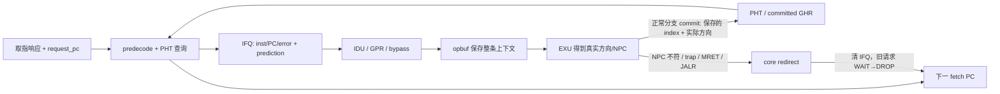

# S2：从取指预测到提交训练的闭环

> 2026-10-31；RTL 集成及局部测试通过。三种模式使用同一条数据通路，默认候选 GSHARE。

**NPC**：next PC，当前指令执行后应到达的地址。**方向错误**与**NPC 错误**不同：例如 branch 偏移为 +4，taken 与 not-taken 的地址相同。**恢复延迟**：从 redirect 到第一条恢复后指令进入 opbuf 的观测周期，不等于可直接相加的性能损失。**mutant**：测试生成的故障版本，用来确认检查器能抓到指定错误，不是生产 RTL 的选项。

## 1. RTL：保存预测事实，预测本身不清流水线

[ysyx_ifu.sv](../../../../npc/vsrc/core/ysyx_ifu.sv) 在正常响应握手时选择 `pred_npc` 并进入 REQ，仍没有新增状态或通用额外等待周期。PC 使用请求的 `request_pc_q`，不会拿已经推进的 fetch PC 加立即数。

IFQ 原来保存 65 bit 的 error/PC/inst，现在保存 `99 + BPU_INDEX_BITS` bit；默认 106 bit，包含 pred_taken、pred_npc、pred_branch、pred_index。预测发生在入队边沿，之后无论阻塞多久，元数据都随指令保存。预测 taken 仅改变下一次请求地址，**保留当前分支本身和更老的队列内容**。

reset、后端 redirect 优先于普通预测；redirect+response 同拍直接消费并丢弃旧响应。如果旧请求还没回来则进入 DROP，重复 redirect 只更新最新目标，不能取消已接受的事务。DROP 响应不入 IFQ，更不训练。

[ysyx_opbuf.sv](../../../../npc/vsrc/core/ysyx_opbuf.sv) 新增 pred_branch/index 的输入输出及打包，默认 payload 从 277 增至 285 bit。其他 valid/ready 行为沿用原实现。这里的 bit 数是 RTL 存储宽度，最终常量裁剪和映射面积由 DC 确认。

## 2. RTL：真实执行、恢复与训练

[ysyx_exu.sv](../../../../npc/vsrc/core/ysyx_exu.sv) 输出实际 `branch_taken`，B/J 在 enabled 模式下比较 `commit_npc != op_pred_npc`。因此预测 taken、实际不跳转也会恢复到 PC+4；正确预测不误清前端。JAL 仍正常写回 PC+4。JALR、trap、MRET 保留强制 redirect，IRQ 仍由 core 优先处理。

[ysyx_core.sv](../../../../npc/vsrc/core/ysyx_core.sv) 串接元数据，并定义训练使能：GSHARE + commit_valid + 非异常 + 合法 branch + 有效 branch metadata。IRQ 使 EXU 不 commit，因此不会训练被抢先丢弃的指令。opbuf 仍 `flush=0`，IRQ 用原有 `op_ready || interrupt_taken` 清掉旧上下文，避免把 flush 串进 ready/exception 组合环。

原 EXU “预测永远 PC+4”断言仅在 OFF 启用；core 的架构 PC、opbuf 稳定性及 bypass 检查保留，并增加“正常提交 branch 必须带有效 metadata”检查。参数经三层 wrapper 透传，外部 AXI/CPU 引脚不变。

## 3. 仿真观察：只读事件，不进入综合

新增 [bpu_monitor.sv](../../../../npc/sim/bpu_monitor.sv) bind 到 `ysyx_core`，在上升沿采样真实握手／提交／恢复事件；通过 DPI 调用 [bpu_stats.h](../../../../npc/csrc/soc/bpu_stats.h)，最终由 [main.cpp](../../../../npc/csrc/soc/main.cpp) 写入 summary 的 `bpu` 对象。新 monitor 只在 `soc.mk` 的仿真源里，综合 filelist 不含它。

| JSON 字段 | 含义 |
| --- | --- |
| branches / covered / trained | 正常提交条件分支数／带有效 GShare metadata 数／训练数；GSHARE 要三者相等 |
| directions[0..3] | 依次为预测NT实际NT、NT/T、T/NT、T/T |
| direction_wrong / npc_wrong | 条件分支方向错误／普通 B/J 的实际 NPC 与预测 NPC 不符 |
| redirects[0..7] | 0 未使用；1 branch、2 JAL、3 JALR、4 同步异常、5 IRQ、6 MRET、7 未分类；7 应为零 |
| fetch_requests | IFU 本地请求握手数；包括最终被取消的推测路径 |
| flushed_entries / discarded_responses | 恢复时 IFQ 中实际被清条目／DROP 或 redirect 同拍消费的响应 |
| recovery_completed / cycles / max | 完成的恢复样本数、延迟和、最大值；字段前缀均为 recovery |
| recovery_interrupted / pending | 被第二次 redirect 打断／仿真结束仍未完成的样本 |

`redirects` 统计发生的恢复，`npc_wrong` 统计地址差异；OFF 的冗余恢复不一定是 NPC 错误。不能把 recovery_cycles 当成可以从总周期直接扣除的净损失。

## 4. 测试与构建修改

- [bpu_test.py](../../../../npc/tests/bpu_test.py)：IFU 外部 scoreboard 检查请求 PC、IFQ FIFO 顺序及全部 metadata；独立模拟延迟与反压，同时改变 PHT。固定 seed=88，30000 拍。
- [ysyx_exu_tb.sv](../../../../npc/tests/ysyx_exu_tb.sv)：保留 OFF 测试，enabled 模式增加方向四组合、offset=4、JAL link、JALR、trap/MRET 强制清理、IRQ 抢先分支检查。
- 负例一：在 scoreboard 采样处改错 index，必须报 `prediction metadata mismatch`。负例二：测试目录生成“禁止 B/J 误预测恢复”的 EXU mutant，必须报 `taken branch redirect is incorrect`，不接受普通 watchdog 作为成功。
- [filelist-soc.f](../../../../npc/filelist-soc.f)、当前 SoC 综合 filelist 加入新模块；旧 IFU 单测／adapter 集成明确接零训练并选 OFF，避免 floating input。`synthesis_scope_check.py` 改为审查 22 个源文件，撤掉 `op_pred_npc` 的旧 assertion-only 豁免；hash 只使用 PC 部分位有明确说明。三模式 × 四种宏 profile（12 组）检查通过。OFF/JAL_ONLY 无表时的训练输入未使用单独豁免，不扩展到 GSHARE。

测试工具缓存曾被沙箱只读目录阻止；后续新 runner 使用各自 build 下的 disposable ccache 目录，未改变 RTL 或测试判断来绕过失败。设计层面的功能失败尚未发现；测试编写时修正了 JAL 的写回 mux 选择以及汇编器自动展开远分支造成的测试布局变化，见 S3。
