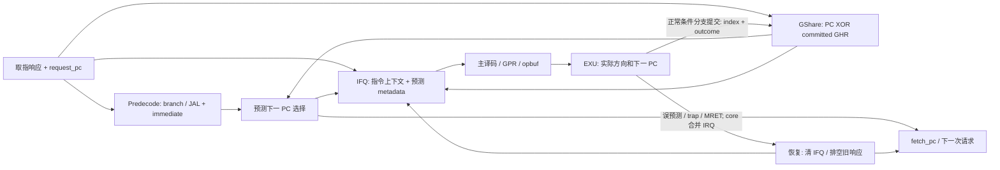

# GShare BPU 设计与实施计划

> 2026-10-31；状态：S0–S3 完成；S4 性能已测、DC/PT 待验。实际进度见 [signoff.md](signoff.md)。配套：[验收矩阵](test-plan.md)、[开发日志](dev-log.md)、[术语与入口](README.md)、[Q&A](qa/README.md)。
> 用户确定：条件分支与 JAL，GShare + predecode，无 BTB。初始表规模、提交历史策略及实验模式按下文规划；S0 核对并固定构建参数和测量入口。

## 1. 目标、范围与设计依据

目标是在已通过 M5 验收的 CPU 上形成一组可解释的微架构优化证据：预测是否减少错误路径取指和恢复等待，代价是多少面积与时序，以及等待、异常和中断下为何仍能保持架构行为正确。

| 项目 | 本轮安排 |
| --- | --- |
| 条件分支 | BEQ/BNE/BLT/BGE/BLTU/BGEU；GShare 预测方向，B-type 立即数提供目标偏移 |
| JAL | 前端直接计算 PC + J-type 立即数并提前取目标；不参与 GShare 方向训练 |
| JALR／函数返回 | 保留执行端计算目标和恢复；不增加前端 GPR 读口、依赖等待或 RAS（返回地址栈） |
| 前端 | 在指令响应被接收、进入 IFQ 时产生预测；IFQ 深度 2、opbuf 深度 1、Fetch 单 outstanding |
| 历史与表 | 初版使用提交时更新的 GHR/PHT；默认 128 × 2-bit 表、7-bit GHR；无推测历史回滚 |
| 外部系统 | 保留现有 AXI4 单拍、仲裁/router/CLINT、存储延迟、ISA 与软件启动方式 |
| 评价 | 功能／协议回归 + 同镜像周期对照 + 同 scope DC/PT 面积时序对照 |
| 不纳入 | BTB、RAS、JALR 预测、I-cache、burst、多 outstanding、流水线重写、完整物理实现与功耗签核 |

### 为什么这一轮不做 BTB

GShare 回答“条件分支会不会跳转”；目标地址需要另外提供。BTB 缓存目标，使前端有机会在指令字返回之前得到它。本方案等待指令返回，由 predecode 提取立即数，直接计算目标。

当前 Fetch 严格单 outstanding，旧取指响应返回之前也不能发起下一笔取指。因此预期 BTB 提前给出目标的收益有限；响应返回时得到目标可能已足够指导下一次请求。还需考虑 predecode／PHT 查询／目标加法的时序代价，不能把这一判断推广成“单 outstanding 下 BTB 一定没有收益”。本轮不做 BTB 对照实验，也不宣称已证实其收益大小。

### 参数选择与依据

初版采用 **128 × 2-bit PHT、7-bit 提交历史**，作为便于实现和比较的工程起点，尚未通过本项目 workload 搜索最优值。

| 项目 | 本工程初版计划 | 选择依据 |
| --- | --- | --- |
| 方向表容量 | 128 × 2-bit | 采用小型寄存器表评估收益与成本；仅表项存储为 256 bit，实际硬件还包括查询 mux、写译码等 |
| GHR 长度 | 7 bit | 直接与 7-bit PC 片段异或，省去历史折叠逻辑 |
| PC 参与位 | PC[8:2] | 匹配当前无 C 的 32-bit 指令布局，排除指令地址中固定为 0 的低两位 |
| 历史更新 | 只移入正常提交的实际条件分支方向 | 错误路径不更新历史，恢复不需要回滚 GHR；代价是无法利用尚未提交的分支方向 |
| 进入历史的指令 | 条件分支；JAL/JALR 不进入 GHR，也不训练方向表 | 聚焦条件分支方向相关性，无条件跳转单独处理目标 |

选 2-bit 是为了保存方向倾向和强弱，避免一次相反结果就立即翻转强预测；本计划采用 §2.2 的二进制饱和计数。选 7-bit 历史是让它与 128 项所需的索引宽度一致，简化 hash；**表项数不强制历史长度必须相同**。同一分支在不同历史下可用不同表项，不同分支也可能发生 aliasing（映射到同一表项），128 项不是“可保存 128 条分支”的一一对应容量。

最终是否保留 128 项应依据准确率、周期、面积和时序结果。如果要声称该规模优于 64/256 项，需另做相同条件的参数实验；本轮不预先承诺最优参数，也不把参数搜索加入强制验收。

### JALR：本轮保留 EXU 处理，前端提前处理暂缓

**本轮暂不优化 JALR 的前端目标供给，不是取消 JALR 指令支持。** 当前 [EXU](../../../../npc/vsrc/core/ysyx_exu.sv) 已用操作数和立即数求目标、清除 bit 0、写回 PC+4，并通过现有 redirect 恢复。函数返回、间接调用等仍按原有路径执行并接受 DiffTest 检查。

这一取舍适合当前限定增量：先完成条件分支＋JAL 的预测、训练、恢复和量化比较，减少同时新增前端寄存器依赖处理的变量。代价是 JALR 继续支付执行端求目标及前端恢复开销，递归／函数返回较多的程序可能因此限制整体收益。**不以“Fetch 单 outstanding”推断 JALR 提前处理没有价值**：它仍可能早于 EXU 给出目标，收益需要与依赖等待成本一起测量。

#### 若增加前端 JALR 处理，需要哪些增量

JALR 无条件 taken，目标为 `(GPR[rs1] + immediate) & ~1`。若通过前端读取实际寄存器值提前计算目标，核心问题是保证 rs1 的值可用且正确；方向不需要 GShare 预测。rs1=x0 时可直接使用常量 0，其余寄存器需要读通路及依赖处理。

“IFU→GPR 读请求、依赖检查和等待控制”概括了主要工作，但每项都会影响现有解耦边界。预计是**中等复杂度的独立微架构扩展**；难点更多在握手／依赖正确性和验证，不在加法器或识别 JALR 的几行逻辑。以下为未来候选，不加入当前 S0–S5 出口。

| 层次 | 预计增量 |
| --- | --- |
| predecode / target | 识别合法 JALR、rs1 与 I-type 立即数，增加寄存器目标操作数和 bit 0 清零，定义得到目标之前的指令保存位置 |
| GPR / core | 当前只有主译码使用的 2R1W 接口；可复用现有读口，为前端增加仲裁与返回通路；若对 x1 增加专用输出，或独立增加第三读口，需评估面积和时序 |
| 依赖判断 | 分清 JALR 之前尚未完成的写入，覆盖 IFQ 中旧指令、opbuf 当前指令以及未完成 load；可比较目的编号或保守等待排空，但不能直接读取可能过期的 GPR |
| 写回交界 | 定义写回与前端读取同拍时使用旁路值还是再等待一拍；当前 decode→opbuf 的旁路不自动覆盖 IFU 新读通路 |
| IFU 等待 / 取消 | 锁存等待中的 JALR 上下文，禁止依赖未解决时发错误目标请求；等待期间允许更老指令推进；redirect/IRQ/reset 到达时丢弃该上下文并恢复进度 |
| 总线与响应 | 维护 adapter 的响应缓冲和排空规则；当前 AXI 响应先被 adapter 接收，再形成 local response，不能将前端等待寄存器的条件直接传播为阻止 AXI 返回的条件 |
| 验证 / PPA | 覆盖 ALU→JALR、load→JALR、x1 返回、通用 rs1、rs1=rd、同拍写回、排空/反压、IRQ/异常/连续 redirect；检查 GPR 读出→目标加法→PC 的新增路径 |

应根据本工程单 opbuf、访存等待和顺序提交判断何时寄存器值已经可用。等待时也不能把整个前后端冻结，否则产生该值的更老指令可能无法完成。现有 [IFU adapter](../../../../npc/vsrc/bus/ysyx_ifu_axi4_adapter.sv) 的 `WAIT_R/HOLD_RSP` 隔离可以作为设计基础。

后续只在固定程序的统计表明 JALR 恢复仍是明显的可优化开销、且愿意增加一次独立设计／验证迭代时再讨论。应同时看 JALR 次数、恢复等待和运行周期，不能仅因递归测试里 JALR 多就假定收益。若需要缩小扩展，x0／x1 专用提前处理可单独立项；本轮不顺带实施。

## 2. 从现有 RTL 接到哪里

当前 [IFU](../../../../npc/vsrc/core/ysyx_ifu.sv) 在请求接受时令 `fetch_pc_q += 4`，IFQ 保存 `{error, request_pc, inst}`；`if_ctx_pred_taken=0`、`if_ctx_pred_npc=if_ctx_pc+4`。[opbuf](../../../../npc/vsrc/core/ysyx_opbuf.sv) 已传递这两个预测字段，但 [EXU](../../../../npc/vsrc/core/ysyx_exu.sv) 仍对 taken branch、JAL、JALR 直接 redirect，尚未用预测结果决定恢复。

计划的数据关系：



普通预测选择下一取指地址；它不代表错误恢复，不应清空 IFQ。来自执行端／core 的 redirect 才丢弃年轻指令、处理已经接受的旧请求。图中的主译码仍负责完整 ISA／异常语义。

### 2.1 预测时点与 predecode

一次预测接收事件要求 `state==WAIT && rsp_valid && rsp_ready && !redirect_valid`。只有无取指错误的响应才可被识别为可预测的 branch／JAL；DROP 中消费的旧响应不产生有效预测或入队。

predecode 读取响应指令和 **`request_pc_q`**，输出 `is_branch`、`is_jal` 和符号扩展后的 B/J 立即数。分支须检查合法 funct3 和 RV32E 的 rs1/rs2 编号；JAL 须检查 rd 编号，避免非法编码被当作合法预测对象。其结果与主 IDU 对这两类编码的判断交叉验证，正式异常仍由现有执行路径产生。

```text
conditional branch: pred_npc = pred_taken ? request_pc + B_imm : request_pc + 4
JAL:                pred_taken = 1; pred_npc = request_pc + J_imm
other / fetch error: pred_taken = 0; pred_npc = request_pc + 4
```

目标地址按现有 ISA 合同处理，不为了取指方便把 branch/JAL 目标低位强行清零。S0 核对目标对齐与访问错误的现有行为，测试保留相同结果，不借本阶段悄悄扩展 ISA。

在上述接收边沿把 `pred_npc` 写入下一取指 PC，同时将对应 metadata 写入 IFQ。不依赖 IFQ 出队时重新查询预测器，也不以预测结果组合驱动 AXI 取消请求。初始目标是在 WAIT→REQ 的既有边界完成选择，不增加所有指令都要经过的额外等待状态；若时序要求必须切级，应先记录其周期代价再决定。

reset 优先，其次为现有 core redirect，再其次为正常响应产生的预测。redirect 与响应同拍时，旧响应被消费／丢弃，下一 PC 使用恢复目标；已接受但未返回的请求继续按 WAIT/DROP 规则排空。

### 2.2 GShare 初始配置与训练规则

| 项目 | 初版约定 |
| --- | --- |
| 表规模 | 128 项，每项 2-bit；参数以索引位数 N 表达，初始 N=7 |
| GHR | N-bit，仅保存正常提交的条件分支方向；JAL/JALR 不移入历史 |
| 查询索引 | `(branch_PC >> 2)[N-1:0] XOR GHR`；N=7 时为 PC[8:2] XOR GHR |
| 预测 | 取计数器最高位；00/01 为不跳转，10/11 为跳转 |
| 训练 | taken 加 1、not-taken 减 1，饱和在 0～3 |
| reset | GHR=0，所有计数器=01（弱不跳转）；共同复位行为与现有 CPU 一致 |
| 实现介质 | 初版小型寄存器表，经 DC 映射评估；不依赖 memory compiler |
| 历史策略 | 只更新已提交真实结果；不维护推测 GHR、快照恢复或特权级历史分区 |

**训练一次的条件**：GSHARE 模式下，当前指令是合法条件分支、确实 commit、没有异常且未被 IRQ 抢先丢弃。无论预测正确与否都训练；只更新实际提交结果，不训练 JAL、错误路径、DROP 响应或异常指令。

训练使用随该指令保存的 `pht_index`，不能用提交时的新 GHR 重新算索引。计数器从训练时该项的当前值递增／递减，不能把取指时保存的旧计数器覆盖回去，否则会丢失期间其他训练。

同拍查询与训练默认采用**边沿前的表值和 GHR 完成查询，边沿更新表／GHR**，不增加训练旁路。查询结果及 index 在该边沿一起入队，之后保持不变。训练同项、不同项和连续别名访问都要验证。

提交历史的代价是前端无法利用尚未提交分支的最新方向；优点是错误路径不会写入历史，恢复不需要回滚 GHR。IRQ／trap／MRET 保留已提交历史，reset 才清零。性能结论中应说明提交历史滞后对预测效果的影响。

### 2.3 metadata 与错误恢复

IFQ→opbuf→EXU 至少传递 `pred_taken`、`pred_npc`、`pht_index` 和表示有效条件分支查询的标记。每项 metadata 必须与自己的 PC/指令同步入队、停留、出队和丢弃；IFQ 受反压时不能随 GHR/PHT 变化而改变预测值。

开启提前处理的模式下，普通控制流以 `actual_npc != pred_npc` 判断是否恢复。特别要覆盖“预测 taken、实际 not-taken”：此时必须回到 PC+4。预测方向不同但目标恰好等于 PC+4 时，方向错误计数可以增加，但下一 PC 相同不需要误预测恢复。

同步异常、MRET 和 IRQ 仍保持原恢复要求，不能因为目标碰巧等于预测 PC 就抑制 trap/flush。JALR 本轮继续走现有执行端恢复。GPR／CSR 写回和 LSU 副作用仍由实际执行与提交控制，预测只影响取指。

预测正确时不能再因“branch taken/JAL”无条件清前端。普通分支提交后，opbuf 可以在同一边沿接收正确路径的下一条；误预测时 IFU 清队列并抑制替换。IRQ 丢弃 opbuf 仍使用现有 `op_ready || interrupt_taken`，不新增组合 flush 环。

## 3. 改动分布与对照模式

| 层次 | 计划改动及阅读入口 |
| --- | --- |
| RTL predictor / predecode | 新增小模块；具体文件名在 S0 固定，说明接口、状态和组合路径 |
| IFU / IFQ | [ysyx_ifu.sv](../../../../npc/vsrc/core/ysyx_ifu.sv)：预测、下一 PC、扩展 FIFO payload、保持旧响应排空 |
| core / opbuf / EXU | [core](../../../../npc/vsrc/core/ysyx_core.sv)、[opbuf](../../../../npc/vsrc/core/ysyx_opbuf.sv)、[EXU](../../../../npc/vsrc/core/ysyx_exu.sv)：metadata、训练回路、恢复判断、断言与观察原因 |
| 构建 / top / flow | 参数透传、各测试 filelist 和综合 filelist；更新 [scope check](../../../../npc/tests/synthesis_scope_check.py) 中“预测字段只用于观察”的旧假设 |
| RTL monitor / C++ harness | [soc_monitor.sv](../../../../npc/sim/soc_monitor.sv) 与 [SoC harness](../../../../npc/csrc/soc/main.cpp)：被动采集事件及计数，不增加 CPU 的正式观察引脚或 ISA CSR |
| 测试组织 / bare-metal | 增加定向 branch/JAL 序列、独立预测器模型、回归及同镜像比较入口 |
| NEMU / AM / SoC | ISA 和平台功能原则上不变；NEMU 不模拟预测器，以架构提交检查正确性，AM 只用于新增测试构建 |

三种构建模式共用一份实现，不复制 core：

| 模式 | 条件分支 | JAL | 用途 |
| --- | --- | --- | --- |
| OFF | 顺序取指 | 执行端处理 | 保留 M5 的原恢复行为和周期对照，确认接入开关没有改变基线 |
| JAL_ONLY | 固定 not-taken | predecode 提前处理 | 接入共同的预测／核对通路，分离 JAL 提前处理及恢复框架的影响 |
| GSHARE | GShare | 与 JAL_ONLY 相同 | 与 JAL_ONLY 比较，评价条件分支方向预测的增量 |

JAL_ONLY 和 GSHARE 使用相同的 metadata／下一 PC 核对／恢复框架，区别只在条件分支方向来源及训练。OFF 保留原来的 taken branch/JAL 恢复，因此 OFF→JAL_ONLY 还可能包含消除“目标等于 PC+4”等冗余恢复的影响，不把该差值全部命名为 JAL 收益。JAL_ONLY 是低成本归因对照，不扩展为另一套动态预测器。

## 4. 实施步骤与出口

以下编号仅属于本目录。所有状态均为待实施；规划完成不等于 S0 已验收。具体实施文档按步骤完成时创建，不预建空结果目录。

| 步骤 | 工作 | 出口与预期文档 |
| --- | --- | --- |
| **S0：固定接口与测量基线** | 核对当前源码／工作区差异、M5 镜像与参数；固定模块接口、模式透传、metadata、同拍规则与计数事件；记录 OFF 的可重跑命令 | `0-contract-and-metrics.md`：源 revision/patch、接口及时序表、计数口径、OFF 实测及输入清单；确认后进入 S1 |
| **S1：predecode 与 GShare 单元** | 实现两类编码识别、立即数/目标、PHT/GHR、查询训练；独立模型验证 | `1-predictor.md`：功能、源码、定向边界、同拍读写与参数测试；单元检查通过 |
| **S2：接入前端与恢复** | 扩展 IFQ/opbuf，选择下一 PC，传递训练 index，改 EXU 恢复和相关断言；接通三种模式及事件观察 | `2-integration.md`：取指到训练的闭环图、正确/错误预测时序、局部 backpressure/redirect/IRQ 定向通过 |
| **S3：系统功能验收** | 真实 SoC 上执行既有适用 ISA、启动、总线、IRQ/RT-Thread 与随机等待回归；新增错误路径副作用负例 | `3-functional-validation.md`：命令、seed、镜像、结果及失败定位；[功能矩阵](test-plan.md)相关项关闭 |
| **S4：性能与 DC/PT 对照** | 三模式、固定六程序测量；OFF/GSHARE 同 scope 综合与 STA，检查必要报告 | `4-performance-ppa.md`：每程序结果、归因、面积/时序代价及原始证据；服务器操作由用户执行 |
| **S5：归档与冻结** | 固定最终代码／配置、重跑必要最小复现、整理 QA/架构图/结果和遗留项 | `signoff.md`：通过范围、实测结论、复现入口，交接 JOB-PREP-01；不要求再重复已合格且输入未变的全套 DC/PT |

子步骤文档按 [roadmap 的实施记录规则](../roadmap.md#子步骤实施文档以理解与学习为目标)撰写：按 RTL、观察／harness、测试、构建等层次说明做了什么、为何修改、源码位置和验证依据，先解释新增术语。QA 按有价值的决策／进展维护，不要求每次提交更新。

## 5. 性能与验收边界

固定输入沿用 [M5 comparison contract](../5-ysyx-soc-integration/comparison-contract.md)。六个程序为 `micro-sieve`、`micro-fib`、`cpu-if-else`、`cpu-recursion`、`cpu-bubble-sort`、`cpu-quick-sort`；保持对应 MROM/SRAM 或 Flash→PSRAM 布局、镜像 hash、真实访存延迟、共同 reset、SOC_DELAY=0 与完整运行区间。IRQ/RT-Thread/随机等待用于功能验证，不混进固定工作量的性能结果。

至少逐程序报告三模式的 cycles、commits、CPI、加速比、条件分支方向准确率、下一 PC 错误次数、JAL 和 JALR 恢复次数及丢弃的取指响应。准确率提高、错误请求减少和运行周期减少分别评价；无 I-cache／共享总线的正常访问延迟仍然存在，不能预先保证加速比例。

DC/PT 保持 M5 S7 的 CPU 子系统 top、观察边界、TT/0.9 V/25°C、DB、5 ns、SDC、Ultra 和 cap90 策略。新增预测器及 metadata 纳入综合，不能因沿用旧 observation waiver 而被排除。分别检查表查询／目标加法／恢复路径是否成为新的关键路径；面积只报告相同 scope 的差值。完整报告和验收指标见 [test-plan.md](test-plan.md)。

功能正确、证据完整、时序/电气要求满足且结果可以解释，才可结束阶段；不设置虚构的准确率或加速百分比门槛。若真实 workload 收益小或负收益，应如实说明冷启动、历史滞后、访存等待、恢复及面积成本，允许选择保留关闭模式作为最终默认，不自动扩展 BTB/cache 来追求数字。

当前实施结果见 [阶段状态](signoff.md)，服务器 DC/PT 待验。以下保留计划的异常处理规则：S0 若发现镜像丢失、基线不匹配或现有 ISA/恢复合同冲突，应记录具体输入与影响；S4 工具／库不可用则保留“功能／性能已验、PPA 待验”，不能填写 PASS。最终完成后进入 [JOB-PREP-01](../../output/interview-readiness.md)，开展理解考察、简历 v1 与投递。
